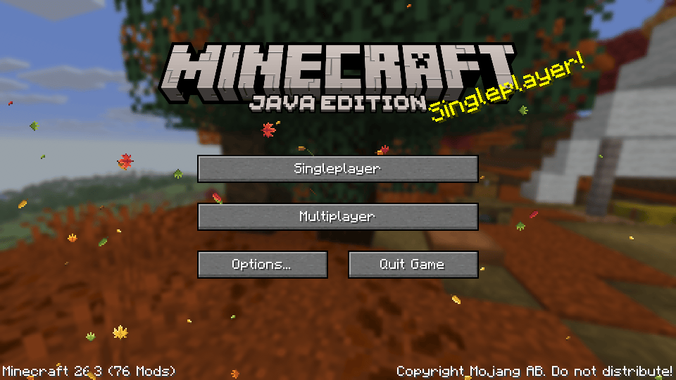
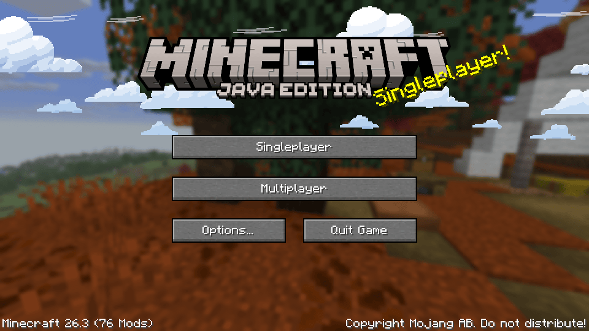
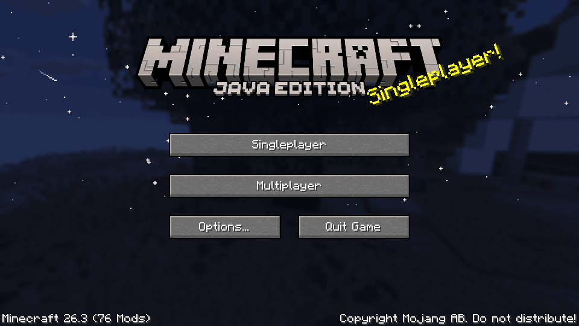

# Decoration Overlays

Decoration overlays are animated effects for the whole screen, like falling snow, fireflies, fog or string lights. Many of them play with your menu: snow piles up on your buttons, birds land on them and fog clears around the mouse.


# Adding an Overlay

1. Open a layout in the layout editor.
2. Right-click the editor background and open **Decoration Overlays**.
3. Open an overlay, like **Snowfall**.
4. Click **Show Overlay** to turn it on.

Overlays that are on have a ✔ in the list. A layout can show as many overlays as you like. Hover an overlay or one of its settings to see what it does.

Overlays play in the layout editor too, but they only react to your elements in the real menu. Save the layout and open the menu to see everything.

When several layouts of a screen have overlays, all of them play, even the same overlay twice. This includes [universal layouts](/universal-layouts).

# Settings of Every Overlay

Every overlay has these two settings:

- **Show Overlay** turns the overlay on or off.
- **Layers** sets where the overlay draws:
  - **Background & Foreground**: Far parts draw behind your elements and near parts in front of them, for a nice sense of depth. This is the default.
  - **Only Background**: Everything draws behind your elements, but in front of the menu background.
  - **Only Foreground**: Everything draws in front of your elements.

What an overlay puts right on your elements, like snow on a button, always stays on them.

Many overlays also have these:

| Setting | What it does |
|---|---|
| **Amount (%)** | How much of it there is, from 25% to 300%. 100% is the normal amount. |
| **Size** | Makes the pixel art 2x or 3x as big. Every pixel stays a clean square. |
| **Look** | **Detailed** shows the full pixel art with shading and extra effects. **Simple** is flatter and closer to the classic look. |

# Overlays and Your Elements

Many overlays play with your elements: snow, ash and confetti pile up on them, icicles hang from them, moss grows on them and birds land on them.

To choose which elements take part, right-click an element and set **Should Be Affected By Decoration Overlays**:

- It's on by default for Buttons, Sliders, Checkboxes, Input Fields and [vanilla elements](/vanilla-elements).
- That includes the logo, splash text, branding and copyright of the title screen. Turn it off for them if nothing should land on them.
- Hidden elements don't take part, and neither does the part of an element that a [Scrollable Area](/scrollable-areas) cuts off.

> [!TIP]
> Leave at least 13 pixels between your elements. Things that pile up on an element or hang under it only get as big as the gap to the next element allows.

Some overlays react to clicks, like Bubbles, Frost and Confetti. Your buttons still get every click.

# Weather

## Snowfall

Snow falls and slowly piles up on your buttons and along the bottom of the screen.


- **Accumulate Snow** lets the snow pile up.
- **Snow Color [HEX]**, **Snowfall Speed**, **Amount (%)** and **Size** change the snow.

## Rainfall

Rain falls, ripples in thin puddles and drips from your buttons.


- **Puddles** gives your elements and the bottom of the screen a wet film that ripples where drops hit it.
- **Drips** lets drops hang and fall from your elements.
- **Thunder Flashes** adds lightning now and then, with a branching bolt and a soft flash. **Thunder Flash Brightness** sets how bright it is.
- **Rain Color [HEX]**, **Amount (%)** and **Size** change the rain.

> [!WARNING]
> **Thunder Flashes** makes the screen flash. Leave it off if players might be sensitive to flashing lights.

## Fog

Soft layers of mist drift across the screen and over your elements, thickest near the ground.


- **Clear Around Pointer** makes the fog part around the mouse.

## Frost

Your menu freezes over. Ice creeps along the edges, into the corners and onto your elements. Click the ice to knock a chunk out.


- **Screen Edges**, **Corners** and **On Elements** turn each part of the ice on or off. Labels on your elements stay clear.

# Nature

## Leaves

Leaves fall and get pushed around by gusts of wind.



- **Look** switches between **Detailed** and **Simple** leaves.
- **Colors** picks **Autumn Mix** (five warm autumn colors) or **Custom Range** (five colors between **Leaf Color Start [HEX]** and **Leaf Color End [HEX]**).
- **Wind Blows** turns the strong gusts on or off. **Wind Intensity** sets how strong the wind is.
- **Leaf Density**, **Leaf Fall Speed** and **Leaf Overlay Scale** change the leaves.

## Cherry Blossoms

Blossoming branches reach in from the top corners and petals drift down.


- **Left Branch** and **Right Branch** show or hide each branch.
- **Look** and **Amount (%)** change the petals.

## Overgrowth

Nature takes over your menu: moss, vines, grass and flowers slowly grow all over it.


- **Grass**, **Left Vines**, **Right Vines** and **On Elements** turn each kind of growth on or off. Labels on your elements stay clear.
- **Flowers on Vines**, **Flowers on Elements** and **Flowers in Grass** let flowers bloom there. **Flowers (%)** sets how many.

## Clouds

Fluffy pixel clouds drift across the sky behind your elements, in three layers of depth. Clouds have no settings of their own.



## Sunbeams

Rays of sunlight fan out from a sun just off the screen, with dust dancing in the light.


- **Sun Side** sets the edge of the screen the sun sits behind. **Sun Angle (°)** moves it along that edge.
- **Sunlight Color [HEX]** and **Intensity (%)** change the light.
- **Sun Glow** spreads a soft glow from the sun.
- **Dust** lets dust drift through the rays. Your mouse stirs it up.
- **Hit Elements** makes the rays stop at your elements, light up their edges and cast shadows. When it's off, the rays shine in front of your elements.

## Bubbles

Bubbles wobble up in streams and slide along the underside of your elements. Click them to pop them! Bubbles have no settings of their own.


# Animals

## Birds

Little birds fly in, hop around on your elements and take off when the mouse gets too close.


## Butterflies

Colorful butterflies flutter around, rest on your elements and shy away from the mouse.


## Bats

Bats flap across the screen in little groups and hang asleep under your elements. Get too close and they wake up!


Birds, Butterflies and Bats have **Amount (%)** and **Size**.

## Fireflies

Groups of fireflies glow and wander around, and some land on your elements.


- **Look** switches between **Detailed** and **Simple** fireflies. **Unlit Bodies** shows their dark little bodies between flashes.
- **Follow Mouse** lets groups follow the mouse when it's close.
- **Landing** lets fireflies land on your elements now and then.
- **Firefly Color [HEX]**, **Group Amount**, **Group Density**, **Group Size** and **Firefly Scale** change the fireflies.

# Night Sky

## Aurora

Glowing northern lights hang in the upper sky and slowly wave behind your elements.


- **Edge Color [HEX]** sets the color of the bright lower edge. **Tip Color [HEX]** sets the color the rays fade into.

## Shooting Stars

A twinkling night sky behind your elements, with a shooting star every few seconds and a whole meteor shower now and then. Shooting Stars have no settings of their own.



## Sky Lanterns

Glowing paper lanterns float up into the night sky, sometimes a whole group at once. Sky Lanterns have **Amount (%)** and **Size**.


# Party

## Confetti

Party poppers in the bottom corners fire confetti every few seconds, and the confetti piles up on your elements.


- **Corner Poppers** turns the poppers on or off.
- **Burst on Click** fires a little burst of confetti wherever you click.
- **Color Mix Mode** uses random colors. Turn it off to use **Confetti Color [HEX]** for all confetti.
- **Landed Particle Cap** sets how many landed pieces can lie around at once.
- **Amount (%)**, **Size** and **Confetti Fall Speed** change the confetti.

## Fireworks

Rockets fly up and burst into fireworks.


- **Show Rocket Flight** shows the rockets on their way up.
- **Amount (%)**, **Size** and **Explosion Size** change the fireworks.

## String Lights

Strings of lights hang across your menu and sway in the wind.


- **Look** switches between **Simple** and **Detailed** lights. **Pine Garland** swaps the wire for pine needles with baubles.
- **Light Program** sets how the lights shine and blink (see below).
- **String Light Scale**, **Wind Strength** and **Flicker Speed** change all strings.
- **Strings** has a menu for each of the eight spots a string can hang. Turn one on with **Show String Light**.

Each string has these settings:

- **Light Count** sets how many lights hang on it. `0` fills the string by its length.
- **Light Color [HEX]** sets the color of its lights. **Christmas Lights Mode** makes them colorful instead.
- **String Color [HEX]** sets the color of the wire. Use the alpha channel to make it see-through or hide it.
- **Individual Light Colors** and **Individual Light Sizes** give every light its own color or size, as a comma-separated list. When there are more lights than values, the list starts over:

```
#FF0000, #00FF00, #0000FF
```

| Light Program | What the lights do |
|---|---|
| **On** | All lights shine, and now and then one gently dims a tiny bit, like real lights. |
| **Fully Lit** | All lights shine at full brightness. |
| **Half Lit** | All lights shine at half brightness. |
| **Off** | All lights are off. |
| **Cycle** | Plays Twinkle, Chase, Alternate and Breathe, switching every 7 seconds. |
| **Twinkle** | The lights flicker at random. |
| **Chase** | A bright light runs along the string. |
| **Alternate** | Every second light shines, then the other half takes over. |
| **Breathe** | All lights glow up and fade together, nice and slow. |

# Spooky

## Cobwebs

Dusty cobwebs hang in the top corners, with little spiders dropping down on their threads.


- **Left Web** and **Right Web** show or hide each web, with its spider.
- **Spiders** lets spiders drop down, hang around and climb back up. They scurry away from the mouse.
- **Closed Front** joins the thread ends with a rim, so no loose threads end on the screen.

## Embers

Glowing embers rise up from below while ash drifts down and piles up.


- **Ash on Floor** adds a deep bed of ash along the bottom of the screen, with smoldering spots and glowing coals.
- **Ash on Elements** lets ash pile up on your elements.

# Buddy

Buddy is a little virtual pet that lives at the bottom of your menu. It walks around, shows what it needs in thought bubbles, reacts when you play with it and remembers everything between game sessions.


## Taking Care of Buddy

Buddy has four needs, from `0` to `100`:

- **Hunger** goes down over time. Food fills it up.
- **Happiness** goes down over time. Petting, food and playing raise it.
- **Energy** goes down while Buddy is awake and comes back while it sleeps.
- **Fun** goes down over time. Playing raises it.

To care for Buddy:

- Left-click Buddy to pet it. Waking it up this way makes it a bit less happy.
- Right-click Buddy to open its status screen. The **Stats** tab shows its needs, level and XP. The **Achievements** tab shows its achievements.
- Click **Feed** in the status screen, then drag the food to Buddy.
- Click **Play** in the status screen, then drag the ball and let go to throw it. Buddy chases and catches it.
- Click **Sleep** to let Buddy rest. It also falls asleep on its own when its energy gets very low.
- Buddy poops now and then. Left-click the poop to clean it up. With three or more poops lying around, Buddy keeps getting less happy.

## Levels and Achievements

Caring for Buddy gives it XP. Buddy levels up from 1 to 30. The higher its level, the slower its hunger, happiness and energy go down, up to half as fast at level 30.

## When Buddy Dies

If hunger or happiness stays at `0` for 10 real hours, Buddy dies and leaves a gravestone. Left-click the gravestone to start over with a new Buddy. Turn off **Buddy Can Die** to keep it from dying.

**Reset Buddy Save** starts over at any time.

> [!WARNING]
> Resetting Buddy deletes its needs, level, XP, achievements and poops for good.

## Saving and Customizing

Buddy saves itself about every two minutes and when its screen closes, in `<game-directory>/fancymenu_data/buddy/`. Each Buddy overlay has its own save. See [Data Storage Locations](/data-storage-locations).

- **Custom Textures** replaces Buddy's sprites, items, icons, status screen and gravestone with your own textures.
- **Stat Tuning** changes how fast its needs go down, what activities cost and give, and the most poops that can lie around (**Max Poops**).

# Browser

The Browser overlay shows a website across the whole screen.

> [!IMPORTANT]
> The Browser overlay needs the [Rinku](https://modrinth.com/mod/rinku) mod.

- **URL** sets the website to show.
- **Consume Mouse Clicks**, **Consume Mouse Scrolls** and **Consume Keyboard Presses** keep the input from reaching your menu behind the browser.
- **Process Mouse Clicks**, **Process Mouse Scrolls** and **Process Keyboard Presses** let the browser itself react to the input.
- **Hide Video Controls**, **Loop Videos**, **Mute Browser** and **Audio/Video Volume** control videos and sound of the website.

The Consume and Process settings are on by default, so the browser works like a normal browser in front of your menu. To show a website just as a backdrop, turn all of them off.

Websites can also run FancyMenu actions and read placeholders. See [Browser JavaScript API](/browser-api).

# GLSL Shader

The GLSL Shader overlay draws your own shader across the whole screen, for animated or still effects. Paste your shader code into **Shader Source**.

See [GLSL Shader API](/glsl-shader-api) for how to write shaders for FancyMenu.
