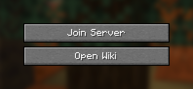
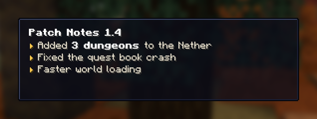
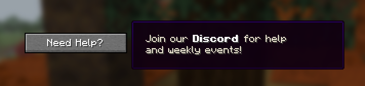

# Elements

Elements are the parts of a layout: buttons, texts, images, sliders, music and more. This page lists all element types and their most important settings.

> [!TIP]
> Buttons and other parts a screen has by default are [Vanilla Elements](/vanilla-elements). You can move, change and hide them too.

# Adding Elements

1. In the layout editor, right-click a free spot and click **New Element**. The menu bar has the same list in **Element -> New**.
2. Click an element type. Hover a type to see what it's for.

The element shows up where you right-clicked. Drag it to move it, drag its edges to resize it, and right-click it for its settings.


To keep elements in place on every window size, read [Positioning Elements](/positioning-elements). To put elements in front of or behind others, read [Layers and Groups](/layers-and-groups).

# Settings of All Elements

Every element has these settings in its right-click menu, next to the settings of its type:

| Setting | What it does |
|---|---|
| **Anchor Point** | What the element is attached to, like a corner of the screen or another element. See [Positioning Elements](/positioning-elements). |
| **Advanced Positioning** and **Advanced Sizing** | Calculate the position and size, for example with [placeholders](/placeholders). See [Advanced Positioning & Sizing](/advanced-positioning-sizing). |
| **Loading Requirements** and **Load Once Per Session** | Show the element only when [requirements](/conditions) are met, or only once per game start. See [Element Visibility](/element-visibility). |
| **Delay Appearance** and **Delay Disappearance** | Wait some seconds before the element shows up or goes away. See [Element Visibility](/element-visibility#delaying-elements). |
| **Fading In/Out** and **Opacity** | Fade the element in and out, or make it see-through. See [Element Visibility](/element-visibility#fading-in-and-out). |
| **Rotation**, **Vertical Tilt** and **Horizontal Tilt** | See [Rotating Elements](/rotating-elements) and [Tilting Elements](/tilting-elements). |
| **Parallax Effect** | Move the element a bit with the mouse. See [Parallax Effect](/parallax). |
| **Copy Element ID** | Copies the identifier that actions, placeholders and other elements use to find it. See [Element Identifiers](/element-identifiers). |
| **In-Editor Display Name** | The name of the element in the layer list. |
| **Export for AI** | Turns the element into text for [AI assistants](/export-for-ai). |

# Buttons and Inputs

## Button

A button that runs an [action script](/action-scripts) when clicked, like joining a server, opening a website or another menu.



- **Edit Action Script**: what the button does when clicked.
- **Label** and **Hover Label**: its text, and the text while the mouse is over it. Both support [placeholders](/placeholders) and [text formatting](/text-formatting).
- **Label Alignment**, **Label Scale**, **Label Base Color**, **Label Hover Color** and **Label Shadow**: the look of the label.
- **Button Textures** and **Button Icon Textures**: your own images for the button and an icon on it, for normal, hovered and inactive buttons. See [Nine-Slicing & Tiling](/nine-slicing-and-tiling) for textures that scale nicely.
- **Hover Sound**, **Unhover Sound** and **Click Sound**: sounds the button plays.
- **Tooltip**: a text that shows while the mouse is over the button.
- **Control Active State**: [requirements](/conditions) for the button to be clickable. When they aren't met, it's greyed out.
- **Template Mode**: gives other buttons and sliders of the screen the look of this button. See [Button & Slider Templates](/button-slider-templates).

## Slider

A slider players drag to pick a value. It runs its action script every time the value changes.


- **Slider Type**:
  - **Value List**: goes through the texts of **List Values**, one per line. **Values From List Variable** takes them from a [list variable](/variables#text-and-list-variables) instead.
  - **Integer Range**: whole numbers from **Minimum Range Value** to **Maximum Range Value**.
  - **Decimal Range**: the same with decimals. **Rounding Decimal Place** sets how many digits come after the point, `-1` doesn't round.
- **Slider Label**: its text. `$$value` shows the current value.
- **Edit Action Script**: runs when the value changes. `$$value` is the new value.
- **Pre-Selected Value**: the value the slider starts at. Point it at what the slider changes, so it shows the right value when the screen opens.

For example, a volume slider of the type **Integer Range** from `0` to `100` has the label `Music Volume: $$value%` and a [**Set Variable Value (FM Variable)**](/action-scripts#set-variable-value-fm-variable-set_variable) action with this value:

```
music_volume:$$value
```

Its **Pre-Selected Value** is `$$music_volume`, so it starts at the last value the player picked.

Sliders have the same label, texture, sound, tooltip and **Control Active State** settings as buttons.

## Checkbox

A box players tick and untick. It runs its action script every time it changes.


- `$$value` is `true` or `false` in its action script and its **Control Active State** requirements.
- **Variable Mode** and **Link To Variable**: the checkbox shows the value of a [variable](/variables) and writes `true` or `false` into it. Linked to a list variable, `true` or `false` becomes its only entry.
- Without Variable Mode, the checkbox remembers its state by itself, separately for every [profile](/profiles).
- **Textures**: your own images for the box and the checkmark.

Checkboxes have the same tooltip, sound and **Navigable** settings as buttons.

## Text Input Field

A field players type into, like a server address or a name.


- **Link To Variable**: what players type goes into the [variable](/variables), and the field shows its value. Linked to a list variable, the typed text replaces the whole list.
- **Input Type**: **Text**, **Only Numbers**, **Only Decimal Numbers** or **URL**. Other characters can't get typed.
- **Hint Text** and **Hint Text Color**: a text that shows while the field is empty.
- **Max Text Length**: how many characters fit in.
- **Background Color**, **Border Color**, **Border Rounding Radius** and **Text Color**: its look.

For example, a field linked to `server_address` and a button with the [**Join Server**](/action-scripts#join-server-joinserver) action and the value `$$server_address` let players join any server.

Without a variable, the [**Text Input Field Value**](/placeholders#text-input-field-value-text_input_field_value) placeholder reads the text, and the [**Set Text Input Field Value**](/action-scripts#set-text-input-field-value-set_text_input_field_value) action changes it.

# Texts and Tooltips

## Text

Text of any length, from a short label to scrollable rules or patch notes, with [Markdown](/text-formatting) and [placeholders](/placeholders).



- **Source Mode**: type the text, or load it from a file or a website.
- A look to start from, a background, and scrolling when the text is bigger than the element.

All about it in [Text in Menus](/text-in-menus).

## Tooltip

A text box like the tooltips of the game, with [Markdown](/text-formatting) and [placeholders](/placeholders).



- It shows where you put it, or at the mouse with **Follow Mouse**.
- Its **Loading Requirements** decide when it shows, like [**Is Element Hovered**](/conditions#is-element-hovered-fancymenu_visibility_requirement_is_element_hovered) for a button.
- **Tooltip Background**: your own texture instead of the dark box.

More in [Text in Menus](/text-in-menus).

## Splash Text

The yellow text of the title screen, with your own texts.


- **Source Mode**: the vanilla splashes, your own text, or a random line of a text file.
- **Bouncing**, **Scale**, **Rotation**, **Text Color** and **Shadow**: its look.
- **Refresh On Screen Load**: picks a new splash every time the screen opens.

More in [Splash Text](/splash-text).

# Images and Media

## Image

An image from your files, a website or the game's resources. Animated images play too.


- **Image Source**: the image. Supported files are listed in [Images](/images).
- **Restore Aspect Ratio**: changes the width, so the image isn't stretched.
- **Nine-Slice Texture** and **Repeat Texture**: scale frames without stretching their borders, or tile the image. See [Nine-Slicing & Tiling](/nine-slicing-and-tiling).
- **Image Tint [HEX]**: colors the image.
- **Corner Rounding Radius**: rounds its corners.

## Slideshow

Shows the images of a slideshow one after another. You make slideshows in `config/fancymenu/slideshows/`, see [Slideshows](/slideshows).

- **Slideshow**: the slideshow to show.
- **Restore Aspect Ratio**: changes the width, so the images aren't stretched.

## Video

Plays a video file, like a trailer or a moving background.

> [!IMPORTANT]
> Videos need the mods Watermedia V3 and Watermedia Binaries V3. See [Videos](/video).

- **Video Source**: a video file, a web link or a resource of the game.
- **Loop Video**, **Volume** and **Sound Channel**: how it plays.
- **Play Video In Layout Editor**: whether it also plays while you edit.
- Actions like [**Toggle Video Element Paused State**](/action-scripts#toggle-video-element-paused-state-toggle_video_element_pause_state) pause it, jump to a time or change its volume.

**Video [Rinku]** is an older video element that needs the Rinku mod. It still works in old layouts, but isn't in **New Element**.

## GLSL Shader

Runs your own GLSL shader inside the element, like animated colors or effects from Shadertoy.


- **Shader Source**: the shader code. Shadertoy shaders with `mainImage` work as they are.
- **Compile Mode**: **Auto**, **Shadertoy** or **Direct Fragment**.
- **Buffer A Source** to **Buffer D Source**: extra passes for shaders with buffers.

How to write them: [GLSL Shader API](/glsl-shader-api).

## Browser

Shows a live website, like a server map or a wiki page.

> [!IMPORTANT]
> The Browser needs the mod [Rinku](https://modrinth.com/mod/rinku) ([CurseForge](https://www.curseforge.com/minecraft/mc-mods/rinku)).

- **URL**: the website.
- **Interactable**: lets players click, scroll and type in it. In the layout editor, it's never interactable.
- **Mute Browser**, **Audio/Video Volume**, **Loop Videos** and **Hide Video Controls**: media on the page.

To load an HTML file from `config/fancymenu/assets/`, start the URL with `file:///`:

```
file:///config/fancymenu/assets/changelog.html
```

On Linux, use the [**Absolute File/Folder Path**](/placeholders#absolute-filefolder-path-absolute_path) placeholder instead:

```
file:///{"placeholder":"absolute_path","values":{"short_path":"/config/fancymenu/assets/changelog.html"}}
```

Websites can run actions and read placeholders: [Browser JavaScript API](/browser-api).

# Shapes, Items and Models

## Rectangle Shape

A rectangle in one color, like a panel behind text.


- **Color**: a HEX color. Two more digits make it see-through, like `#101828C8`.
- **Corner Rounding Radius**: rounds all corners, or every corner on its own.
- **Blur** and **Blur Intensity**: blur what's behind it.

## Circle Shape

A circle or oval in one color, like a status light.


- **Color**, **Blur** and **Blur Intensity**: like the Rectangle Shape.
- **Roundness**: `2` is a circle. Bigger numbers make it more square, smaller numbers pointier.

## Item

Shows a Minecraft or mod item, like in the inventory.


- **Item Key**: the item, like `minecraft:diamond_sword`.
- **Item Count**, **Item Name**, **Item Lore** and **Enchanted**: like on a real item.
- **Show Item Tooltip**: shows the item's tooltip while the mouse is over it.
- **Custom NBT Data**: more item data, written like the part of a `/give` command right after the item.

## Block/Item JSON Model

Shows a block or item model in 3D, from the game's resources or a JSON file of yours.


- **Model**: the **Model Source**, like `minecraft:models/block/crafting_table.json`.
- **Texture**: replaces the model's texture with yours.
- **Transform**: scale, rotate and move the model.
- **Lighting**: **Light Hue [HEX]** colors the light on the model.

## Player Entity

Shows a player in 3D, like the player's own character on the title screen.

> [!IMPORTANT]
> Player Entities need the mod Fancy Entity Renderer ([CurseForge](https://www.curseforge.com/minecraft/mc-mods/fancy-entity-renderer), [Modrinth](https://modrinth.com/mod/fancy-entity-renderer)). Without it, they show an error instead of the player.

- **Copy Client Player**: shows the player who plays the game, with their skin and name.
- **Player Name**, **Skin Texture** and **Cape Texture**: any other player or skin.
- **Entity Pose**, **Head Follows Mouse** and **Body Follows Mouse**: how it stands and looks.
- **Armor and Tools**, **Parrot**, **Is Baby** and **Show Player Name**: what it wears and shows.

More in [Player Entities](/player-entities). For just a head, see [Player Heads](/player-heads).

## Progress Bar

A bar that fills up, like a loading bar.


- **Progress Value Source**: how full it is. Use [placeholders](/placeholders) here, like [**World Loading Progress**](/placeholders#world-loading-progress-world_load_progress) in a world loading screen.
- **Progress Value Mode**: **PERCENTAGE (0-100)** or **FLOATING POINT (0.0-1.0)**.
- **Direction**: the side it fills to.
- **Bar Color** and **Background Color**, or **Bar Texture** and **Background Texture**.
- **Smooth Filling Animation**: slides to new values instead of jumping.
- **Use Progress for Element Anchor**: elements anchored to the bar move with the end of the filled part.

# Layout Helpers

## Scrollable Area

Holds other elements and scrolls through them, like a list of servers or a long info page.


Drop elements into it in the layout editor. Only custom elements can go in, no vanilla elements. All about it in [Scrollable Areas](/scrollable-areas).

## Dragger

An area players can grab and move outside the editor. Elements anchored to it move along, like a movable info panel. It's invisible outside the editor.

**Save User Drag Offset** keeps the new position after the screen closes and the game restarts. More in [Dragger](/dragger).

## Element Animator

Moves and resizes other elements with keyframes, like a panel sliding into the screen. It's invisible outside the editor.

- **Manage Target Elements**: the elements it animates.
- **Edit Keyframes**: opens the keyframe editor.
- **Loop Animation**: starts again at the end.

All about it in [Element Animator](/element-animator).

# Invisible Elements

These elements only show in the layout editor.

## Ticker

Runs its action script over and over while the screen is open.

> [!IMPORTANT]
> [Schedulers](/schedulers) are the recommended way for everything that runs over and over or at a later time. Use them instead of Tickers whenever possible. They work on every screen and without any screen, every action works in them, and actions start and stop them.

What Tickers do, done with Schedulers:

- Running all the time while a screen is open: a Scheduler with a **Tick Delay (ms)**. Start it with [**Start Scheduler**](/action-scripts#start-scheduler-start_scheduler) in **Edit 'Open Screen' Action Script** of the layout, and stop it with [**Stop Scheduler**](/action-scripts#stop-scheduler-stop_scheduler) in **Edit 'Close Screen' Action Script**. Both are in the right-click menu of the editor background.
- Running once per game start: a Scheduler with **Start on Launch** and **Ticks to Run** `1`.
- Running once every time a screen opens: no Ticker or Scheduler needed. Put the actions in **Edit 'Open Screen' Action Script**.

Settings of the Ticker:

- **Tick Delay [ms]**: the time between two runs, in milliseconds. `0` runs it every tick, 20 times per second.
- **Tick Mode**: **Normal** runs it all the time. **Session** runs it only once until the game restarts. **On Load Screen** runs it once every time the screen opens, also when the window gets resized.
- **Async**: runs it in the background. Most actions can't run like that and show an error.

## Audio

Plays music or sounds while the screen is open, one track after another.

- **Manage Tracks**: the audio files, their order and their **Track Weight** for shuffling.
- **Play Mode**: **Normal** plays them in order, **Shuffle** in random order.
- **Loop Tracks**, **Volume** and **Sound Channel**: how they play.

To keep the music playing across screens, put the Audio element in a [Universal Layout](/universal-layouts). More in [Menu Background Music](/background-music).

## Music Controller

Turns the game's own music off for this screen.

- **Play Menu Music**: the music of menus while no world is loaded, like on the title screen.
- **Play World Music**: the music of the world that keeps playing in menus, like the inventory.

It only works while a screen is open.

## Cursor

Replaces the mouse cursor with your own image while the screen is open.

- **Cursor Texture**: a PNG image, like 32×32 pixels.
- **Hotspot X-Coordinate** and **Hotspot Y-Coordinate**: the pixel of the image that clicks, like the tip of an arrow.
- **Editor Preview Mode**: shows the cursor in the editor while the mouse is over the element.

More in [Custom Cursor](/custom-cursor).
