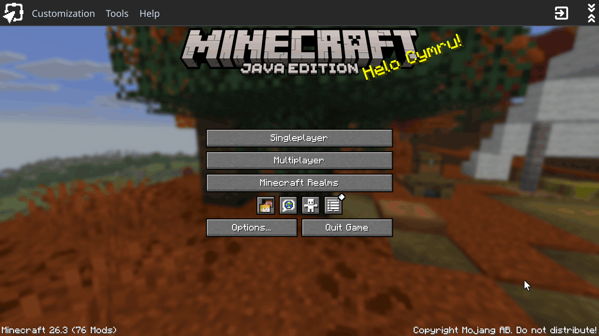

# Listeners

Listeners run an [action script](/action-scripts) when something happens in the game: a key gets pressed, a screen opens, you unlock an achievement, and a lot more. They work in every menu and while playing, and they don't belong to a layout.

Most listeners also give their script variables about what happened, like the name of the pressed key.

> [!CAUTION]
> A listener can run file, network, command, clipboard, resource pack and link actions while no menu is open. Only use listeners from profiles and files of people you trust.

# Adding a Listener

1. Open **menu bar -> Customization -> Manage Listeners**.
2. Click **Add Listener**.
3. Click the event in **Available Listeners**. The search bar finds listeners by name and description.
   - **Listener Description** shows what the listener does and which variables it gives.
   - **Copy Variables to Clipboard** copies the names of its variables.
   - **Pop Out Description** opens the description in its own window.
4. Click **Done**, or double-click the listener. The action script editor opens.
5. Add the actions that should run and click **Done**. See [Action Scripts](/action-scripts#making-an-action-script).
6. Click **Done** in **Manage Listeners** to save. The listener works right away.

**Cancel** throws away everything you changed in **Manage Listeners**, after asking you.

# Managing Listeners

- Click a listener to see its type and action script on the right.
- **Edit Actions**, or a right-click on a listener, opens its action script.
- Double-click a listener's name to rename it, like `Help Key`. `Enter` saves the name, `Esc` cancels. An empty name shows the listener type again.
- **Remove Listener** deletes the selected listener.
- **Export for AI** copies the selected listener or all listeners for an [AI chat](/export-for-ai), with your unsaved changes.

Listeners get saved in `config/fancymenu/listener_instances.txt` (see [Data Storage Locations](/data-storage-locations)). Every [profile](/profiles) has its own listeners.

# Listener Variables

The variables of a listener start with `$$` and work everywhere in its own script: in every action value and in the requirements of [IF statements](/action-scripts#if-else-if-and-else). Upper and lower case matter. Every listener below lists its variables, and so does its description in the listener chooser.

For example, this listener opens a help screen when `H` gets pressed:

1. Add an **On Keyboard Key Pressed** listener.
2. In its script, use **Add IF Statement** with the [**Is Text**](/conditions#is-text-fancymenu_visibility_requirement_is_text) requirement. Set **Compare Mode** to **Equals**, **Text** to `$$key_name` and **Compare to Text** to `H`.
3. Inside the IF, add [**Open Screen or Custom GUI**](/action-scripts#open-screen-or-custom-gui-opengui) with your help screen.

More about listener variables:

- Listener variables are always text. When a listener can't find out a value, the variable gets a fallback, like `ERROR`, `UNKNOWN`, `NONE`, `EMPTY`, `0`, `-1` or nothing.
- Listener variables get filled in before [placeholders](/placeholders), so they work inside placeholders too.
- Listener variables only exist while their script runs. To keep a value, save it in one of your [variables](/variables) with [**Set Variable Value (FM Variable)**](/action-scripts#set-variable-value-fm-variable-set_variable).
- When one of your variables has the same name as a listener variable, `$$name` in that script means the listener variable. Your variables with longer names, like `key_name_log`, still work.
- Text from chat, servers, files and other players can be anything. Never put it straight into commands, file paths or links.

# Good to Know

- Some listeners need FancyMenu on the server. They say so below. In singleplayer, they always work.
- Some listeners run very often, like **On Mouse Moved in Screen**, **On Element Scrolled**, **On Position Changed** and **On World Sound Triggered**. Keep their scripts short, and never use slow actions like [**Reload FancyMenu**](/action-scripts#reload-fancymenu-reloadmenu) in them.
- To replace a screen with **On Screen Opened**, check `$$screen_identifier` with an IF statement first. Otherwise every screen gets replaced, even the one you open.

# Keyboard and Mouse

To check which key it was, use `$$key_name`. The code numbers of keys aren't the same in every Minecraft version.

## On Keyboard Key Pressed (`keyboard_key_pressed`)

Runs when a key gets pressed, in menus and while playing. While a key is held down, it runs again and again.

- `$$key_name`: the name of the key, like `H` or `Left Shift`
- `$$key_keycode`: the code number of the key
- `$$key_scancode`: the scan code of the key
- `$$key_modifiers`: a number for the modifier keys held at the same time, like `Shift` and `Ctrl`

## On Keyboard Key Released (`keyboard_key_released`)

Runs when a key gets released, in menus and while playing.

It gives the same variables as **On Keyboard Key Pressed**: `$$key_name`, `$$key_keycode`, `$$key_scancode` and `$$key_modifiers`.

## On Keyboard Character Typed in Screen (`keyboard_char_typed`)

Runs for every character that gets typed while a screen is open.

- `$$char`: the typed character

## On Mouse Moved in Screen (`mouse_moved`)

Runs every time the mouse moves while a screen is open.

- `$$mouse_pos_x`, `$$mouse_pos_y`: where the mouse is, in GUI pixels
- `$$mouse_move_delta_x`, `$$mouse_move_delta_y`: how far it moved since the last time

## On Mouse Button Clicked (`mouse_button_clicked`)

Runs once when a mouse button gets pressed, in menus and while playing.

- `$$button`: `left`, `right` or `middle`. Other buttons give their number.
- `$$mouse_pos_x`, `$$mouse_pos_y`: where the mouse is, in GUI pixels

## On Mouse Button Released (`mouse_button_released`)

Runs once when a mouse button gets released, in menus and while playing.

It gives the same variables as **On Mouse Button Clicked**: `$$button`, `$$mouse_pos_x` and `$$mouse_pos_y`.

## On Mouse Scrolled in Screen (`mouse_scrolled`)

Runs when the mouse wheel turns while a screen is open.

- `$$scroll_delta_y`: how far the wheel turned. Above `0` when scrolling up, below `0` when scrolling down.

# Screens and Elements

## On Screen Opened (`screen_open`)

Runs right after a screen opens. An [**Open Screen or Custom GUI**](/action-scripts#open-screen-or-custom-gui-opengui) action in its script can replace the screen with another one.

- `$$screen_identifier`: the [identifier](/screen-identifiers) of the screen

## On Screen Closed (`screen_close`)

Runs right after a screen closes.

- `$$screen_identifier`: the [identifier](/screen-identifiers) of the closed screen

## On Markdown Text Clicked (`text_clicked`)

Runs when someone clicks a [click event](/text-formatting#click-and-hover-events) in a text, like `[Read the rules](click:open_rules)`.

- `$$text_event_id`: the ID of the event, like `open_rules`

## On Markdown Text Hovered (`text_hovered`)

Runs when the mouse moves onto a [hover event](/text-formatting#click-and-hover-events) in a text, like `[What's this?](hover:show_hint)`.

- `$$text_event_id`: the ID of the event, like `show_hint`

## On Element Scrolled (`scroll_area_scrolled`)

Runs every time the content of a [Scrollable Area](/scrollable-areas) or a [Text element](/text-in-menus) moves. While the content glides, that's every frame. It doesn't run in the layout editor.

- `$$element_identifier`: the [identifier](/element-identifiers) of the element
- `$$scroll_x`: how far the content is scrolled sideways, in pixels
- `$$scroll_y`: how far the content is scrolled down, in pixels
- `$$scroll_percent`: how far the content is scrolled in the element's main direction, from `0` (start) to `100` (end)

## On Element Scrolled to Start (`scroll_area_reached_start`)

Runs when the content of a Scrollable Area or a Text element gets scrolled back to its start.

It gives the same variables as **On Element Scrolled**: `$$element_identifier`, `$$scroll_x`, `$$scroll_y` and `$$scroll_percent`.

## On Element Scrolled to End (`scroll_area_reached_end`)

Runs when the content of a Scrollable Area or a Text element gets scrolled to its end, like when someone scrolled through all the rules.

It gives the same variables as **On Element Scrolled**: `$$element_identifier`, `$$scroll_x`, `$$scroll_y` and `$$scroll_percent`.

## Animated Texture Started Playing (`animated_texture_started_playing`)

Runs when an [animated texture](/animations) (GIF, APNG or FMA) starts playing, and every time it starts over.

- `$$texture_source`: where the texture comes from: a file path, a web link or a resource location
- `$$texture_source_type`: `LOCAL`, `WEB` or `RESOURCE_LOCATION`
- `$$texture_will_restart`: `true` if it starts over after this round, otherwise `false`

## Animated Texture Finished Playing (`animated_texture_finished_playing`)

Runs when an animated texture finishes a round. When it loops, that's right before it starts over.

It gives the same variables as **Animated Texture Started Playing**: `$$texture_source`, `$$texture_source_type` and `$$texture_will_restart`.

## Video Playback Status Changed (`video_playback_status_changed`)

Runs when a [video](/video) element or menu background starts, pauses, stops or ends.

- `$$video_source`: where the video comes from: a file path, a web link or a resource location
- `$$video_source_type`: `LOCAL`, `WEB` or `RESOURCE_LOCATION`
- `$$is_looping`: `true` if the video loops, otherwise `false`
- `$$new_status`:
  - `PLAYING`: the video started or got unpaused
  - `PAUSED`: the video got paused
  - `STOPPED`: the video got stopped
  - `FINISHED`: the video reached its end. Looping videos get this too, right before they start over.

# Variables, Files and Data

## On Variable Updated [FM Variable] (`fm_variable_updated`)

Runs every time a [variable](/variables) gets set.

- `$$var_name`: the name of the variable
- `$$old_value`: its value before
- `$$new_value`: its new value

For list variables, both values are the whole list as a JSON array, like `["Diamonds","Emeralds"]`.

## On File Download Started via Action (`file_download_started_via_action`)

Runs when a download of [**Download File to Game Directory**](/action-scripts#download-file-to-game-directory-download_file_to_game_dir) starts, as soon as the file name is known. The file only shows up at its path when the download is done, so use **On File Downloaded via Action** to know when it's ready.

- `$$download_url`: the link of the file
- `$$target_file_path`: where the file will get saved

## On File Downloaded via Action (`file_downloaded_via_action`)

Runs when a download of [**Download File to Game Directory**](/action-scripts#download-file-to-game-directory-download_file_to_game_dir) is done or failed.

- `$$download_url`: the link of the file
- `$$target_file_path`: where the file got saved. When the download failed, it can be only the folder.
- `$$download_succeeded`: `true` or `false`

## On File Selected (`file_selected_via_action`)

Runs when [**Select File from System**](/action-scripts#select-file-from-system-select_file_to_game_dir) is done: the file got copied, the file picker got cancelled, or something failed.

- `$$selected_file_path`: the full path of the chosen file. Empty when the picker got cancelled.
- `$$target_file_path`: where the file got copied to, in the game folder
- `$$selection_succeeded`: `true` when the file got copied
- `$$selection_cancelled`: `true` when the picker got closed without a file
- `$$failure_reason`: what went wrong. Empty when nothing did.

## On ZIP Extracted via Action (`zip_extracted_via_action`)

Runs when [**Extract ZIP File In Game Directory**](/action-scripts#extract-zip-file-in-game-directory-extract_zip_file_in_game_dir) is done.

- `$$source_zip_path`: the ZIP file
- `$$target_folder_path`: the folder it got extracted to
- `$$extract_succeeded`: `true` or `false`
- `$$failure_reason`: what went wrong. Empty when nothing did.

Paths in the game folder start with `/`, like `/config/fancymenu/assets/pack.zip`. Paths in the `.minecraft` folder start with `.minecraft/`.

## On FM Data Received (`fm_data_received`)

Runs when the server sends data to this player with `/fmdata send`. See [FM Data](/fm-data).

- `$$data_identifier`: the identifier the data got sent with
- `$$data`: the data
- `$$sent_by`: the IP of the server, or `integrated_server` in singleplayer

## On Remote Server Connected (`remote_server_connected`)

Runs when a [remote server connection](/remote-server-communication) opens.

- `$$request_id`: the request ID of the connection
- `$$remote_server_url`: the link of the remote server

## On Remote Server Data Received (`remote_server_data_received`)

Runs every time a connected remote server sends text.

- `$$request_id`: the request ID of the connection
- `$$remote_server_url`: the link of the remote server
- `$$data`: the text it sent

## On Remote Server Connection Closed (`remote_server_connection_closed`)

Runs when a remote server connection closes.

- `$$request_id`: the request ID of the connection
- `$$remote_server_url`: the link of the remote server
- `$$intentionally_closed`: `true` when [**Close Remote Server Connection**](/action-scripts#close-remote-server-connection-close_remote_server_connection) closed it
- `$$crashed`: `true` when the connection crashed
- `$$unknown_close_reason`: `true` when it closed for an unknown reason

# Game, Worlds and Servers

## On Quit Minecraft (`quit_minecraft`)

Runs once when the game starts closing.

- `$$timestamp_millis`: the time, in milliseconds since 1970
- `$$timestamp_iso`: the time as ISO-8601 text, like `2026-11-24T18:30:00.123Z`

## On Screenshot Taken (`screenshot_taken`)

Runs when a screenshot got taken and saved, like with the screenshot key.

- `$$screenshot_path`: the path of the screenshot in the game folder, like `/screenshots/2026-10-29_14.30.00.png`

## Singleplayer World Entered (`world_entered`)

Runs when a singleplayer world finished loading and you can move.

- `$$world_name`: the name of the world
- `$$world_save_path`: the full path of the world's save folder
- `$$world_difficulty`: the difficulty of the world
- `$$world_cheats_allowed`: `true` when cheats are on
- `$$world_icon_path`: the full path of the world's icon
- `$$world_is_first_join`: `true` on the very first visit after the world got created

## Singleplayer World Left (`world_left`)

Runs when a singleplayer world got closed and saved.

It gives the same variables as **Singleplayer World Entered**, without `$$world_is_first_join`: `$$world_name`, `$$world_save_path`, `$$world_difficulty`, `$$world_cheats_allowed` and `$$world_icon_path`.

## On Start Joining Server (`start_joining_server`)

Runs when the game starts connecting to a server or Realm, before it's joined. It also runs when the connection fails or gets cancelled, so it can remember the server, like for a reconnect button on the Disconnected screen.

- `$$server_ip`: the IP of the server

## On Server Joined (`server_joined`)

Runs after you joined a multiplayer server.

- `$$server_ip`: the IP of the server

## On Server Left (`server_left`)

Runs after you left a multiplayer server.

- `$$server_ip`: the IP of the server

## On Other Player Joined World/Server (`other_player_joined_world`)

Runs when another player joins your world or server.

- `$$player_name`: the name of the player
- `$$player_uuid`: the UUID of the player

## On Other Player Left World/Server (`other_player_left_world`)

Runs when another player leaves your world or server.

- `$$player_name`: the name of the player
- `$$player_uuid`: the UUID of the player

## On Other Player Died (`other_player_died`)

Runs when another player in your world dies.

- `$$player_name`: the name of the player
- `$$player_uuid`: the UUID of the player
- `$$death_pos_x`, `$$death_pos_y`, `$$death_pos_z`: where the player died

# Chat

## On Chat Message Received (`chat_message_received`)

Runs when a chat message of a player shows up in your chat.

- `$$chat_message_string`: the message as plain text
- `$$chat_message_component`: the message as JSON text component
- `$$sender_uuid`: the UUID of the sender, or `ERROR` when it's unknown
- `$$sender_name`: the name of the sender, or `ERROR` when it's unknown

## On Chat Message Sent (`chat_message_sent`)

Runs when you send a chat message. Commands don't count.

- `$$chat_message_string`: the message as plain text
- `$$chat_message_component`: the message as JSON text component

## On System Message Received in Chat (`system_message_received_in_chat`)

Runs when a message that isn't from a player shows up in your chat, like the feedback of a command.

- `$$system_message_string`: the message as plain text
- `$$system_message_component`: the message as JSON text component

# Player

## On Death (`player_death`)

Runs right after the death screen opens.

- `$$days_survived`: the in-game days since your last death, rounded down
- `$$death_reason_string`: the death message as plain text
- `$$death_reason_component`: the death message as JSON text component
- `$$death_pos_x`, `$$death_pos_y`, `$$death_pos_z`: where you died

## On Damage Taken (`damage_taken`)

Runs once for every hit you take.

- `$$damage_amount`: how much health the hit took
- `$$damage_type`: the type of damage, like `minecraft:fall`
- `$$is_fatal_damage`: `true` when the hit killed you
- `$$damage_source`: the type of the entity that caused it, like `minecraft:zombie`, or `NONE`

## On Effect Gained (`effect_gained`)

Runs once when you get a status effect.

- `$$effect_key`: the effect, like `minecraft:speed`
- `$$effect_type`: `positive`, `negative` or `neutral`
- `$$effect_duration`: how long it lasts, in ticks (20 ticks are 1 second)

## On Effect Lost (`effect_lost`)

Runs once when a status effect ends.

- `$$effect_key`: the effect, like `minecraft:speed`
- `$$effect_type`: `positive`, `negative` or `neutral`

## On Experience Changed (`experience_changed`)

Runs every time your experience points go up or down.

- `$$new_experience_amount`: your total experience points now
- `$$old_experience_amount`: your total experience points before
- `$$is_level_up`: `true` when you got a new level

## On Achievement Unlocked (`achievement_unlocked`)

Runs once when you unlock an achievement (advancement). Achievements that were already done, like when you join a world, don't count.

- `$$achievement_key`: the achievement, like `minecraft:story/mine_diamond`
- `$$achievement_label`: its title, in the game language
- `$$achievement_description`: its description, in the game language
- `$$achievement_icon_item_key`: the item of its icon, like `minecraft:diamond`
- `$$achievement_type`: `advancement`, `goal` or `challenge`

## On Jump (`jump`)

Runs every time you jump. It has no variables.

## On Started Running (`started_running`)

Runs once when you start sprinting. It has no variables.

## On Stopped Running (`stopped_running`)

Runs once when you stop sprinting. It has no variables.

## On Position Changed (`position_changed`)

Runs every time you move to another block.

- `$$old_pos_x`, `$$old_pos_y`, `$$old_pos_z`: the block position before
- `$$new_pos_x`, `$$new_pos_y`, `$$new_pos_z`: the new block position

## On Started Burning (`started_burning`)

Runs once when you start burning. It has no variables.

## On Stopped Burning (`stopped_burning`)

Runs once when you stop burning. It has no variables.

## On Started Drowning (`started_drowning`)

Runs once when you start taking drowning damage. It has no variables.

## On Started Freezing (`started_freezing`)

Runs once when you start freezing, like in powder snow.

- `$$freezing_intensity`: how frozen you are, from `0.0` (not at all) to `1.0` (fully frozen)

## On Stopped Freezing (`stopped_freezing`)

Runs once when you stop freezing. It has no variables.

## On Fully Frozen (`fully_frozen`)

Runs once when you're fully frozen. It has no variables.

## On Start Swimming (`start_swimming`)

Runs once when you start swimming.

- `$$fluid_type`: the fluid, like `minecraft:water`

## On Stop Swimming (`stop_swimming`)

Runs once when you stop swimming.

- `$$fluid_type`: the fluid, like `minecraft:water`

## On Start Touching Fluid (`start_touching_fluid`)

Runs once when you start touching a fluid, like water or lava.

- `$$fluid_type`: the fluid, like `minecraft:lava`

## On Stop Touching Fluid (`stop_touching_fluid`)

Runs once when you stop touching a fluid.

- `$$fluid_type`: the fluid, like `minecraft:lava`

# Items

## On Item Picked Up (`item_picked_up`)

Runs once when you pick up an item.

- `$$item_key`: the item, like `minecraft:diamond`

## On Item Dropped (`item_dropped`)

Runs once when you drop an item from your inventory.

- `$$item_key`: the item, like `minecraft:diamond`

## On Item Consumed (`item_consumed`)

Runs once when you finished eating or drinking an item.

- `$$item_key`: the item, like `minecraft:golden_apple`

## On Item Used (`item_used`)

Runs once when you use an item.

- `$$item_key`: the item, like `minecraft:flint_and_steel`
- `$$used_on_type`: what it got used on: `block`, `entity`, `self` or `none`
- `$$used_on_entity_key`: the type of the entity it got used on. Empty when there's none.
- `$$used_on_block_key`: the block it got used on. Empty when there's none.
- `$$target_pos_x`, `$$target_pos_y`, `$$target_pos_z`: the position it got used on, or `-1`

## On Item Broke (`item_broke`)

Runs once when an item in your inventory breaks.

- `$$item_key`: the item, like `minecraft:iron_pickaxe`
- `$$item_type`: `tool`, `armor` or `other`

## On Item Hovered In Inventory (`item_hovered_in_inventory`)

Runs once when the mouse moves onto an item in any inventory, like your own or a chest.

- `$$item_key`: the item, like `minecraft:diamond_sword`
- `$$item_display_name_string`: the name of the item as plain text
- `$$item_display_name_json`: the name of the item as JSON text component

# Blocks

## On Start Looking At Block (`start_looking_at_block`)

Runs once when your crosshair starts pointing at a block, up to 20 blocks away.

- `$$block_key`: the block, like `minecraft:oak_log`
- `$$block_pos_x`, `$$block_pos_y`, `$$block_pos_z`: the position of the block
- `$$distance_to_player`: the distance from your eyes to the spot the crosshair points at

## On Stop Looking At Block (`stop_looking_at_block`)

Runs once when your crosshair stops pointing at a block.

It gives the same variables as **On Start Looking At Block**, for the block you looked at before: `$$block_key`, `$$block_pos_x`, `$$block_pos_y`, `$$block_pos_z` and `$$distance_to_player`.

## On Block Broke (`block_broke`)

Runs once when you break a block.

- `$$block_key`: the block, like `minecraft:stone`
- `$$broke_with_item_key`: the item in your hand, like `minecraft:iron_pickaxe`, or `EMPTY`
- `$$block_pos_x`, `$$block_pos_y`, `$$block_pos_z`: the position of the block

## On Block Placed (`block_placed`)

Runs once when you place a block.

- `$$block_key`: the block, like `minecraft:torch`
- `$$block_pos_x`, `$$block_pos_y`, `$$block_pos_z`: the position of the block

## On Interacted With Block (`interacted_with_block`)

Runs once when you use a block, like opening a chest or pressing a button.

- `$$block_key`: the block, like `minecraft:chest`
- `$$block_pos_x`, `$$block_pos_y`, `$$block_pos_z`: the position of the block

## On Stepping On Block (`stepping_on_block`)

Runs once when you step onto a block.

- `$$block_key`: the block, like `minecraft:grass_block`
- `$$block_pos_x`, `$$block_pos_y`, `$$block_pos_z`: the position of the block

# Entities

## On Start Looking At Entity (`start_looking_at_entity`)

Runs once when your crosshair starts pointing at an entity, up to 20 blocks away.

- `$$entity_key`: the type of the entity, like `minecraft:villager`
- `$$distance_to_player`: the distance from your eyes to the spot the crosshair points at
- `$$entity_pos_x`, `$$entity_pos_y`, `$$entity_pos_z`: the position of the entity
- `$$entity_uuid`: the UUID of the entity

## On Stop Looking At Entity (`stop_looking_at_entity`)

Runs once when your crosshair stops pointing at an entity.

It gives the same variables as **On Start Looking At Entity**, for the entity you looked at before: `$$entity_key`, `$$distance_to_player`, `$$entity_pos_x`, `$$entity_pos_y`, `$$entity_pos_z` and `$$entity_uuid`.

## On Entity Starts Being In Sight (`entity_starts_being_in_sight`)

Runs once when an entity becomes visible on your screen, up to 200 blocks away.

- `$$entity_key`: the type of the entity, like `minecraft:creeper`
- `$$distance_to_player`: the distance from your eyes to the entity
- `$$entity_pos_x`, `$$entity_pos_y`, `$$entity_pos_z`: the position of the entity
- `$$entity_uuid`: the UUID of the entity

## On Entity Stops Being In Sight (`entity_stops_being_in_sight`)

Runs once when a visible entity leaves your screen or gets farther away than 200 blocks.

It gives the same variables as **On Entity Starts Being In Sight**: `$$entity_key`, `$$distance_to_player`, `$$entity_pos_x`, `$$entity_pos_y`, `$$entity_pos_z` and `$$entity_uuid`.

## On Interacted With Entity (`entity_interacted`)

Runs once when you use an entity, like trading with a villager.

- `$$entity_key`: the type of the entity, like `minecraft:villager`
- `$$entity_pos_x`, `$$entity_pos_y`, `$$entity_pos_z`: the position of the entity
- `$$entity_uuid`: the UUID of the entity

## On Entity Mounted (`entity_mounted`)

Runs once when you start riding an entity, like a horse or a boat.

- `$$entity_key`: the type of the entity, like `minecraft:horse`
- `$$entity_pos_x`, `$$entity_pos_y`, `$$entity_pos_z`: the position of the entity
- `$$entity_uuid`: the UUID of the entity

## On Entity Unmounted (`entity_unmounted`)

Runs once when you stop riding an entity.

- `$$entity_key`: the type of the entity, like `minecraft:horse`
- `$$entity_pos_x`, `$$entity_pos_y`, `$$entity_pos_z`: the position of the entity
- `$$entity_uuid`: the UUID of the entity

## On Entity Spawned (`entity_spawned`)

Needs FancyMenu on the server. Runs when an entity spawns anywhere in the world, even far away or in another dimension.

- `$$entity_key`: the type of the entity, like `minecraft:zombie`
- `$$distance_to_player`: the distance to you, or `-1` in another dimension
- `$$entity_pos_x`, `$$entity_pos_y`, `$$entity_pos_z`: where it spawned
- `$$entity_uuid`: the UUID of the entity
- `$$dimension_key`: the dimension, like `minecraft:overworld`
- `$$is_same_dimension_as_player`: `true` when it spawned in your dimension

## On Entity Died (`entity_died`)

Needs FancyMenu on the server. Runs when an entity dies anywhere in the world, even far away or in another dimension.

- `$$entity_key`: the type of the entity, like `minecraft:ender_dragon`
- `$$distance_to_player`: the distance to you, or `-1` in another dimension
- `$$death_pos_x`, `$$death_pos_y`, `$$death_pos_z`: where it died
- `$$entity_uuid`: the UUID of the entity
- `$$dimension_key`: the dimension, like `minecraft:the_end`
- `$$damage_type`: the type of the damage that killed it, like `minecraft:player_attack`
- `$$is_same_dimension_as_player`: `true` when it died in your dimension
- `$$entity_killed_by_name`: the name of the killer, or `NONE`
- `$$entity_killed_by_key`: the type of the killer, like `minecraft:player`, or `NONE`
- `$$entity_killed_by_uuid`: the UUID of the killer, or `NONE`

# World and Places

## On Enter Biome (`enter_biome`)

Runs once when you enter another biome.

- `$$biome_key`: the biome, like `minecraft:cherry_grove`

## On Leave Biome (`leave_biome`)

Runs once when you leave a biome.

- `$$biome_key`: the biome you left, like `minecraft:cherry_grove`

## On Enter Structure (`enter_structure`)

Needs FancyMenu on the server. Runs once when you enter the area of a structure. The area is rough, so it can also run near a structure or above one, like a mineshaft under you. For the inside only, use **On Enter Structure (High Precision)**.

- `$$structure_key`: the structure, like `minecraft:village_plains`

## On Leave Structure (`leave_structure`)

Needs FancyMenu on the server. Runs once when you leave the area of a structure, as rough as **On Enter Structure**.

- `$$structure_key`: the structure you left

## On Enter Structure (High Precision) (`enter_structure_high_precision`)

Needs FancyMenu on the server. Runs once when you step into the inside of a structure.

- `$$structure_key`: the structure, like `minecraft:stronghold`

## On Leave Structure (High Precision) (`leave_structure_high_precision`)

Needs FancyMenu on the server. Runs once when you're fully out of a structure again.

- `$$structure_key`: the structure you left

## On Dimension Entered (`enter_dimension`)

Runs once when you enter another dimension.

- `$$dimension_key`: the dimension, like `minecraft:the_nether`

## On Weather Changed (`weather_changed`)

Runs once when the weather changes. It also runs when the weather where you are changes: while it rains, walking into a desert, a snowy biome or a building counts too.

- `$$weather_type`: `clear`, `rain` or `thunder`
- `$$weather_can_snow`: `true` when it would snow where you are
- `$$weather_can_rain`: `true` when it would rain where you are

## On Raid Started (`raid_started`)

Needs FancyMenu on the server. Runs when a raid starts while you're in its area, so the raid bar shows up. It has no variables.

Walking into a raid that's already going on doesn't count. Use **On Enter Active Raid Area** for that.

## On Enter Active Raid Area (`enter_active_raid_area`)

Needs FancyMenu on the server. Runs when you walk into the area of a raid that's already going on, so the raid bar shows up. It has no variables.

## On Leave Active Raid Area (`leave_active_raid_area`)

Needs FancyMenu on the server. Runs when you leave the area of a raid, so the raid bar disappears. Dying or changing the dimension there counts too, but the end of the raid doesn't. It has no variables.

## On Raid Finished (`raid_finished`)

Needs FancyMenu on the server. Runs when a raid ends while you're in its area.

- `$$raid_result`: `victory` or `defeat`

# Sound and Music

## On Music Track Started (`music_track_started`)

Runs once when a music track starts playing.

- `$$track_resource_location`: the sound file of the track
- `$$track_display_name`: the name of the track, or `UNKNOWN`
- `$$track_artist`: the artist of the track, or `UNKNOWN`
- `$$track_duration_ms`: how long it is, in milliseconds, or `0` when that's unknown

## On Music Track Stopped (`music_track_stopped`)

Runs once when the music track stops, because it ended or another one replaced it.

It gives the same variables as **On Music Track Started**: `$$track_resource_location`, `$$track_display_name`, `$$track_artist` and `$$track_duration_ms`.

## On World Sound Triggered (`world_sound_triggered`)

Runs every time a sound starts playing in the world near you, like a door or a creeper.

- `$$sound_resource_location`: the sound file
- `$$sound_display_name`: the subtitle of the sound, or `UNKNOWN`
- `$$sound_origin_pos_x`, `$$sound_origin_pos_y`, `$$sound_origin_pos_z`: where the sound comes from
- `$$sound_origin_distance_to_player`: how far away it is
- `$$sound_origin_direction_from_player`: its direction in degrees (0 to 360), compared to where you look
