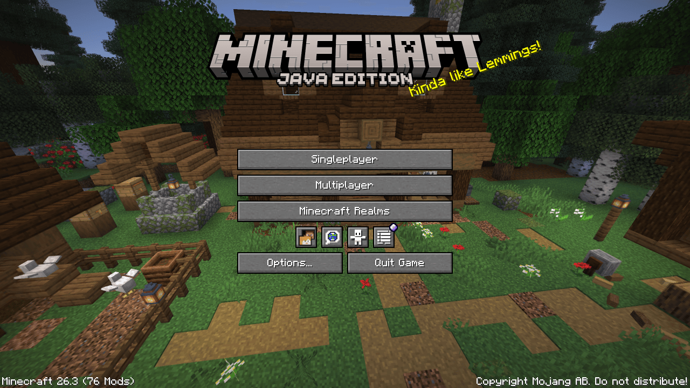

# Panoramas

A panorama is a background that slowly turns around you, like the one on Minecraft's Title screen. It's made of six images that form a cube around the viewer.

You can show your own panoramas as the [menu background](/menu-backgrounds) of a layout, or instead of Minecraft's panorama in all menus.



# Making a Panorama

1. Open the `panoramas` folder in `config/fancymenu/` of your game directory. **menu bar -> Tools -> Open FancyMenu Directory** opens `config/fancymenu/`.
2. Make a folder for your panorama in it, like `forest_homestead`. Its name doesn't matter.
3. Put a `properties.txt` and a folder called `panorama` with the [six images](#the-six-images) into it. An `overlay.png` is optional.
4. Reload FancyMenu with **menu bar -> Customization -> Reload FancyMenu** or `Ctrl + Alt + R` (`Cmd + Alt + R` on macOS), or restart the game.

```text
config/fancymenu/panoramas/
└── forest_homestead/
    ├── properties.txt
    ├── overlay.png
    └── panorama/
        ├── panorama_0.png
        ├── panorama_1.png
        ├── panorama_2.png
        ├── panorama_3.png
        ├── panorama_4.png
        └── panorama_5.png
```

# The Six Images

Each image is one side of the cube:


| Image | Side |
|---|---|
| `panorama_0.png` | Front |
| `panorama_1.png` | Right |
| `panorama_2.png` | Back |
| `panorama_3.png` | Left |
| `panorama_4.png` | Top |
| `panorama_5.png` | Bottom |

- The four sides go around you in this order: the right edge of each image continues at the left edge of the next one, and the right edge of `panorama_3.png` meets the left edge of `panorama_0.png`.
- The bottom edge of the top image touches the top edge of the front image. The top edge of the bottom image touches the bottom edge of the front image.
- All six have to be PNG files of the same size. Make them square, like 1024 × 1024.
- FancyMenu doesn't smooth the images, so pixel art stays crisp.

This is the same layout Minecraft uses for its own panorama, so panoramas made for Minecraft work too.

# properties.txt

```text
type = panorama

panorama-meta {
  name = forest_homestead
  speed = 2.0
  fov = 85.0
  angle = 25.0
  start_rotation = 0
}
```

| Setting | What it does |
|---|---|
| `name` | The name you pick the panorama by. Give every panorama its own name. |
| `speed` | How fast it turns. `1.0` turns once around in about 4 minutes, `2.0` twice as fast. `0` keeps it still. Speeds above `10.0` don't get faster. |
| `fov` | How much of the panorama fits on the screen, in degrees from the top to the bottom of the screen. Smaller numbers zoom in. |
| `angle` | How far it looks down, in degrees. `0` looks straight at the horizon, negative numbers look up. |
| `start_rotation` | Where it starts turning, in degrees from `0` to `360`. `0` starts with the front image in the middle. |

Only `name` is required. Settings you leave out use `speed = 1.0`, `fov = 85.0`, `angle = 25.0` and `start_rotation = 0`. Keep the `type = panorama` and `panorama-meta {` lines as they are, write one setting per line and use a point for decimals, like `1.5`.

# Overlay

An `overlay.png` next to `properties.txt` gets drawn over the panorama, stretched to the whole screen. It doesn't turn with the panorama, so it's made for things like a vignette, a frame or a color tint. Its transparent parts let the panorama show through.

# Using a Panorama

## As Menu Background


1. In the [layout editor](/layout-editor), right-click the background and open **Menu Backgrounds -> Cubic Panorama**.
2. Click **Show Background** to turn it on.
3. Click **Panorama Name**, pick your panorama and click **Done**. The preview on the right shows it turning.

**Clear Panorama** takes it out again. To combine it with other backgrounds, see [Menu Backgrounds](/menu-backgrounds).

## In All Menus

**menu bar -> Customization -> Global Customizations -> Custom Menu Background Panorama -> Choose Panorama** shows your panorama instead of Minecraft's, on the Title screen and in all menus before you join a world. See [Global Customizations](/global-customizations#menu-backgrounds).

## Pre-Loading

A big panorama can take a moment to show up the first time. To load it while the game starts, add it with **Add Cubic Panorama** in **menu bar -> Customization -> Pre-Load Resources**. See [Pre-Load Resources](/preload-layouts#pre-loading-slideshows--panoramas).

# Good to Know

- Panoramas turn to the right: the front image moves to the left and the right image comes in.
- All menus that show the same panorama share its rotation, so it turns on smoothly when you switch between them. It pauses while no menu shows it.
- Reloading FancyMenu starts every panorama over at its `start_rotation`.
- Panoramas belong to the loaded [profile](/profiles).
- A panorama that's missing from **Choose Panorama** didn't load. The game's log, `logs/latest.log`, says why, like a missing `name` or image.
- A purple and black checkerboard means no panorama is picked yet, its six images don't have the same size, or the layout uses a panorama name that doesn't exist anymore.
- If two panoramas have the same `name`, only one of them shows up.
