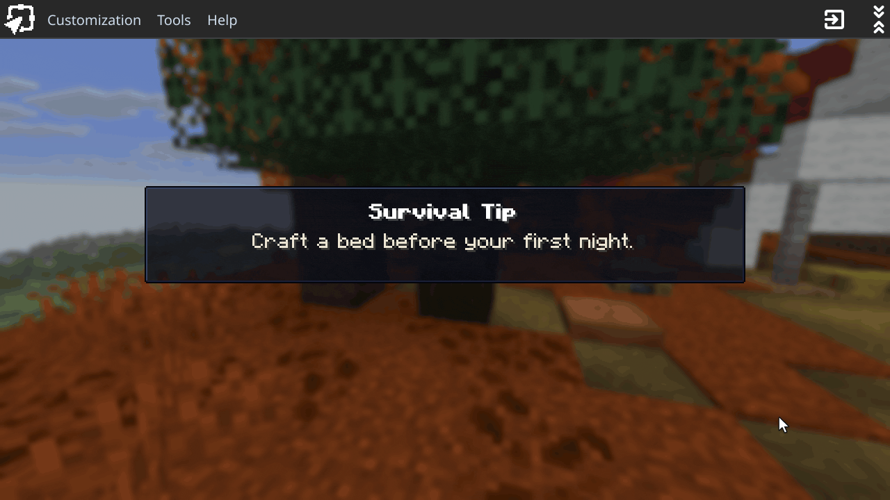

# Schedulers

Schedulers run an [action script](/action-scripts) on a timer: once after a wait, a few times, or over and over until something stops them. They work in every menu and while playing, even when no menu is open, and they don't belong to a layout.

Schedulers are the recommended way for everything that should happen later or over and over. Use them instead of [Ticker elements](/elements#ticker) whenever possible.

> [!CAUTION]
> A scheduler can run file, network, command, clipboard, resource pack and link actions while no menu is open. Only use schedulers from profiles and files of people you trust.

# Adding a Scheduler

1. Open **menu bar -> Customization -> Manage Schedulers**.
2. Click **Add Scheduler**. The action script editor opens.
3. Add the actions that should run every time and click **Done**. See [Action Scripts](/action-scripts#making-an-action-script).

4. The new scheduler shows up with a random ID. Click it, then click **Edit Settings**.
5. Give it a **Scheduler ID**, like `random_tip`, set up its [timer](#settings) and click **Done**.
6. Click **Start Now** to try it.

Everything you change in **Manage Schedulers** gets saved right away.

The scheduler in the GIFs runs [**Arrange List (FM Variable)**](/action-scripts#arrange-list-fm-variable) with **Shuffle** for the list `tips` every 4 seconds. A Text element shows the first entry of the list, so it shows a random tip. How the list and the text work: [List Actions](/variables#list-actions).

# Settings

| Setting | What it does |
|---|---|
| **Scheduler ID** | The name that actions and requirements use. Only lowercase letters, numbers, `.`, `_` and `-`. |
| **Start Delay (ms)** | How long it waits after it got started, before it runs the first time. `0` runs it right away. |
| **Tick Delay (ms)** | The time between two runs. `0` runs it every tick, 20 times per second. |
| **Ticks to Run** | How often it runs before it stops on its own. `0` keeps it running until something stops it. |
| **Start on Launch** | Starts it every time the game starts. |

Times are in milliseconds: `1000` is one second, `60000` one minute and `1800000` half an hour.

# Starting and Stopping

A scheduler only runs after it got started:

- With **Start on Launch**, when the game starts and after switching [profiles](/profiles).
- With **Start Now** in **Manage Schedulers**. While the scheduler runs, the button is **Stop Now**.
- With the action [**Start Scheduler**](/action-scripts#start-scheduler) and the scheduler's ID, like in the script of a button or a [listener](/listeners).

It stops:

- On its own, after it ran **Ticks to Run** times.
- With **Stop Now**, or the action [**Stop Scheduler**](/action-scripts#stop-scheduler) and its ID.
- When it gets renamed or removed, when you switch [profiles](/profiles), and when the game closes. After a restart, only schedulers with **Start on Launch** run again.

A scheduler that runs can't get started a second time: **Start Scheduler** does nothing until it stopped. To start it over, use **Stop Scheduler** and then **Start Scheduler**.

The requirement [**Scheduler Is Running**](/conditions#scheduler-is-running) checks if a scheduler runs, like to show a stop button only while it does.

## Only While a Screen Is Open

To run a scheduler only while a certain screen is open, like the title screen:

1. Open a layout of the screen in the layout editor.
2. Right-click the editor background, click **Edit 'Open Screen' Action Script** and add **Start Scheduler** with the scheduler's ID.
3. Right-click the background again, click **Edit 'Close Screen' Action Script** and add **Stop Scheduler** with the same ID.

# Managing Schedulers

- Click a scheduler to see its settings, if it runs and its action script on the right.
- **Edit Actions**, or a right-click on a scheduler, opens its action script.
- Double-click a scheduler's ID to rename it. `Enter` saves the name, `Esc` cancels. Renaming stops the scheduler, and actions with the old ID don't find it anymore.
- **Remove Scheduler** deletes the selected scheduler, after asking you.
- **Export for AI** copies the selected scheduler or all schedulers for an [AI chat](/export-for-ai).
- The search bar finds schedulers by their ID.

Schedulers get saved in `config/fancymenu/scheduler_instances.txt` (see [Data Storage Locations](/data-storage-locations)). Every [profile](/profiles) has its own schedulers.

# Example: Break Reminder

A toast every 30 minutes after the game started:

1. Add a scheduler with [**Show Toast**](/action-scripts#show-toast). Set its **Title** to `Time for a Break` and its **Message** to `Stand up, stretch and drink some water.`
2. In **Edit Settings**, set **Scheduler ID** to `break_reminder`, **Start Delay (ms)** and **Tick Delay (ms)** to `1800000`, and **Start on Launch** to **Enabled**.

Without the **Start Delay (ms)**, the first toast would show right when the game starts.

# Good to Know

- Keep **Tick Delay (ms)** as high as the job allows. At `0`, the actions run 20 times per second, and slow actions make the game lag.
- When the game lags, several runs can happen right after each other.
- Changes to the action script work right away, even while the scheduler runs. Changes to its settings work the next time it starts.
- If an action fails, the scheduler keeps running. The error goes to the game's log, `logs/latest.log`.
- For a single wait inside one action script, like "open the screen 2 seconds after the click", the [Execute Later](/action-scripts#execute-later) block is simpler.
