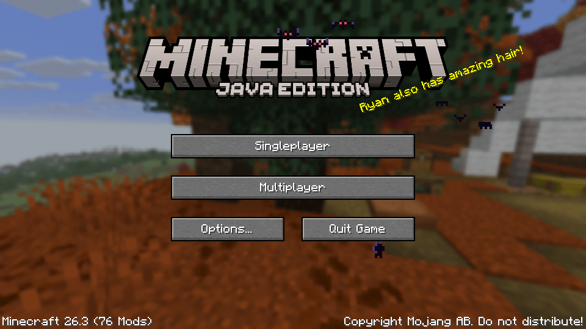
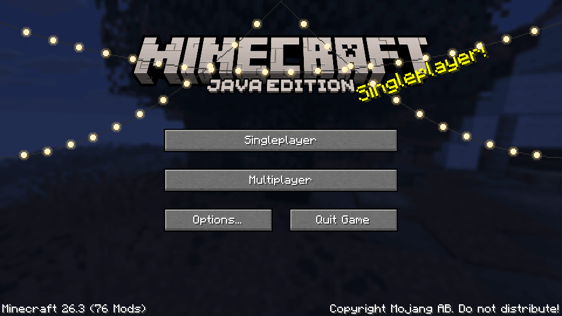

# Dekorations-Overlays

Dekorations-Overlays sind animierte Effekte für den ganzen Bildschirm, zum Beispiel fallender Schnee, Glühwürmchen, Nebel oder Lichterketten. Viele davon interagieren mit deinem Menü: Schnee sammelt sich auf deinen Buttons, Vögel landen darauf und der Nebel lichtet sich rund um die Maus.


# Ein Overlay hinzufügen

1. Öffne ein Layout im Layout-Editor.
2. Klicke mit der rechten Maustaste auf den Hintergrund des Editors und öffne **Dekorations-Overlays**.
3. Öffne ein Overlay, zum Beispiel **Schneefall**.
4. Klicke auf **Overlay anzeigen**, um es einzuschalten.

Eingeschaltete Overlays sind in der Liste mit einem ✔ markiert. Ein Layout kann beliebig viele Overlays anzeigen. Bewege den Mauszeiger über ein Overlay oder eine seiner Einstellungen, um zu sehen, was es bewirkt.

Overlays werden auch im Layout-Editor abgespielt, reagieren dort aber nicht auf deine Elemente. Das tun sie erst im richtigen Menü. Speichere das Layout und öffne das Menü, um alles zu sehen.

Wenn mehrere Layouts eines Bildschirms Overlays enthalten, werden alle abgespielt – auch dasselbe Overlay mehrfach. Das gilt auch für [universelle Layouts](/universal-layouts).

# Einstellungen aller Overlays

Jedes Overlay hat diese beiden Einstellungen:

- **Overlay anzeigen** schaltet das Overlay ein oder aus.
- **Ebenen** legt fest, wo das Overlay gezeichnet wird:
  - **Hintergrund und Vordergrund**: Entfernte Teile werden hinter deinen Elementen und nahe Teile davor gezeichnet. Das sorgt für einen schönen Tiefeneffekt. Dies ist die Standardeinstellung.
  - **Nur Hintergrund**: Alles wird hinter deinen Elementen, aber vor dem Menühintergrund gezeichnet.
  - **Nur Vordergrund**: Alles wird vor deinen Elementen gezeichnet.

Was ein Overlay direkt auf deine Elemente zeichnet, zum Beispiel Schnee auf einem Button, bleibt immer auf den Elementen.

Viele Overlays haben außerdem folgende Einstellungen:

| Einstellung | Wirkung |
|---|---|
| **Menge (%)** | Legt fest, wie viel davon zu sehen ist – von 25 % bis 300 %. 100 % entspricht der normalen Menge. |
| **Größe** | Vergrößert die Pixelgrafik auf das Zwei- oder Dreifache. Jeder Pixel bleibt ein sauberes Quadrat. |
| **Darstellung** | **Detailliert** zeigt die vollständige Pixelgrafik mit Schattierungen und zusätzlichen Effekten. **Einfach** ist flacher und näher an der klassischen Darstellung. |

# Overlays und deine Elemente

Viele Overlays interagieren mit deinen Elementen: Schnee, Asche und Konfetti sammeln sich darauf, Eiszapfen hängen daran, Moos wächst darauf und Vögel landen darauf.

Um auszuwählen, welche Elemente betroffen sind, klicke mit der rechten Maustaste auf ein Element und stelle **Soll von Dekorations-Overlays beeinflusst werden** ein:

- Bei Buttons, Schiebereglern, Kontrollkästchen, Eingabefeldern und [Vanilla-Elementen](/vanilla-elements) ist die Option standardmäßig eingeschaltet.
- Dazu gehören auch das Logo, der Begrüßungstext, das Branding und das Copyright des Titelbildschirms. Schalte die Option für diese Elemente aus, wenn nichts darauf landen soll.
- Versteckte Elemente werden nicht berücksichtigt. Dasselbe gilt für den Teil eines Elements, der von einem [scrollbaren Bereich](/scrollable-areas) abgeschnitten wird.

> [!TIP]
> Lass zwischen deinen Elementen mindestens 13 Pixel Platz. Dinge, die sich auf einem Element sammeln oder darunter hängen, werden nur so groß, wie es der Abstand zum nächsten Element zulässt.

Einige Overlays reagieren auf Klicks, zum Beispiel Blasen, Frost und Konfetti. Deine Buttons reagieren weiterhin auf jeden Klick.

# Alle Dekorations-Overlays

Hier findest du alle Dekorations-Overlays von FancyMenu, nach Themen sortiert.

## Wetter

### Schneefall

Schnee fällt und sammelt sich langsam auf deinen Buttons und am unteren Bildschirmrand.


- **Schnee ansammeln** lässt den Schnee sich auftürmen.
- **Schneefarbe [HEX]**, **Schneefallgeschwindigkeit**, **Menge (%)** und **Größe** ändern den Schnee.

### Regen

Regen fällt, bildet Wellen in flachen Pfützen und tropft von deinen Buttons.


- **Pfützen** legt einen nassen Film über deine Elemente und den unteren Bildschirmrand. Dort, wo Tropfen aufkommen, entstehen Wellen.
- **Tropfen** lässt Tropfen an deinen Elementen hängen und herunterfallen.
- **Blitze** sorgt hin und wieder für Blitze mit verzweigten Lichtbögen und einem sanften Aufleuchten. Mit **Helligkeit der Blitze** legst du fest, wie hell sie sind.
- **Regenfarbe [HEX]**, **Menge (%)** und **Größe** ändern den Regen.

> [!WARNING]
> **Blitze** lässt den Bildschirm aufleuchten. Lass diese Option ausgeschaltet, wenn Spieler empfindlich auf blinkendes Licht reagieren könnten.

### Nebel

Sanfte Nebelschichten ziehen über den Bildschirm und deine Elemente. Am dichtesten ist der Nebel in Bodennähe.


- **Rund um den Mauszeiger aufklaren** lässt den Nebel rund um die Maus auseinandertreiben.

### Frost

Dein Menü friert ein. Eis breitet sich an den Rändern und in den Ecken aus und überzieht deine Elemente. Klicke auf das Eis, um ein Stück herauszuschlagen.


- **Bildschirmränder**, **Ecken** und **Auf Elementen** schalten die einzelnen Eisbereiche ein oder aus. Beschriftungen auf deinen Elementen bleiben frei.

## Natur

### Blätter

Blätter fallen und werden von Windböen umhergewirbelt.


- **Darstellung** wechselt zwischen **Detaillierten** und **Einfachen** Blättern.
- **Farben** bietet **Herbstmix** (fünf warme Herbstfarben) oder **Benutzerdefinierter Bereich** (fünf Farben zwischen **Blattfarbe Anfang [HEX]** und **Blattfarbe Ende [HEX]**).
- **Windböen** schaltet die starken Windböen ein oder aus. Mit **Windstärke** legst du fest, wie stark der Wind ist.
- **Blattdichte**, **Fallgeschwindigkeit der Blätter** und **Skalierung des Blatt-Overlays** ändern die Blätter.

### Kirschblüten

Blühende Äste ragen aus den oberen Ecken ins Bild, während Blütenblätter herabtreiben.


- **Linker Ast** und **Rechter Ast** blenden jeweils einen Ast ein oder aus.
- **Darstellung** und **Menge (%)** ändern die Blütenblätter.

### Überwucherung

Die Natur erobert dein Menü: Moos, Ranken, Gras und Blumen breiten sich langsam überall aus.


- **Gras**, **Linke Ranken**, **Rechte Ranken** und **Auf Elementen** schalten die jeweiligen Pflanzen ein oder aus. Beschriftungen auf deinen Elementen bleiben frei.
- Mit **Blumen an Ranken**, **Blumen auf Elementen** und **Blumen im Gras** können dort Blumen blühen. **Blumen (%)** legt fest, wie viele es gibt.

### Wolken

Flauschige Pixelwolken ziehen in drei Tiefenebenen hinter deinen Elementen über den Himmel. Wolken haben keine eigenen Einstellungen.


### Sonnenstrahlen

Sonnenstrahlen fächern sich von einer Sonne knapp außerhalb des Bildschirms aus. Im Licht tanzen Staubpartikel.


- **Sonnenseite** legt fest, hinter welcher Bildschirmkante sich die Sonne befindet. Mit **Sonnenwinkel (°)** verschiebst du sie entlang dieser Kante.
- **Sonnenlichtfarbe [HEX]** und **Intensität (%)** ändern das Licht.
- **Sonnenschein** lässt ein sanftes Leuchten von der Sonne ausgehen.
- **Staub** lässt Staub durch die Strahlen treiben. Deine Maus wirbelt ihn auf.
- **Elemente treffen** lässt die Strahlen an deinen Elementen enden, ihre Ränder aufleuchten und Schatten werfen. Ist die Option ausgeschaltet, scheinen die Strahlen vor deinen Elementen.

### Blasen

Blasen steigen in Strömen wabernd nach oben und gleiten an der Unterseite deiner Elemente entlang. Klicke darauf, um sie platzen zu lassen! Blasen haben keine eigenen Einstellungen.


## Tiere

### Vögel

Kleine Vögel fliegen herein, hüpfen auf deinen Elementen umher und fliegen davon, wenn die Maus ihnen zu nahe kommt.


### Schmetterlinge

Bunte Schmetterlinge flattern umher, ruhen sich auf deinen Elementen aus und weichen der Maus aus.


### Fledermäuse

Fledermäuse flattern in kleinen Gruppen über den Bildschirm und hängen schlafend unter deinen Elementen. Kommst du ihnen zu nahe, wachen sie auf!



Für Vögel, Schmetterlinge und Fledermäuse gibt es die Einstellungen **Menge (%)** und **Größe**.

### Glühwürmchen

Gruppen von Glühwürmchen leuchten, schwirren umher und landen manchmal auf deinen Elementen.


- **Darstellung** wechselt zwischen **Detaillierten** und **Einfachen** Glühwürmchen. **Unbeleuchtete Körper** zeigt ihre kleinen dunklen Körper zwischen den Lichtblitzen.
- **Maus folgen** lässt Gruppen der Maus folgen, wenn sie in der Nähe ist.
- **Landen** lässt Glühwürmchen hin und wieder auf deinen Elementen landen.
- **Glühwürmchenfarbe [HEX]**, **Anzahl der Gruppen**, **Gruppendichte**, **Gruppengröße** und **Glühwürmchenskalierung** ändern die Glühwürmchen.

### Buddy

Buddy ist ein kleines virtuelles Haustier, das am unteren Rand deines Menüs lebt. Es läuft umher, zeigt seine Bedürfnisse in Gedankenblasen an, reagiert, wenn du mit ihm spielst, und merkt sich alles zwischen den Spielsitzungen.


#### Buddy versorgen

Buddy hat vier Bedürfnisse, die von `0` bis `100` reichen:

- **Hunger** sinkt mit der Zeit. Futter füllt ihn wieder auf.
- **Glück** sinkt mit der Zeit. Streicheln, Futter und Spielen steigern es.
- **Energie** sinkt, solange Buddy wach ist, und steigt wieder, während es schläft.
- **Spaß** sinkt mit der Zeit. Spielen steigert ihn.

So kümmerst du dich um Buddy:

- Klicke mit der linken Maustaste auf Buddy, um es zu streicheln. Wenn du es auf diese Weise aufweckst, wird es etwas weniger glücklich.
- Klicke mit der rechten Maustaste auf Buddy, um den Statusbildschirm zu öffnen. Auf der Registerkarte **Werte** siehst du seine Bedürfnisse, Stufe und EP. Auf der Registerkarte **Erfolge** findest du seine Erfolge.
- Klicke im Statusbildschirm auf **Füttern** und ziehe das Futter anschließend zu Buddy.
- Klicke im Statusbildschirm auf **Spielen** und ziehe dann den Ball. Lass ihn los, um ihn zu werfen. Buddy jagt ihm hinterher und fängt ihn.
- Klicke auf **Schlafen**, damit Buddy sich ausruhen kann. Wenn seine Energie sehr niedrig ist, schläft es auch von selbst ein.
- Buddy macht hin und wieder Häufchen. Klicke mit der linken Maustaste darauf, um sie zu entfernen. Liegen drei oder mehr Häufchen herum, wird Buddy immer unglücklicher.

#### Stufen und Erfolge

Wenn du dich um Buddy kümmerst, erhält es EP. Buddy steigt von Stufe 1 bis 30 auf. Je höher seine Stufe, desto langsamer sinken Hunger, Glück und Energie – auf Stufe 30 nur noch halb so schnell.

#### Wenn Buddy stirbt

Bleiben Hunger oder Glück 10 echte Stunden lang bei `0`, stirbt Buddy und hinterlässt einen Grabstein. Klicke mit der linken Maustaste auf den Grabstein, um mit einem neuen Buddy von vorn anzufangen. Schalte **Buddy kann sterben** aus, damit es nicht stirbt.

Mit **Buddy-Spielstand zurücksetzen** kannst du jederzeit von vorn anfangen.

> [!WARNING]
> Beim Zurücksetzen von Buddy werden seine Bedürfnisse, Stufe, EP, Erfolge und Häufchen endgültig gelöscht.

#### Speichern und anpassen

Buddy speichert sich etwa alle zwei Minuten und beim Schließen seines Bildschirms unter `<game-directory>/fancymenu_data/buddy/`. Jedes Buddy-Overlay hat einen eigenen Spielstand. Siehe [Speicherorte für Daten](/data-storage-locations).

- **Benutzerdefinierte Texturen** ersetzt Buddys Sprites, Gegenstände, Symbole, Statusbildschirm und Grabstein durch deine eigenen Texturen.
- **Werte anpassen** ändert, wie schnell Buddys Bedürfnisse sinken, wie viel Aktivitäten kosten und einbringen und wie viele Häufchen maximal herumliegen dürfen (**Maximale Anzahl Häufchen**).

## Nachthimmel

### Polarlichter

Leuchtende Nordlichter hängen hoch am Himmel und bewegen sich langsam wellenförmig hinter deinen Elementen.


- **Randfarbe [HEX]** legt die Farbe des hellen unteren Rands fest. **Farbe der Spitzen [HEX]** legt die Farbe fest, in die die Strahlen übergehen.

### Sternschnuppen

Ein funkelnder Nachthimmel hinter deinen Elementen, auf dem alle paar Sekunden eine Sternschnuppe und hin und wieder ein ganzer Meteorschauer erscheint. Sternschnuppen haben keine eigenen Einstellungen.


### Himmelslaternen

Leuchtende Papierlaternen steigen in den Nachthimmel auf, manchmal gleich eine ganze Gruppe. Für Himmelslaternen gibt es die Einstellungen **Menge (%)** und **Größe**.


## Party

### Konfetti

Konfettikanonen in den unteren Ecken schießen alle paar Sekunden Konfetti ab, das sich auf deinen Elementen sammelt.


- **Konfettikanonen in den Ecken** schaltet die Konfettikanonen ein oder aus.
- **Bei Klick Konfetti auslösen** lässt an der Stelle, an der du klickst, eine kleine Konfettimenge explodieren.
- **Farbmix-Modus** verwendet zufällige Farben. Schalte ihn aus, um für alles Konfetti **Konfettifarbe [HEX]** zu verwenden.
- **Obergrenze für gelandete Partikel** legt fest, wie viele Konfettiteile gleichzeitig herumliegen dürfen.
- **Menge (%)**, **Größe** und **Fallgeschwindigkeit des Konfettis** ändern das Konfetti.

### Feuerwerk

Raketen steigen auf und explodieren zu Feuerwerk.


- **Raketenflug anzeigen** zeigt die Raketen beim Aufsteigen.
- **Menge (%)**, **Größe** und **Explosionsgröße** ändern das Feuerwerk.

### Lichterketten

Lichterketten hängen quer über deinem Menü und schwingen im Wind.



- **Darstellung** wechselt zwischen **Einfachen** und **Detaillierten** Lichtern. **Tannengirlande** ersetzt das Kabel durch Tannennadeln mit Christbaumkugeln.
- **Lichtprogramm** legt fest, wie die Lichter leuchten und blinken (siehe unten).
- **Skalierung der Lichterkette**, **Windstärke** und **Flackergeschwindigkeit** ändern alle Lichterketten.
- Unter **Lichterketten** findest du ein Menü für jeden der acht möglichen Aufhängepunkte. Schalte eine Lichterkette mit **Lichterkette anzeigen** ein.

Jede Lichterkette hat folgende Einstellungen:

- **Anzahl der Lichter** legt fest, wie viele Lichter daran hängen. `0` füllt die Lichterkette entsprechend ihrer Länge.
- **Lichtfarbe [HEX]** legt die Farbe der Lichter fest. **Weihnachtsbeleuchtungsmodus** macht sie stattdessen bunt.
- **Farbe der Lichterkette [HEX]** legt die Farbe des Kabels fest. Mit dem Alphakanal kannst du es durchsichtig machen oder ausblenden.
- **Individuelle Lichtfarben** und **Individuelle Lichtgrößen** legen für jedes Licht eine eigene Farbe oder Größe fest. Gib die Werte durch Kommas getrennt ein. Gibt es mehr Lichter als Werte, beginnt die Liste wieder von vorn:

```
#FF0000, #00FF00, #0000FF
```

| Lichtprogramm | Wirkung |
|---|---|
| **Ein** | Alle Lichter leuchten. Hin und wieder wird eines wie bei echten Lichtern ganz leicht gedimmt. |
| **Voll beleuchtet** | Alle Lichter leuchten mit voller Helligkeit. |
| **Halb beleuchtet** | Alle Lichter leuchten mit halber Helligkeit. |
| **Aus** | Alle Lichter sind ausgeschaltet. |
| **Zyklus** | Spielt Funkeln, Lauflicht, Abwechselnd und Atmen ab und wechselt alle 7 Sekunden. |
| **Funkeln** | Die Lichter flackern zufällig. |
| **Lauflicht** | Ein helles Licht wandert an der Lichterkette entlang. |
| **Abwechselnd** | Jedes zweite Licht leuchtet. Danach übernimmt die andere Hälfte. |
| **Atmen** | Alle Lichter werden langsam gemeinsam heller und dunkler. |

## Gruseliges

### Spinnweben

Staubige Spinnweben hängen in den oberen Ecken. Kleine Spinnen seilen sich daran ab.


- **Linkes Netz** und **Rechtes Netz** blenden jeweils ein Spinnennetz samt Spinne ein oder aus.
- **Spinnen** lässt Spinnen herunterseilen, herumhängen und wieder nach oben klettern. Sie huschen vor der Maus davon.
- **Geschlossener vorderer Rand** verbindet die Fadenenden mit einem Rand, sodass keine losen Fäden auf dem Bildschirm enden.

### Glut

Glühende Funken steigen von unten auf, während Asche herabtreibt und sich sammelt.


- **Asche am Boden** legt am unteren Bildschirmrand eine tiefe Ascheschicht mit glimmenden Stellen und glühenden Kohlen an.
- **Asche auf Elementen** lässt Asche auf deinen Elementen liegen bleiben.

## Benutzerdefiniert

### Browser

Das Browser-Overlay zeigt eine Website auf dem gesamten Bildschirm an.

> [!IMPORTANT]
> Für das Browser-Overlay wird die Mod [Rinku](https://modrinth.com/mod/rinku) benötigt.

- **URL** legt fest, welche Website angezeigt wird.
- **Mausklicks abfangen**, **Maus-Scrollen abfangen** und **Tastatureingaben abfangen** verhindern, dass Eingaben den Browser verlassen und das Menü dahinter erreichen.
- **Mausklicks verarbeiten**, **Maus-Scrollen verarbeiten** und **Tastatureingaben verarbeiten** lassen den Browser selbst auf Eingaben reagieren.
- Mit **Videosteuerung ausblenden**, **Videos in Schleife abspielen**, **Browser stummschalten** und **Audio-/Videolautstärke** steuerst du Videos und den Ton der Website.

Die Optionen zum Abfangen und Verarbeiten sind standardmäßig eingeschaltet. Dadurch funktioniert der Browser wie ein normaler Browser vor deinem Menü. Wenn du eine Website nur als Hintergrund anzeigen möchtest, schalte alle diese Optionen aus.

Websites können auch FancyMenu-Aktionen ausführen und Platzhalter auslesen. Siehe [JavaScript-API des Browsers](/browser-api).

### GLSL-Shader

Das GLSL-Shader-Overlay zeichnet deinen eigenen Shader über den gesamten Bildschirm. Damit kannst du animierte oder statische Effekte erstellen. Füge deinen Shader-Code unter **Shader-Quelle** ein.

Unter [GLSL-Shader-API](/glsl-shader-api) erfährst du, wie du Shader für FancyMenu schreibst.
