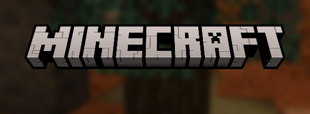
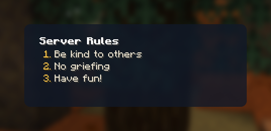

# Elemente

Elemente sind die Bestandteile eines Layouts: Schaltflächen, Texte, Bilder, Schieberegler, Musik und mehr. Auf dieser Seite findest du alle Elementtypen und ihre wichtigsten Einstellungen.

> [!TIP]
> Schaltflächen und andere Bestandteile, die ein Bildschirm standardmäßig hat, sind [Vanilla-Elemente](/vanilla-elements). Du kannst sie ebenfalls verschieben, ändern und ausblenden.

# Elemente hinzufügen

1. Klicke im Layout-Editor mit der rechten Maustaste auf eine freie Stelle und dann auf **New Element**. Dieselbe Liste findest du in der Menüleiste unter **Element -> New**.
2. Klicke auf einen Elementtyp. Bewege den Mauszeiger über einen Typ, um zu sehen, wofür er gedacht ist.

Das Element erscheint an der Stelle, auf die du rechtsgeklickt hast. Ziehe es, um es zu verschieben, ziehe an den Kanten, um seine Größe zu ändern, und klicke mit der rechten Maustaste darauf, um die Einstellungen zu öffnen.


So wählst, verschiebst, kopierst und löschst du Elemente und findest alle Tastenkürzel des Editors: [Layout-Editor](/layout-editor). Damit Elemente bei jeder Fenstergröße an ihrem Platz bleiben, lies [Elemente positionieren](/positioning-elements). Wie du Elemente vor oder hinter anderen anordnest, erfährst du unter [Ebenen und Gruppen](/layout-editor#layers-and-groups).

# Einstellungen für alle Elemente

Jedes Element hat im Rechtsklickmenü neben den Einstellungen seines Typs auch folgende Einstellungen:

| Einstellung | Funktion |
|---|---|
| **Anchor Point** | Legt fest, woran das Element verankert ist, zum Beispiel an einer Bildschirmecke oder einem anderen Element. Siehe [Elemente positionieren](/positioning-elements). |
| **Advanced Positioning** und **Advanced Sizing** | Berechnen Position und Größe, zum Beispiel mit [Platzhaltern](/placeholders). Siehe [Erweiterte Positionierung und Größenanpassung](/advanced-positioning-sizing). |
| **Loading Requirements** und **Load Once Per Session** | Zeigen das Element nur an, wenn die [Bedingungen](/conditions) erfüllt sind, oder nur einmal pro Spielstart. Siehe [Elementsichtbarkeit](/element-visibility). |
| **Delay Appearance** und **Delay Disappearance** | Warten einige Sekunden, bevor das Element erscheint oder ausgeblendet wird. Siehe [Elementsichtbarkeit](/element-visibility#delaying-elements). |
| **Fading In/Out** und **Opacity** | Blenden das Element ein und aus oder machen es durchsichtig. Siehe [Elementsichtbarkeit](/element-visibility#fading-in-and-out). |
| **Rotation**, **Vertical Tilt** und **Horizontal Tilt** | Drehen und neigen das Element. Siehe [Elemente drehen und neigen](/rotating-elements). |
| **Parallax Effect** | Bewegt das Element ein wenig mit der Maus. Siehe [Parallax-Effekt](/parallax). |
| **Copy Element ID** | Kopiert die Kennung, über die Aktionen, Platzhalter und andere Elemente das Element finden. Siehe [Elementkennungen](/element-identifiers). |
| **In-Editor Display Name** | Der Name des Elements in der Ebenenliste. |
| **Export for AI** | Wandelt das Element in Text für [KI-Assistenten](/export-for-ai) um. |

# Alle Elemente

Alle Elemente, die FancyMenu bietet, nach ihrem Zweck sortiert.

## Schaltflächen und Eingaben

### Schaltfläche

Eine Schaltfläche, die beim Anklicken ein [Aktionsskript](/action-scripts) ausführt, zum Beispiel einem Server beitritt, eine Website oder ein anderes Menü öffnet.


- **Edit Action Script**: legt fest, was die Schaltfläche beim Anklicken tut.
- **Label** und **Hover Label**: der Beschriftungstext und der Text, der angezeigt wird, wenn sich die Maus über der Schaltfläche befindet. Beide unterstützen [Platzhalter](/placeholders) und [Textformatierung](/text-formatting).
- **Label Alignment**: richtet die Beschriftung **Left**, **Centered** oder **Right** auf der Schaltfläche aus. Beschriftungen, die zu breit für die Schaltfläche sind, scrollen von einer Seite zur anderen – unabhängig von ihrer Ausrichtung.
- **Label Scale**, **Label Base Color**, **Label Hover Color**, **Label Shadow** und **Underline Label On Hover**: Größe, Farben und Schatten der Beschriftung.
- **Button Textures** und **Button Icon Textures**: eigene Bilder für die Schaltfläche und ein Symbol darauf – jeweils für den normalen, den überfahrenen und den inaktiven Zustand. Informationen zu Texturen, die sich gut skalieren lassen, findest du unter [Nine-Slicing und Kachelung](/nine-slicing-and-tiling).
- **Hover Sound**, **Unhover Sound** und **Click Sound**: die Töne, die die Schaltfläche abspielt.
- **Tooltip**: ein Text, der angezeigt wird, wenn sich die Maus über der Schaltfläche befindet.
- **Control Active State**: [Bedingungen](/conditions), die erfüllt sein müssen, damit die Schaltfläche anklickbar ist. Andernfalls wird sie ausgegraut.
- **Template Mode**: Übernimmt das Aussehen dieser Schaltfläche für andere Schaltflächen und Schieberegler auf dem Bildschirm. Siehe [Vorlagen für Schaltflächen und Schieberegler](/button-slider-templates).

### Schieberegler

Ein Schieberegler, mit dem Spieler einen Wert auswählen. Bei jeder Wertänderung wird das Aktionsskript ausgeführt.


- **Slider Type**:
  - **Value List**: Geht die Texte unter **List Values** durch, einen pro Zeile. Mit **Values From List Variable** werden die Werte stattdessen aus einer [Listenvariable](/variables#text-and-list-variables) übernommen.
  - **Integer Range**: Ganze Zahlen von **Minimum Range Value** bis **Maximum Range Value**.
  - **Decimal Range**: Funktioniert genauso, aber mit Dezimalzahlen. **Rounding Decimal Place** legt fest, wie viele Stellen nach dem Komma angezeigt werden. Bei `-1` wird nicht gerundet.
- **Slider Label**: die Beschriftung. `$$value` zeigt den aktuellen Wert an.
- **Edit Action Script**: Wird bei einer Wertänderung ausgeführt. `$$value` steht für den neuen Wert.
- **Pre-Selected Value**: Der Wert, mit dem der Schieberegler startet. Verknüpfe ihn mit dem Wert, den der Schieberegler ändert, damit beim Öffnen des Bildschirms der richtige Wert angezeigt wird.

Ein Lautstärkeregler vom Typ **Integer Range** mit einem Bereich von `0` bis `100` könnte beispielsweise die Beschriftung `Music Volume: $$value%` und eine Aktion vom Typ [**Set Variable Value (FM Variable)**](/action-scripts#set-variable-value-fm-variable) mit folgendem Wert haben:

```
music_volume:$$value
```

Als **Pre-Selected Value** wird `$$music_volume` verwendet, damit der Regler mit dem zuletzt vom Spieler gewählten Wert startet.

Schieberegler haben dieselben Einstellungen für Beschriftung, Textur, Ton, Tooltip und **Control Active State** wie Schaltflächen. Mit **Label Alignment** kannst du die Beschriftung also ebenfalls links oder rechts platzieren.

### Kontrollkästchen

Ein Kästchen, das Spieler an- und abwählen können. Bei jeder Änderung wird das Aktionsskript ausgeführt.


- `$$value` ist im Aktionsskript und bei den Bedingungen von **Control Active State** entweder `true` oder `false`.
- **Variable Mode** und **Link To Variable**: Das Kontrollkästchen zeigt den Wert einer [Variable](/variables) an und schreibt `true` oder `false` hinein. Ist es mit einer Listenvariable verknüpft, wird `true` oder `false` zu ihrem einzigen Eintrag.
- Ohne den Variablenmodus merkt sich das Kontrollkästchen seinen Zustand selbst – für jedes [Profil](/profiles) separat.
- **Textures**: eigene Bilder für das Kästchen und das Häkchen.

Kontrollkästchen haben dieselben Einstellungen für Tooltips und Töne wie Schaltflächen sowie die Einstellung **Navigable**.

### Texteingabefeld

Ein Feld, in das Spieler Text eingeben, zum Beispiel eine Serveradresse oder einen Namen.


- **Link To Variable**: Die Eingabe der Spieler wird in der [Variable](/variables) gespeichert, und das Feld zeigt ihren Wert an. Ist das Feld mit einer Listenvariable verknüpft, ersetzt der eingegebene Text die gesamte Liste.
- **Input Type**: **Text**, **Only Numbers**, **Only Decimal Numbers** oder **URL**. Andere Zeichen können nicht eingegeben werden.
- **Hint Text** und **Hint Text Color**: ein Text, der angezeigt wird, solange das Feld leer ist.
- **Max Text Length**: die maximale Anzahl an Zeichen.
- **Background Color**, **Border Color**, **Border Rounding Radius** und **Text Color**: das Erscheinungsbild des Feldes.

Ein Feld, das beispielsweise mit `server_address` verknüpft ist, und eine Schaltfläche mit der Aktion [**Join Server**](/action-scripts#join-server) und dem Wert `$$server_address` ermöglichen es Spielern, einem beliebigen Server beizutreten.

Ohne Variable liest der Platzhalter [**Text Input Field Value**](/placeholders#text-input-field-value) den Text aus, und mit der Aktion [**Set Text Input Field Value**](/action-scripts#set-text-input-field-value) kannst du ihn ändern.

## Texte und Tooltips

### Text

Text beliebiger Länge – von einer kurzen Beschriftung bis hin zu scrollbaren Regeln oder Patch-Notizen – mit [Markdown](/text-formatting) und [Platzhaltern](/placeholders).


- **Source Mode**: Gib den Text ein oder lade ihn aus einer Datei oder Website.
- Wähle ein Ausgangsdesign und aktiviere das Scrollen, wenn der Text größer als das Element ist.
- **Background**: ein dunkles Feld hinter dem Text. Deaktiviere es mit **Show Background** oder verwende stattdessen eine eigene Textur.

Alles dazu findest du unter [Text in Menüs](/text-in-menus).

### Tooltip

Ein Textfeld wie die Tooltips im Spiel, mit [Markdown](/text-formatting) und [Platzhaltern](/placeholders).


- Der Tooltip wird an der von dir festgelegten Stelle angezeigt oder mit **Follow Mouse** an der Maus.
- Über **Loading Requirements** legst du fest, wann er angezeigt wird, zum Beispiel mit [**Is Element Hovered**](/conditions#is-element-hovered) für eine Schaltfläche.
- **Tooltip Background**: eine eigene Textur anstelle des dunklen Feldes.

Mehr dazu findest du unter [Text in Menüs](/text-in-menus).

### Splash-Text

Der gelbe Text auf dem Titelbildschirm, mit eigenen Texten.


- **Source Mode**: die Vanilla-Splash-Texte, ein eigener Text oder eine zufällige Zeile aus einer Textdatei.
- **Bouncing**, **Scale**, **Rotation**, **Text Color** und **Shadow**: das Erscheinungsbild des Textes.
- **Refresh On Screen Load**: Wählt bei jedem Öffnen des Bildschirms einen neuen Splash-Text aus.

Mehr dazu findest du unter [Splash-Text](/splash-text).

## Bilder und Medien

### Bild

Ein Bild aus deinen Dateien, von einer Website oder aus den Ressourcen des Spiels. Auch animierte Bilder werden wiedergegeben.



- **Image Source**: das Bild. Eine Liste unterstützter Dateien findest du unter [Bilder](/images).
- **Restore Aspect Ratio**: Ändert die Breite, damit das Bild nicht verzerrt wird.
- **Nine-Slice Texture** und **Repeat Texture**: Skalieren Rahmen, ohne ihre Ränder zu verzerren, oder kacheln das Bild. Siehe [Nine-Slicing und Kachelung](/nine-slicing-and-tiling).
- **Image Tint [HEX]**: färbt das Bild ein.
- **Corner Rounding Radius**: rundet die Ecken ab.

### Diashow

Zeigt nacheinander die Bilder einer Diashow an. Diashows erstellst du in `config/fancymenu/slideshows/`. Siehe [Diashows](/slideshows).

- **Slideshow**: die anzuzeigende Diashow.
- **Restore Aspect Ratio**: Ändert die Breite, damit die Bilder nicht verzerrt werden.

### Video

Spielt eine Videodatei ab, zum Beispiel einen Trailer oder einen bewegten Hintergrund.

> [!IMPORTANT]
> Für Videos werden die Mods Watermedia V3 und Watermedia Binaries V3 benötigt. Siehe [Videos](/video).

- **Video Source**: eine Videodatei, ein Weblink oder eine Ressource des Spiels.
- **Loop Video**, **Volume** und **Sound Channel**: legen fest, wie das Video abgespielt wird.
- **Play Video In Layout Editor**: legt fest, ob das Video auch während der Bearbeitung abgespielt wird.
- Aktionen wie [**Toggle Video Element Paused State**](/action-scripts#toggle-video-element-paused-state) pausieren das Video, springen zu einer bestimmten Zeit oder ändern die Lautstärke.

**Video [Rinku]** ist ein älteres Videoelement, für das der Rinku-Mod benötigt wird. Es funktioniert weiterhin in alten Layouts, ist aber nicht unter **New Element** verfügbar.

### GLSL-Shader

Führt einen eigenen GLSL-Shader innerhalb des Elements aus, zum Beispiel animierte Farben oder Effekte von Shadertoy.


- **Shader Source**: der Shader-Code. Shadertoy-Shader mit `mainImage` funktionieren unverändert.
- **Compile Mode**: **Auto**, **Shadertoy** oder **Direct Fragment**.
- **Buffer A Source** bis **Buffer D Source**: zusätzliche Durchläufe für Shader mit Buffern.

Wie du sie schreibst, erfährst du unter [GLSL-Shader-API](/glsl-shader-api).

### Browser

Zeigt eine Website live an, zum Beispiel eine Serverkarte oder eine Wiki-Seite.

> [!IMPORTANT]
> Für den Browser wird der Mod [Rinku](https://modrinth.com/mod/rinku) ([CurseForge](https://www.curseforge.com/minecraft/mc-mods/rinku)) benötigt.

- **URL**: die Website.
- **Interactable**: Ermöglicht Spielern, auf der Website zu klicken, zu scrollen und Text einzugeben. Im Layout-Editor ist die Website nie interaktiv.
- **Mute Browser**, **Audio/Video Volume**, **Loop Videos** und **Hide Video Controls**: Einstellungen für Medien auf der Seite.

Um eine HTML-Datei aus `config/fancymenu/assets/` zu laden, beginne die URL mit `file:///`:

```
file:///config/fancymenu/assets/changelog.html
```

Verwende unter Linux stattdessen den Platzhalter [**Absolute File/Folder Path**](/placeholders#absolute-filefolder-path):

```
file:///{"placeholder":"absolute_path","values":{"short_path":"/config/fancymenu/assets/changelog.html"}}
```

Websites können Aktionen ausführen und Platzhalter auslesen: [Browser-JavaScript-API](/browser-api).

## Formen, Gegenstände und Modelle

### Rechteckform

Ein Rechteck in einer Farbe, zum Beispiel ein Feld hinter Text.



- **Color**: eine HEX-Farbe. Mit zwei weiteren Ziffern wird sie durchsichtig, zum Beispiel `#101828C8`.
- **Corner Rounding Radius**: Rundet alle Ecken oder jede Ecke einzeln ab.
- **Blur** und **Blur Intensity**: Verwischen den Hintergrund.

### Kreisform

Ein Kreis oder Oval in einer Farbe, zum Beispiel eine Statusleuchte.


- **Color**, **Blur** und **Blur Intensity**: funktionieren wie bei der Rechteckform.
- **Roundness**: `2` ergibt einen Kreis. Größere Werte machen die Form eckiger, kleinere spitzer.

### Gegenstand

Zeigt einen Minecraft-Gegenstand oder einen Gegenstand aus einem Mod an, wie im Inventar.


- **Item Key**: der Gegenstand, zum Beispiel `minecraft:diamond_sword`.
- **Item Count**, **Item Name**, **Item Lore** und **Enchanted**: funktionieren wie bei einem richtigen Gegenstand.
- **Show Item Tooltip**: Zeigt den Tooltip des Gegenstands an, wenn sich die Maus darüber befindet.
- **Custom NBT Data**: zusätzliche Gegenstandsdaten im selben Format wie der Teil eines `/give`-Befehls direkt nach dem Gegenstand.

### JSON-Modell für Block oder Gegenstand

Zeigt ein Block- oder Gegenstandsmodell in 3D an – aus den Ressourcen des Spiels oder aus einer eigenen JSON-Datei.


- **Model**: die **Model Source**, zum Beispiel `minecraft:models/block/crafting_table.json`.
- **Texture**: Ersetzt die Textur des Modells durch deine eigene.
- **Transform**: Skaliert, dreht und verschiebt das Modell.
- **Lighting**: Mit **Light Hue [HEX]** färbst du das Licht auf dem Modell.

### Spieler-Entität

Zeigt einen Spieler in 3D an, zum Beispiel den eigenen Charakter auf dem Titelbildschirm.


> [!IMPORTANT]
> Für Spieler-Entitäten wird der Mod Fancy Entity Renderer benötigt ([CurseForge](https://www.curseforge.com/minecraft/mc-mods/fancy-entity-renderer), [Modrinth](https://modrinth.com/mod/fancy-entity-renderer)). Ohne ihn wird anstelle des Spielers ein Fehler angezeigt.

- **Copy Client Player**: Zeigt den Spieler an, der das Spiel spielt, mit dessen Skin und Namen.
- **Player Name**, **Skin Texture** und **Cape Texture**: Legen einen anderen Spieler oder Skin fest.
- **Entity Pose**, **Head Follows Mouse** und **Body Follows Mouse**: Legen fest, wie die Entität steht und blickt.
- **Armor and Tools**, **Parrot**, **Is Baby** und **Show Player Name**: Legen fest, was sie trägt und anzeigt.

Mehr dazu findest du unter [Spieler-Entitäten](/player-entities). Für einen einzelnen Kopf siehe [Spielerköpfe](/player-heads).

### Fortschrittsbalken

Ein Balken, der sich füllt, zum Beispiel ein Ladebalken.


- **Progress Value Source**: Legt fest, wie weit der Balken gefüllt ist. Verwende hier [Platzhalter](/placeholders), zum Beispiel [**World Loading Progress**](/placeholders#world-loading-progress) auf einem Bildschirm, der eine Welt lädt.
- **Progress Value Mode**: **PERCENTAGE (0-100)** oder **FLOATING POINT (0.0-1.0)**.
- **Direction**: die Richtung, in die sich der Balken füllt.
- **Bar Color** und **Background Color** oder **Bar Texture** und **Background Texture**.
- **Smooth Filling Animation**: Blendet zu neuen Werten über, statt direkt dorthin zu springen.
- **Use Progress for Element Anchor**: Elemente, die am Balken verankert sind, bewegen sich mit dem Ende des gefüllten Abschnitts.

## Layout-Hilfen

### Scrollbarer Bereich

Enthält andere Elemente und ermöglicht es, durch sie zu scrollen – zum Beispiel durch eine Serverliste oder eine lange Infoseite.


- Ziehe Elemente im Layout-Editor hinein. Es können nur eigene Elemente hinzugefügt werden, keine Vanilla-Elemente.
- **Arrangement**: Ordne die Elemente selbst an oder lass sie vom Bereich als Stapel, Raster oder Fluss ausrichten.
- **Background**: ein dunkles Feld hinter dem Bereich. Deaktiviere es mit **Show Background** oder verwende stattdessen eine eigene Textur.

Alles dazu findest du unter [Scrollbare Bereiche](/scrollable-areas).

### Verschieber

Ein Bereich, den Spieler außerhalb des Editors greifen und verschieben können. Daran verankerte Elemente bewegen sich mit – zum Beispiel ein verschiebbares Infopanel. Außerhalb des Editors ist der Verschieber unsichtbar.

**Save User Drag Offset** behält die neue Position bei, nachdem der Bildschirm geschlossen und das Spiel neu gestartet wurde. Mehr dazu unter [Verschieber](/dragger).

### Element-Animator

Verschiebt und skaliert andere Elemente mithilfe von Keyframes, zum Beispiel ein Panel, das in den Bildschirm gleitet. Außerhalb des Editors ist der Animator unsichtbar.

- **Manage Target Elements**: Legt fest, welche Elemente animiert werden.
- **Edit Keyframes**: Öffnet den Keyframe-Editor.
- **Loop Animation**: Startet die Animation am Ende erneut.

Alles dazu findest du unter [Element-Animator](/element-animator).

## Unsichtbare Elemente

Diese Elemente sind nur im Layout-Editor sichtbar.

### Ticker

Führt sein Aktionsskript immer wieder aus, solange der Bildschirm geöffnet ist.

> [!IMPORTANT]
> Für alles, was wiederholt oder zu einem späteren Zeitpunkt ausgeführt werden soll, empfehlen sich [Scheduler](/schedulers). Verwende sie nach Möglichkeit anstelle von Tickern. Sie funktionieren auf jedem Bildschirm und auch ohne geöffneten Bildschirm, unterstützen alle Aktionen und lassen sich durch Aktionen starten und stoppen.

So erledigst du mit Schedulern, was Ticker tun:

- Dauerhaft ausführen, solange ein Bildschirm geöffnet ist: Erstelle einen Scheduler mit einer **Tick Delay (ms)**. Starte ihn mit [**Start Scheduler**](/action-scripts#start-scheduler) im **Edit 'Open Screen' Action Script** des Layouts und stoppe ihn mit [**Stop Scheduler**](/action-scripts#stop-scheduler) im **Edit 'Close Screen' Action Script**. Beide findest du im Rechtsklickmenü auf den Hintergrund des Editors.
- Einmal pro Spielstart ausführen: Erstelle einen Scheduler mit **Start on Launch** und **Ticks to Run** auf `1`.
- Jedes Mal ausführen, wenn ein Bildschirm geöffnet wird: Ein Ticker oder Scheduler ist nicht nötig. Füge die Aktionen unter **Edit 'Open Screen' Action Script** ein.

Einstellungen des Tickers:

- **Tick Delay [ms]**: die Zeit zwischen zwei Ausführungen in Millisekunden. Bei `0` wird er bei jedem Tick ausgeführt, also 20-mal pro Sekunde.
- **Tick Mode**: **Normal** führt ihn dauerhaft aus. **Session** führt ihn nur einmal aus, bis das Spiel neu gestartet wird. **On Load Screen** führt ihn bei jedem Öffnen des Bildschirms einmal aus, auch wenn die Fenstergröße geändert wird.
- **Async**: Führt ihn im Hintergrund aus. Die meisten Aktionen können nicht auf diese Weise ausgeführt werden und zeigen dann einen Fehler an.

### Audio

Spielt Musik oder Töne ab, solange der Bildschirm geöffnet ist, einen Titel nach dem anderen.

- **Manage Tracks**: Hier legst du die Audiodateien, ihre Reihenfolge und ihr **Track Weight** für die Zufallswiedergabe fest.
- **Play Mode**: **Normal** spielt die Titel der Reihe nach ab, **Shuffle** in zufälliger Reihenfolge.
- **Loop Tracks**, **Volume** und **Sound Channel**: legen fest, wie die Titel abgespielt werden.

Damit die Musik beim Wechsel zwischen Bildschirmen weiterläuft, füge das Audioelement zu einem [universellen Layout](/universal-layouts) hinzu. Mehr dazu unter [Menühintergrundmusik](/background-music).

### Musiksteuerung

Schaltet die eigene Musik des Spiels für diesen Bildschirm aus.

- **Play Menu Music**: die Musik der Menüs, wenn keine Welt geladen ist, zum Beispiel auf dem Titelbildschirm.
- **Play World Music**: die Musik der Welt, die in Menüs weiterläuft, zum Beispiel im Inventar.

Funktioniert nur, solange ein Bildschirm geöffnet ist.

### Mauszeiger

Ersetzt den Mauszeiger durch ein eigenes Bild, solange der Bildschirm geöffnet ist.

- **Cursor Texture**: ein PNG-Bild, zum Beispiel mit den Maßen 32 × 32 Pixel.
- **Hotspot X-Coordinate** und **Hotspot Y-Coordinate**: die Position des klickenden Pixels im Bild, zum Beispiel die Spitze eines Pfeils.
- **Editor Preview Mode**: Zeigt den Mauszeiger im Editor an, wenn sich die Maus über dem Element befindet.

Mehr dazu findest du unter [Eigener Mauszeiger](/custom-cursor).
