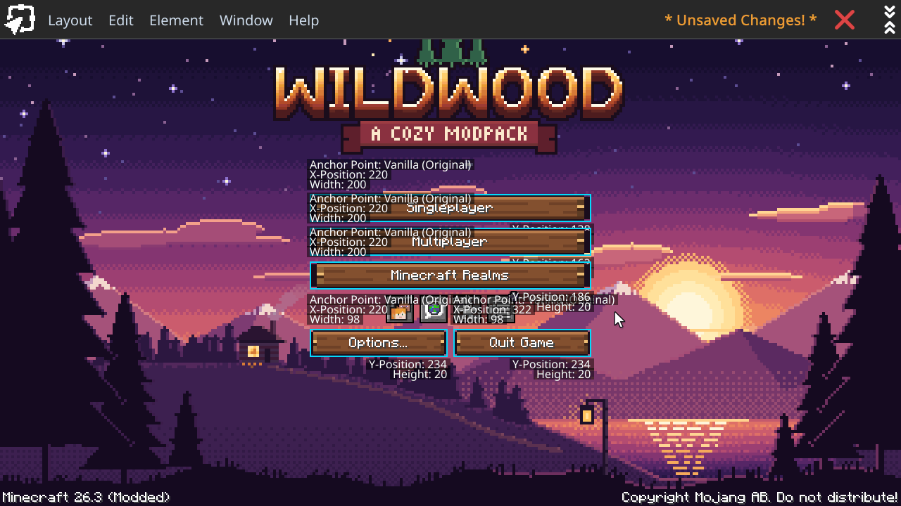

# Erste Schritte

Mit FancyMenu kannst du jedes Minecraft-Menü anpassen, zum Beispiel den Titelbildschirm, das Pausenmenü und die Menüs anderer Mods. Verpasse ihnen eigene Hintergründe, Logos, Schaltflächen, Texte, Sounds und Animationen, verschiebe oder verstecke bereits vorhandene Elemente, weise Schaltflächen neue Funktionen zu oder erstelle ganz neue Menüs. Das alles erledigst du direkt im Spiel – ganz ohne Code.

Auf dieser Seite lernst du die Grundlagen Schritt für Schritt kennen. Dabei erstellst du eine einfachere Version dieses Titelbildschirms. Unter [So wurde das Beispiel erstellt](#how-the-example-is-made) erfährst du, was die vollständige Version zusätzlich bietet.

> [!TIP]
> Hol dir diesen Titelbildschirm für dein eigenes Spiel: Lade [wildwood_title_screen.fmp](https://raw.githubusercontent.com/Keksuccino/docs_fancymenu/refs/heads/wiki-2026/assets/wildwood_title_screen.fmp?raw=true) herunter und [importiere](/profiles#importing) und [lade](/profiles#loading-a-profile) ihn anschließend unter **Menüleiste -> Anpassung -> Profile**. Du kannst ihn kostenlos für alles verwenden, zum Beispiel zum Ausprobieren von FancyMenu, zum Lernen oder für dein Modpack – mit oder ohne Änderungen. Eine Quellenangabe ist nicht erforderlich.

# Die Menüleiste

In der Menüleiste oben in jedem Menü findest du alle Funktionen von FancyMenu.

- **Anpassung**: Die Layouts des aktuellen Menüs und alles für deine gesamte Konfiguration, zum Beispiel [Globale Anpassungen](/global-customizations), [Benutzerdefinierte GUIs](/custom-guis), [Variablen](/variables), [Listener](/listeners), [Zeitplaner](/schedulers), [Profile](/profiles) und die Einstellungen von FancyMenu.
- **Werkzeuge**: Hilfsfunktionen wie [Dummy-Bildschirminstanzen](/dummy-screen-instances), der [AFMA-Generator](/animations#fma-and-afma), **Spielressourcen durchsuchen** und **FancyMenu-Verzeichnis öffnen**. Letzteres öffnet den Ordner deiner Konfiguration (siehe [Speicherorte für Daten](/data-storage-locations)).
- **Hilfe**: Diese Dokumentation, der Discord-Server, **Fehler melden** und [Für KI exportieren](/export-for-ai).
- Das Türsymbol ganz rechts schließt das aktuelle Menü – nützlich bei Menüs ohne eigene Schaltfläche zum Schließen.
- Mit den Doppelpfeilen ganz rechts kannst du die Menüleiste zu einer kleinen Schaltfläche einklappen und wieder ausklappen.

Spieler deines Modpacks brauchen die Menüleiste nicht. Unter [Modpacks](/modpacks#disabling-the-menu-bar-and-hotkeys) erfährst du, wie du sie deaktivierst.

## Tastenkürzel der Menüleiste

Diese Tastenkürzel funktionieren in jedem Menü, aber nicht im Layout-Editor und nicht, wenn der Modpack-Modus aktiviert ist. Unter macOS verwendest du `Cmd + Option` statt `Ctrl + Alt`.

| Tastenkürzel | Funktion |
|---|---|
| `Ctrl + Alt + C` | Menüleiste ein- oder ausblenden. Falls sie plötzlich verschwunden ist, kannst du sie damit wieder einblenden. |
| `Ctrl + Alt + R` | FancyMenu neu laden, wie über **Menüleiste -> Anpassung -> FancyMenu neu laden** |
| `Ctrl + Alt + D` | Das **Debug-Overlay** ein- oder ausblenden. Es zeigt die [Kennung](/screen-identifiers) des Menüs und weitere Informationen an. |
| `Ctrl + Alt + L` | Den [Layout-Editor](/layout-editor) mit dem zuletzt bearbeiteten Layout öffnen. |

# Dein erstes Layout

Ein Layout enthält deine Änderungen an einem Menü: den Hintergrund, hinzugefügte Elemente und Änderungen an bereits vorhandenen Schaltflächen und Texten. Für ein Menü kann es mehrere Layouts geben, die du einzeln ein- und ausschalten kannst.

## Ein Layout erstellen

1. Öffne das Menü, das du ändern möchtest, zum Beispiel den Titelbildschirm.
2. Klicke auf **Menüleiste -> Anpassung -> Anpassung des aktuellen Bildschirms**, sodass **Aktiviert** angezeigt wird. FancyMenu passt nur Menüs an, für die diese Option eingeschaltet ist.
3. Klicke auf **Menüleiste -> Anpassung -> Layouts -> Neu -> Für aktuellen Bildschirm**.

Der Layout-Editor wird geöffnet. Er zeigt das Menü so an, wie Spieler es sehen, damit du jede Änderung sofort überprüfen kannst. Unter [Layout-Editor](/layout-editor) findest du alle Informationen dazu, zum Beispiel zum Verschieben, Ändern der Größe und Kopieren von Elementen.

Mit **Für alle Bildschirme [Universal]** erstellst du stattdessen ein [universelles Layout](/universal-layouts), das in jedem Menü angezeigt wird.

## Einen Hintergrund festlegen

Lege deine Bilder zunächst im Ordner `config/fancymenu/assets` deines Spiels ab. Über **Menüleiste -> Werkzeuge -> FancyMenu-Verzeichnis öffnen** öffnest du `config/fancymenu`.

1. Klicke mit der rechten Maustaste auf den Hintergrund des Editors und öffne **Menühintergründe -> Bild**.
2. Klicke auf **Hintergrund anzeigen**, sodass **Aktiviert** angezeigt wird.
3. Klicke auf **Bild auswählen**, setze **Quelltyp** auf **Lokal** und klicke auf **Lokale Ressourcendatei auswählen**.
4. Klicke auf dein Bild und dann auf **OK**. Mit einem Doppelklick öffnest du Ordner.

Als Hintergrund eignen sich auch Panoramen, Diashows, Videos, Farben und vieles mehr. Siehe [Menühintergründe](/menu-backgrounds).

## Ein Logo hinzufügen

1. Klicke auf das Minecraft-Logo und drücke `Delete`. Wiederhole das für den gelben Begrüßungstext.
2. Klicke in der Menüleiste des Editors auf **Element -> Neu -> Bild**.
3. Klicke mit der rechten Maustaste auf das neue Element, wähle **Bildquelle** und wähle dein Logo aus – genauso wie beim Hintergrund.

Gelöschte Vanilla-Elemente werden lediglich ausgeblendet. Über **Element -> Gelöschte Vanilla-Elemente** kannst du sie wieder einblenden.

4. Klicke erneut mit der rechten Maustaste darauf und wähle **Seitenverhältnis wiederherstellen**, damit das Logo nicht gestaucht aussieht. Mit `Esc` schließt du das Menü.
5. Ziehe das Logo an die gewünschte Stelle.

Du kannst noch vieles mehr hinzufügen, etwa Schaltflächen, Texte, Videos und Spieler. Siehe [Elemente](/elements).

## Die Schaltflächen ändern

1. Klicke auf die erste Schaltfläche. Halte anschließend `Ctrl` gedrückt (`Cmd` unter macOS) und klicke auf die übrigen Schaltflächen, damit sie alle ausgewählt sind. Wenn du mit der rechten Maustaste auf eine davon klickst, änderst du alle ausgewählten Schaltflächen gleichzeitig.
2. Klicke mit der rechten Maustaste auf eine davon, wähle **Schaltflächentexturen -> Festlegen -> Normaler Hintergrund** und wähle deine Textur aus – genauso wie beim Hintergrund.

3. Wiederhole den Vorgang mit **Hintergrund bei Hover**. Diese Textur wird angezeigt, wenn sich der Mauszeiger über einer Schaltfläche befindet.
4. Klicke auf **Schaltflächentexturen -> Benutzerdefinierten Hintergrund mit neun Scheiben**, sodass **Aktiviert** angezeigt wird. Damit bleiben die Kanten der Textur bei Schaltflächen jeder Breite scharf. Siehe [Neun-Scheiben-Technik](/nine-slicing-and-tiling).

Das Kontextmenü mehrerer Elemente enthält nur Einstellungen, die für alle ausgewählten Elemente verfügbar sind. Wähle daher nur Schaltflächen aus. Wenn du mit der rechten Maustaste auf eine einzelne Schaltfläche klickst, werden alle ihre Einstellungen angezeigt, zum Beispiel Beschriftung, Sounds, die Funktion beim Anklicken ([Aktionsskripte](/action-scripts)) und die Bedingungen für ihre Anzeige ([Element-Sichtbarkeit](/element-visibility)). Siehe [Vanilla-/Mod-Elemente](/vanilla-elements).

## Speichern

1. Drücke `Ctrl + S` (`Cmd + S` unter macOS) oder klicke auf **Layout -> Speichern**.
2. Beim ersten Mal fragt FancyMenu nach einem Dateinamen. Behalte den vorgeschlagenen Namen bei oder gib einen neuen ein und klicke auf **Speichern**.
3. Schließe den Editor über das X rechts in der Menüleiste.

Dein Layout wird sofort im Menü angezeigt. Wenn du es später ändern möchtest, fahre unter **Menüleiste -> Anpassung -> Layouts** mit der Maus darüber und klicke auf **Layout bearbeiten**. Alternativ kannst du `Ctrl + Alt + L` drücken.

# So wurde das Beispiel erstellt

Der Titelbildschirm oben auf dieser Seite ergänzt das Layout, das du erstellt hast, um ein paar weitere Dinge:

- Himmel, Hügel und Bäume sind drei Bilder, die sich mit der Maus bewegen. Die Bäume bewegen sich dabei am stärksten. Siehe [Parallax-Effekt](/parallax).
- Hügel und Bäume sind Bildelemente, die so groß wie der Bildschirm sind. Damit sie hinter den Schaltflächen und Texten bleiben, ist im Kontextmenü des Editorhintergrunds **Benutzerdefinierte Elemente hinter Vanilla-Elementen** aktiviert.
- Die Glühwürmchen werden durch eine [Dekorationsüberlagerung](/decoration-overlays#fireflies) erzeugt.
- Die Größe der Hügel, der Bäume und des Logos richtet sich anhand von Platzhaltern über [Erweiterte Positionierung und Größenanpassung](/advanced-positioning-sizing) nach der Bildschirmgröße. So passt das Menü bei jeder Fenstergröße. Auf niedrigen Bildschirmen wird das Logo verkleinert, damit es die Schaltflächen nie verdeckt.

Um dir alles im Layout-Editor anzusehen, lade das [Beispielprofil](#getting-started) und bearbeite sein Layout.

# Wie es weitergeht

**Gestalte ein tolles Aussehen**

- [Elemente](/elements): Alles, was du Menüs hinzufügen kannst.
- [Elemente positionieren](/positioning-elements): Elemente bei jeder Fenstergröße an derselben Stelle halten.
- [Menühintergründe](/menu-backgrounds), [Animationen](/animations), [Videos](/video), [Dekorationsüberlagerungen](/decoration-overlays) und [Hintergrundmusik](/background-music).

**Sorge dafür, dass etwas passiert**

- [Aktionsskripte](/action-scripts): Was Schaltflächen und andere Elemente tun.
- [Element-Sichtbarkeit](/element-visibility) und [Bedingungen](/conditions): Elemente nur unter bestimmten Umständen anzeigen.
- [Platzhalter](/placeholders): Dynamische Informationen in Texten, zum Beispiel den Namen des Spielers.
- [Variablen](/variables), [Listener](/listeners) und [Zeitplaner](/schedulers): Informationen speichern, auf das Spiel reagieren und Aktionen nach Zeitplan ausführen.

**Erstelle noch mehr**

- [Benutzerdefinierte GUIs](/custom-guis): Ganz neue Menüs.
- [Universelle Layouts](/universal-layouts): Änderungen für jedes Menü.
- [Globale Anpassungen](/global-customizations): Änderungen für das gesamte Spiel, zum Beispiel am Fenstertitel.
- [Ladebildschirm](/loading-screen) und [Spieleinführung](/game-intro).

**Teile deine Arbeit**

- [Modpacks](/modpacks): Deine Konfiguration in ein Modpack übernehmen.
- [Profile](/profiles): Zwischen Konfigurationen wechseln und sie exportieren.

# Hilfe erhalten

- Die [FAQ](/faq) beantwortet die häufigsten Fragen.
- Über **Menüleiste -> Hilfe -> Discord beitreten** gelangst du zum FancyMenu-Discord-Server.
- Mit [Für KI exportieren](/export-for-ai) wandelst du deine Konfiguration in Text für KI-Chats um, zum Beispiel für den Support-Bot auf dem Discord-Server.
- Wenn etwas nicht wie erwartet funktioniert, klicke auf **Menüleiste -> Hilfe -> Fehler melden**.

# Für Entwickler

Wenn du ein Add-on für FancyMenu erstellen oder FancyMenu in deiner Mod verwenden möchtest, findest du weitere Informationen in der [Entwicklerdokumentation](https://github.com/Keksuccino/FancyMenu-Dev-Docs/wiki).
