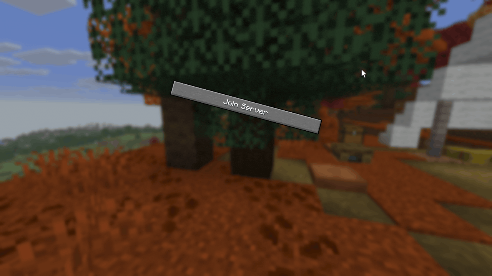

# Elemente drehen und neigen

Die meisten Elemente lassen sich drehen und neigen. Beides geschieht um die Mitte des Elements, wobei Position und Größe erhalten bleiben.

- **Drehung** dreht das Element wie einen Uhrzeiger.
- **Vertikale Neigung** kippt es nach hinten, **horizontale Neigung** zur Seite. Geneigte Elemente werden ohne Perspektive dargestellt und dadurch nur niedriger oder schmaler. Bei beiden Neigungen werden sie außerdem schräg.


# Im Layout-Editor


Wähle ein Element im [Layout-Editor](/layout-editor) aus und ziehe an seinen Griffen:

- Mit dem Griff am Kreis um das Element drehst du es.
- Mit dem Griff an der Linie rechts davon stellst du die **vertikale Neigung** ein, mit dem Griff an der Linie darunter die **horizontale Neigung**. In der Mitte einer Linie ist die Neigung null.

Beim Ziehen gilt:

- Halte `Shift` gedrückt, um in Schritten einzurasten: bei der Drehung in 45-Grad-Schritten, bei der Neigung in 15-Grad-Schritten.
- Nahe bei 0 rasten die Griffe bei 0 ein, sodass du ein Element ganz einfach wieder gerade ausrichten kannst.
- Oben links am Element werden Drehung und Neigung angezeigt.

Gut zu wissen:

- Der Auswahlrahmen bleibt gerade. Klicke hinein, um das Element auszuwählen oder zu verschieben.
- Die Griffe werden nur angezeigt, wenn ein Element ausgewählt ist.
- Elemente ohne Kreis oder Linien lassen sich nicht drehen oder neigen. Siehe [Elemente ohne Drehung oder Neigung](#elements-without-rotation-or-tilt).
- Über **Menüleiste -> Fenster -> Elementdrehungs-Steuerelemente** und **Neigungs-Steuerelemente** kannst du die Griffe aller Elemente ausblenden.

# Genaue Werte

Klicke mit der rechten Maustaste auf das Element, um diese Einstellungen aufzurufen. Für jede gibt es **Über Zahlenauswahl festlegen**, **Als einfachen Text festlegen** und **Auf Standard zurücksetzen**.

| Einstellung | Funktion |
|---|---|
| **Drehung** | Gibt an, um wie viele Grad das Element im Uhrzeigersinn gedreht wird, zum Beispiel `90` für eine Vierteldrehung. Negative Werte drehen es gegen den Uhrzeigersinn. |
| **Vertikale Neigung** | Gibt an, wie weit es nach hinten gekippt wird: von `-60` bis `60` Grad. |
| **Horizontale Neigung** | Gibt an, wie weit es zur Seite gedreht wird: von `-60` bis `60` Grad. |

Eine einzelne Neigung sieht bei positivem und negativem Wert gleich aus. Bei beiden Neigungen bestimmen die Vorzeichen, in welche Richtung das Element schräg steht.

## Mit Platzhaltern

So drehst oder neigst du ein Element mithilfe einer [Variable](/variables) oder eines anderen [Platzhalters](/placeholders):

1. Klicke mit der rechten Maustaste auf das Element und aktiviere **Erweiterter Drehungsmodus**, **Erweiterter Modus für vertikale Neigung** oder **Erweiterter Modus für horizontale Neigung**.
2. Klicke auf **Drehung**, **Vertikale Neigung** oder **Horizontale Neigung**, dann auf **Als einfachen Text festlegen** und gib den Platzhalter ein.

Die erweiterten Modi speichern ihren eigenen Wert und blenden den Griff aus, sodass du deinen Platzhalter nicht versehentlich durch Ziehen überschreibst. Wenn du einen Modus deaktivierst, erhält das Element seinen alten Wert zurück.

Ein Logo, das sich alle 3,6 Sekunden einmal dreht. Verwende dafür diese **Drehung** im **Erweiterten Drehungsmodus**. Teile durch einen Wert größer als `10`, damit es sich langsamer dreht:

```
{"placeholder":"calc","values":{"expression":"{"placeholder":"unix_time"} / 10 % 360"}}
```

Eine Nadel, die auf den Wert der Variable `needle_angle` zeigt. Diesen Wert können Schaltflächen oder ein [Schieberegler](/elements#slider) festlegen:

```
{"placeholder":"getvariable","values":{"name":"needle_angle"}}
```

# Klicks und die Maus



Schaltflächen, Schieberegler sowie Links und Bildlaufleisten von Textelementen reagieren dort auf die Maus, wo sie angezeigt werden – auch wenn sie gedreht oder geneigt sind. Das gilt auch für die Bedingungen [**Element wird überfahren**](/conditions#is-element-hovered), [**Beliebiges Element wird überfahren**](/conditions#is-any-element-hovered) und [**Beliebige Schaltfläche wird überfahren**](/conditions#is-any-button-hovered).

> [!NOTE]
> Kontrollkästchen, Texteingabefelder, Ziehelemente und Browser reagieren weiterhin innerhalb des Bereichs, den sie ohne Drehung und Neigung hätten. Lass sie gerade.

# Elemente ohne Drehung oder Neigung

- Keine Drehung und keine Neigung: [Bildlaufbereiche](/scrollable-areas), [GLSL-Shader](/elements#glsl-shader), [Block-/Item-JSON-Modelle](/elements#blockitem-json-model), [Spieler-Entitäten](/player-entities) und [Vanilla-Elemente](/vanilla-elements), wie etwa die Schaltflächen des Bildschirms selbst.
- Drehung, aber keine Neigung: [Tooltips](/elements#tooltip) und [Items](/elements#item).

Elemente in einem Bildlaufbereich lassen sich drehen und neigen; nur der Bereich selbst nicht.

Für [Splash-Text](/splash-text)-Elemente gibt es weiter unten im Rechtsklickmenü außerdem eine eigene **Drehung** für ihre typische Neigung. Sie funktioniert zusätzlich zur Drehung auf dieser Seite.
