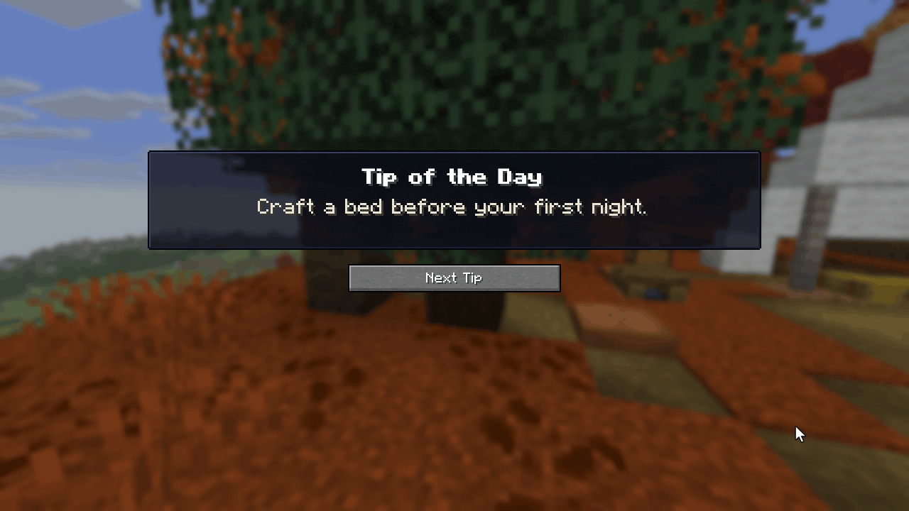

# Variablen

Variablen sind Werte, die FancyMenu sich merkt – auch nachdem das Spiel geschlossen wurde. Verwende sie, um Klicks zu zählen, Auswahlen zu speichern, Fortschritte zu verfolgen oder Listen wie Ladetipps zu verwalten. Texte, Aktionen, Bedingungen, Listener und einige Elemente können Variablen lesen und ändern.

> [!TIP]
> Die Aktionen für Variablen sind unter [Aktionsskripte](/action-scripts) aufgeführt, die Bedingungen unter [Bedingungen](/conditions) und der Listener unter [Listener](/listeners#on-variable-updated-fm-variable).

# Text- und Listenvariablen

Es gibt zwei Arten von Variablen:

- Textvariablen enthalten einen einzelnen Text, zum Beispiel `dark`, `5` oder `true`.
- Listenvariablen enthalten eine Liste von Einträgen, zum Beispiel Ladetipps oder Servernamen. Jeder Eintrag ist ein eigener Text.

Die Position eines Eintrags in einer Liste ist sein Index. Der erste Eintrag hat den Index `0`, der zweite `1` und so weiter. Negative Indizes zählen vom Ende aus, also ist `-1` der letzte Eintrag.

Funktionen, die nur Text verstehen, wie `$$name` oder **Is Variable Value (FM Variable)**, geben eine Liste als JSON-Array ihrer Einträge aus, zum Beispiel `["Craft a bed before your first night.","Torches keep most mobs away."]`.

# Variablen verwalten

Öffne **Menüleiste -> Anpassung -> Variablen verwalten**. Die Menüleiste ist nur außerhalb des Layout-Editors verfügbar.


## Variablen hinzufügen

1. Klicke mit der rechten Maustaste auf die Liste und wähle **Textvariable hinzufügen** oder **Listenvariable hinzufügen**.
2. Gib einen Namen ein und klicke auf **Fertig**.

Namen dürfen Kleinbuchstaben, Zahlen, `.`, `_` und `-` enthalten. Jeder Name darf nur einmal vorkommen.

## Variablen ändern

Klicke mit der rechten Maustaste auf eine Variable, um diese Optionen aufzurufen:

| Option | Funktion |
|---|---|
| **Wert festlegen** | Legt den Textwert einer Textvariablen fest. |
| **Liste bearbeiten** | Öffnet den Listen-Editor einer Listenvariablen (siehe unten). |
| **In Liste umwandeln…** | Wandelt eine Textvariable in eine Liste um. Ein **Trennzeichen** teilt den Text in Einträge auf: Gib `\n` ein, um an Zeilenumbrüchen zu trennen. **Einträge kürzen** entfernt Leerzeichen um jeden Eintrag, und **Leere Einträge überspringen** lässt leere Einträge aus. Ein Text, der bereits ein JSON-Array ist, etwa `["a","b"]`, wird als solches gelesen (**Als JSON-Array lesen**). |
| **In Text umwandeln…** | Wandelt eine Liste in eine Textvariable um. Das **Trennzeichen** wird zwischen die Einträge gesetzt, oder **JSON-Text beibehalten** lässt die Liste als JSON-Array bestehen. |
| **Variable beim Spielstart leeren** | Leert die Variable bei jedem Spielstart. Eignet sich für Werte, die nur eine Sitzung lang gelten sollen. |
| **Variable löschen** | Löscht die Variable. |
| **Kopieren** und **Einfügen** | Erstellt eine Kopie einer Variable. |
| **Variable für KI exportieren** | Exportiert die Variable für [KI-Chats](/export-for-ai). |

Änderungen werden sofort übernommen. Mache sie mit `Ctrl + Z` rückgängig und mit `Ctrl + Y` erneut (`Cmd` unter macOS). Beginne mit der Eingabe, um zu suchen, drücke `Enter`, um die ausgewählte Variable zu bearbeiten, oder `Delete`, um sie zu löschen.

## Listen bearbeiten

Der Listen-Editor zeigt jeden Eintrag mit seinem Index an.

- Um Einträge hinzuzufügen, klicke unter der Liste auf **Eintrag hinzufügen**, gib den Eintrag ein und drücke `Enter`. Sofort wird der nächste neue Eintrag begonnen. Drücke bei einem leeren Eintrag `Enter` oder `Esc`, um das Hinzufügen zu beenden.
- Um einen Eintrag zu bearbeiten, doppelklicke darauf. Mit `Shift + Enter` öffnest du ihn im Texteditor, wo er Zeilenumbrüche enthalten kann.
- Um Einträge neu anzuordnen, ziehe sie an die gewünschte Stelle oder drücke `Alt + Up` bzw. `Alt + Down`.
- Klicke mit der rechten Maustaste auf einen Eintrag, um **Eintrag duplizieren** (`Ctrl + D`), **Eintrag löschen** (`Delete`), **Kopieren**, **Einfügen**, **Nach oben verschieben** oder **Nach unten verschieben** auszuwählen.
- **Als Text bearbeiten** bearbeitet alle Einträge auf einmal, jeweils einen pro Zeile.

Mit **Fertig** speicherst du die Liste. **Abbrechen** verwirft alle Änderungen, die du im Listen-Editor vorgenommen hast.

# Variablen in Texten anzeigen

Gib `$$` und den Namen einer Variable ein, um ihren Wert anzuzeigen: Eine Variable namens `menu_theme` wird mit `$$menu_theme` eingefügt. Das funktioniert in jedem Text, der [Platzhalter](/placeholders) unterstützt, zum Beispiel in [Textelementen](/text-in-menus), Schaltflächenbeschriftungen, Tooltips sowie den Werten von Aktionen und Bedingungen. Der Text wird automatisch aktualisiert, wenn sich die Variable ändert.

```
Current theme: $$menu_theme
```

- `$$name` einer nicht vorhandenen Variable bleibt unverändert.
- Wenn mehrere Namen denselben Anfang haben, wie `coins` und `coins_record`, steht `$$coins_record` immer für den längeren Namen.
- Eine Liste wird als JSON-Array angezeigt. Mit diesen Platzhaltern lassen sich Listen lesbarer darstellen:

| Platzhalter | Beispiel | Ergebnis |
|---|---|---|
| **Get Variable Value (FM Variable)** | `{"placeholder":"getvariable","values":{"name":"clicks"}}` | Der Wert oder `0`, wenn die Variable leer ist oder nicht existiert. Am besten für Zahlen geeignet. |
| **Get List Entry (FM Variable)** | `{"placeholder":"list_get","values":{"name":"tips","index":"0","fallback":"No tips yet"}}` | Der Eintrag am angegebenen Index oder `fallback`, wenn es keinen gibt. |
| **List Size (FM Variable)** | `{"placeholder":"list_size","values":{"name":"tips"}}` | Die Anzahl der Einträge in der Liste. |
| **Index of List Entry (FM Variable)** | `{"placeholder":"list_index_of","values":{"name":"tips","value":"Torches keep most mobs away.","ignore_case":"false"}}` | Der Index des ersten Eintrags, der exakt mit dem gesamten `value` übereinstimmt, oder `-1`. |
| **Join List Entries (FM Variable)** | `{"placeholder":"list_join","values":{"name":"tips","separator":"\n"}}` | Alle Einträge in einem Text, getrennt durch `separator` (`, `, wenn nichts angegeben ist). `\n` steht für einen Zeilenumbruch. |

# Variablen mit Aktionen ändern

[Aktionsskripte](/action-scripts) ändern Variablen, wenn eine Schaltfläche angeklickt wird, ein Ticker läuft, ein Listener ausgelöst wird und so weiter.

## Textvariablen

[**Set Variable Value (FM Variable)**](/action-scripts#set-variable-value-fm-variable) erwartet den Namen und den neuen Wert, getrennt durch `:`. Eine noch nicht existierende Variable wird erstellt.

```
menu_theme:dark
```

Nur das erste `:` trennt den Namen vom Wert. Der Wert kann also weitere Doppelpunkte enthalten, zum Beispiel `last_server:play.example.net:25565`.

Um Schaltflächenklicks zu zählen, addiere 1 zum bisherigen Wert:

```
clicks:{"placeholder":"calc","values":{"decimal":"false","expression":"{"placeholder":"getvariable","values":{"name":"clicks"}} + 1"}}
```

**Get Variable Value (FM Variable)** gibt `0` zurück, solange `clicks` noch leer ist. Beim ersten Klick wird der Wert daher auf `1` gesetzt.

Set Variable Value wandelt eine Liste niemals in Text um. Ein JSON-Array wird zu den Einträgen der Liste, leerer Text leert sie und jeder andere Text wird zu ihrem einzigen Eintrag.

[**Delete Variable (FM Variable)**](/action-scripts#delete-variable-fm-variable) löscht eine Variable, und [**Clear All Variables (FM Variable)**](/action-scripts#clear-all-variables-fm-variable) löscht alle Variablen.

## Listenaktionen

Jede Listenaktion hat ein eigenes Fenster. Alle Felder unterstützen Platzhalter.

| Aktion | Funktion |
|---|---|
| [**Add to List (FM Variable)**](/action-scripts#add-to-list-fm-variable) | Fügt am Ende oder an einem bestimmten Index einen Eintrag hinzu. **Überspringen, wenn bereits in der Liste** fügt nichts hinzu, wenn der Eintrag schon vorhanden ist. |
| [**Set List Entry (FM Variable)**](/action-scripts#set-list-entry-fm-variable) | Ersetzt den Eintrag an einem bestimmten Index. |
| [**Remove from List (FM Variable)**](/action-scripts#remove-from-list-fm-variable) | Entfernt den **Eintrag am Index**, den **ersten Treffer** eines Werts oder **alle Treffer**. |
| [**Clear List (FM Variable)**](/action-scripts#clear-list-fm-variable) | Entfernt alle Einträge. Die Liste bleibt bestehen, ist aber leer. |
| [**Set List (FM Variable)**](/action-scripts#set-list-fm-variable) | Ersetzt alle Einträge durch die Teile eines **geteilten Textes** oder die Einträge eines **JSON-Arrays**. `$$other_list` als JSON-Array kopiert eine andere Liste. |
| [**Arrange List (FM Variable)**](/action-scripts#arrange-list-fm-variable) | **A–Z sortieren**, **Z–A sortieren**, **Zahlen, kleinste zuerst**, **Zahlen, größte zuerst**, **Reihenfolge umkehren**, **Mischen** oder **Duplikate entfernen**. |

- Listenaktionen erstellen eine noch nicht vorhandene Liste und wandeln leere Textvariablen in Listen um. Textvariablen mit einem Wert ändern sie nie: [Wandle sie zuerst um](#variablen-ändern).
- Gib den Namen der Liste ohne `$$` ein. Mit `$$` verwendet die Aktion den Wert dieser Variable als Namen.

Ein Textelement zeigt zum Beispiel den ersten Eintrag der Liste `tips` an:

```
{"placeholder":"list_get","values":{"name":"tips","index":"0"}}
```

Eine Schaltfläche „Nächster Tipp“ darunter erhält **Arrange List (FM Variable)** mit **Mischen** in ihrem Aktionsskript:


Bei jedem Klick wird die Liste gemischt, sodass ein zufälliger Tipp angezeigt wird:



## Eine Liste durchlaufen

Die [FOR EACH-Schleife](/action-scripts#for-each-loop) führt die darin enthaltenen Aktionen für jeden Eintrag einer Liste aus – vom ersten bis zum letzten.

1. Klicke im Skriptbereich des Aktionsskript-Editors mit der rechten Maustaste und wähle **FOR EACH-Schleife hinzufügen**.
2. Gib den Namen der Listenvariable ohne `$$` ein und klicke auf **Fertig**.
3. Füge Aktionen innerhalb der Schleife hinzu. In ihren Werten steht `$$list_entry` für den aktuellen Eintrag und `$$list_index` für seinen Index.

Eine Liste `starter_commands` mit den Einträgen `/time set day` und `/weather clear` führt zum Beispiel beide Befehle aus, wenn sich innerhalb der Schleife eine [**Send Chat Message/Command**](/action-scripts#send-chat-messagecommand)-Aktion mit folgendem Wert befindet:

```
$$list_entry
```

- Die Schleife liest die Liste einmal zu Beginn ein. Aktionen innerhalb der Schleife können die Liste ändern, ohne zu ändern, welche Einträge die Schleife durchläuft.
- Bei einer Textvariable oder einer nicht existierenden Liste wird die Schleife kein einziges Mal ausgeführt.
- Wie WHILE-Schleifen wird sie nach 3 Sekunden beendet, damit sie das Spiel nicht einfrieren kann.

# Variablen überprüfen

[Bedingungen](/conditions) zeigen Elemente an oder führen Teile von Aktionsskripten nur dann aus, wenn eine Variable einen bestimmten Wert hat.

- [**Is Variable Value (FM Variable)**](/conditions#is-variable-value-fm-variable) prüft den gesamten Wert. Bei Listen wird das JSON-Array aller Einträge verglichen.
- [**List Contains Entry (FM Variable)**](/conditions#list-contains-entry-fm-variable) prüft, ob eine Liste einen Eintrag enthält. Der gesamte Eintrag muss übereinstimmen. **Groß-/Kleinschreibung ignorieren** sorgt dafür, dass `Apple` und `apple` als gleich gelten.
- [**Is Number**](/conditions#is-number) vergleicht Zahlen, zum Beispiel ob `$$clicks` größer als `5` ist.

Eine Schaltfläche kann zum Beispiel den neuesten Nachrichtenbeitrag öffnen und mit **Add to List (FM Variable)** `news_42` zur Liste `read_news` hinzufügen. Ein „Neu!“-Abzeichen neben der Schaltfläche erhält die Bedingung **List Contains Entry (FM Variable)** für `news_42` und den **Bedingungsmodus** „Umgekehrt“. Das Abzeichen wird also ausgeblendet, sobald der Spieler den Beitrag gelesen hat.

# Variablen mit Elementen verknüpfen

- [Texteingabefeld](/elements#text-input-field): **Mit Variable verknüpfen** schreibt die Eingabe des Spielers in die Variable und zeigt den Variablenwert im Feld an. Ist das Feld mit einer Liste verknüpft, ersetzt der eingegebene Text die gesamte Liste.
- [Kontrollkästchen](/elements#checkbox): Aktiviere **Variablenmodus** und lege **Mit Variable verknüpfen** fest. Das Kontrollkästchen schreibt `true` oder `false` in die Variable.
- [Schieberegler](/elements#slider) vom Typ **Werteliste**: **Werte aus Listenvariable** bezieht die Schiebereglerwerte aus einer Liste. Einträge, die der Liste hinzugefügt oder aus ihr entfernt werden, erscheinen sofort im Schieberegler.

# Auf Änderungen reagieren

- Der Listener [**On Variable Updated [FM Variable]**](/listeners#on-variable-updated-fm-variable) führt jedes Mal ein Aktionsskript aus, wenn eine Variable festgelegt wird.
- Mit dem Befehl [`/fmvariable`](/commands#fmvariable) lassen sich Variablen im Chat, in Befehlsblöcken und über andere Mods festlegen und auslesen.

# Speicherort der Variablen

FancyMenu speichert Variablen sofort in `<game-directory>/config/fancymenu/user_variables.db`, sodass sie nach einem Neustart erhalten bleiben.

- Variablen gelten für die gesamte Minecraft-Instanz und ihr aktives [Profil](/profiles). Sie sind nicht nach Layout, Welt, Server oder Spieler getrennt.
- Bei Namen wird zwischen Groß- und Kleinschreibung unterschieden.
- Speichere keine Passwörter, Tokens oder andere vertrauliche Informationen in Variablen. Jeder, der Zugriff auf den Spielordner hat, kann sie lesen.
