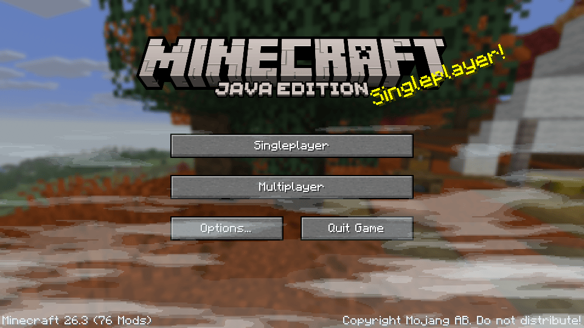
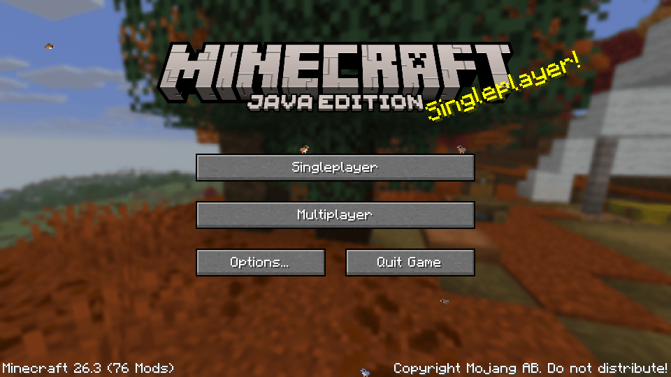
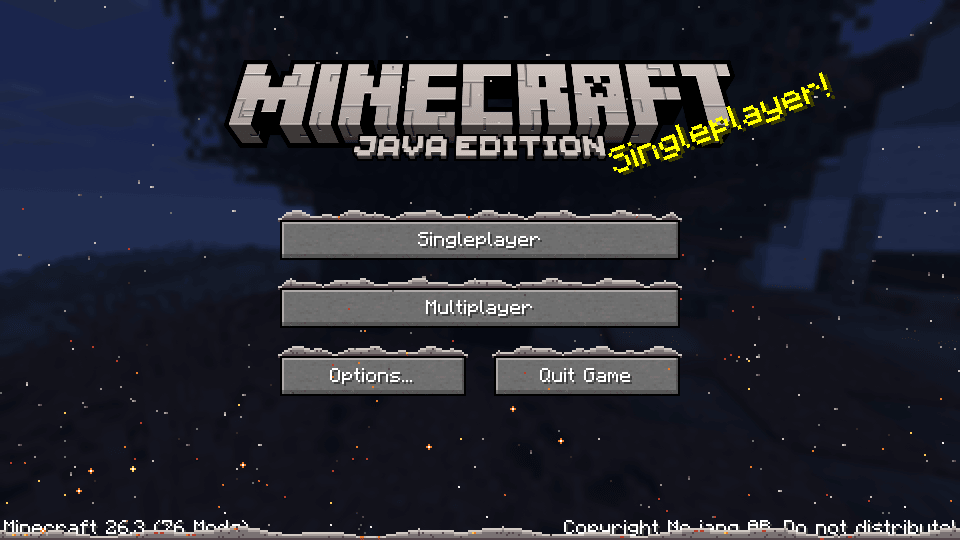

# Superposiciones decorativas

Las superposiciones decorativas son efectos animados que ocupan toda la pantalla, como nieve que cae, luciérnagas, niebla o guirnaldas de luces. Muchas interactúan con tu menú: la nieve se acumula sobre los botones, los pájaros se posan en ellos y la niebla se despeja alrededor del ratón.


# Añadir una superposición

1. Abre un diseño en el editor de diseños.
2. Haz clic derecho en el fondo del editor y abre **Superposiciones decorativas**.
3. Abre una superposición, como **Nevada**.
4. Haz clic en **Mostrar superposición** para activarla.

Las superposiciones activadas tienen una ✔ en la lista. Puedes mostrar tantas superposiciones como quieras en un diseño. Pasa el cursor por encima de una superposición o de uno de sus ajustes para ver para qué sirve.

Las superposiciones también se reproducen en el editor de diseños, pero solo reaccionan a tus elementos en el menú real. Guarda el diseño y abre el menú para verlo todo.

Si varios diseños de una pantalla tienen superposiciones, se reproducirán todas, incluso si se repite alguna. Esto también incluye los [diseños universales](/universal-layouts).

# Ajustes comunes a todas las superposiciones

Todas las superposiciones tienen estos dos ajustes:

- **Mostrar superposición** activa o desactiva la superposición.
- **Capas** establece dónde se dibuja la superposición:
  - **Fondo y primer plano**: las partes lejanas se dibujan detrás de tus elementos y las cercanas, delante, para crear una agradable sensación de profundidad. Es el ajuste predeterminado.
  - **Solo fondo**: todo se dibuja detrás de tus elementos, pero delante del fondo del menú.
  - **Solo primer plano**: todo se dibuja delante de tus elementos.

Los elementos que una superposición coloca directamente sobre tus elementos, como la nieve sobre un botón, siempre permanecen encima de ellos.

Muchas superposiciones también tienen estos ajustes:

| Ajuste | Función |
|---|---|
| **Cantidad (%)** | Establece la cantidad, entre el 25 % y el 300 %. El 100 % es la cantidad normal. |
| **Tamaño** | Hace que el pixel art tenga el doble o el triple de tamaño. Cada píxel sigue siendo un cuadrado nítido. |
| **Aspecto** | **Detallado** muestra todo el pixel art, con sombreado y efectos adicionales. **Sencillo** es más plano y se acerca más al aspecto clásico. |

# Superposiciones y tus elementos

Muchas superposiciones interactúan con tus elementos: la nieve, la ceniza y el confeti se acumulan sobre ellos; de ellos cuelgan carámbanos; les crece musgo y los pájaros se posan encima.

Para elegir qué elementos participan, haz clic derecho en un elemento y configura **Debe verse afectado por las superposiciones decorativas**:

- Está activado de forma predeterminada para botones, deslizadores, casillas de verificación, campos de entrada y [elementos de Minecraft](/vanilla-elements).
- Esto incluye el logotipo, el texto de bienvenida, la marca y el copyright de la pantalla de título. Desactívalo para esos elementos si no quieres que nada se pose sobre ellos.
- Los elementos ocultos no participan. Tampoco lo hace la parte de un elemento que quede recortada por un [área desplazable](/scrollable-areas).

> [!TIP]
> Deja al menos 13 píxeles entre los elementos. Los objetos que se acumulan sobre un elemento o cuelgan por debajo de él solo pueden crecer hasta el espacio que haya antes del siguiente elemento.

Algunas superposiciones reaccionan a los clics, como Burbujas, Escarcha y Confeti. Tus botones seguirán recibiendo todos los clics.

# Todas las superposiciones decorativas

Todas las superposiciones decorativas de FancyMenu, ordenadas por tema.

## Tiempo

### Nevada

La nieve cae y se acumula poco a poco sobre los botones y a lo largo de la parte inferior de la pantalla.


- **Acumular nieve** permite que la nieve se amontone.
- **Color de la nieve [HEX]**, **Velocidad de la nevada**, **Cantidad (%)** y **Tamaño** modifican la nieve.

### Lluvia

La lluvia cae, forma ondas en los charcos poco profundos y gotea desde tus botones.


- **Charcos** cubre los elementos y la parte inferior de la pantalla con una película de agua que forma ondas cuando caen las gotas.
- **Goteo** permite que las gotas se acumulen y caigan desde tus elementos.
- **Relámpagos** añade relámpagos de vez en cuando, con rayos ramificados y destellos suaves. **Brillo de los relámpagos** establece su intensidad.
- **Color de la lluvia [HEX]**, **Cantidad (%)** y **Tamaño** modifican la lluvia.

> [!WARNING]
> **Relámpagos** hace que la pantalla parpadee. Déjalo desactivado si puede haber jugadores sensibles a las luces intermitentes.

### Niebla

Capas suaves de neblina se desplazan por la pantalla y sobre tus elementos; son más densas cerca del suelo.



- **Despejar alrededor del puntero** hace que la niebla se aparte del ratón.

### Escarcha

El menú se cubre de hielo. El hielo avanza por los bordes, las esquinas y tus elementos. Haz clic en el hielo para romper un trozo.


- **Bordes de la pantalla**, **Esquinas** y **Sobre los elementos** activan o desactivan cada parte del hielo. Las etiquetas de tus elementos permanecen despejadas.

## Naturaleza

### Hojas

Las hojas caen y las ráfagas de viento las arrastran.


- **Aspecto** alterna entre hojas **Detalladas** y **Sencillas**.
- **Colores** permite elegir **Mezcla otoñal** (cinco colores cálidos de otoño) o **Rango personalizado** (cinco colores entre **Color inicial de las hojas [HEX]** y **Color final de las hojas [HEX]**).
- **Viento** activa o desactiva las ráfagas fuertes. **Intensidad del viento** establece la fuerza del viento.
- **Densidad de las hojas**, **Velocidad de caída de las hojas** y **Escala de la superposición de hojas** modifican las hojas.

### Flores de cerezo

Ramas en flor aparecen por las esquinas superiores y los pétalos caen lentamente.


- **Rama izquierda** y **Rama derecha** muestran u ocultan cada rama.
- **Aspecto** y **Cantidad (%)** modifican los pétalos.

### Vegetación

La naturaleza se apodera del menú: el musgo, las enredaderas, la hierba y las flores crecen poco a poco por todas partes.


- **Hierba**, **Enredaderas izquierdas**, **Enredaderas derechas** y **Sobre los elementos** activan o desactivan cada tipo de vegetación. Las etiquetas de tus elementos permanecen despejadas.
- **Flores en las enredaderas**, **Flores en los elementos** y **Flores en la hierba** permiten que broten flores en esos lugares. **Flores (%)** establece cuántas aparecen.

### Nubes

Nubes pixeladas y esponjosas se desplazan por el cielo detrás de tus elementos, en tres capas de profundidad. Las nubes no tienen ajustes propios.


### Rayos de sol

Rayos de sol se abren en abanico desde un sol situado justo fuera de la pantalla, mientras el polvo danza a su luz.


- **Lado del sol** establece el borde de la pantalla tras el que se encuentra el sol. **Ángulo del sol (°)** lo desplaza a lo largo de ese borde.
- **Color de la luz solar [HEX]** e **Intensidad (%)** modifican la luz.
- **Resplandor solar** proyecta un brillo suave desde el sol.
- **Polvo** hace que el polvo se desplace por los rayos. El ratón lo remueve.
- **Interacción con los elementos** hace que los rayos se detengan en tus elementos, iluminen sus bordes y proyecten sombras. Si está desactivado, los rayos brillan delante de tus elementos.

### Burbujas

Las burbujas suben en grupos tambaleantes y se deslizan por la parte inferior de tus elementos. ¡Haz clic en ellas para explotarlas! Las burbujas no tienen ajustes propios.


## Animales

### Pájaros

Pequeños pájaros aparecen volando, saltan sobre tus elementos y levantan el vuelo cuando el ratón se acerca demasiado.



### Mariposas

Mariposas de colores revolotean, se posan en tus elementos y se alejan tímidamente del ratón.


### Murciélagos

Pequeños grupos de murciélagos cruzan la pantalla aleteando y duermen colgados debajo de tus elementos. ¡Si te acercas demasiado, se despiertan!


Pájaros, Mariposas y Murciélagos tienen los ajustes **Cantidad (%)** y **Tamaño**.

### Luciérnagas

Grupos de luciérnagas brillan y se desplazan por los alrededores; algunas se posan en tus elementos.


- **Aspecto** alterna entre luciérnagas **Detalladas** y **Sencillas**. **Cuerpos apagados** muestra sus cuerpecitos oscuros entre destellos.
- **Seguir al ratón** permite que los grupos sigan al ratón cuando se acerca.
- **Posarse** permite que las luciérnagas se posen de vez en cuando en tus elementos.
- **Color de las luciérnagas [HEX]**, **Cantidad de grupos**, **Densidad de los grupos**, **Tamaño de los grupos** y **Escala de las luciérnagas** modifican las luciérnagas.

### Buddy

Buddy es una pequeña mascota virtual que vive en la parte inferior del menú. Camina de un lado a otro, muestra lo que necesita en bocadillos de pensamiento, reacciona cuando juegas con ella y recuerda todo entre partidas.


#### Cuidar de Buddy

Buddy tiene cuatro necesidades, de `0` a `100`:

- **Hambre** disminuye con el tiempo. La comida la sacia.
- **Felicidad** disminuye con el tiempo. Las caricias, la comida y los juegos la aumentan.
- **Energía** disminuye mientras Buddy está despierta y se recupera mientras duerme.
- **Diversión** disminuye con el tiempo. Jugar la aumenta.

Para cuidar de Buddy:

- Haz clic izquierdo en Buddy para acariciarla. Si la despiertas así, se pondrá un poco menos contenta.
- Haz clic derecho en Buddy para abrir su pantalla de estado. La pestaña **Estadísticas** muestra sus necesidades, nivel y XP. La pestaña **Logros** muestra sus logros.
- Haz clic en **Alimentar** en la pantalla de estado y arrastra la comida hasta Buddy.
- Haz clic en **Jugar** en la pantalla de estado, arrastra la pelota y suéltala para lanzarla. Buddy la perseguirá y atrapará.
- Haz clic en **Dormir** para que Buddy descanse. También se duerme por su cuenta cuando su energía es muy baja.
- Buddy hace caca de vez en cuando. Haz clic izquierdo en las cacas para limpiarlas. Si hay tres o más cacas por ahí, Buddy se pondrá cada vez menos contenta.

#### Niveles y logros

Cuidar de Buddy le da XP. Buddy sube de nivel del 1 al 30. Cuanto más alto sea su nivel, más despacio disminuirán su hambre, felicidad y energía; en el nivel 30, lo harán a la mitad de velocidad.

#### Cuando Buddy muere

Si el hambre o la felicidad permanecen en `0` durante 10 horas reales, Buddy muere y deja una lápida. Haz clic izquierdo en la lápida para empezar de nuevo con otra Buddy. Desactiva **Buddy puede morir** para evitar que muera.

**Restablecer guardado de Buddy** permite empezar de nuevo en cualquier momento.

> [!WARNING]
> Al restablecer Buddy, se eliminarán definitivamente sus necesidades, nivel, XP, logros y cacas.

#### Guardado y personalización

Buddy se guarda cada dos minutos aproximadamente y cuando se cierra su pantalla, en `<game-directory>/fancymenu_data/buddy/`. Cada superposición de Buddy tiene su propio guardado. Consulta [Ubicaciones de almacenamiento de datos](/data-storage-locations).

- **Texturas personalizadas** sustituye los sprites, objetos, iconos, la pantalla de estado y la lápida de Buddy por tus propias texturas.
- **Ajuste de estadísticas** modifica la velocidad a la que disminuyen sus necesidades, el coste y la recompensa de las actividades y el número máximo de cacas que puede haber por ahí (**Máximo de cacas**).

## Cielo nocturno

### Aurora

Luces del norte brillantes cubren la parte superior del cielo y ondean lentamente detrás de tus elementos.


- **Color del borde [HEX]** establece el color del borde inferior brillante. **Color de la punta [HEX]** establece el color en el que se desvanecen los rayos.

### Estrellas fugaces

Un cielo nocturno centelleante detrás de tus elementos, con una estrella fugaz cada pocos segundos y una lluvia de meteoros de vez en cuando. Las estrellas fugaces no tienen ajustes propios.


### Farolillos voladores

Farolillos de papel brillantes ascienden por el cielo nocturno, a veces en grupos enteros. Los farolillos voladores tienen los ajustes **Cantidad (%)** y **Tamaño**.


## Fiesta

### Confeti

Cañones de confeti en las esquinas inferiores disparan confeti cada pocos segundos, que se acumula sobre tus elementos.


- **Cañones en las esquinas** activa o desactiva los cañones.
- **Estallido al hacer clic** lanza una pequeña ráfaga de confeti dondequiera que hagas clic.
- **Modo de mezcla de colores** usa colores aleatorios. Desactívalo para usar **Color del confeti [HEX]** en todo el confeti.
- **Límite de partículas en el suelo** establece cuántos trozos pueden acumularse a la vez.
- **Cantidad (%)**, **Tamaño** y **Velocidad de caída del confeti** modifican el confeti.

### Fuegos artificiales

Los cohetes ascienden y estallan en fuegos artificiales.


- **Mostrar trayectoria del cohete** muestra los cohetes mientras ascienden.
- **Cantidad (%)**, **Tamaño** y **Tamaño de la explosión** modifican los fuegos artificiales.

### Guirnaldas de luces

Guirnaldas de luces cuelgan por el menú y se mecen con el viento.


- **Aspecto** alterna entre luces **Sencillas** y **Detalladas**. **Guirnalda de pino** sustituye el cable por agujas de pino con adornos.
- **Programa de luces** establece cómo brillan y parpadean las luces (consulta más abajo).
- **Escala de las guirnaldas**, **Fuerza del viento** y **Velocidad del parpadeo** modifican todas las guirnaldas.
- **Guirnaldas** contiene un menú para cada uno de los ocho lugares donde puede colgar una guirnalda. Actívala con **Mostrar guirnalda de luces**.

Cada guirnalda tiene estos ajustes:

- **Número de luces** establece cuántas luces cuelgan de ella. `0` llena la guirnalda según su longitud.
- **Color de las luces [HEX]** establece el color de las luces. **Modo de luces navideñas** hace que sean de varios colores.
- **Color de la guirnalda [HEX]** establece el color del cable. Usa el canal alfa para hacer que sea translúcido u ocultarlo.
- **Colores de luces individuales** y **Tamaños de luces individuales** asignan un color o tamaño a cada luz mediante una lista separada por comas. Si hay más luces que valores, la lista vuelve a empezar:

```
#FF0000, #00FF00, #0000FF
```

| Programa de luces | Comportamiento de las luces |
|---|---|
| **Encendidas** | Todas las luces brillan y, de vez en cuando, una se atenúa ligeramente, como las luces reales. |
| **Brillo máximo** | Todas las luces brillan con la máxima intensidad. |
| **Brillo medio** | Todas las luces brillan a media intensidad. |
| **Apagadas** | Todas las luces están apagadas. |
| **Ciclo** | Reproduce los efectos Destellos, Persecución, Alternancia y Respiración, cambiando cada 7 segundos. |
| **Destellos** | Las luces parpadean aleatoriamente. |
| **Persecución** | Una luz brillante recorre la guirnalda. |
| **Alternancia** | Se encienden las luces alternas y, después, las otras. |
| **Respiración** | Todas las luces se iluminan y se atenúan juntas, despacio y con suavidad. |

## Terror

### Telarañas

Telarañas polvorientas cuelgan de las esquinas superiores y unas arañitas descienden por sus hilos.


- **Telaraña izquierda** y **Telaraña derecha** muestran u ocultan cada telaraña y su araña.
- **Arañas** permite que las arañas desciendan, se queden colgando y vuelvan a subir. Huyen del ratón.
- **Borde cerrado** une los extremos de los hilos con un borde, para que no queden hilos sueltos en la pantalla.

### Brasas

Las brasas brillantes ascienden desde abajo mientras la ceniza cae y se acumula.



- **Ceniza en el suelo** añade una capa profunda de ceniza a lo largo de la parte inferior de la pantalla, con puntos humeantes y brasas brillantes.
- **Ceniza sobre los elementos** permite que la ceniza se acumule sobre tus elementos.

## Personalizadas

### Navegador

La superposición Navegador muestra un sitio web en toda la pantalla.

> [!IMPORTANT]
> La superposición Navegador necesita el mod [Rinku](https://modrinth.com/mod/rinku).

- **URL** establece el sitio web que se mostrará.
- **Consumir clics del ratón**, **Consumir desplazamientos del ratón** y **Consumir pulsaciones de teclas** impiden que las entradas lleguen al menú que hay detrás del navegador.
- **Procesar clics del ratón**, **Procesar desplazamientos del ratón** y **Procesar pulsaciones de teclas** permiten que el propio navegador responda a las entradas.
- **Ocultar controles de vídeo**, **Repetir vídeos**, **Silenciar navegador** y **Volumen de audio/vídeo** controlan los vídeos y el sonido del sitio web.

Los ajustes Consumir y Procesar están activados de forma predeterminada, por lo que el navegador funciona como un navegador normal delante del menú. Para mostrar un sitio web solo como fondo, desactívalos todos.

Los sitios web también pueden ejecutar acciones de FancyMenu y leer marcadores de posición. Consulta la [API de JavaScript del navegador](/browser-api).

### Sombreado GLSL

La superposición Sombreado GLSL dibuja tu propio sombreador en toda la pantalla, para crear efectos animados o estáticos. Pega el código del sombreador en **Código fuente del sombreador**.

Consulta la [API de sombreadores GLSL](/glsl-shader-api) para saber cómo escribir sombreadores para FancyMenu.
