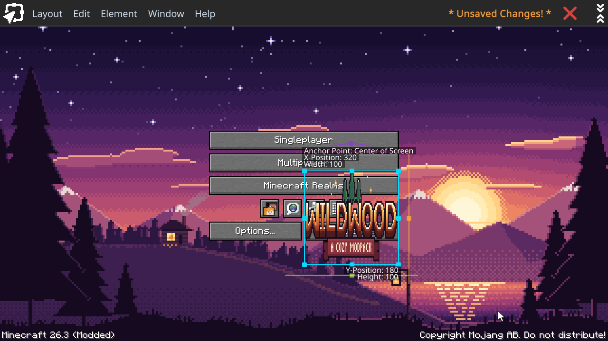

# Primeros pasos

FancyMenu te permite cambiar todos los menús de Minecraft, como la pantalla de título, el menú de pausa y los menús de otros mods. Ponles tus propios fondos, logotipos, botones, textos, sonidos y animaciones; mueve u oculta lo que ya hay, haz que los botones hagan cosas nuevas o crea menús totalmente nuevos. Todo se hace dentro del juego, sin código.

En esta página aprenderás los conceptos básicos paso a paso. Mientras tanto, crearás una versión más sencilla de esta pantalla de título, y [Cómo se ha creado el ejemplo](#how-the-example-is-made) explica qué añade la versión completa.

> [!TIP]
> Consigue esta pantalla de título para tu juego: descarga [wildwood_title_screen.fmp](https://raw.githubusercontent.com/Keksuccino/docs_fancymenu/refs/heads/wiki-2026/assets/wildwood_title_screen.fmp?raw=true) y luego [impórtala](/profiles#importing) y [cárgala](/profiles#loading-a-profile) desde **barra de menú -> Personalización -> Perfiles**. Puedes usarla gratis para lo que quieras: probar FancyMenu, aprender de ella o usarla en tu modpack, con o sin modificaciones. No hace falta mencionar al autor.

# La barra de menú

La barra de menú, situada en la parte superior de todos los menús, reúne todas las funciones de FancyMenu.

- **Personalización**: los diseños del menú en el que estás y todo lo relacionado con tu configuración, como las [Personalizaciones globales](/global-customizations), las [Interfaces gráficas personalizadas](/custom-guis), las [Variables](/variables), los [Oyentes](/listeners), los [Programadores](/schedulers), los [Perfiles](/profiles) y los ajustes de FancyMenu.
- **Herramientas**: utilidades como las [Instancias de pantalla ficticias](/dummy-screen-instances), el [Creador de AFMA](/animations#fma-and-afma), **Explorar los recursos del juego** y **Abrir el directorio de FancyMenu**, que abre la carpeta de tu configuración (consulta [Ubicaciones de almacenamiento de datos](/data-storage-locations)).
- **Ayuda**: esta documentación, el servidor de Discord, **Informar de un error** y [Exportar para IA](/export-for-ai).
- El icono de la puerta, a la derecha, cierra el menú en el que estás. Es útil para los menús que no tienen una opción para salir.
- Las flechas dobles del extremo derecho pliegan la barra de menú hasta dejarla en un botón pequeño y vuelven a desplegarla.

Los jugadores de tu modpack no necesitan la barra de menú. Consulta [Modpacks](/modpacks#disabling-the-menu-bar-and-hotkeys) para saber cómo desactivarla.

## Atajos de la barra de menú

Funcionan en todos los menús, excepto en el editor de diseños y cuando está activado el modo Modpack. En macOS, usa `Cmd + Option` en lugar de `Ctrl + Alt`.

| Atajo | Función |
|---|---|
| `Ctrl + Alt + C` | Muestra u oculta la barra de menú. Si desaparece de repente, este atajo la vuelve a mostrar. |
| `Ctrl + Alt + R` | Recarga FancyMenu, como **barra de menú -> Personalización -> Recargar FancyMenu** |
| `Ctrl + Alt + D` | Muestra u oculta la **superposición de depuración**, que indica el [identificador](/screen-identifiers) del menú y más información. |
| `Ctrl + Alt + L` | Abre el [editor de diseños](/layout-editor) con el último diseño que editaste. |

# Tu primer diseño

Un diseño reúne los cambios que haces en un menú: el fondo, los elementos que añades y los cambios que aplicas a los botones y textos que ya existen. Un menú puede tener varios diseños, y puedes activar o desactivar cada uno.

## Crear un diseño

1. Abre el menú que quieras cambiar, como la pantalla de título.
2. Haz clic en **barra de menú -> Personalización -> Personalización de la pantalla actual** y comprueba que indique **Activado**. FancyMenu solo modifica los menús en los que está activada.
3. Haz clic en **barra de menú -> Personalización -> Diseños -> Nuevo -> Para la pantalla actual**.

Se abrirá el editor de diseños. Muestra el menú tal como lo ven los jugadores, así que podrás ver cada cambio al instante. Consulta [Editor de diseños](/layout-editor) para obtener más información, por ejemplo, sobre cómo mover, cambiar de tamaño y copiar elementos.

**Para todas las pantallas [Universal]** crea un [diseño universal](/universal-layouts), que se muestra en todos los menús.

## Establecer un fondo

Primero, coloca las imágenes en la carpeta `config/fancymenu/assets` del juego. **barra de menú -> Herramientas -> Abrir el directorio de FancyMenu** abre `config/fancymenu`.

1. Haz clic con el botón derecho en el fondo del editor y abre **Fondos del menú -> Imagen**.
2. Haz clic en **Mostrar fondo** y comprueba que indique **Activado**.
3. Haz clic en **Elegir imagen**, establece **Tipo de origen** en **Local** y haz clic en **Elegir archivo de recurso local**.
4. Haz clic en tu imagen y luego en **Aceptar**. Haz doble clic para abrir carpetas.

También puedes usar panorámicas, presentaciones de diapositivas, vídeos, colores y mucho más como fondo. Consulta [Fondos del menú](/menu-backgrounds).

## Añadir un logotipo

1. Haz clic en el logotipo de Minecraft y pulsa `Delete`. Haz lo mismo con el texto amarillo.
2. En la barra de menú del editor, haz clic en **Elemento -> Nuevo -> Imagen**.
3. Haz clic con el botón derecho en el nuevo elemento, selecciona **Origen de la imagen** y elige tu logotipo, igual que hiciste con el fondo.

Los elementos originales de Minecraft que elimines solo quedan ocultos. Puedes recuperarlos desde **Elemento -> Elementos originales eliminados**.

4. Vuelve a hacer clic con el botón derecho y selecciona **Restaurar proporción** para que no quede aplastado. Pulsa `Esc` para cerrar el menú.
5. Arrástralo hasta el lugar que quieras.

Puedes añadir muchas más cosas, como botones, textos, vídeos y jugadores. Consulta [Elementos](/elements).

## Cambiar los botones

1. Haz clic en el primer botón y, mientras mantienes pulsada la tecla `Ctrl` (`Cmd` en macOS), haz clic en los demás para seleccionarlos todos. Si haces clic con el botón derecho en uno, cambiarás todos los que estén seleccionados a la vez.
2. Haz clic con el botón derecho en uno de ellos, selecciona **Texturas de botón -> Establecer -> Fondo normal** y elige tu textura, igual que hiciste con el fondo.

3. Haz lo mismo con **Fondo al pasar el cursor**, la textura que aparece cuando el ratón está sobre un botón.
4. Haz clic en **Texturas de botón -> Fondo personalizado en nueve partes** y comprueba que indique **Activado**. Así se mantienen nítidos los bordes de la textura en botones de cualquier anchura. Consulta [División en nueve partes](/nine-slicing-and-tiling).

El menú que aparece al hacer clic con el botón derecho en varios elementos solo muestra los ajustes comunes a todos ellos, así que selecciona únicamente botones. Haz clic con el botón derecho en un solo botón para ver todos sus ajustes, como el texto, los sonidos, lo que hace al pulsarlo ([Scripts de acción](/action-scripts)) y cuándo se muestra ([Visibilidad de elementos](/element-visibility)). Consulta [Elementos originales/de mods](/vanilla-elements).

## Guardar

1. Pulsa `Ctrl + S` (`Cmd + S` en macOS) o haz clic en **Diseño -> Guardar**.
2. La primera vez, FancyMenu te pedirá un nombre de archivo. Puedes dejar el que propone o escribir otro; después, haz clic en **Guardar**.
3. Cierra el editor con la X situada a la derecha de su barra de menú.

El menú mostrará tu diseño al instante. Para cambiarlo más adelante, pasa el cursor por encima en **barra de menú -> Personalización -> Diseños** y haz clic en **Editar diseño**, o pulsa `Ctrl + Alt + L`.

# Cómo se ha creado el ejemplo

La pantalla de título que aparece al principio de esta página añade unas cuantas cosas al diseño que has creado:

- El cielo, las colinas y los árboles son tres imágenes que se mueven con el ratón; los árboles son los que más se mueven. Consulta [Efecto de paralaje](/parallax).
- Las colinas y los árboles son elementos de imagen del tamaño de la pantalla. Así quedan detrás de los botones y los textos: en el menú del botón derecho del fondo del editor está activada la opción **Elementos personalizados detrás de los originales**.
- Las luciérnagas forman una [superposición decorativa](/decoration-overlays#fireflies).
- El tamaño de las colinas, los árboles y el logotipo depende del tamaño de la pantalla, gracias al [posicionamiento y tamaño avanzados](/advanced-positioning-sizing) con marcadores de posición. Así, el menú se adapta a cualquier tamaño de ventana. El logotipo se hace más pequeño en las pantallas bajas para no tapar nunca los botones.

Para verlo todo en el editor de diseños, carga el [perfil de ejemplo](#getting-started) y edita su diseño.

# Qué hacer después

**Mejora su aspecto**

- [Elementos](/elements): todo lo que puedes añadir a los menús.
- [Posicionamiento de elementos](/positioning-elements): mantén los elementos en su sitio con cualquier tamaño de ventana.
- [Fondos del menú](/menu-backgrounds), [Animaciones](/animations), [Vídeos](/video), [Superposiciones decorativas](/decoration-overlays) y [Música de fondo](/background-music).

**Haz que haga cosas**

- [Scripts de acción](/action-scripts): acciones que realizan los botones y otros elementos.
- [Visibilidad de elementos](/element-visibility) y [Requisitos](/conditions): muestra elementos solo en determinadas ocasiones.
- [Marcadores de posición](/placeholders): información dinámica en los textos, como el nombre del jugador.
- [Variables](/variables), [Oyentes](/listeners) y [Programadores](/schedulers): guarda información, reacciona al juego y ejecuta acciones según un temporizador.

**Crea más cosas**

- [Interfaces gráficas personalizadas](/custom-guis): menús completamente nuevos.
- [Diseños universales](/universal-layouts): cambios para todos los menús.
- [Personalizaciones globales](/global-customizations): ajustes para todo el juego, como el título de la ventana.
- [Pantalla de carga](/loading-screen) e [Introducción del juego](/game-intro).

**Compártelo**

- [Modpacks](/modpacks): incluye tu configuración en un modpack.
- [Perfiles](/profiles): cambia entre configuraciones y expórtalas.

# Obtener ayuda

- Las [preguntas frecuentes](/faq) responden a las dudas más habituales.
- **barra de menú -> Ayuda -> Unirse a Discord** te lleva al servidor de Discord de FancyMenu.
- [Exportar para IA](/export-for-ai) convierte tu configuración en texto para chats de IA, como el bot de asistencia del servidor de Discord.
- Usa **barra de menú -> Ayuda -> Informar de un error** si algo no funciona como debería.

# Para desarrolladores

Si quieres crear un complemento para FancyMenu o usarlo en tu mod, consulta la [documentación para desarrolladores](https://github.com/Keksuccino/FancyMenu-Dev-Docs/wiki).
