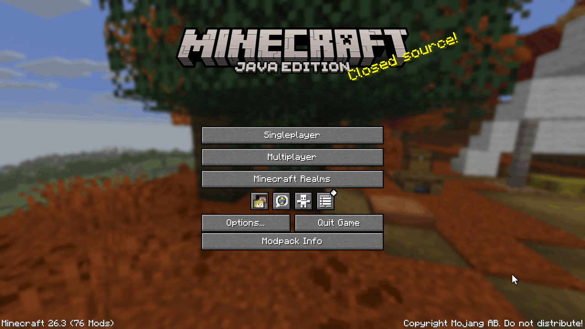

# GUI personalizadas

Las GUI personalizadas son menús que creas tú mismo, como una pantalla con información del modpack, un centro de servidor o una página de reglas. Al principio están vacías y tú las llenas con un [diseño](/layout-editor), como cualquier otro menú. Después, puedes abrirlas con botones, teclas y comandos.

# Crear una GUI personalizada

1. Abre **barra de menús -> Personalización -> GUI personalizadas -> Administrar GUI personalizadas**.
2. Haz clic en **Nueva GUI**.
3. Escribe un **Identificador de GUI personalizada**, como `modpack_info`, configura los [ajustes](#configuracion) y haz clic en **Listo**.
4. Haz clic en la nueva GUI personalizada de la lista y luego en **Abrir GUI**.
5. Haz clic en **Listo** para cerrar **Administrar GUI personalizadas**.

**Administrar GUI personalizadas** solo guarda los cambios cuando haces clic en **Listo** o **Abrir GUI**. **Cancelar** los descarta.

## El identificador

Los botones, comandos y diseños encuentran una GUI personalizada mediante su identificador.

- Solo se permiten letras minúsculas, números, `.`, `_` y `-`. Cada GUI personalizada necesita un identificador único.
- No uses el [identificador de otra pantalla](/screen-identifiers), como `title_screen`. La GUI personalizada compartiría sus diseños con esa pantalla.
- Si después cambias el identificador, ya no se encontrarán sus diseños ni los botones y comandos que tengan el identificador anterior. Si lo vuelves a cambiar al original, los encontrarás de nuevo.

## Crear su diseño

1. Abre la GUI personalizada.
2. Haz clic en **barra de menús -> Personalización -> Diseños -> Nuevo -> Para la pantalla actual**. La personalización siempre está activada para las GUI personalizadas.
3. Agrega elementos y guarda el diseño. Consulta [Editor de diseños](/layout-editor).

Una GUI personalizada no incluye nada, ni siquiera un botón Atrás. Agrega un [Botón](/elements#button) con la acción [**Volver a la última pantalla**](/action-scripts#back-to-last-screen) o deja activada la opción **Permitir cerrar la GUI con Esc** para que los jugadores puedan salir.

# Ajustes

La opción **Editar GUI** en **Administrar GUI personalizadas** cambia los ajustes de la GUI personalizada seleccionada.

| Ajuste | Qué hace |
|---|---|
| **Identificador de GUI personalizada** | El nombre de la GUI personalizada. Consulta [El identificador](#el-identificador). |
| **Título de pantalla (opcional)** | Un título blanco en la parte superior de la GUI. Déjalo vacío si no quieres mostrar uno. Funcionan los [marcadores de posición](/placeholders), y las claves de localización del juego, los mods y los paquetes de recursos se muestran en el idioma del jugador. |
| **Permitir cerrar la GUI con Esc** | `Esc` cierra la GUI. Está activado de forma predeterminada. |
| **Pausar juego/mundo** | Pausa los mundos de un jugador mientras la GUI está abierta. Está activado de forma predeterminada. |
| **Renderizar el fondo del mundo** | Muestra el mundo detrás de la GUI mientras juegas. Fuera de los mundos, o si esta opción está desactivada, se muestra el panorama de Minecraft. Está activado de forma predeterminada. |
| **Renderizar la superposición del fondo del mundo** | Desenfoca y oscurece el mundo o el panorama detrás de la GUI, como lo hace el menú de pausa. Solo funciona con **Renderizar el fondo del mundo**: si esta opción está desactivada, el panorama siempre aparece desenfocado y más oscuro. Está activado de forma predeterminada. |
| **Modo emergente** | Muestra la GUI encima del menú desde el que se abrió. Consulta [Modo emergente](#modo-emergente). |
| **Superposición de fondo del modo emergente** | Desenfoca el menú detrás de la ventana emergente. Solo funciona con el **Modo emergente**. Está activado de forma predeterminada. |

- El desenfoque tiene la misma intensidad que la opción **Desenfoque del fondo del menú** de Minecraft.
- Un [fondo de menú](/menu-backgrounds) en el diseño cubre todo esto: el mundo, el panorama y el menú detrás de una ventana emergente.
- El editor de diseños no puede cambiar el título (**Título de pantalla personalizado**) de las GUI personalizadas. Cambia **Título de pantalla (opcional)**. Para usar un título con su propia fuente, color o ubicación, deja esa opción vacía y agrega un [elemento de texto](/elements#text).

## Modo emergente

Con el **Modo emergente**, el menú desde el que se abrió la GUI personalizada permanece visible detrás, junto con su diseño. No se puede hacer clic en él mientras la ventana emergente esté abierta.

- Las ventanas emergentes funcionan mejor para cosas pequeñas, como un cuadro de información, una confirmación o un panel de ajustes. Deja un espacio libre para que se vea el menú de atrás.
- No agregues un fondo de menú al diseño de una ventana emergente o el menú de atrás desaparecerá.
- Si la GUI personalizada se abre cuando no hay ningún menú abierto, por ejemplo, al usar una tecla mientras juegas, no habrá ningún menú detrás. En ese caso, se mostrará su fondo normal.

# Abrir una GUI personalizada

Todo lo que puede abrir pantallas puede abrir GUI personalizadas usando su identificador:

- **Botones:** la acción [**Abrir pantalla o GUI personalizada**](/action-scripts#open-screen-or-custom-gui) con el valor `modpack_info`.
- **Teclas:** un [receptor **Al presionar una tecla del teclado**](/listeners#listener-variables) con la misma acción. Abre la GUI personalizada tanto en los menús como mientras juegas.
- **Comandos:** `/openguiscreen modpack_info`, también desde servidores, bloques de comandos y recompensas de misiones. Consulta [Comandos](/commands#openguiscreen).
- **Al salir de un mundo:** la acción [**Salir del mundo o servidor**](/action-scripts#leave-world-or-server) con el identificador abre la GUI personalizada después de salir.

Las GUI personalizadas forman parte de la configuración de FancyMenu de cada jugador. Un servidor solo puede abrir las GUI personalizadas que tengan sus jugadores, como las del modpack.

Para salir de una GUI personalizada:

- `Esc` (si está activada la opción **Permitir cerrar la GUI con Esc**) y la acción **Volver a la última pantalla** regresan al menú desde el que se abrió. Si no había ningún menú abierto, `Esc` regresa al juego.
- La acción [**Cerrar pantalla**](/action-scripts#close-screen) la cierra. Fuera de los mundos, se abre la pantalla de título.

# Reemplazar una pantalla existente

Una GUI personalizada puede reemplazar un menú del juego o de un mod. Cada vez que se fuera a abrir ese menú, se abrirá la GUI personalizada en su lugar.

> [!WARNING]
> El menú reemplazado nunca se abre, así que no ocurre nada de lo que haría, y otros mods que lo necesiten pueden dejar de funcionar. Siempre que puedas, modifica los menús con un diseño normal. Reemplaza un menú solo cuando un diseño no pueda hacer lo que necesitas.

1. Activa **barra de menús -> Personalización -> Ajustes -> Modo de personalización avanzado**.
2. Abre el menú que quieras reemplazar.
3. Haz clic en **barra de menús -> Personalización -> GUI personalizadas -> Reemplazar la pantalla actual con una GUI personalizada**.
4. Confirma la advertencia y selecciona la GUI personalizada en **Elegir GUI personalizada**.

La GUI personalizada se abrirá de inmediato. `Esc` y **Volver a la última pantalla** regresan al menú que estaba abierto antes del menú reemplazado.

Para deshacerlo, abre **barra de menús -> Personalización -> GUI personalizadas -> Administrar pantallas reemplazadas**, haz clic en **Eliminar regla de reemplazo** debajo de la pantalla y luego en **Listo**.

> [!TIP]
> Para reemplazar un menú solo en ciertos casos, por ejemplo, únicamente cuando una [variable](/variables) tenga un valor asignado, usa en su lugar un [receptor **Al abrir una pantalla**](/listeners#on-screen-opened) con una instrucción IF.

# Administrar GUI personalizadas

- **Nueva GUI**, **Editar GUI** y **Abrir GUI** en **Administrar GUI personalizadas** permiten agregar, modificar y abrir GUI personalizadas.
- **Eliminar GUI** elimina la GUI personalizada seleccionada después de pedirte confirmación. Sus diseños se conservan y vuelven a aparecer en una nueva GUI personalizada con el mismo identificador.
- La barra de búsqueda encuentra GUI personalizadas por su identificador.
- **barra de menús -> Ayuda -> Exportar para IA -> GUI personalizadas** exporta todas las GUI personalizadas y las reglas de reemplazo para un [chat de IA](/export-for-ai).

Las GUI personalizadas y las reglas de reemplazo se guardan en `config/fancymenu/custom_gui_screens.txt`. Sus diseños se guardan en `config/fancymenu/customization/`, como todos los demás (consulta [Ubicaciones de almacenamiento de datos](/data-storage-locations)). Cada [perfil](/profiles) tiene sus propias GUI personalizadas.
