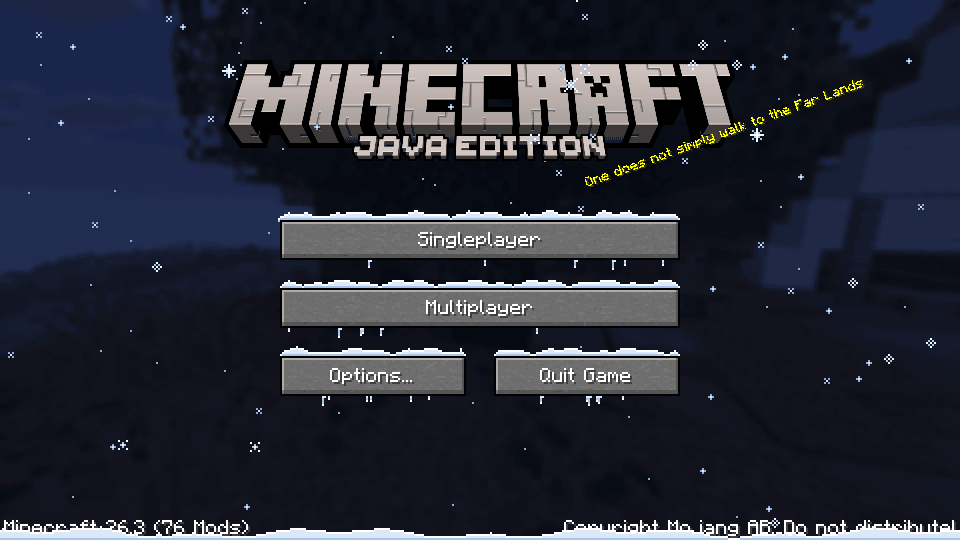
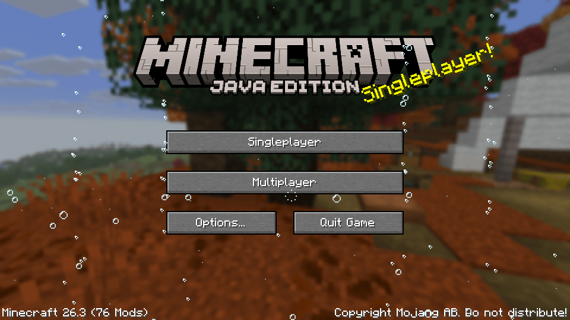

# Superposiciones decorativas

Las superposiciones decorativas son efectos animados que cubren toda la pantalla, como nieve que cae, luciérnagas, niebla o series de luces. Muchas interactúan con tu menú: la nieve se acumula sobre los botones, los pájaros se posan en ellos y la niebla se despeja alrededor del mouse.


# Agregar una superposición

1. Abre un diseño en el editor de diseños.
2. Haz clic derecho en el fondo del editor y abre **Superposiciones decorativas**.
3. Abre una superposición, como **Nieve**.
4. Haz clic en **Mostrar superposición** para activarla.

Las superposiciones activas tienen una ✔ en la lista. Un diseño puede mostrar tantas superposiciones como quieras. Pasa el cursor sobre una superposición o uno de sus ajustes para ver qué hace.

Las superposiciones también se reproducen en el editor de diseños, pero solo reaccionan a tus elementos en el menú real. Guarda el diseño y abre el menú para verlo todo.

Si hay superposiciones en varios diseños de una pantalla, todas se reproducen, incluso si se repite la misma. Esto también incluye los [diseños universales](/universal-layouts).

# Ajustes de todas las superposiciones

Todas las superposiciones tienen estos dos ajustes:

- **Mostrar superposición** activa o desactiva la superposición.
- **Capas** define dónde se dibuja la superposición:
  - **Fondo y primer plano**: las partes lejanas se dibujan detrás de tus elementos y las cercanas, delante de ellos, para crear una agradable sensación de profundidad. Esta es la opción predeterminada.
  - **Solo fondo**: todo se dibuja detrás de tus elementos, pero delante del fondo del menú.
  - **Solo primer plano**: todo se dibuja delante de tus elementos.

Lo que una superposición coloca directamente sobre tus elementos, como la nieve sobre un botón, siempre permanece encima de ellos.

Muchas superposiciones también tienen estos ajustes:

| Ajuste | Qué hace |
|---|---|
| **Cantidad (%)** | Define cuánto hay, de 25% a 300%. 100% es la cantidad normal. |
| **Tamaño** | Hace que el pixel art sea 2x o 3x más grande. Cada píxel conserva su forma cuadrada y nítida. |
| **Estilo** | **Detallado** muestra el pixel art completo, con sombras y efectos adicionales. **Simple** es más plano y se acerca más al estilo clásico. |

# Superposiciones y tus elementos

Muchas superposiciones interactúan con tus elementos: la nieve, la ceniza y el confeti se acumulan sobre ellos; de ellos cuelgan carámbanos; les crece musgo y los pájaros se posan encima.

Para elegir qué elementos participan, haz clic derecho en un elemento y configura **Debe verse afectado por las superposiciones decorativas**:

- Esta opción está activada de forma predeterminada en botones, controles deslizantes, casillas, campos de entrada y [elementos vanilla](/vanilla-elements).
- También incluye el logotipo, el texto de inicio, la marca y los derechos de autor de la pantalla de título. Desactiva la opción para estos elementos si no quieres que nada se pose sobre ellos.
- Los elementos ocultos no participan. Tampoco participa la parte de un elemento que quede recortada por un [área desplazable](/scrollable-areas).

> [!TIP]
> Deja al menos 13 píxeles entre tus elementos. Las cosas que se acumulan sobre un elemento o cuelgan de él solo crecerán hasta donde lo permita el espacio con el siguiente elemento.

Algunas superposiciones reaccionan a los clics, como Burbujas, Escarcha y Confeti. Tus botones seguirán recibiendo todos los clics.

# Todas las superposiciones decorativas

Estas son todas las superposiciones decorativas de FancyMenu, ordenadas por tema.

## Clima

### Nieve

La nieve cae y se acumula lentamente sobre tus botones y a lo largo de la parte inferior de la pantalla.



- **Acumular nieve** permite que la nieve se acumule.
- **Color de la nieve [HEX]**, **Velocidad de caída de la nieve**, **Cantidad (%)** y **Tamaño** cambian la nieve.

### Lluvia

La lluvia cae, forma ondas en charcos poco profundos y gotea de tus botones.


- **Charcos** cubre tus elementos y la parte inferior de la pantalla con una película de agua que forma ondas donde caen las gotas.
- **Goteo** permite que las gotas cuelguen de tus elementos y caigan de ellos.
- **Destellos de relámpagos** agrega relámpagos de vez en cuando, con un rayo ramificado y un destello tenue. **Brillo de los destellos de relámpagos** define qué tan brillantes son.
- **Color de la lluvia [HEX]**, **Cantidad (%)** y **Tamaño** cambian la lluvia.

> [!WARNING]
> **Destellos de relámpagos** hace que la pantalla parpadee. Déjalo desactivado si los jugadores podrían ser sensibles a las luces intermitentes.

### Niebla

Capas suaves de neblina se desplazan por la pantalla y sobre tus elementos; son más densas cerca del suelo.


- **Despejar alrededor del cursor** hace que la niebla se aparte del mouse.

### Escarcha

Tu menú queda cubierto de hielo. El hielo se extiende por los bordes, las esquinas y tus elementos. Haz clic en el hielo para romper un trozo.


- **Bordes de la pantalla**, **Esquinas** y **Sobre los elementos** activan o desactivan cada parte del hielo. Las etiquetas de tus elementos permanecen despejadas.

## Naturaleza

### Hojas

Las hojas caen y las ráfagas de viento las empujan.


- **Estilo** alterna entre hojas **Detalladas** y **Simples**.
- **Colores** permite elegir **Mezcla otoñal** (cinco colores cálidos de otoño) o **Rango personalizado** (cinco colores entre **Color inicial de las hojas [HEX]** y **Color final de las hojas [HEX]**).
- **Viento** activa o desactiva las ráfagas fuertes. **Intensidad del viento** define qué tan fuerte es el viento.
- **Densidad de las hojas**, **Velocidad de caída de las hojas** y **Escala de la superposición de hojas** cambian las hojas.

### Flores de cerezo

Ramas florecidas se asoman desde las esquinas superiores y los pétalos caen lentamente.


- **Rama izquierda** y **Rama derecha** muestran u ocultan cada rama.
- **Estilo** y **Cantidad (%)** cambian los pétalos.

### Vegetación desbordante

La naturaleza se apodera de tu menú: el musgo, las enredaderas, el pasto y las flores crecen lentamente por todas partes.


- **Pasto**, **Enredaderas izquierdas**, **Enredaderas derechas** y **Sobre los elementos** activan o desactivan cada tipo de vegetación. Las etiquetas de tus elementos permanecen despejadas.
- **Flores en las enredaderas**, **Flores en los elementos** y **Flores en el pasto** permiten que florezcan. **Flores (%)** define cuántas habrá.

### Nubes

Nubes pixeladas y esponjosas se desplazan por el cielo detrás de tus elementos, en tres capas de profundidad. Las nubes no tienen ajustes propios.


### Rayos de sol

Los rayos de sol se despliegan desde un sol que queda justo fuera de la pantalla, mientras el polvo danza en la luz.


- **Lado del sol** define detrás de qué borde de la pantalla se encuentra el sol. **Ángulo del sol (°)** lo desplaza a lo largo de ese borde.
- **Color de la luz solar [HEX]** e **Intensidad (%)** cambian la luz.
- **Resplandor del sol** difumina el brillo del sol.
- **Polvo** permite que el polvo se desplace por los rayos. El mouse lo agita.
- **Incidir en los elementos** hace que los rayos se detengan en tus elementos, iluminen sus bordes y proyecten sombras. Si está desactivado, los rayos brillan delante de tus elementos.

### Burbujas

Las burbujas suben en corrientes, tambaleándose, y se deslizan por la parte inferior de tus elementos. ¡Haz clic para reventarlas! Las burbujas no tienen ajustes propios.



## Animales

### Pájaros

Pajaritos vuelan hasta tus elementos, brincan sobre ellos y se van volando cuando el mouse se acerca demasiado.


### Mariposas

Mariposas coloridas revolotean, descansan sobre tus elementos y se alejan del mouse.


### Murciélagos

Pequeños grupos de murciélagos aletean por la pantalla y cuelgan dormidos debajo de tus elementos. ¡Si te acercas demasiado, despiertan!


Pájaros, Mariposas y Murciélagos tienen los ajustes **Cantidad (%)** y **Tamaño**.

### Luciérnagas

Grupos de luciérnagas brillan y deambulan; algunas se posan sobre tus elementos.


- **Estilo** alterna entre luciérnagas **Detalladas** y **Simples**. **Cuerpos sin luz** muestra sus pequeños cuerpos oscuros entre destellos.
- **Seguir al mouse** permite que los grupos sigan al mouse cuando está cerca.
- **Posarse** permite que las luciérnagas se posen de vez en cuando sobre tus elementos.
- **Color de las luciérnagas [HEX]**, **Cantidad de grupos**, **Densidad de los grupos**, **Tamaño de los grupos** y **Escala de las luciérnagas** cambian las luciérnagas.

### Buddy

Buddy es una pequeña mascota virtual que vive en la parte inferior de tu menú. Camina, muestra lo que necesita en burbujas de pensamiento, reacciona cuando juegas con él y recuerda todo entre sesiones de juego.


#### Cuidar a Buddy

Buddy tiene cuatro necesidades, de `0` a `100`:

- **Hambre** disminuye con el tiempo. La comida la aumenta.
- **Felicidad** disminuye con el tiempo. Las caricias, la comida y jugar la aumentan.
- **Energía** disminuye mientras Buddy está despierto y se recupera mientras duerme.
- **Diversión** disminuye con el tiempo. Jugar la aumenta.

Para cuidar a Buddy:

- Haz clic izquierdo en Buddy para acariciarlo. Si lo despiertas así, su felicidad disminuye un poco.
- Haz clic derecho en Buddy para abrir su pantalla de estado. La pestaña **Estadísticas** muestra sus necesidades, nivel y XP. La pestaña **Logros** muestra sus logros.
- Haz clic en **Alimentar** en la pantalla de estado y luego arrastra la comida hasta Buddy.
- Haz clic en **Jugar** en la pantalla de estado y luego arrastra la pelota y suéltala para lanzarla. Buddy la persigue y la atrapa.
- Haz clic en **Dormir** para que Buddy descanse. También se duerme por su cuenta cuando su energía baja demasiado.
- Buddy hace popó de vez en cuando. Haz clic izquierdo en la popó para limpiarla. Si hay tres o más popós por ahí, Buddy seguirá perdiendo felicidad.

#### Niveles y logros

Cuidar a Buddy le da XP. Buddy sube de nivel del 1 al 30. Cuanto más alto sea su nivel, más lentamente disminuirán su hambre, felicidad y energía; en el nivel 30, disminuirán hasta la mitad de rápido.

#### Cuando Buddy muere

Si el hambre o la felicidad permanece en `0` durante 10 horas reales, Buddy muere y deja una lápida. Haz clic izquierdo en la lápida para empezar de nuevo con un Buddy nuevo. Desactiva **Buddy puede morir** para evitar que muera.

**Restablecer partida guardada de Buddy** permite empezar de nuevo en cualquier momento.

> [!WARNING]
> Al restablecer a Buddy, se borran para siempre sus necesidades, nivel, XP, logros y popós.

#### Guardar y personalizar

Buddy se guarda aproximadamente cada dos minutos y cuando se cierra su pantalla, en `<game-directory>/fancymenu_data/buddy/`. Cada superposición de Buddy tiene su propio archivo guardado. Consulta [Ubicaciones de almacenamiento de datos](/data-storage-locations).

- **Texturas personalizadas** reemplaza los sprites, objetos, íconos, la pantalla de estado y la lápida de Buddy con tus propias texturas.
- **Ajustes de estadísticas** cambia la velocidad a la que disminuyen sus necesidades, el costo y las recompensas de sus actividades, y la cantidad máxima de popós que puede haber (**Máximo de popós**).

## Cielo nocturno

### Aurora

Luces del norte resplandecientes aparecen en la parte alta del cielo y ondean lentamente detrás de tus elementos.


- **Color del borde [HEX]** define el color del borde inferior brillante. **Color de la punta [HEX]** define el color en el que se difuminan los rayos.

### Estrellas fugaces

Un cielo nocturno centelleante detrás de tus elementos, con una estrella fugaz cada pocos segundos y una lluvia de meteoros de vez en cuando. Las estrellas fugaces no tienen ajustes propios.


### Faroles celestes

Faroles de papel resplandecientes flotan hacia el cielo nocturno; a veces, todo un grupo a la vez. Los faroles celestes tienen los ajustes **Cantidad (%)** y **Tamaño**.


## Fiesta

### Confeti

Los cañones de fiesta en las esquinas inferiores lanzan confeti cada pocos segundos, y este se acumula sobre tus elementos.


- **Cañones en las esquinas** activa o desactiva los cañones.
- **Lanzar al hacer clic** lanza una pequeña ráfaga de confeti donde hagas clic.
- **Modo de mezcla de colores** usa colores aleatorios. Desactívalo para usar **Color del confeti [HEX]** en todo el confeti.
- **Límite de partículas acumuladas** define cuántas piezas pueden quedar acumuladas a la vez.
- **Cantidad (%)**, **Tamaño** y **Velocidad de caída del confeti** cambian el confeti.

### Fuegos artificiales

Los cohetes vuelan hacia arriba y estallan en fuegos artificiales.


- **Mostrar trayectoria del cohete** muestra los cohetes mientras suben.
- **Cantidad (%)**, **Tamaño** y **Tamaño de la explosión** cambian los fuegos artificiales.

### Series de luces

Series de luces cuelgan por todo tu menú y se balancean con el viento.


- **Estilo** alterna entre luces **Simples** y **Detalladas**. **Guirnalda de pino** reemplaza el cable por agujas de pino con esferas.
- **Programa de luces** define cómo brillan y parpadean las luces (consulta más abajo).
- **Escala de las series de luces**, **Intensidad del viento** y **Velocidad del parpadeo** cambian todas las series.
- **Series** muestra un menú para cada uno de los ocho lugares donde puede colgar una serie. Actívala con **Mostrar serie de luces**.

Cada serie tiene estos ajustes:

- **Cantidad de luces** define cuántas luces cuelgan de ella. `0` llena la serie según su longitud.
- **Color de las luces [HEX]** define el color de las luces. **Modo de luces navideñas** las hace coloridas.
- **Color de la serie [HEX]** define el color del cable. Usa el canal alfa para hacerlo translúcido u ocultarlo.
- **Colores individuales de las luces** y **Tamaños individuales de las luces** asignan un color o tamaño a cada luz mediante una lista separada por comas. Si hay más luces que valores, la lista vuelve a empezar:

```
#FF0000, #00FF00, #0000FF
```

| Programa de luces | Qué hacen las luces |
|---|---|
| **Encendidas** | Todas las luces brillan y, de vez en cuando, una baja suavemente su intensidad por un instante, como las luces reales. |
| **Totalmente encendidas** | Todas las luces brillan con la intensidad máxima. |
| **A media intensidad** | Todas las luces brillan a media intensidad. |
| **Apagadas** | Todas las luces están apagadas. |
| **Ciclo** | Reproduce Destellos, Persecución, Alternadas y Respiración, y cambia cada 7 segundos. |
| **Destellos** | Las luces parpadean al azar. |
| **Persecución** | Una luz brillante recorre la serie. |
| **Alternadas** | Brilla una de cada dos luces y luego se enciende la otra mitad. |
| **Respiración** | Todas las luces aumentan y reducen su brillo al mismo tiempo, lentamente. |

## Terror

### Telarañas

Telarañas polvorientas cuelgan en las esquinas superiores, con arañitas que bajan por sus hilos.


- **Telaraña izquierda** y **Telaraña derecha** muestran u ocultan cada telaraña y su araña.
- **Arañas** permite que las arañas bajen, se queden un rato y vuelvan a subir. Huyen del mouse.
- **Borde cerrado** une los extremos de los hilos con un borde, para que no queden hilos sueltos en la pantalla.

### Brasas

Las brasas resplandecientes suben desde abajo mientras la ceniza cae y se acumula.


- **Ceniza en el suelo** agrega una capa profunda de ceniza a lo largo de la parte inferior de la pantalla, con puntos humeantes y carbones encendidos.
- **Ceniza sobre los elementos** permite que la ceniza se acumule sobre tus elementos.

## Personalizadas

### Navegador

La superposición Navegador muestra un sitio web en toda la pantalla.

> [!IMPORTANT]
> La superposición Navegador necesita el mod [Rinku](https://modrinth.com/mod/rinku).

- **URL** define qué sitio web mostrar.
- **Consumir clics del mouse**, **Consumir desplazamiento del mouse** y **Consumir pulsaciones del teclado** impiden que la entrada llegue al menú que está detrás del navegador.
- **Procesar clics del mouse**, **Procesar desplazamiento del mouse** y **Procesar pulsaciones del teclado** permiten que el navegador reaccione a la entrada.
- **Ocultar controles de video**, **Repetir videos**, **Silenciar navegador** y **Volumen de audio y video** controlan los videos y el sonido del sitio web.

Los ajustes Consumir y Procesar están activados de forma predeterminada, así que el navegador funciona como uno normal delante de tu menú. Para mostrar un sitio web solo como fondo, desactívalos todos.

Los sitios web también pueden ejecutar acciones de FancyMenu y leer marcadores de posición. Consulta [API de JavaScript del navegador](/browser-api).

### Shader GLSL

La superposición Shader GLSL dibuja tu propio shader en toda la pantalla para crear efectos animados o estáticos. Pega el código del shader en **Código fuente del shader**.

Consulta [API de shaders GLSL](/glsl-shader-api) para aprender a escribir shaders para FancyMenu.
