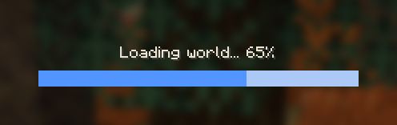

# Elementos

Los elementos son las partes de un diseño: botones, textos, imágenes, controles deslizantes, música y más. En esta página se enumeran todos los tipos de elementos y sus ajustes más importantes.

> [!TIP]
> Los botones y otras partes que una pantalla incluye de forma predeterminada son [Elementos de Vanilla](/vanilla-elements). También puedes moverlos, modificarlos y ocultarlos.

# Agregar elementos

1. En el editor de diseños, haz clic derecho en un espacio libre y luego en **Nuevo elemento**. La barra de menú tiene la misma lista en **Elemento -> Nuevo**.
2. Haz clic en un tipo de elemento. Pasa el cursor sobre un tipo para ver para qué sirve.

El elemento aparecerá donde hiciste clic derecho. Arrástralo para moverlo, arrastra sus bordes para cambiar su tamaño y haz clic derecho sobre él para abrir sus ajustes.


Para saber cómo seleccionar, mover, copiar y eliminar elementos, y conocer todos los atajos del editor, consulta [Editor de diseños](/layout-editor). Para mantener los elementos en su lugar en cualquier tamaño de ventana, lee [Posicionar elementos](/positioning-elements). Para colocar elementos delante o detrás de otros, lee [Capas y grupos](/layout-editor#layers-and-groups).

# Ajustes de todos los elementos

Todos los elementos tienen estos ajustes en su menú del clic derecho, además de los ajustes propios de su tipo:

| Ajuste | Qué hace |
|---|---|
| **Punto de anclaje** | A qué está unido el elemento, por ejemplo, a una esquina de la pantalla o a otro elemento. Consulta [Posicionar elementos](/positioning-elements). |
| **Posicionamiento avanzado** y **Tamaño avanzado** | Calculan la posición y el tamaño, por ejemplo, con [marcadores de posición](/placeholders). Consulta [Posicionamiento y tamaño avanzados](/advanced-positioning-sizing). |
| **Requisitos de carga** y **Cargar una vez por sesión** | Muestran el elemento solo cuando se cumplen los [requisitos](/conditions) o una sola vez por inicio del juego. Consulta [Visibilidad de los elementos](/element-visibility). |
| **Retrasar aparición** y **Retrasar desaparición** | Esperan algunos segundos antes de que aparezca o desaparezca el elemento. Consulta [Visibilidad de los elementos](/element-visibility#delaying-elements). |
| **Aparición/desaparición gradual** y **Opacidad** | Hacen que el elemento aparezca o desaparezca gradualmente, o que sea transparente. Consulta [Visibilidad de los elementos](/element-visibility#fading-in-and-out). |
| **Rotación**, **Inclinación vertical** e **Inclinación horizontal** | Giran e inclinan el elemento. Consulta [Girar e inclinar elementos](/rotating-elements). |
| **Efecto de paralaje** | Mueve un poco el elemento junto con el mouse. Consulta [Efecto de paralaje](/parallax). |
| **Copiar ID del elemento** | Copia el identificador que usan las acciones, los marcadores de posición y otros elementos para encontrarlo. Consulta [Identificadores de elementos](/element-identifiers). |
| **Nombre para mostrar en el editor** | El nombre del elemento en la lista de capas. |
| **Exportar para IA** | Convierte el elemento en texto para [asistentes de IA](/export-for-ai). |

# Todos los elementos

Todos los elementos que incluye FancyMenu, organizados según su función.

## Botones y entradas

### Botón

Un botón que ejecuta un [script de acciones](/action-scripts) al hacer clic, por ejemplo, para unirse a un servidor, abrir un sitio web u otro menú.


- **Editar script de acciones**: lo que hace el botón al hacer clic.
- **Etiqueta** y **Etiqueta al pasar el cursor**: el texto del botón y el texto que aparece cuando el mouse está encima. Ambos admiten [marcadores de posición](/placeholders) y [formato de texto](/text-formatting).
- **Alineación de la etiqueta**: coloca la etiqueta a la **Izquierda**, **Centrada** o a la **Derecha** del botón. Las etiquetas que son demasiado anchas para el botón se desplazan de un lado a otro, sin importar la alineación.
- **Escala de la etiqueta**, **Color base de la etiqueta**, **Color de la etiqueta al pasar el cursor**, **Sombra de la etiqueta** y **Subrayar etiqueta al pasar el cursor**: el tamaño, los colores y la sombra de la etiqueta.
- **Texturas del botón** y **Texturas del ícono del botón**: imágenes propias para el botón y para un ícono, en los estados normal, al pasar el cursor e inactivo. Consulta [División en nueve partes y mosaico](/nine-slicing-and-tiling) para aprender a escalar texturas sin que se deformen.
- **Sonido al pasar el cursor**, **Sonido al quitar el cursor** y **Sonido al hacer clic**: los sonidos que reproduce el botón.
- **Información sobre herramientas**: texto que aparece cuando el mouse está sobre el botón.
- **Controlar estado activo**: [requisitos](/conditions) para que se pueda hacer clic en el botón. Si no se cumplen, el botón aparece en gris.
- **Modo de plantilla**: da a otros botones y controles deslizantes de la pantalla el aspecto de este botón. Consulta [Plantillas de botones y controles deslizantes](/button-slider-templates).

### Control deslizante

Un control que los jugadores arrastran para elegir un valor. Ejecuta su script de acciones cada vez que cambia el valor.


- **Tipo de control deslizante**:
  - **Lista de valores**: recorre los textos de **Valores de la lista**, uno por línea. **Valores de una variable de lista** obtiene los valores de una [variable de lista](/variables#text-and-list-variables).
  - **Rango de enteros**: números enteros desde **Valor mínimo del rango** hasta **Valor máximo del rango**.
  - **Rango decimal**: lo mismo, pero con decimales. **Posición decimal de redondeo** indica cuántos dígitos van después del punto; `-1` no redondea.
- **Etiqueta del control deslizante**: su texto. `$$value` muestra el valor actual.
- **Editar script de acciones**: se ejecuta cuando cambia el valor. `$$value` representa el nuevo valor.
- **Valor preseleccionado**: el valor inicial del control deslizante. Vincúlalo con el valor que modifica el control para que muestre el valor correcto al abrirse la pantalla.

Por ejemplo, un control deslizante de volumen de tipo **Rango de enteros**, de `0` a `100`, tiene la etiqueta `Volumen de música: $$value%` y una acción [**Establecer valor de variable (variable de FM)**](/action-scripts#set-variable-value-fm-variable) con este valor:

```
music_volume:$$value
```

Su **Valor preseleccionado** es `$$music_volume`, así que comienza con el último valor que eligió el jugador.

Los controles deslizantes tienen los mismos ajustes de etiqueta, textura, sonido, información sobre herramientas y **Controlar estado activo** que los botones. También puedes colocar su etiqueta a la izquierda o a la derecha con **Alineación de la etiqueta**.

### Casilla

Una casilla que los jugadores pueden marcar y desmarcar. Ejecuta su script de acciones cada vez que cambia.


- `$$value` es `true` o `false` en su script de acciones y en los requisitos de **Controlar estado activo**.
- **Modo de variable** y **Vincular a variable**: la casilla muestra el valor de una [variable](/variables) y escribe `true` o `false` en ella. Si se vincula a una variable de lista, `true` o `false` se convierte en su único elemento.
- Sin el modo de variable, la casilla recuerda su estado por sí sola, de forma independiente para cada [perfil](/profiles).
- **Texturas**: imágenes propias para la casilla y la marca de verificación.

Las casillas tienen los mismos ajustes de información sobre herramientas, sonido y **Navegable** que los botones.

### Campo de texto

Un campo donde los jugadores escriben, por ejemplo, una dirección de servidor o un nombre.


- **Vincular a variable**: lo que escriban los jugadores se guarda en la [variable](/variables), y el campo muestra su valor. Si se vincula a una variable de lista, el texto escrito reemplaza toda la lista.
- **Tipo de entrada**: **Texto**, **Solo números**, **Solo números decimales** o **URL**. No se pueden escribir otros caracteres.
- **Texto de ayuda** y **Color del texto de ayuda**: texto que aparece mientras el campo está vacío.
- **Longitud máxima del texto**: cuántos caracteres caben.
- **Color de fondo**, **Color del borde**, **Radio de redondeo del borde** y **Color del texto**: su apariencia.

Por ejemplo, un campo vinculado a `server_address` y un botón con la acción [**Unirse al servidor**](/action-scripts#join-server) y el valor `$$server_address` permiten que los jugadores se unan a cualquier servidor.

Si no se vincula a una variable, el marcador de posición [**Valor del campo de texto**](/placeholders#text-input-field-value) lee el texto y la acción [**Establecer valor del campo de texto**](/action-scripts#set-text-input-field-value) lo modifica.

## Textos e información sobre herramientas

### Texto

Texto de cualquier longitud, desde una etiqueta breve hasta reglas o notas de actualización con desplazamiento, con [Markdown](/text-formatting) y [marcadores de posición](/placeholders).


- **Modo de origen**: escribe el texto o cárgalo desde un archivo o sitio web.
- Elige un estilo inicial y activa el desplazamiento cuando el texto sea más grande que el elemento.
- **Fondo**: un panel oscuro detrás del texto. Desactívalo con **Mostrar fondo** o usa una textura propia.

Consulta todos los detalles en [Texto en menús](/text-in-menus).

### Información sobre herramientas

Un cuadro de texto como los que aparecen en el juego, con [Markdown](/text-formatting) y [marcadores de posición](/placeholders).


- Aparece donde lo coloques o junto al mouse si activas **Seguir al mouse**.
- Sus **Requisitos de carga** determinan cuándo aparece, por ejemplo, con [**El elemento está bajo el cursor**](/conditions#is-element-hovered) para un botón.
- **Fondo de información sobre herramientas**: usa una textura propia en lugar del cuadro oscuro.

Encontrarás más información en [Texto en menús](/text-in-menus).

### Texto de bienvenida

El texto amarillo de la pantalla del título, con tus propios textos.


- **Modo de origen**: los textos de bienvenida de Vanilla, un texto propio o una línea aleatoria de un archivo de texto.
- **Rebote**, **Escala**, **Rotación**, **Color del texto** y **Sombra**: su apariencia.
- **Actualizar al cargar la pantalla**: elige un nuevo texto de bienvenida cada vez que se abre la pantalla.

Encontrarás más información en [Texto de bienvenida](/splash-text).

## Imágenes y medios

### Imagen

Una imagen de tus archivos, de un sitio web o de los recursos del juego. También reproduce imágenes animadas.


- **Origen de la imagen**: la imagen. En [Imágenes](/images) se enumeran los archivos compatibles.
- **Conservar relación de aspecto**: cambia el ancho para que la imagen no se estire.
- **Textura de nueve partes** y **Repetir textura**: escalan los marcos sin estirar sus bordes o repiten la imagen en mosaico. Consulta [División en nueve partes y mosaico](/nine-slicing-and-tiling).
- **Tinte de imagen [HEX]**: cambia el color de la imagen.
- **Radio de redondeo de esquinas**: redondea sus esquinas.

### Presentación de diapositivas

Muestra, una tras otra, las imágenes de una presentación. Puedes crear presentaciones en `config/fancymenu/slideshows/`; consulta [Presentaciones de diapositivas](/slideshows).

- **Presentación de diapositivas**: la presentación que se mostrará.
- **Conservar relación de aspecto**: cambia el ancho para que las imágenes no se estiren.

### Video

Reproduce un archivo de video, como un tráiler o un fondo animado.

> [!IMPORTANT]
> Los videos requieren los mods Watermedia V3 y Watermedia Binaries V3. Consulta [Videos](/video).

- **Origen del video**: un archivo de video, un enlace web o un recurso del juego.
- **Repetir video**, **Volumen** y **Canal de sonido**: cómo se reproduce.
- **Reproducir video en el editor de diseños**: indica si también se reproduce mientras editas.
- Acciones como [**Alternar estado de pausa del elemento de video**](/action-scripts#toggle-video-element-paused-state) lo pausan, avanzan a un momento específico o cambian su volumen.

**Video [Rinku]** es un elemento de video antiguo que requiere el mod Rinku. Sigue funcionando en diseños antiguos, pero no aparece en **Nuevo elemento**.

### Shader GLSL

Ejecuta tu propio shader GLSL dentro del elemento, por ejemplo, para crear colores animados o efectos de Shadertoy.


- **Origen del shader**: el código del shader. Los shaders de Shadertoy que usan `mainImage` funcionan tal cual.
- **Modo de compilación**: **Automático**, **Shadertoy** o **Fragmento directo**.
- **Origen del búfer A** a **Origen del búfer D**: pasadas adicionales para shaders con búferes.

Aprende a escribirlos en [API de shaders GLSL](/glsl-shader-api).

### Navegador

Muestra un sitio web en tiempo real, como un mapa de servidor o una página wiki.

> [!IMPORTANT]
> El navegador requiere el mod [Rinku](https://modrinth.com/mod/rinku) ([CurseForge](https://www.curseforge.com/minecraft/mc-mods/rinku)).

- **URL**: el sitio web.
- **Interactivo**: permite que los jugadores hagan clic, se desplacen y escriban en él. En el editor de diseños nunca es interactivo.
- **Silenciar navegador**, **Volumen de audio/video**, **Repetir videos** y **Ocultar controles de video**: controlan los medios de la página.

Para cargar un archivo HTML desde `config/fancymenu/assets/`, inicia la URL con `file:///`:

```
file:///config/fancymenu/assets/changelog.html
```

En Linux, usa en su lugar el marcador de posición [**Ruta absoluta de archivo/carpeta**](/placeholders#absolute-filefolder-path):

```
file:///{"placeholder":"absolute_path","values":{"short_path":"/config/fancymenu/assets/changelog.html"}}
```

Los sitios web pueden ejecutar acciones y leer marcadores de posición: [API de JavaScript del navegador](/browser-api).

## Formas, objetos y modelos

### Forma rectangular

Un rectángulo de un solo color, como un panel detrás del texto.


- **Color**: un color HEX. Si agregas dos dígitos más, será semitransparente, por ejemplo, `#101828C8`.
- **Radio de redondeo de esquinas**: redondea todas las esquinas o cada una por separado.
- **Desenfoque** e **Intensidad del desenfoque**: desenfocan lo que está detrás.

### Forma circular

Un círculo o una elipse de un solo color, como una luz de estado.


- **Color**, **Desenfoque** e **Intensidad del desenfoque**: funcionan igual que en la forma rectangular.
- **Redondez**: `2` forma un círculo. Los números mayores hacen que sea más cuadrado y los menores, más puntiagudo.

### Objeto

Muestra un objeto de Minecraft o de un mod, como en el inventario.


- **Clave del objeto**: el objeto, por ejemplo, `minecraft:diamond_sword`.
- **Cantidad de objetos**, **Nombre del objeto**, **Descripción del objeto** y **Encantado**: como en un objeto real.
- **Mostrar información sobre herramientas del objeto**: muestra la información del objeto cuando el mouse está encima.
- **Datos NBT personalizados**: datos adicionales del objeto, escritos como la parte de un comando `/give` que va justo después del objeto.

### Modelo JSON de bloque/objeto

Muestra en 3D un modelo de bloque u objeto, ya sea de los recursos del juego o de un archivo JSON propio.


- **Modelo**: el **Origen del modelo**, por ejemplo, `minecraft:models/block/crafting_table.json`.
- **Textura**: reemplaza la textura del modelo por una tuya.
- **Transformación**: escala, gira y mueve el modelo.
- **Iluminación**: **Tono de luz [HEX]** cambia el color de la luz sobre el modelo.

### Entidad de jugador

Muestra en 3D a un jugador, como el personaje del jugador en la pantalla del título.


> [!IMPORTANT]
> Las entidades de jugador requieren el mod Fancy Entity Renderer ([CurseForge](https://www.curseforge.com/minecraft/mc-mods/fancy-entity-renderer), [Modrinth](https://modrinth.com/mod/fancy-entity-renderer)). Sin él, aparece un error en lugar del jugador.

- **Copiar jugador del cliente**: muestra al jugador que está jugando, con su skin y nombre.
- **Nombre del jugador**, **Textura de skin** y **Textura de capa**: permiten mostrar a otro jugador o una skin diferente.
- **Pose de la entidad**, **La cabeza sigue al mouse** y **El cuerpo sigue al mouse**: controlan cómo se para y hacia dónde mira.
- **Armadura y herramientas**, **Loro**, **Es bebé** y **Mostrar nombre del jugador**: controlan qué lleva puesto y qué se muestra.

Encontrarás más información en [Entidades de jugador](/player-entities). Para mostrar solo una cabeza, consulta [Cabezas de jugador](/player-heads).

### Barra de progreso

Una barra que se va llenando, como una barra de carga.



- **Origen del valor de progreso**: indica qué tan llena está. Usa [marcadores de posición](/placeholders), como [**Progreso de carga del mundo**](/placeholders#world-loading-progress) en una pantalla de carga del mundo.
- **Modo del valor de progreso**: **PORCENTAJE (0-100)** o **PUNTO FLOTANTE (0.0-1.0)**.
- **Dirección**: el lado hacia el que se llena.
- **Color de la barra** y **Color del fondo**, o bien **Textura de la barra** y **Textura del fondo**.
- **Animación de llenado suave**: se desliza hasta los nuevos valores en lugar de saltar.
- **Usar el progreso como anclaje del elemento**: los elementos anclados a la barra se mueven junto con el extremo de la parte llena.

## Elementos auxiliares de diseño

### Área desplazable

Contiene otros elementos y permite desplazarse por ellos, como en una lista de servidores o una página de información extensa.


- Arrastra elementos dentro del área en el editor de diseños. Solo admite elementos personalizados, no elementos de Vanilla.
- **Organización**: coloca los elementos tú mismo o deja que el área los organice en una pila, cuadrícula o flujo.
- **Fondo**: un panel oscuro detrás del área. Desactívalo con **Mostrar fondo** o usa una textura propia.

Consulta todos los detalles en [Áreas desplazables](/scrollable-areas).

### Arrastrador

Un área que los jugadores pueden agarrar y mover fuera del editor. Los elementos anclados a ella se mueven junto con ella, como un panel de información móvil. Es invisible fuera del editor.

**Guardar desplazamiento de arrastre del usuario** conserva la nueva posición cuando se cierra la pantalla y se reinicia el juego. Encontrarás más información en [Arrastrador](/dragger).

### Animador de elementos

Mueve y cambia el tamaño de otros elementos mediante fotogramas clave, por ejemplo, para que un panel se deslice dentro de la pantalla. Es invisible fuera del editor.

- **Administrar elementos de destino**: los elementos que anima.
- **Editar fotogramas clave**: abre el editor de fotogramas clave.
- **Repetir animación**: vuelve a empezar al terminar.

Consulta todos los detalles en [Animador de elementos](/element-animator).

## Elementos invisibles

Estos elementos solo se muestran en el editor de diseños.

### Activador repetitivo

Ejecuta su script de acciones una y otra vez mientras la pantalla está abierta.

> [!IMPORTANT]
> Los [Programadores](/schedulers) son la opción recomendada para todo lo que se ejecuta repetidamente o más adelante. Siempre que sea posible, úsalos en lugar de los activadores repetitivos. Funcionan en cualquier pantalla e incluso cuando no hay ninguna pantalla abierta; todas las acciones funcionan en ellos, y las acciones pueden iniciarlos y detenerlos.

Cómo hacer con programadores lo que hacen los activadores repetitivos:

- Ejecutarse continuamente mientras una pantalla está abierta: crea un programador con un **Retraso entre ticks (ms)**. Inícialo con [**Iniciar programador**](/action-scripts#start-scheduler) en **Editar script de acciones «Abrir pantalla»** del diseño y detenlo con [**Detener programador**](/action-scripts#stop-scheduler) en **Editar script de acciones «Cerrar pantalla»**. Ambas opciones están en el menú del clic derecho sobre el fondo del editor.
- Ejecutarse una vez por inicio del juego: crea un programador con **Iniciar al abrir** y **Ticks que se ejecutarán** en `1`.
- Ejecutarse cada vez que se abre una pantalla: no necesitas un activador repetitivo ni un programador. Coloca las acciones en **Editar script de acciones «Abrir pantalla»**.

Ajustes del activador repetitivo:

- **Retraso entre ticks [ms]**: el tiempo entre dos ejecuciones, en milisegundos. `0` lo ejecuta en cada tick, 20 veces por segundo.
- **Modo de ticks**: **Normal** lo ejecuta continuamente. **Sesión** lo ejecuta una sola vez hasta que se reinicie el juego. **Al cargar la pantalla** lo ejecuta una vez cada vez que se abre la pantalla, incluso cuando cambia el tamaño de la ventana.
- **Asíncrono**: lo ejecuta en segundo plano. La mayoría de las acciones no pueden ejecutarse así y mostrarán un error.

### Audio

Reproduce música o sonidos mientras la pantalla está abierta, una pista tras otra.

- **Administrar pistas**: los archivos de audio, su orden y su **Peso de pista** para la reproducción aleatoria.
- **Modo de reproducción**: **Normal** las reproduce en orden y **Aleatorio** en orden aleatorio.
- **Repetir pistas**, **Volumen** y **Canal de sonido**: controlan cómo se reproducen.

Para mantener la música al cambiar de pantalla, coloca el elemento de audio en un [Diseño universal](/universal-layouts). Encontrarás más información en [Música de fondo en los menús](/background-music).

### Controlador de música

Desactiva la música propia del juego en esta pantalla.

- **Reproducir música de menú**: la música de los menús cuando no hay ningún mundo cargado, como la de la pantalla del título.
- **Reproducir música del mundo**: la música del mundo que sigue sonando en los menús, como el inventario.

Solo funciona mientras haya una pantalla abierta.

### Cursor

Reemplaza el cursor del mouse por una imagen propia mientras la pantalla está abierta.

- **Textura del cursor**: una imagen PNG, por ejemplo, de 32 × 32 píxeles.
- **Coordenada X del punto activo** y **Coordenada Y del punto activo**: el píxel de la imagen que hace clic, como la punta de una flecha.
- **Modo de vista previa en el editor**: muestra el cursor en el editor cuando el mouse está sobre el elemento.

Encontrarás más información en [Cursor personalizado](/custom-cursor).
