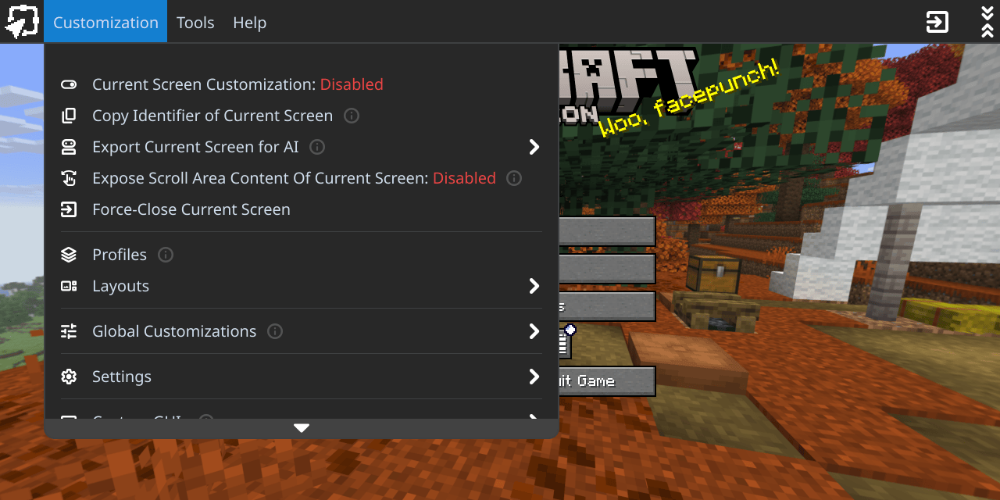

# Primeros pasos

FancyMenu te permite cambiar todos los menús de Minecraft, como la pantalla de título, el menú de pausa y los menús de otros mods. Ponles tus propios fondos, logotipos, botones, textos, sonidos y animaciones; mueve u oculta lo que ya está ahí; haz que los botones hagan cosas nuevas o crea menús completamente nuevos. Todo se hace dentro del juego, sin código.

En esta página aprenderás los conceptos básicos paso a paso. Mientras tanto, crearás una versión más sencilla de esta pantalla de título. En [Cómo se hizo el ejemplo](#how-the-example-is-made) verás qué elementos adicionales tiene la versión completa.

> [!TIP]
> Consigue esta pantalla de título para tu juego: descarga [wildwood_title_screen.fmp](https://raw.githubusercontent.com/Keksuccino/docs_fancymenu/refs/heads/wiki-2026/assets/wildwood_title_screen.fmp?raw=true) y luego [impórtala](/profiles#importing) y [cárgala](/profiles#loading-a-profile) en **barra de menú -> Personalización -> Perfiles**. Puedes usarla gratis para lo que quieras, ya sea para probar FancyMenu, aprender o usarla en tu modpack, con o sin cambios. No hace falta dar crédito.

# La barra de menú

La barra de menú que aparece en la parte superior de cada menú reúne todas las funciones de FancyMenu.

- **Personalización**: los diseños del menú en el que estás y todo lo que necesitas para configurar FancyMenu, como [Personalizaciones globales](/global-customizations), [Interfaces personalizadas](/custom-guis), [Variables](/variables), [Listeners](/listeners), [Programadores](/schedulers), [Perfiles](/profiles) y las opciones de FancyMenu.
- **Herramientas**: utilidades como [Instancias de pantalla de prueba](/dummy-screen-instances), el [Creador de AFMA](/animations#fma-and-afma), **Explorar recursos del juego** y **Abrir carpeta de FancyMenu**, que abre la carpeta de tu configuración (consulta [Ubicaciones de almacenamiento de datos](/data-storage-locations)).
- **Ayuda**: esta documentación, el servidor de Discord, **Reportar un error** y [Exportar para IA](/export-for-ai).
- El ícono de la puerta, a la derecha, cierra el menú en el que estás. Úsalo en los menús que no tengan otra forma de salir.
- Las flechas dobles del extremo derecho contraen la barra de menú hasta convertirla en un botón pequeño, y la vuelven a mostrar.

Los jugadores de tu modpack no necesitan la barra de menú. Consulta [Modpacks](/modpacks#disabling-the-menu-bar-and-hotkeys) para saber cómo desactivarla.

## Atajos de la barra de menú

Funcionan en todos los menús, excepto en el editor de diseños y cuando el modo Modpack está activado. En macOS, usa `Cmd + Option` en lugar de `Ctrl + Alt`.

| Atajo | Función |
|---|---|
| `Ctrl + Alt + C` | Muestra u oculta la barra de menú. Si desaparece de repente, este atajo la vuelve a mostrar. |
| `Ctrl + Alt + R` | Recarga FancyMenu, igual que **barra de menú -> Personalización -> Recargar FancyMenu** |
| `Ctrl + Alt + D` | Muestra u oculta la **superposición de depuración**, donde aparecen el [identificador](/screen-identifiers) del menú y otros datos |
| `Ctrl + Alt + L` | Abre el [editor de diseños](/layout-editor) con el último diseño que editaste |

# Tu primer diseño

Un diseño contiene los cambios que haces en un menú: su fondo, los elementos que agregas y los cambios que haces en los botones y textos existentes. Un menú puede tener varios diseños, y puedes activar o desactivar cada uno.

## Crear un diseño

1. Abre el menú que quieras cambiar, como la pantalla de título.
2. Haz clic en **barra de menú -> Personalización -> Personalización de la pantalla actual** para que indique **Activada**. FancyMenu solo modifica los menús en los que esta opción está activada.
3. Haz clic en **barra de menú -> Personalización -> Diseños -> Nuevo -> Para la pantalla actual**.

Se abrirá el editor de diseños. Muestra el menú tal como lo ven los jugadores, así que podrás ver cada cambio de inmediato. Consulta [Editor de diseños](/layout-editor) para aprender todo lo que puedes hacer, como mover, cambiar el tamaño y copiar elementos.

La opción **Para todas las pantallas [Universal]** crea un [diseño universal](/universal-layouts) que aparece en todos los menús.

## Configurar un fondo

Primero, coloca tus imágenes en la carpeta `config/fancymenu/assets` del juego. **barra de menú -> Herramientas -> Abrir carpeta de FancyMenu** abre `config/fancymenu`.

1. Haz clic derecho en el fondo del editor y abre **Fondos del menú -> Imagen**.
2. Haz clic en **Mostrar fondo** para que indique **Activado**.
3. Haz clic en **Elegir imagen**, cambia **Tipo de origen** a **Local** y haz clic en **Elegir archivo de recurso local**.
4. Haz clic en la imagen y luego en **Aceptar**. Haz doble clic para abrir carpetas.

También puedes usar panoramas, presentaciones de diapositivas, videos, colores y mucho más como fondo. Consulta [Fondos del menú](/menu-backgrounds).

## Agregar un logotipo

1. Haz clic en el logotipo de Minecraft y presiona `Delete`. Haz lo mismo con el texto amarillo.
2. En la barra de menú del editor, haz clic en **Elemento -> Nuevo -> Imagen**.
3. Haz clic derecho en el elemento nuevo, elige **Origen de imagen** y selecciona tu logotipo, igual que hiciste con el fondo.

Los elementos predeterminados de Minecraft que elimines solo se ocultan. Para volver a mostrarlos, ve a **Elemento -> Elementos predeterminados ocultos**.

4. Vuelve a hacer clic derecho en el logotipo y selecciona **Restaurar relación de aspecto** para que deje de verse aplastado. Presiona `Esc` para cerrar el menú.
5. Arrástralo hasta donde quieras colocarlo.

Puedes agregar muchas otras cosas, como botones, textos, videos y jugadores. Consulta [Elementos](/elements).

## Cambiar los botones

1. Haz clic en el primer botón y luego mantén presionada la tecla `Ctrl` (`Cmd` en macOS) mientras haces clic en los demás, para seleccionarlos todos. Si haces clic derecho en uno, los cambios se aplicarán a todos los seleccionados a la vez.
2. Haz clic derecho en uno de ellos, selecciona **Texturas de botones -> Establecer -> Fondo normal** y elige tu textura, igual que hiciste con el fondo.

3. Repite el proceso con **Fondo al pasar el cursor**, la textura que aparece cuando el mouse está sobre un botón.
4. Haz clic en **Texturas de botones -> Fondo personalizado de nueve secciones** para que indique **Activado**. Así, los bordes de la textura se mantienen nítidos en botones de cualquier ancho. Consulta [División en nueve secciones](/nine-slicing-and-tiling).

El menú contextual de varios elementos solo muestra los ajustes que tienen en común, así que selecciona únicamente botones. Haz clic derecho en un solo botón para ver todos sus ajustes, como su etiqueta, sus sonidos, lo que hace al hacer clic ([Scripts de acciones](/action-scripts)) y cuándo aparece ([Visibilidad de elementos](/element-visibility)). Consulta [Elementos predeterminados y de mods](/vanilla-elements).

## Guardar

1. Presiona `Ctrl + S` (`Cmd + S` en macOS) o haz clic en **Diseño -> Guardar**.
2. La primera vez, FancyMenu te pedirá un nombre de archivo. Conserva el que aparece o escribe uno nuevo y haz clic en **Guardar**.
3. Cierra el editor con la X que está a la derecha de su barra de menú.

El menú mostrará tu diseño de inmediato. Para cambiarlo más adelante, pasa el cursor sobre él en **barra de menú -> Personalización -> Diseños** y haz clic en **Editar diseño**, o presiona `Ctrl + Alt + L`.

# Cómo se hizo el ejemplo

La pantalla de título que aparece al principio de esta página agrega algunas cosas a la que creaste:

- El cielo, las colinas y los árboles son tres imágenes que se mueven con el mouse; los árboles son los que más se mueven. Consulta [Efecto de paralaje](/parallax).
- Las colinas y los árboles son elementos de imagen del tamaño de la pantalla. Para que queden detrás de los botones y los textos, la opción **Elementos personalizados detrás de los predeterminados** está activada en el menú contextual del fondo del editor.
- Las luciérnagas forman parte de una [superposición decorativa](/decoration-overlays#fireflies).
- El tamaño de las colinas, los árboles y el logotipo depende del tamaño de la pantalla. Se configura mediante [Posicionamiento y tamaño avanzados](/advanced-positioning-sizing) con marcadores de posición, para que el menú se ajuste a cualquier tamaño de ventana. El logotipo se hace más pequeño en pantallas bajas para que nunca cubra los botones.

Para explorar todos estos elementos en el editor de diseños, carga el [perfil de ejemplo](#getting-started) y edita su diseño.

# Qué hacer después

**Dale un buen aspecto**

- [Elementos](/elements): todo lo que puedes agregar a los menús.
- [Posicionamiento de elementos](/positioning-elements): mantén los elementos en su lugar con cualquier tamaño de ventana.
- [Fondos del menú](/menu-backgrounds), [Animaciones](/animations), [Videos](/video), [Superposiciones decorativas](/decoration-overlays) y [Música de fondo](/background-music).

**Haz que haga cosas**

- [Scripts de acciones](/action-scripts): lo que hacen los botones y otros elementos.
- [Visibilidad de elementos](/element-visibility) y [Requisitos](/conditions): muestra elementos solo en ciertas ocasiones.
- [Marcadores de posición](/placeholders): muestra información actualizada en los textos, como el nombre del jugador.
- [Variables](/variables), [Listeners](/listeners) y [Programadores](/schedulers): guarda información, reacciona a lo que ocurre en el juego y ejecuta tareas con un temporizador.

**Crea más cosas**

- [Interfaces personalizadas](/custom-guis): menús completamente nuevos.
- [Diseños universales](/universal-layouts): cambios para todos los menús.
- [Personalizaciones globales](/global-customizations): ajustes para todo el juego, como el título de la ventana.
- [Pantalla de carga](/loading-screen) e [Introducción del juego](/game-intro).

**Compártelo**

- [Modpacks](/modpacks): incluye tu configuración en un modpack.
- [Perfiles](/profiles): cambia entre distintas configuraciones y expórtalas.

# Obtener ayuda

- En las [Preguntas frecuentes](/faq) encontrarás respuestas a las dudas más comunes.
- **barra de menú -> Ayuda -> Unirse a Discord** te llevará al servidor de Discord de FancyMenu.
- [Exportar para IA](/export-for-ai) convierte tu configuración en texto para chats de IA, como el bot de soporte del servidor de Discord.
- Si algo no funciona como debería, ve a **barra de menú -> Ayuda -> Reportar un error**.

# Para desarrolladores

Si quieres crear un complemento para FancyMenu o usarlo en tu mod, consulta la [documentación para desarrolladores](https://github.com/Keksuccino/FancyMenu-Dev-Docs/wiki).
