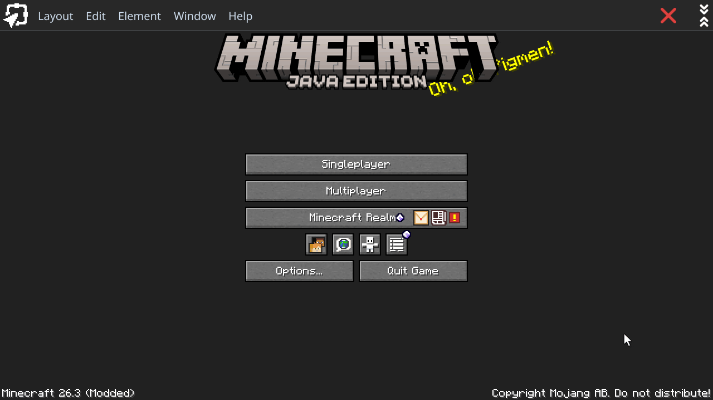

# Fondos del menú

Un diseño puede darle a su pantalla su propio fondo: una imagen, una animación, un panorama, una presentación, un video, un color, un sitio web o un shader. Este reemplaza el fondo normal de la pantalla, como el panorama de la pantalla de título, el desenfoque de otros menús o el mundo detrás del menú de pausa.

> [!TIP]
> Para que todos los menús tengan el mismo fondo sin crear diseños, usa las [Personalizaciones globales](/global-customizations#menu-backgrounds).

# Configurar un fondo

1. Abre un diseño de la pantalla en el [editor de diseños](/layout-editor).
2. Haz clic derecho en el fondo del editor y abre **Fondos del menú**. También está en **barra de menú -> Diseño -> Propiedades del diseño**.
3. Abre un tipo de fondo, como **Imagen**.
4. Haz clic en **Mostrar fondo** para cambiarlo a **Activado**.
5. Configura el fondo; por ejemplo, usa **Elegir imagen** para un fondo de imagen.

En **Fondos del menú**, cada tipo que esté activado tiene un ✔ al lado, y cada tipo desactivado tiene un ✖. Pasa el cursor sobre un tipo para ver qué hace.

Para recuperar el fondo normal de la pantalla, vuelve a cambiar **Mostrar fondo** del tipo a **Desactivado**. Su configuración se conserva, así que puedes volver a activarlo después.

# Tipos de fondo

## Imagen

Una imagen de tus archivos, de un sitio web o de los recursos del juego, extendida por toda la pantalla. Las imágenes animadas también se reproducen. Los archivos compatibles aparecen en [Imágenes](/images).

- **Elegir imagen**: la imagen. Consulta de dónde puede provenir en [Recursos](/resources).
- **Elegir imagen alternativa**: se muestra mientras no se pueda cargar la imagen, por ejemplo, si estás sin conexión y la imagen está en línea.
- **Reiniciar texturas animadas al abrir la pantalla**: vuelve a iniciar una [imagen animada](/animations) cada vez que se abre la pantalla. De lo contrario, continúa reproduciéndose desde donde se quedó.
- **Repetir textura**: repite la imagen en mosaico por toda la pantalla en lugar de extenderla. Consulta [División en nueve y mosaicos](/nine-slicing-and-tiling).
- **Deslizar imágenes panorámicas de izquierda a derecha**: una imagen panorámica, como una foto de un paisaje completo, cubre la altura de la pantalla y se desliza lentamente de un lado a otro, con una breve pausa en cada extremo.
- **Efecto de paralaje** y su configuración: la imagen se mueve un poco con el mouse. Consulta [Efecto de paralaje](/parallax#menu-backgrounds).

**Deslizar imágenes panorámicas de izquierda a derecha** no se puede activar al mismo tiempo que **Repetir textura** o **Efecto de paralaje**.

## Color

Un solo color para toda la pantalla.

- **Color [HEX]**: el color, por ejemplo, `#1B2440`. Puedes agregar dos dígitos más para hacerlo traslúcido, como `#1B2440C8`. También puede ser un [marcador de posición](/placeholders).

El color queda debajo de los demás fondos del diseño, así que rellena sus partes transparentes. Consulta [Apilar fondos](#stacking-backgrounds).

## Panorama cúbico

Un panorama que gira lentamente, como el de la pantalla de título. Los panoramas se crean en `config/fancymenu/panoramas/`; consulta [Panoramas](/panoramas).

- **Nombre del panorama**: abre **Elegir panorama**, donde puedes elegir uno de tus panoramas y ver una vista previa.
- **Quitar panorama**: elimina el panorama.

Si no hay ningún panorama, el fondo muestra la textura faltante morada y negra de Minecraft.

## Presentación

Muestra las imágenes de una presentación, una tras otra. Las presentaciones se crean en `config/fancymenu/slideshows/`; consulta [Presentaciones](/slideshows).

- **Nombre de la presentación**: abre **Elegir presentación**, donde puedes elegir una de tus presentaciones.
- **Quitar presentación**: elimina la presentación.

Si no hay ninguna presentación, el fondo también muestra la textura faltante de Minecraft.

## Video

Reproduce un video de tus archivos, de un sitio web o de los recursos del juego. Requiere Watermedia; consulta [Videos](/video#requirements). Si no lo tienes, el fondo muestra un aviso con enlaces de descarga.

- **Fuente del video**: el video.
- **Repetir video**, **Volumen** y **Canal de sonido**: cómo se reproduce.
- **Efecto de paralaje** y su configuración: funcionan igual que con los fondos de imagen.
- **Reproducir video en el editor de diseños**: si se desactiva, el video permanece en pausa en el editor de diseños.

Las [acciones](/video) pueden pausar el video y cambiar su volumen y tiempo de reproducción. Necesitan el ID del fondo: haz clic en **Copiar identificador del fondo** en su configuración.

## Navegador

Un sitio web que ocupa toda la pantalla, como el [elemento Navegador](/elements#browser).

> [!IMPORTANT]
> El navegador requiere el mod [Rinku](https://modrinth.com/mod/rinku). Si no lo tienes, el fondo es rojo e indica que falta Rinku.

- **URL**: el sitio web. Puede contener [marcadores de posición](/placeholders).
- **Procesar clics del mouse**, **Procesar desplazamiento del mouse** y **Procesar pulsaciones de teclas**: permiten que los jugadores hagan clic, se desplacen y escriban en el sitio web. El navegador toma el control del teclado al abrirse la pantalla.
- **Consumir clics del mouse**, **Consumir desplazamiento del mouse** y **Consumir pulsaciones de teclas**: impiden que los clics, el desplazamiento y las teclas lleguen al sitio web, para que la pantalla tampoco reaccione a ellos.
- **Silenciar navegador**, **Volumen de audio/video**, **Repetir videos** y **Ocultar controles de video**: opciones para el contenido multimedia del sitio web.

Los botones y elementos que están delante del fondo siempre reciben primero los clics. En el editor de diseños, el fondo muestra rayas en lugar del sitio web.

## Shader GLSL

Dibuja un shader, un pequeño programa para la tarjeta gráfica, como ondas animadas, estrellas o patrones. También funcionan los shaders de Shadertoy.

- **Fuente del shader**: el código del shader.
- **Mostrar errores de compilación**: muestra en pantalla los errores del código. Desactívalo cuando termines el diseño.

Las demás opciones, como los pases adicionales, las texturas y el tiempo, se explican en la [API de shaders GLSL](/glsl-shader-api).

## Video [Rinku]

Un fondo de video antiguo que requiere Rinku. Solo aparece en la lista cuando está activado, como en los diseños de versiones anteriores. Usa **Video** en su lugar.

# Configuración para todos los fondos

Debajo de los tipos, **Fondos del menú** incluye opciones que se aplican a todos los fondos del diseño:

- **Conservar la proporción de aspecto del fondo**: conserva las proporciones de los fondos de imagen, presentación y video. Aun así, cubren toda la pantalla, por lo que se recortan las partes que no caben. Si se desactiva, se estiran para ocupar la pantalla.
- **Mostrar superposición oscura sobre el fondo personalizado**: coloca sobre los fondos la capa oscura y traslúcida de los menús de Minecraft, para que los botones y el texto resalten más.
- **Aplicar desenfoque de fondo vanilla**: desenfoca los fondos, como Minecraft desenfoca el mundo detrás de los menús. La intensidad depende de la opción **Desenfoque del fondo del menú** del jugador, en **Configuración de accesibilidad** de Minecraft. En `0`, no hay desenfoque.

De izquierda a derecha: sin opciones, **Mostrar superposición oscura sobre el fondo personalizado** y **Aplicar desenfoque de fondo vanilla**.

# Apilar fondos

Puedes activar varios tipos en un mismo diseño. Se dibujan unos sobre otros en este orden, de abajo hacia arriba:

1. Color
2. Panorama cúbico
3. Imagen
4. Presentación
5. Video
6. Video [Rinku]
7. Navegador
8. Shader GLSL

Los tipos que agregan otros mods se dibujan al final, encima de los demás.

FancyMenu dibuja negro detrás de los fondos, así que las partes transparentes de una imagen se ven negras. Un fondo de color debajo de la imagen las rellena con ese color:

A la izquierda solo está activada la imagen. A la derecha, un fondo de color rellena el cielo.

- Una imagen, presentación o shader traslúcido sobre un panorama cúbico funciona de la misma manera, como un marco alrededor de un panorama giratorio.
- Un fondo de video nunca es traslúcido. Cubre todo lo que está debajo, incluso las partes a las que no llega el video.

## Varios diseños

Cuando hay varios diseños activos en una pantalla, como un [diseño universal](/universal-layouts) y un diseño de la pantalla, sus fondos también se apilan:

- El diseño con el **Índice del diseño [Orden de varios diseños]** más alto queda encima. Configúralo en el menú que aparece al hacer clic derecho en el fondo del editor.
- Si uno de los diseños activa una [opción para todos los fondos](#settings-for-all-backgrounds), se activa para los fondos de todos ellos.
- El editor de diseños solo muestra los fondos del diseño que estás editando.

# Información útil

- Los elementos del diseño siempre quedan delante de sus fondos.
- **Copiar identificador del fondo**, en la configuración de cada tipo, copia el ID del fondo para usarlo con acciones y marcadores de posición que lo controlan, como los de los [fondos de video](/video).
- **Exportar para IA**, en la configuración de cada tipo, copia el fondo para usarlo en un [chat de IA](/export-for-ai).
- El encabezado y el pie de página de las pantallas con listas, como la lista de mundos, tienen sus propias texturas: haz clic derecho en el fondo del editor y abre **Personalizaciones del encabezado/pie de página**.
