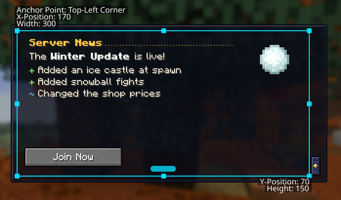

# Áreas desplazables

Un **área desplazable** contiene otros elementos y permite que los jugadores se desplacen por ellos. Es ideal para listas largas de botones, selectores de mundos o servidores, exhibiciones de objetos, paneles de noticias y todo lo que no quepa en una sola pantalla.

Todo lo que está dentro del área se desplaza con ella y queda recortado en sus bordes.


> [!NOTE]
> Solo se pueden agregar a un área los elementos que añadiste al diseño. Los [elementos de Vanilla](/vanilla-elements) no se pueden agregar porque pertenecen al menú en sí.

# Agregar un área desplazable

1. Abre un diseño en el editor de diseños.
2. Haz clic derecho en el fondo del editor y selecciona **Nuevo elemento -> Área desplazable**.
3. Arrastra elementos al área.

# Agregar y sacar elementos

- Arrastra un elemento al área para agregarlo. El área se ilumina cuando lo acepta. El elemento solo se agrega si una parte de él queda dentro del área.
- Para arrastrar varios elementos seleccionados a la vez, mantén presionada la tecla `Ctrl` (`Cmd` en macOS) al empezar a arrastrarlos.
- Si arrastras un elemento cerca del borde del área, esta se desplaza para que puedas llegar a todas sus partes. También puedes desplazarla con la rueda del mouse en el editor.
- Para sacar un elemento, arrástralo fuera del área o haz clic derecho sobre él y selecciona **Sacar del área desplazable**. El elemento se queda en el mismo lugar de la pantalla.
- También puedes agregar áreas dentro de otras áreas.

## Capas

En el [widget Capas](/layout-editor#scrollable-areas), los elementos de un área aparecen debajo de ella. Arrastra las capas para agregarlas a un área, sacarlas de ella o cambiar su orden. El botón para contraer la capa de un área oculta sus elementos en la lista.

## Copiar y eliminar

- Al copiar un área, también se copia todo lo que contiene.
- Si eliminas un área que todavía contiene elementos, se te preguntará qué hacer con ellos: **Eliminar elementos** también los elimina, mientras que **Conservar elementos** los deja en el mismo lugar de la pantalla.

# Organizar elementos

Haz clic derecho en el área y abre **Organización**. **Modo** determina cómo coloca el área sus elementos:

- **Anclajes**: Tú colocas los elementos, como en el resto del diseño. Las áreas nuevas usan este modo.
- **Pila**: Los elementos se colocan uno tras otro.
- **Cuadrícula**: Los elementos se colocan en celdas del mismo tamaño.
- **Flujo**: Los elementos se colocan uno junto a otro y empiezan una nueva línea cuando se llena la actual.


## Modo Anclajes

Los elementos de un área tienen sus propios anclajes, que se refieren al contenido del área en lugar de a la pantalla. Por ejemplo, el anclaje **Esquina superior izquierda** corresponde a la esquina superior izquierda del contenido, y los anclajes inferiores se fijan al final del contenido. Consulta [Posicionar elementos](/positioning-elements) para saber cómo funcionan los anclajes.

- **Estirar horizontalmente** y **Estirar verticalmente** hacen que un elemento tenga el mismo ancho o alto que el contenido.
- Los elementos solo se pueden anclar a otros elementos de la misma área. Al mover un elemento dentro o fuera de un área, los elementos que estaban anclados al otro lado del borde del área reciben el anclaje **Esquina superior izquierda** y se quedan en el mismo lugar.

### Tamaño del contenido

En el modo Anclajes, tú decides el tamaño del contenido y, por lo tanto, cuánto se desplaza el área.

Selecciona el área y arrastra el control que está al final del contenido. Para continuar más allá del borde del área, arrástralo hacia afuera; el área se desplazará a medida que lo hagas.



También puedes hacer clic derecho en el área y abrir **Tamaño del contenido**:

- **Ancho del contenido** y **Alto del contenido** establecen el tamaño con un valor numérico. Admiten [marcadores de posición](/placeholders). Si usas un marcador de posición, no podrás arrastrar el control.
- **Ajustar al contenido** hace que el contenido termine justo donde termina el último elemento. Los elementos anclados al centro o al final del contenido se mueven con él, así que no se toman en cuenta.

El contenido nunca es más pequeño que el área y solo aumenta de tamaño en las direcciones en las que se desplaza el área.

## Pila, Cuadrícula y Flujo

- El área coloca los elementos por ti y el contenido crece automáticamente a medida que los agregas.
- Arrastra un elemento para cambiarlo de orden. Una línea indica dónde quedará.
- Al cambiar de Anclajes a uno de estos modos, los elementos conservan el orden que tenían en pantalla. Al volver a Anclajes, cada elemento conserva su posición.
- Los elementos que ocultan sus [requisitos](/conditions) no dejan espacios vacíos.
- En estos modos no se puede estirar.
- Estos modos solo permiten desplazarse en una dirección. Un área configurada en **Ambas** se desplaza verticalmente.

Abre **Organización** para ajustar estos modos:

| Opción | Función |
|---|---|
| **Alineación** | Dónde se colocan los elementos en sentido perpendicular a la dirección en la que se organizan: **Inicio**, **Centro**, **Final** o **Rellenar**. Con **Rellenar**, ocupan todo el ancho disponible (o todo el alto, en las áreas que se desplazan horizontalmente). Flujo no tiene la opción **Rellenar**. |
| **Espaciado** | El espacio entre los elementos. |
| **Relleno** | El espacio entre los elementos y los bordes del contenido. |
| **Elementos por línea** | Solo para Cuadrícula. Cuántos elementos se colocan en cada línea. |
| **Ajustar tantos como sea posible** | Solo para Cuadrícula. Coloca tantos elementos como quepan en una línea, en lugar de usar una cantidad fija. **Tamaño mínimo de celda** determina cuántos caben. |

# Desplazamiento

Los jugadores se desplazan por el área con la rueda del mouse. Mantén presionada la tecla `Shift` para desplazarte horizontalmente.

- **Dirección del desplazamiento** determina si el área se desplaza **Verticalmente**, **Horizontalmente** o en **Ambas** direcciones. En la dirección en la que no se desplaza, el contenido tiene exactamente el mismo tamaño que el área.
- Los elementos de texto dentro de un área se desplazan primero. Cuando llegan al final, el área continúa desplazándose.
- Cuando los jugadores cambian de botón con `Tab`, el área se desplaza hasta el botón seleccionado.

Los menús **Desplazamiento**, **Desplazamiento automático** y **Barras de desplazamiento** tienen las mismas opciones que los elementos de texto. Consulta [Texto en los menús](/text-in-menus#scrolling-settings) para verlas todas. Estas son las diferencias:

- **Ajustar** puede hacer que el contenido se ajuste **A los elementos**, de modo que siempre haya un elemento al inicio del área, o **A las páginas**.
- Los botones y todos los demás elementos del área siguen funcionando con **Desplazar al arrastrar** activado.
- Los controles de desplazamiento son controles de píxeles, a menos que les asignes tus propias **Texturas del control de desplazamiento** o un **Color del control de desplazamiento [HEX]**.

# Fondo

Las áreas dibujan un panel detrás de su contenido. Abre **Fondo** para cambiarlo. Funciona igual que el [fondo de los elementos de texto](/text-in-menus#background): desactívalo con **Mostrar fondo**, usa tu propia textura con [división en nueve partes](/nine-slicing-and-tiling) o mosaico, y cambia hasta dónde llega con **Relleno**.

# Desplazamiento con acciones

También puedes controlar y supervisar las áreas desde otras partes de FancyMenu:

- La [acción](/action-scripts) **Desplazar un elemento** desplaza un área hasta el inicio, el final, una posición o uno de los elementos que contiene.
- Los [marcadores de posición](/placeholders) **Posición de desplazamiento del elemento**, **Porcentaje de desplazamiento del elemento** y **Tamaño del contenido del elemento** indican cuánto se ha desplazado el área y cuál es el tamaño de su contenido.
- El [requisito](/conditions) **El elemento está desplazado hasta el final** comprueba si el área llegó al final de su desplazamiento.
- Los [detectores](/listeners) **Al desplazarse el elemento**, **Al desplazarse el elemento al inicio** y **Al desplazarse el elemento al final** ejecutan acciones mientras el área se desplaza.

Para todo esto, necesitas el [identificador del elemento](/element-identifiers) del área. Por ejemplo, esto muestra cuánto se ha desplazado un área, de 0 a 100:

```
{"placeholder":"scroll_area_scroll_percent","values":{"element_identifier":"3f2a9c1e-7b4d-4e8a-9c2f-1d5e6a7b8c9d-1763950000000","axis":"vertical"}}
```

# Información útil

- Al ocultar un área, se oculta todo lo que contiene. La opacidad del área también se aplica a todo lo que contiene.
- Las áreas no se pueden rotar ni inclinar, y el paralaje no funciona en ellas ni en los elementos que contienen.
- Los elementos de información sobre herramientas dentro de un área quedan recortados en sus bordes, a menos que sigan al mouse.
