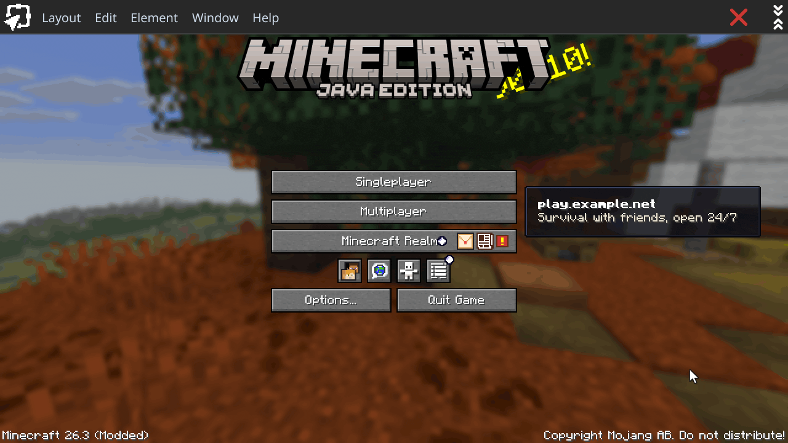

# Conditions requises

Les conditions requises sont des conditions, comme « le curseur se trouve sur ce bouton », « nous sommes en décembre » ou « un monde est chargé ». Utilisez-les pour :

- afficher un [élément](/elements) seulement dans certains cas ;
- charger une mise en page entière seulement dans certains cas ;
- rendre des boutons, des curseurs et des cases à cocher cliquables seulement dans certains cas ;
- exécuter certaines parties d’un [script d’action](/action-scripts) seulement dans certains cas.

FancyMenu vérifie constamment les conditions requises tant qu’un menu est ouvert. Les éléments s’affichent, se masquent ou changent donc immédiatement. Cette boîte d’information s’affiche uniquement lorsque le curseur se trouve sur « Multijoueur » :

# Où les trouver

| Emplacement | Fonction des conditions requises |
|---|---|
| Clic droit sur un élément -> **Conditions requises de chargement** | L’élément s’affiche uniquement lorsque les conditions sont remplies. Fonctionne aussi avec les [éléments Vanilla](/vanilla-elements). |
| Clic droit sur l’arrière-plan de l’éditeur -> **Conditions requises de chargement [pour toute la mise en page]** | La mise en page entière se charge uniquement lorsque les conditions sont remplies. Consultez la section [Conditions requises pour toute la mise en page](#conditions-requises-pour-toute-la-mise-en-page). |
| Clic droit sur un bouton, un curseur ou une case à cocher -> **État actif du contrôle** | Le contrôle est cliquable uniquement lorsque les conditions sont remplies. Sinon, il est grisé. Les boutons Vanilla proposent aussi cette option. |
| IF, ELSE-IF et WHILE dans les [scripts d’action](/action-scripts#statements) | Les actions qu’ils contiennent s’exécutent uniquement lorsque les conditions sont remplies. |

Dans l’éditeur de mise en page, les éléments sont toujours visibles afin que vous puissiez les modifier. Les conditions requises des éléments s’appliquent en dehors de l’éditeur.

> [!TIP]
> [Visibilité des éléments](/element-visibility) présente d’autres façons d’afficher et de masquer des éléments, par exemple en utilisant des délais, des fondus ou un bouton pour les activer et les désactiver.

# Ajouter une condition requise

1. Faites un clic droit sur l’élément, puis cliquez sur **Conditions requises de chargement**. La fenêtre **Gérer les conditions requises** s’ouvre.
2. Faites un clic droit sur la liste vide et cliquez sur **Ajouter une condition requise**, ou appuyez sur `A`.
3. Cliquez sur une catégorie dans **Conditions requises disponibles**, ou commencez à saisir du texte pour rechercher des noms et des descriptions. La **Description de la condition requise** explique la condition sélectionnée.
4. Cliquez sur **Étape suivante** pour définir sa valeur. Les conditions requises sans valeur affichent plutôt le bouton **Terminé**. Un double-clic sur une condition requise produit le même résultat.
5. Saisissez la valeur, puis cliquez sur **Terminé**. Par exemple, **L’élément est survolé** nécessite l’identifiant de l’élément. Faites un clic droit sur un élément et cliquez sur **Copier l’identifiant de l’élément** pour l’obtenir.
6. Cliquez sur **Terminé** dans la fenêtre **Gérer les conditions requises**.

## Mode de condition requise

Le bouton **Mode de condition requise** dans le sélecteur de conditions permet de choisir entre :

- **Normal** : la condition est remplie lorsque son résultat est vrai.
- **Inverse** : la condition est remplie lorsque son résultat est faux. Par exemple, **Un monde est chargé** en mode inverse est remplie uniquement dans les menus principaux.

La fenêtre **Gérer les conditions requises** affiche le mode et la valeur de chaque condition.

## Valeurs

- Les valeurs prennent en charge les [espaces réservés](/placeholders) et vos [variables](/variables#showing-variables-in-text), comme `$$coins`. FancyMenu les remplace à chaque vérification de la condition.
- De nombreux champs de valeur proposent des suggestions pendant la saisie, par exemple pour les biomes, les identifiants de mods, les langues ou les noms de vos variables. Cliquez sur une suggestion ou appuyez sur `Tab`.
- Les conditions requises avec une valeur simple ouvrent un éditeur de texte sur une seule ligne. Son titre indique ce qu’il faut saisir, par exemple **Identifiant de l’élément cible**.

## Gérer les conditions requises

Faites un clic droit sur la liste, une condition requise ou un groupe dans la fenêtre **Gérer les conditions requises** pour accéder aux options suivantes :

| Option | Raccourci | Fonction |
|---|---|---|
| **Ajouter une condition requise** | `A` | Ajoute une condition requise. |
| **Ajouter un groupe** | `G` | Ajoute un groupe (voir ci-dessous). |
| **Modifier la condition requise** | `Entrée` ou double-clic | Ouvre le sélecteur de conditions avec son type, son mode et sa valeur. |
| **Supprimer la condition requise** / **Supprimer le groupe** | `Suppr` | Supprime l’élément. |
| **Annuler** / **Rétablir** | `Ctrl + Z` / `Ctrl + Y` | Annule ou rétablit les modifications effectuées dans cette fenêtre. |
| **Exporter les conditions requises pour l’IA** | | Exporte toutes les conditions requises de la fenêtre pour une [conversation avec une IA](/export-for-ai), y compris les modifications non enregistrées. |

Les touches `Haut` et `Bas` permettent de sélectionner la condition requise précédente ou suivante. Le bouton **Terminé** (`Ctrl + S`) enregistre les modifications ; **Annuler** abandonne toutes les modifications effectuées dans la fenêtre. Sur macOS, utilisez `Cmd` au lieu de `Ctrl`.

Lorsque plusieurs éléments sont sélectionnés, **Conditions requises de chargement** modifie les conditions de tous ces éléments. Si leurs conditions diffèrent, FancyMenu vous demande d’abord confirmation, car elles seront toutes remplacées.

# Combiner des conditions requises

Toutes les conditions requises de la fenêtre **Gérer les conditions requises** doivent être remplies. Pour exprimer « ceci OU cela », utilisez un groupe.

Un groupe fonctionne comme une seule condition requise :

- Mode **Et** : toutes les conditions du groupe doivent être remplies. Les nouveaux groupes utilisent ce mode par défaut.
- Mode **Ou** : il suffit qu’une seule condition du groupe soit remplie.

1. Faites un clic droit sur la liste, puis cliquez sur **Ajouter un groupe**, ou appuyez sur `G`. Le groupe reçoit un nom tel que `group_1`.
2. Faites un clic droit sur le groupe et cliquez sur **Mode du groupe** pour basculer entre **Et** et **Ou**.
3. Cliquez sur **Modifier les conditions requises du groupe**, ou double-cliquez sur le groupe. Une fenêtre semblable à **Gérer les conditions requises** s’ouvre.
4. Ajoutez les conditions requises du groupe, puis cliquez sur **Terminé**.

Par exemple, pour afficher un message de Noël en décembre ou lorsque le joueur active `xmas_lights`, créez un groupe **Ou** contenant **Mois actuel** avec la valeur `12` et **Valeur d’une variable (variable FM)** pour la variable `xmas_lights` avec la valeur `on`.

- Les groupes peuvent contenir d’autres groupes, par exemple pour exprimer « (A et B) ou (C et D) ». Le titre de la fenêtre indique où vous vous trouvez, par exemple `Modifier le groupe : group_1 › group_2`.
- **Modifier l’identifiant du groupe** permet de renommer un groupe. Chaque nom ne peut être utilisé qu’une seule fois, y compris dans les groupes.
- Un groupe vide en mode **Ou** n’est jamais rempli.

# Conditions requises pour toute la mise en page

Les conditions requises pour toute la mise en page déterminent si une mise en page entière se charge. Utilisez-les pour créer une version nocturne de votre écran titre, une mise en page par langue ou une mise en page qui s’affiche uniquement en solo.

Faites un clic droit sur l’arrière-plan de l’éditeur et cliquez sur **Conditions requises de chargement [pour toute la mise en page]**. Vous trouverez aussi cette option dans **barre de menus -> Mise en page -> Propriétés de la mise en page**.

- Si le résultat change alors que le menu est ouvert, FancyMenu reconstruit l’écran avec les mises en page dont les conditions sont alors remplies.
- Elles fonctionnent aussi avec les [mises en page universelles](/universal-layouts).
- Pour activer et désactiver une mise en page à l’aide d’un bouton, placez le bouton dans une autre mise en page. Consultez [Activer et désactiver des mises en page](/element-visibility#turning-layouts-on-and-off).

# Bon à savoir

- Les conditions requises liées au monde et au joueur ne sont jamais remplies lorsqu’aucun monde n’est chargé, par exemple dans les menus principaux.
- Les conditions requises concernant les éléments, le curseur, les inventaires, le joueur et le monde ne fonctionnent pas dans un [Ticker](/elements#ticker) lorsque l’option **Asynchrone** est activée. FancyMenu affiche alors une erreur indiquant le nom de la condition concernée.
- Les conditions requises des extensions que vous avez supprimées sont ignorées. Enregistrer la mise en page dans l’éditeur les supprime définitivement.
- **barre de menus -> Personnalisation -> Paramètres -> Durée de mise en cache des conditions requises [ms]** réutilise les résultats des conditions pendant quelques millisecondes, ce qui accélère les grandes mises en page. La valeur `0` désactive cette option ; c’est la valeur par défaut. La mise en cache peut entraîner un comportement inattendu des scripts d’action et des modifications rapides.

# Toutes les conditions requises

Les conditions sont classées comme dans le sélecteur : d’abord par catégorie, puis par nom. Dans le sélecteur, les conditions sans catégorie se trouvent tout en bas ; elles figurent ici dans la section [Autres](#autres).

## Interface graphique

### Le type de curseur actif est

**Identifiant :** `is_active_cursor_type`

Condition remplie lorsque le curseur de la souris a une forme donnée, par exemple **Main pointant** au-dessus d’un lien ou **Curseur de saisie** au-dessus d’un champ de texte.

- Valeur : cliquez sur **Type de curseur** pour choisir **Normal**, **Curseur de saisie**, **Réticule**, **Main pointant**, **Redimensionnement horizontal**, **Redimensionnement vertical**, **Redimensionnement nord-ouest/sud-est**, **Redimensionnement nord-est/sud-ouest**, **Redimensionnement dans toutes les directions** ou **Interdit**.

### Un bouton quelconque est survolé

**Identifiant :** `fancymenu_visibility_requirement_is_any_button_hovered`

Condition remplie lorsque le curseur se trouve sur un bouton visible, Vanilla ou personnalisé.

### Un élément quelconque est survolé

**Identifiant :** `fancymenu_visibility_requirement_is_any_element_hovered`

Condition remplie lorsque le curseur se trouve sur un élément visible, pas seulement un bouton.

### Un écran quelconque est ouvert

**Identifiant :** `is_any_screen_open`

Condition remplie lorsqu’un menu est ouvert, par exemple le menu de pause ou l’inventaire. Elle ne l’est pas lorsque vous jouez sans menu.

### Le bouton est actif

**Identifiant :** `fancymenu_visibility_requirement_is_button_active`

Condition remplie lorsqu’un bouton est cliquable.

- Valeur : l’[identifiant de l’élément](/element-identifiers) correspondant au bouton. Faites un clic droit dessus dans l’éditeur, puis cliquez sur **Copier l’identifiant de l’élément**.

### La barre de menus de personnalisation est visible

**Identifiant :** `is_customization_menu_bar_visible`

Condition remplie lorsque la barre de menus de FancyMenu est affichée. Elle ne l’est pas en mode Modpack ni lorsque la barre de menus est désactivée.

### L’élément a le focus

**Identifiant :** `is_element_focused`

Condition remplie lorsqu’un élément a le focus. Les boutons et les curseurs obtiennent le focus lorsque vous cliquez dessus ou que vous les sélectionnez avec les touches fléchées ou `Tab`. Les sélectionner au clavier ne compte pas comme les survoler : pour permettre aux joueurs utilisant le clavier d’activer la condition, placez-la dans un [groupe Ou](#combiner-des-conditions-requises) avec **L’élément est survolé**.

- Valeur : l’[identifiant de l’élément](/element-identifiers), par exemple `mc_titlescreen_multiplayer_button`.

### L’élément est survolé

**Identifiant :** `fancymenu_visibility_requirement_is_element_hovered`

Condition remplie lorsque le curseur se trouve sur un élément. L’élément doit être visible.

- Valeur : l’[identifiant de l’élément](/element-identifiers), par exemple `mc_titlescreen_multiplayer_button` pour le bouton Multijoueur de l’écran titre. Faites un clic droit sur un élément dans l’éditeur, puis cliquez sur **Copier l’identifiant de l’élément** pour l’obtenir.

### L’élément a défilé jusqu’en bas

**Identifiant :** `is_scroll_area_scrolled_to_end`

Condition remplie lorsqu’une [zone défilable](/scrollable-areas) ou un élément Texte a défilé jusqu’en bas. Un élément qui ne contient rien à faire défiler est considéré comme arrivé en bas. Pratique pour un bouton **Accepter** qui ne devient actif qu’après que le joueur a parcouru les règles.

- Valeur : l’[identifiant de l’élément](/element-identifiers) correspondant à la zone défilable ou à l’élément Texte.

### L’échelle de l’interface graphique est

**Identifiant :** `fancymenu_loading_requirement_is_gui_scale`

Condition remplie lorsque l’échelle de l’interface graphique de Minecraft correspond à la valeur indiquée.

- Valeur : un nombre, par exemple `2` pour cette échelle exacte, `>2` pour une valeur supérieure à 2 ou `<4` pour une valeur inférieure à 4. Les décimales sont également acceptées, par exemple `<3.5`.
- Séparez plusieurs conditions par des virgules. Pour les nombres sans opérateur, l’une des valeurs doit correspondre, par exemple `2,3`. Toutes les conditions `>` et `<` doivent être remplies, par exemple `>1,<4`.

### Une touche est enfoncée

**Identifiant :** `is_key_pressed`

Condition remplie tant qu’une touche est maintenue enfoncée. Pour exécuter des actions une seule fois par pression, utilisez plutôt l’événement [**Lorsqu’une touche du clavier est enfoncée**](/listeners#on-keyboard-key-pressed).

- Valeur : cliquez sur **Changer la touche** dans **Sélection de la touche**, puis appuyez sur la touche.

### La mise en page est activée

**Identifiant :** `fancymenu_visibility_requirement_is_layout_enabled`

Condition remplie lorsqu’une mise en page est activée.

- Valeur : le nom de la mise en page, par exemple `winter_title_screen`.

### La superposition de débogage de Minecraft est activée

**Identifiant :** `is_debug_overlay_enabled`

Condition remplie lorsque l’écran de débogage F3 est affiché. Elle ne l’est pas lorsque l’ATH est masqué avec F1.

### Le mode Modpack est activé

**Identifiant :** `is_modpack_mode_enabled`

Condition remplie lorsque le mode Modpack de FancyMenu est activé.

### Le titre de l’écran est

**Identifiant :** `is_menu_title`

Condition remplie lorsque le titre de l’écran ouvert correspond, par exemple « Options » ou « Menu du jeu ». Il s’agit du titre visible par les joueurs, et non de l’[identifiant de l’écran](/screen-identifiers).

- Valeur : le texte du titre ou sa clé de traduction, par exemple `options.title`. La fenêtre des valeurs affiche les deux pour l’écran que vous modifiez et propose des clés de traduction.
- Les clés de traduction fonctionnent dans toutes les langues. Le texte du titre doit correspondre exactement.

## Temps réel

Ces conditions consultent l’horloge de l’ordinateur du joueur. Séparez plusieurs valeurs par des virgules : l’une d’elles doit correspondre.

### Le jour actuel est

**Identifiant :** `fancymenu_visibility_requirement_is_realtime_day`

Condition remplie certains jours du mois.

- Valeur : de `1` à `31`, par exemple `24,25,26`.

### L’heure actuelle est

**Identifiant :** `fancymenu_visibility_requirement_is_realtime_hour`

Condition remplie à certaines heures.

- Valeur : de `0` à `23`, par exemple `20,21,22,23` pour la soirée.

### La minute actuelle est

**Identifiant :** `fancymenu_visibility_requirement_is_realtime_minute`

Condition remplie à certaines minutes de l’heure.

- Valeur : de `0` à `59`.

### Le mois actuel est

**Identifiant :** `fancymenu_visibility_requirement_is_realtime_month`

Condition remplie certains mois.

- Valeur : de `1` (janvier) à `12` (décembre), par exemple `12` pour Noël.

### La seconde actuelle est

**Identifiant :** `fancymenu_visibility_requirement_is_realtime_second`

Condition remplie à certaines secondes de la minute.

- Valeur : de `0` à `59`.

### Le jour de la semaine actuel est

**Identifiant :** `fancymenu_visibility_requirement_is_realtime_week_day`

Condition remplie certains jours de la semaine.

- Valeur : de `1` (dimanche) à `7` (samedi), par exemple `1,7` pour le week-end.

### L’année actuelle est

**Identifiant :** `fancymenu_visibility_requirement_is_realtime_year`

Condition remplie certaines années.

- Valeur : l’année complète, par exemple `2027`.

## Système

### Le fichier ou dossier existe

**Identifiant :** `fancymenu_loading_requirement_file_exists`

Condition remplie lorsqu’un fichier ou un dossier existe.

- Valeur : un chemin dans le dossier du jeu, par exemple `config/mymodpack/welcome_seen.txt`. Les chemins commençant par `.minecraft/` pointent vers le dossier `.minecraft` par défaut.

### Une connexion Internet est disponible

**Identifiant :** `is_internet_connection_available`

Condition remplie lorsque l’ordinateur est connecté à Internet. FancyMenu vérifie cela en arrière-plan de temps à autre.

### Le système d’exploitation est Linux

**Identifiant :** `fancymenu_loading_requirement_is_os_linux`

Condition remplie sous Linux. Techniquement, elle l’est sur tout système qui n’est ni Windows ni macOS.

### Le système d’exploitation est macOS

**Identifiant :** `fancymenu_loading_requirement_is_os_macos`

Condition remplie sous macOS.

### Le système d’exploitation est Windows

**Identifiant :** `fancymenu_loading_requirement_is_os_windows`

Condition remplie sous Windows.

### Le planificateur est en cours d’exécution

**Identifiant :** `fancymenu_visibility_requirement_is_scheduler_running`

Condition remplie lorsqu’un [planificateur](/schedulers) est en cours d’exécution.

- Valeur : l’identifiant du planificateur, par exemple `my_scheduler`.

## Fenêtre

Les dimensions de la fenêtre sont exprimées en pixels réels de la fenêtre du jeu, et non en pixels de l’interface graphique. La description de la condition indique les dimensions actuelles.

### Le jeu est en plein écran

**Identifiant :** `fancymenu_loading_requirement_is_fullscreen`

Condition remplie lorsque le jeu est en plein écran.

### La hauteur de la fenêtre est

**Identifiant :** `fancymenu_loading_requirement_is_window_height`

Condition remplie lorsque la fenêtre a une hauteur donnée.

- Valeur : la hauteur, par exemple `1080`. Séparez plusieurs hauteurs par des virgules : l’une d’elles doit correspondre.

### La hauteur de la fenêtre est supérieure à

**Identifiant :** `fancymenu_loading_requirement_is_window_height_bigger_than`

Condition remplie lorsque la fenêtre dépasse une hauteur donnée.

- Valeur : la hauteur, par exemple `1080`.

### La largeur de la fenêtre est

**Identifiant :** `fancymenu_loading_requirement_is_window_width`

Condition remplie lorsque la fenêtre a une largeur donnée.

- Valeur : la largeur, par exemple `1920`. Séparez plusieurs largeurs par des virgules : l’une d’elles doit correspondre.

### La largeur de la fenêtre est supérieure à

**Identifiant :** `fancymenu_loading_requirement_is_window_width_bigger_than`

Condition remplie lorsque la fenêtre dépasse une largeur donnée.

- Valeur : la largeur, par exemple `1920`.

## Monde

Ces conditions ne sont jamais remplies lorsqu’aucun monde n’est chargé. **Le joueur se trouve dans une structure** et **Le joueur se trouve dans une zone de raid actif** nécessitent que FancyMenu soit installé sur le serveur. En solo, elles fonctionnent toujours.

### Le joueur a des cœurs d’absorption

**Identifiant :** `has_player_absorption_hearts`

Condition remplie lorsque le joueur a des cœurs d’absorption dorés.

### Le joueur a un niveau de permission

**Identifiant :** `fancymenu_loading_requirement_has_player_permission_level`

Condition remplie lorsque le joueur a au moins un certain niveau de permission dans le monde ou sur le serveur, par exemple celui d’un opérateur.

- Valeur : de `0` à `4`. La valeur `0` est toujours remplie, le niveau `2` suffit pour des commandes comme `/gamemode`, et le niveau `4` est celui accordé par la commande `/op`.

### Le joueur est en mode Aventure

**Identifiant :** `fancymenu_visibility_requirement_is_adventure`

Condition remplie lorsque le joueur est en mode Aventure.

### Un effet est actif

**Identifiant :** `is_any_effect_active`

Condition remplie lorsque le joueur subit un effet quelconque, comme Vitesse ou Poison.

### La puissance d’attaque est réduite

**Identifiant :** `is_attack_strength_weakened`

Condition remplie lorsque l’attaque du joueur n’est pas complètement chargée. L’indicateur d’attaque est alors visible.

### Le bloc ou l’objet appartient à un tag

**Identifiant :** `is_in_tag`

Condition remplie lorsqu’un bloc ou un objet appartient à un tag, comme `minecraft:logs` ou `c:tools`. Les tags n’existent que lorsqu’un monde est chargé.

- Valeur : cliquez sur **Type de tag** et choisissez **Bloc** ou **Objet**, puis saisissez la **Clé du bloc/de l’objet** et le **Tag**. Les deux champs proposent des suggestions. Le `#` devant le tag est facultatif.
- La clé est très pratique avec les variables d’événement, comme `$$block_key`. Par exemple, une instruction IF dans le script de l’événement [**Lorsqu’un bloc est détruit**](/listeners#on-block-broke) peut afficher une notification uniquement pour les bûches.

### La perspective de la caméra est

**Identifiant :** `is_camera_perspective`

Condition remplie lorsque la caméra utilise une perspective donnée (F5).

- Valeur : cliquez sur le bouton pour choisir **Première personne**, **Troisième personne** ou **Vue de face**.

### Le temps est dégagé

**Identifiant :** `is_clear_weather`

Condition remplie lorsqu’il ne pleut pas et qu’il n’y a pas d’orage.

### Le joueur est en mode Créatif

**Identifiant :** `fancymenu_visibility_requirement_is_creative`

Condition remplie lorsque le joueur est en mode Créatif.

### Le curseur tient un objet de l’inventaire

**Identifiant :** `is_cursor_holding_inventory_item`

Condition remplie lorsque le curseur de la souris tient un objet dans un écran d’inventaire.

### La difficulté est

**Identifiant :** `is_difficulty`

Condition remplie lorsque le monde utilise une difficulté donnée.

- Valeur : `peaceful`, `easy`, `normal` ou `hard`.

### Un effet est actif

**Identifiant :** `is_effect_active`

Condition remplie lorsque le joueur subit un effet donné.

- Valeur : la clé de l’effet, par exemple `minecraft:speed`. Le champ propose des effets lorsque vous êtes dans un monde.

### Une entité se trouve à proximité

**Identifiant :** `is_entity_nearby`

Condition remplie lorsqu’une entité d’un type donné se trouve près du joueur.

- Valeur : la **Clé du registre de l’entité**, par exemple `minecraft:creeper`, et le **Rayon de vérification en blocs**, par exemple `10`. Le champ de la clé propose des entités lorsque vous êtes dans un monde.

### Le mode de jeu est

**Identifiant :** `is_gamemode`

Condition remplie lorsque le joueur est dans un mode de jeu donné.

- Valeur : `survival`, `creative`, `adventure` ou `spectator`.

### Le monde est en mode Hardcore

**Identifiant :** `is_hardcore`

Condition remplie dans les mondes Hardcore.

### L’emplacement de la barre rapide est sélectionné

**Identifiant :** `is_hotbar_slot_active`

Condition remplie lorsqu’un emplacement donné de la barre rapide est sélectionné.

- Valeur : de `0` (emplacement tout à gauche) à `8`.

### Le joueur se trouve dans une zone de raid actif

**Identifiant :** `is_in_active_raid_area`

Condition remplie lorsque le joueur se trouve dans la zone d’un raid, là où la barre de raid s’affiche. FancyMenu doit être installé sur le serveur.

### Un emplacement d’inventaire contient un objet

**Identifiant :** `is_inventory_slot_filled`

Condition remplie lorsqu’un emplacement de l’inventaire du joueur contient un objet.

- Valeur : le numéro de l’emplacement. De `0` à `8`, il s’agit de la barre rapide ; de `9` à `35`, du reste de l’inventaire.

### Un objet de l’inventaire est survolé

**Identifiant :** `is_item_hovered_in_inventory`

Condition remplie lorsque le curseur se trouve sur un objet dans un écran d’inventaire, comme l’inventaire du joueur ou un coffre.

### Le joueur est en multijoueur

**Identifiant :** `fancymenu_loading_requirement_is_multiplayer`

Condition remplie lorsque le joueur se trouve sur un serveur.

### Le joueur vole en mode Créatif

**Identifiant :** `is_player_creative_flying`

Condition remplie lorsque le joueur vole en mode Créatif.

### Le joueur vole avec des élytres

**Identifiant :** `is_player_flying_with_elytra`

Condition remplie lorsque le joueur plane avec des élytres.

### Le joueur est complètement gelé

**Identifiant :** `is_player_fully_frozen`

Condition remplie lorsque le joueur est entièrement gelé par la neige poudreuse et que des cœurs gelés apparaissent dans la barre de vie.

### Le joueur se trouve dans un biome

**Identifiant :** `is_player_in_biome`

Condition remplie lorsque le joueur se trouve dans un biome donné.

- Valeur : la clé du biome, par exemple `minecraft:birch_forest`. Le champ propose des biomes lorsque vous êtes dans un monde.

### Le joueur se trouve dans une dimension

**Identifiant :** `is_player_in_dimension`

Condition remplie lorsque le joueur se trouve dans une dimension donnée.

- Valeur : la clé de la dimension : `minecraft:overworld`, `minecraft:the_nether`, `minecraft:the_end` ou une dimension ajoutée par un mod. Le champ propose des dimensions lorsque vous êtes dans un monde.

### Le joueur se trouve dans un fluide

**Identifiant :** `is_player_in_fluid`

Condition remplie lorsque le joueur se trouve dans un fluide quelconque, comme l’eau ou la lave.

### Le joueur se trouve dans la lave

**Identifiant :** `is_player_in_lava`

Condition remplie lorsque le joueur se trouve dans la lave.

### Le joueur se trouve dans la neige poudreuse

**Identifiant :** `is_player_in_powder_snow`

Condition remplie lorsque le joueur se trouve dans la neige poudreuse.

### Le joueur se trouve dans une structure

**Identifiant :** `is_player_in_structure`

Condition remplie lorsque le joueur se trouve dans une structure donnée. FancyMenu doit être installé sur le serveur.

- Valeur : la clé de la structure, par exemple `minecraft:village_plains`. Le champ propose des structures lorsque vous êtes dans un monde.

### Le joueur se trouve dans l’eau

**Identifiant :** `is_player_in_water`

Condition remplie lorsque le joueur se trouve dans l’eau, même en partie.

### Le joueur saute ou tombe

**Identifiant :** `is_player_jumping`

Condition remplie lorsque le joueur est dans les airs. La nage, les fluides, le vol avec des élytres, le sommeil et la reptation ne comptent pas.

### Le joueur est gaucher

**Identifiant :** `is_left_handed`

Condition remplie lorsque l’option « Main principale » des options de personnalisation du skin de Minecraft est réglée sur « Gauche ».

### Le joueur est empoisonné

**Identifiant :** `is_player_poisoned`

Condition remplie lorsque le joueur subit l’effet Poison et que des cœurs empoisonnés apparaissent dans la barre de vie.

### Le joueur chevauche une entité avec une barre de vie

**Identifiant :** `is_player_riding_entity_with_health`

Condition remplie lorsque le joueur chevauche une entité vivante, comme un cheval ou un cochon. Les bateaux et les wagonnets ne comptent pas.

### Le joueur chevauche une entité ou un véhicule

**Identifiant :** `is_player_riding_entity`

Condition remplie lorsque le joueur chevauche quelque chose, comme un cheval, un bateau ou un wagonnet.

### Le joueur chevauche une entité capable de sauter

**Identifiant :** `is_player_riding_jumpable_entity`

Condition remplie lorsque le joueur chevauche une entité capable de sauter, comme un cheval.

### Le joueur court

**Identifiant :** `is_player_running`

Condition remplie lorsque le joueur sprinte.

### Le joueur s’accroupit

**Identifiant :** `is_player_sneaking`

Condition remplie lorsque le joueur s’accroupit.

### Le joueur nage

**Identifiant :** `is_player_swimming`

Condition remplie lorsque le joueur nage.

### Le joueur est sous l’eau

**Identifiant :** `is_player_under_water`

Condition remplie lorsque la tête du joueur est sous l’eau.

### Le joueur utilise un objet

**Identifiant :** `is_player_using_item`

Condition remplie lorsque le joueur utilise un objet, par exemple pour manger, boire une potion ou bander un arc.

### Le joueur porte une citrouille

**Identifiant :** `is_player_wearing_pumpkin`

Condition remplie lorsque le joueur porte une citrouille sculptée sur la tête.

### Le joueur subit l’effet Wither

**Identifiant :** `is_player_withered`

Condition remplie lorsque le joueur subit l’effet Wither et que des cœurs desséchés apparaissent dans la barre de vie.

### Il pleut

**Identifiant :** `is_raining`

Condition remplie lorsqu’il pleut à l’endroit où se trouve le joueur.

### Le joueur est en solo

**Identifiant :** `fancymenu_loading_requirement_is_singpleplayer`

Condition remplie lorsque le joueur se trouve dans un monde solo.

### Il neige

**Identifiant :** `is_snowing`

Condition remplie lorsqu’il neige à l’endroit où se trouve le joueur.

### Le joueur est en mode Spectateur

**Identifiant :** `fancymenu_visibility_requirement_is_spectator`

Condition remplie lorsque le joueur est en mode Spectateur.

### Le joueur est en mode Survie

**Identifiant :** `fancymenu_visibility_requirement_is_survival`

Condition remplie lorsque le joueur est en mode Survie.

### Il y a un orage

**Identifiant :** `is_thundering`

Condition remplie pendant un orage.

### Un monde est chargé

**Identifiant :** `fancymenu_loading_requirement_is_world_loaded`

Condition remplie lorsque le joueur se trouve dans un monde, en solo ou en multijoueur.

### Le joueur se trouvait dans la neige poudreuse

**Identifiant :** `was_player_in_powder_snow`

Condition remplie lorsque le joueur se trouvait dans la neige poudreuse il y a un instant.

## Autres

### La langue du jeu est

**Identifiant :** `fancymenu_loading_requirement_is_language`

Condition remplie lorsque Minecraft utilise une langue donnée.

- Valeur : le code de langue, par exemple `en_us` ou `de_de`. Le champ propose toutes les langues.

### Un mod est chargé

**Identifiant :** `fancymenu_loading_requirement_is_mod_loaded`

Condition remplie lorsque certains mods sont installés.

- Valeur : l’identifiant du mod, par exemple `jei`. Le champ propose les identifiants de vos mods. Séparez plusieurs identifiants par des virgules : ils doivent tous être installés. `optifine` vérifie si OptiFine est installé.

### Il s’agit d’un nombre

**Identifiant :** `fancymenu_visibility_requirement_is_number`

Compare deux nombres. Vous pouvez saisir des espaces réservés ou des variables dans les champs, comme `$$coins`.

- **Mode de comparaison** : **Égal à**, **Supérieur à**, **Inférieur à**, **Supérieur ou égal à** ou **Inférieur ou égal à**.
- **Nombre** : le nombre à vérifier, par exemple `$$coins`.
- **Comparer au nombre** : le nombre avec lequel le comparer, par exemple `100`.

Les décimales sont acceptées, par exemple `2.5`. Si un champ ne contient pas un nombre, la condition n’est jamais remplie.

### Un pack de ressources est activé

**Identifiant :** `is_resource_pack_enabled`

Condition remplie lorsqu’un pack de ressources est activé.

- Valeur : le nom du pack tel qu’il apparaît dans l’écran des packs de ressources, par exemple `Programmer Art`, ou son identifiant. La casse n’a pas d’importance.

### Rinku est chargé

**Identifiant :** `is_rinku_loaded`

Condition remplie lorsque le mod [Rinku](https://modrinth.com/mod/rinku) est installé. L’[élément Navigateur](/elements#browser) et les anciens [types de vidéo basés sur Rinku](/video#requirements) en ont besoin.

### L’adresse IP du serveur est

**Identifiant :** `fancymenu_visibility_requirement_is_server_ip`

Condition remplie lorsque le joueur se trouve sur un serveur donné.

- Valeur : l’adresse du serveur, par exemple `play.example.net`. Si vous indiquez un port, comme dans `play.example.net:25566`, celui-ci doit également correspondre.

### Le serveur est en ligne

**Identifiant :** `fancymenu_loading_requirement_is_server_online`

Condition remplie lorsqu’un serveur est en ligne. FancyMenu le teste en arrière-plan environ toutes les 30 secondes ; il peut donc y avoir un délai après le démarrage du jeu.

- Valeur : l’adresse du serveur, par exemple `play.example.net`.

### Il s’agit d’un texte

**Identifiant :** `fancymenu_visibility_requirement_is_text`

Compare deux textes. Vous pouvez saisir des espaces réservés ou des variables dans les champs, comme `$$key_name`.

- **Mode de comparaison** : **Égal à**, **Contient**, **Commence par** ou **Se termine par**.
- **Texte** : le texte à vérifier.
- **Comparer au texte** : le texte auquel le comparer.

La casse est importante.

### La valeur d’une variable (variable FM) est

**Identifiant :** `fancymenu_visibility_requirement_is_variable_value`

Condition remplie lorsqu’une de vos [variables](/variables) a une valeur donnée.

- **Nom de la variable** : le nom de la variable, sans `$$`. Le champ propose vos variables.
- **Valeur de la variable à vérifier** : la valeur, par exemple `on`. Elle doit correspondre à la valeur entière, en respectant la casse.

La condition n’est jamais remplie si la variable n’existe pas. Pour une variable de liste, la comparaison porte sur le tableau JSON de toutes les entrées, par exemple `["apple","banana"]`. Pour vérifier une seule entrée, utilisez **La liste contient une entrée (variable FM)**.

### La liste contient une entrée (variable FM)

**Identifiant :** `list_contains_entry`

Condition remplie lorsqu’une [variable de liste](/variables#text-and-list-variables) contient une entrée donnée.

- **Nom de la variable de liste** : le nom de la liste, sans `$$`. Le champ propose vos variables de liste et vous avertit si vous saisissez le nom d’une variable de texte.
- **Entrée à rechercher** : l’entrée. Elle doit correspondre à une entrée entière, et non à une partie de celle-ci.
- **Ignorer la casse** : lorsque cette option est activée, `Apple` correspond aussi à `apple`.

La condition n’est jamais remplie si la liste n’existe pas.

### Un bouton de la souris est enfoncé

**Identifiant :** `mouse_click`

Condition remplie tant qu’un bouton de la souris est maintenu enfoncé. Pour exécuter des actions une seule fois par clic, utilisez plutôt l’événement [**Lorsqu’un bouton de la souris est cliqué**](/listeners#on-mouse-button-clicked).

- Valeur : `left` ou `right`.

### Une seule fois par session

**Identifiant :** `once_per_session`

Condition remplie lors de sa première vérification, puis plus jamais avant le prochain redémarrage du jeu. Chaque copie de cette condition est traitée séparément.

Pour les éléments qui ne doivent s’afficher qu’une seule fois par session de jeu, l’option [**Charger une seule fois par session**](/element-visibility#load-once-per-session) des éléments est plus simple : ils restent affichés jusqu’à l’ouverture d’un nouvel écran.
