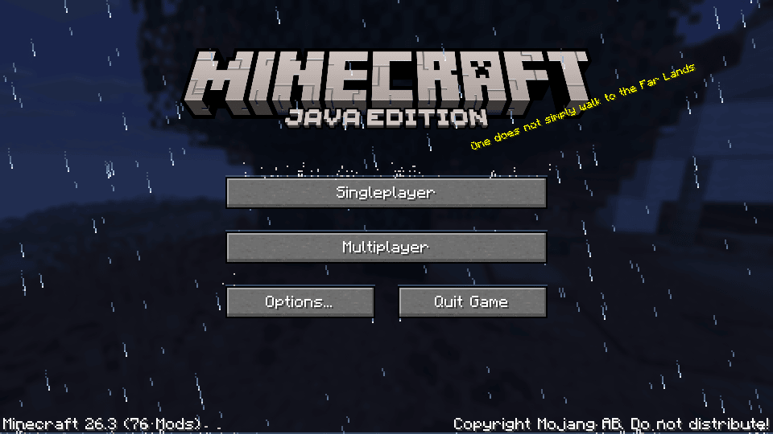
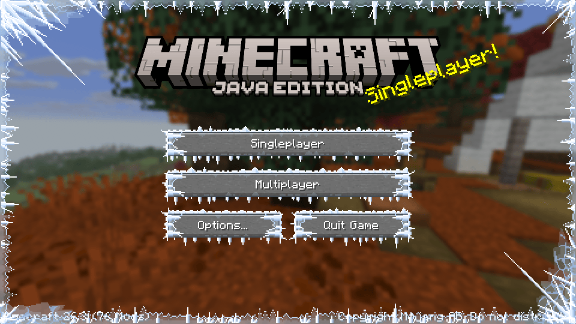
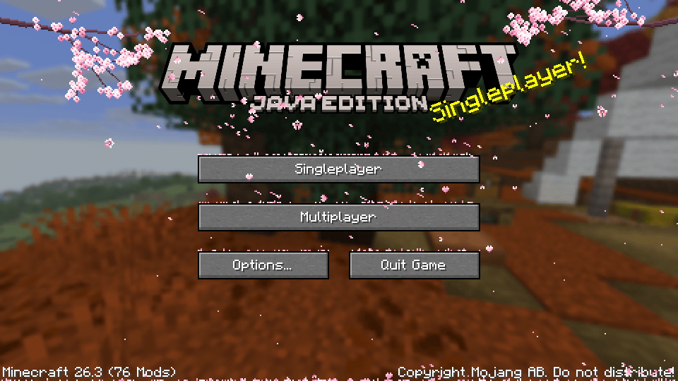

# Superpositions décoratives

Les superpositions décoratives sont des effets animés qui couvrent tout l’écran, comme des chutes de neige, des lucioles, du brouillard ou des guirlandes lumineuses. Beaucoup interagissent avec votre menu : la neige s’accumule sur vos boutons, des oiseaux s’y posent et le brouillard se dissipe autour de la souris.


# Ajouter une superposition

1. Ouvrez une disposition dans l’éditeur de disposition.
2. Faites un clic droit sur l’arrière-plan de l’éditeur, puis ouvrez **Superpositions décoratives**.
3. Ouvrez une superposition, comme **Chute de neige**.
4. Cliquez sur **Afficher la superposition** pour l’activer.

Les superpositions activées sont marquées d’un ✔ dans la liste. Une disposition peut afficher autant de superpositions que vous le souhaitez. Survolez une superposition ou l’un de ses paramètres pour découvrir son effet.

Les superpositions sont aussi visibles dans l’éditeur de disposition, mais elles n’interagissent avec vos éléments que dans le vrai menu. Enregistrez la disposition et ouvrez le menu pour voir le résultat complet.

Lorsque plusieurs dispositions d’un même écran comportent des superpositions, elles s’affichent toutes, même si une même superposition apparaît plusieurs fois. Cela inclut les [dispositions universelles](/universal-layouts).

# Paramètres communs à toutes les superpositions

Chaque superposition comporte les deux paramètres suivants :

- **Afficher la superposition** active ou désactive la superposition.
- **Calques** définit où la superposition est dessinée :
  - **Arrière-plan et premier plan** : les éléments éloignés sont dessinés derrière vos éléments et les éléments proches devant, pour donner une belle impression de profondeur. C’est le réglage par défaut.
  - **Arrière-plan uniquement** : tout est dessiné derrière vos éléments, mais devant l’arrière-plan du menu.
  - **Premier plan uniquement** : tout est dessiné devant vos éléments.

Les effets appliqués directement à vos éléments, comme la neige sur un bouton, restent toujours sur ceux-ci.

De nombreuses superpositions comportent aussi les paramètres suivants :

| Paramètre | Effet |
|---|---|
| **Quantité (%)** | Définit la quantité, de 25 % à 300 %. La valeur normale est 100 %. |
| **Taille** | Agrandit les pixels de 2 ou 3 fois. Chaque pixel reste un carré bien net. |
| **Style** | **Détaillé** affiche tous les pixels avec leurs ombres et effets supplémentaires. **Simple** est plus épuré et se rapproche du style classique. |

# Superpositions et vos éléments

De nombreuses superpositions interagissent avec vos éléments : la neige, la cendre et les confettis s’y accumulent, des stalactites de glace en pendent, de la mousse y pousse et des oiseaux s’y posent.

Pour choisir les éléments concernés, faites un clic droit sur un élément et définissez **Doit être affecté par les superpositions décoratives** :

- Cette option est activée par défaut pour les boutons, les curseurs, les cases à cocher, les champs de saisie et les [éléments vanilla](/vanilla-elements).
- Cela inclut le logo, le texte d’accueil, la marque et le copyright de l’écran-titre. Désactivez cette option pour ces éléments si vous ne souhaitez pas que quoi que ce soit s’y pose.
- Les éléments masqués ne sont pas concernés. Il en va de même pour les parties d’un élément coupées par une [zone défilante](/scrollable-areas).

> [!TIP]
> Laissez au moins 13 pixels entre vos éléments. Les éléments qui s’accumulent dessus ou pendent dessous ne peuvent pas dépasser l’espace disponible jusqu’à l’élément suivant.

Certaines superpositions réagissent aux clics, comme **Bulles**, **Givre** et **Confettis**. Vos boutons continuent de recevoir tous les clics.

# Toutes les superpositions décoratives

Voici toutes les superpositions décoratives de FancyMenu, classées par thème.

## Météo

### Chute de neige

La neige tombe et s’accumule lentement sur vos boutons et le long du bas de l’écran.


- **Accumuler la neige** permet à la neige de s’accumuler.
- **Couleur de la neige [HEX]**, **Vitesse de chute de neige**, **Quantité (%)** et **Taille** modifient la neige.

### Pluie

La pluie tombe, forme des ondulations dans de fines flaques et goutte depuis vos boutons.



- **Flaques** recouvre vos éléments et le bas de l’écran d’un film humide qui ondule lorsque les gouttes le frappent.
- **Gouttes** permet aux gouttes de s’accrocher à vos éléments et d’en tomber.
- **Éclairs de tonnerre** ajoute de temps en temps des éclairs, avec une décharge ramifiée et une lueur diffuse. **Luminosité des éclairs** définit leur intensité.
- **Couleur de la pluie [HEX]**, **Quantité (%)** et **Taille** modifient la pluie.

> [!WARNING]
> **Éclairs de tonnerre** fait clignoter l’écran. Désactivez cette option si certains joueurs sont sensibles aux lumières clignotantes.

### Brouillard

De douces couches de brume dérivent sur l’écran et vos éléments. Elles sont plus épaisses près du sol.


- **Dissiper autour du pointeur** écarte le brouillard autour de la souris.

### Givre

Votre menu se couvre de glace. La glace s’étend le long des bords, dans les coins et sur vos éléments. Cliquez dessus pour en briser un morceau.



- **Bords de l’écran**, **Coins** et **Sur les éléments** activent ou désactivent chaque partie de la glace. Les libellés de vos éléments restent dégagés.

## Nature

### Feuilles

Des feuilles tombent et sont emportées par les rafales de vent.


- **Style** permet de choisir entre des feuilles **Détaillées** et **Simples**.
- **Couleurs** permet de choisir **Mélange automnal** (cinq couleurs chaudes d’automne) ou **Plage personnalisée** (cinq couleurs comprises entre **Couleur de départ des feuilles [HEX]** et **Couleur de fin des feuilles [HEX]**).
- **Rafales de vent** active ou désactive les fortes rafales. **Intensité du vent** définit leur puissance.
- **Densité des feuilles**, **Vitesse de chute des feuilles** et **Échelle de la superposition de feuilles** modifient les feuilles.

### Fleurs de cerisier

Des branches en fleurs apparaissent dans les coins supérieurs et des pétales dérivent vers le bas.



- **Branche gauche** et **Branche droite** affichent ou masquent chaque branche.
- **Style** et **Quantité (%)** modifient les pétales.

### Végétation envahissante

La nature reprend votre menu : de la mousse, des lianes, de l’herbe et des fleurs y poussent lentement.


- **Herbe**, **Lianes à gauche**, **Lianes à droite** et **Sur les éléments** activent ou désactivent chaque type de végétation. Les libellés de vos éléments restent dégagés.
- **Fleurs sur les lianes**, **Fleurs sur les éléments** et **Fleurs dans l’herbe** permettent aux fleurs d’y éclore. **Fleurs (%)** définit leur quantité.

### Nuages

Des nuages pixelisés et cotonneux dérivent dans le ciel derrière vos éléments, sur trois plans de profondeur. Les nuages n’ont pas de paramètres propres.


### Rayons de soleil

Des rayons de soleil partent d’un soleil situé juste hors de l’écran, tandis que de la poussière danse dans la lumière.


- **Côté du soleil** définit le bord de l’écran derrière lequel se trouve le soleil. **Angle du soleil (°)** le déplace le long de ce bord.
- **Couleur de la lumière du soleil [HEX]** et **Intensité (%)** modifient la lumière.
- **Lueur du soleil** diffuse une douce lueur depuis le soleil.
- **Poussière** fait dériver de la poussière dans les rayons. Votre souris la soulève.
- **Interagir avec les éléments** fait s’arrêter les rayons sur vos éléments, éclaire leurs bords et projette des ombres. Si cette option est désactivée, les rayons brillent devant vos éléments.

### Bulles

Des bulles ondulent en remontant par groupes et glissent sous vos éléments. Cliquez dessus pour les faire éclater ! Les bulles n’ont pas de paramètres propres.


## Animaux

### Oiseaux

De petits oiseaux arrivent en volant, sautillent sur vos éléments et s’envolent lorsque la souris s’approche trop.


### Papillons

Des papillons colorés voltigent, se reposent sur vos éléments et s’éloignent de la souris.


### Chauves-souris

Des chauves-souris traversent l’écran en petits groupes et s’accrochent, endormies, sous vos éléments. Approchez-vous trop et elles se réveillent !


Les superpositions **Oiseaux**, **Papillons** et **Chauves-souris** comportent les paramètres **Quantité (%)** et **Taille**.

### Lucioles

Des groupes de lucioles brillent et se déplacent, et certaines se posent sur vos éléments.


- **Style** permet de choisir entre des lucioles **Détaillées** et **Simples**. **Corps non lumineux** affiche leur petit corps sombre entre deux clignotements.
- **Suivre la souris** permet aux groupes de suivre la souris lorsqu’elle s’approche.
- **Se poser** permet aux lucioles de se poser de temps en temps sur vos éléments.
- **Couleur des lucioles [HEX]**, **Nombre de groupes**, **Densité des groupes**, **Taille des groupes** et **Échelle des lucioles** modifient les lucioles.

### Buddy

Buddy est un petit animal de compagnie virtuel qui vit en bas de votre menu. Il se promène, indique ses besoins dans des bulles de pensée, réagit lorsque vous jouez avec lui et se souvient de tout entre les sessions de jeu.


#### Prendre soin de Buddy

Buddy a quatre besoins, qui vont de `0` à `100` :

- **Faim** diminue avec le temps. La nourriture la comble.
- **Bonheur** diminue avec le temps. Les caresses, la nourriture et les jeux l’augmentent.
- **Énergie** diminue lorsque Buddy est éveillé et remonte pendant son sommeil.
- **Amusement** diminue avec le temps. Les jeux l’augmentent.

Pour prendre soin de Buddy :

- Faites un clic gauche sur Buddy pour le caresser. Le réveiller de cette façon le rend un peu moins heureux.
- Faites un clic droit sur Buddy pour ouvrir son écran d’état. L’onglet **Statistiques** affiche ses besoins, son niveau et son XP. L’onglet **Succès** affiche ses succès.
- Cliquez sur **Nourrir** dans l’écran d’état, puis faites glisser la nourriture jusqu’à Buddy.
- Cliquez sur **Jouer** dans l’écran d’état, puis faites glisser la balle et relâchez-la pour la lancer. Buddy la poursuit et l’attrape.
- Cliquez sur **Dormir** pour laisser Buddy se reposer. Il s’endort aussi de lui-même lorsque son énergie devient très faible.
- Buddy fait ses besoins de temps en temps. Faites un clic gauche dessus pour les nettoyer. S’il y en a trois ou plus, Buddy devient de moins en moins heureux.

#### Niveaux et succès

Prendre soin de Buddy lui fait gagner de l’XP. Buddy peut passer du niveau 1 au niveau 30. Plus son niveau est élevé, plus sa faim, son bonheur et son énergie diminuent lentement : au niveau 30, ils diminuent deux fois moins vite.

#### Lorsque Buddy meurt

Si sa faim ou son bonheur reste à `0` pendant 10 heures réelles, Buddy meurt et laisse une pierre tombale. Faites un clic gauche sur la pierre tombale pour recommencer avec un nouveau Buddy. Désactivez **Buddy peut mourir** pour l’empêcher de mourir.

**Réinitialiser la sauvegarde de Buddy** permet de recommencer à tout moment.

> [!WARNING]
> La réinitialisation de Buddy supprime définitivement ses besoins, son niveau, son XP, ses succès et ses besoins faits.

#### Sauvegarde et personnalisation

Buddy se sauvegarde environ toutes les deux minutes et lorsque son écran se ferme, dans `<game-directory>/fancymenu_data/buddy/`. Chaque superposition Buddy possède sa propre sauvegarde. Consultez [Emplacements de stockage des données](/data-storage-locations).

- **Textures personnalisées** remplace les sprites, les objets, les icônes, l’écran d’état et la pierre tombale de Buddy par vos propres textures.
- **Réglage des statistiques** modifie la vitesse à laquelle ses besoins diminuent, le coût et les récompenses de ses activités, ainsi que le nombre maximal de besoins faits qui peuvent rester au sol (**Maximum de besoins faits**).

## Ciel nocturne

### Aurore boréale

Des aurores boréales lumineuses ondulent lentement dans le ciel et derrière vos éléments.


- **Couleur du bord [HEX]** définit la couleur du bord inférieur lumineux. **Couleur de la pointe [HEX]** définit la couleur vers laquelle les rayons s’estompent.

### Étoiles filantes

Un ciel nocturne scintillant apparaît derrière vos éléments, avec une étoile filante toutes les quelques secondes et une pluie de météores de temps en temps. Les étoiles filantes n’ont pas de paramètres propres.


### Lanternes célestes

Des lanternes en papier lumineuses s’envolent dans le ciel nocturne, parfois par groupes entiers. Les lanternes célestes comportent les paramètres **Quantité (%)** et **Taille**.


## Fête

### Confettis

Des canons à confettis placés dans les coins inférieurs tirent quelques confettis toutes les quelques secondes. Ceux-ci s’accumulent sur vos éléments.


- **Canons dans les coins** active ou désactive les canons.
- **Explosion au clic** déclenche une petite explosion de confettis à l’endroit où vous cliquez.
- **Mode mélange de couleurs** utilise des couleurs aléatoires. Désactivez cette option pour utiliser **Couleur des confettis [HEX]** pour tous les confettis.
- **Limite de particules au sol** définit le nombre de confettis pouvant rester au sol en même temps.
- **Quantité (%)**, **Taille** et **Vitesse de chute des confettis** modifient les confettis.

### Feux d’artifice

Des fusées s’élèvent et explosent en feux d’artifice.


- **Afficher le vol des fusées** affiche les fusées pendant leur ascension.
- **Quantité (%)**, **Taille** et **Taille des explosions** modifient les feux d’artifice.

### Guirlandes lumineuses

Des guirlandes lumineuses sont suspendues dans votre menu et se balancent au gré du vent.


- **Style** permet de choisir entre des guirlandes **Simples** et **Détaillées**. **Guirlande de pin** remplace le fil par des aiguilles de pin et des boules.
- **Programme lumineux** définit le comportement des lumières et leur clignotement (voir ci-dessous).
- **Échelle des guirlandes**, **Force du vent** et **Vitesse de scintillement** modifient toutes les guirlandes.
- **Guirlandes** propose un menu pour chacun des huit emplacements où une guirlande peut être suspendue. Activez-en une avec **Afficher la guirlande lumineuse**.

Chaque guirlande possède les paramètres suivants :

- **Nombre de lumières** définit le nombre de lumières suspendues. La valeur `0` remplit la guirlande sur toute sa longueur.
- **Couleur des lumières [HEX]** définit la couleur des lumières. **Mode lumières de Noël** leur donne plutôt plusieurs couleurs.
- **Couleur de la guirlande [HEX]** définit la couleur du fil. Utilisez le canal alpha pour le rendre transparent ou le masquer.
- **Couleurs individuelles des lumières** et **Tailles individuelles des lumières** attribuent une couleur ou une taille à chaque lumière, sous forme de liste séparée par des virgules. Si la guirlande compte plus de lumières que la liste, celle-ci recommence au début :

```
#FF0000, #00FF00, #0000FF
```

| Programme lumineux | Effet sur les lumières |
|---|---|
| **Allumé** | Toutes les lumières brillent et, de temps en temps, l’une d’elles baisse légèrement en intensité, comme de vraies lumières. |
| **Pleine intensité** | Toutes les lumières brillent à pleine intensité. |
| **Demi-intensité** | Toutes les lumières brillent à mi-intensité. |
| **Éteint** | Toutes les lumières sont éteintes. |
| **Cycle** | Enchaîne Scintillement, Poursuite, Alternance et Respiration, en changeant toutes les 7 secondes. |
| **Scintillement** | Les lumières clignotent de façon aléatoire. |
| **Poursuite** | Une lumière vive parcourt la guirlande. |
| **Alternance** | Une lumière sur deux brille, puis l’autre moitié prend le relais. |
| **Respiration** | Toutes les lumières s’intensifient et s’atténuent ensemble, lentement. |

## Épouvante

### Toiles d’araignée

Des toiles d’araignée poussiéreuses pendent dans les coins supérieurs, et de petites araignées descendent le long de leurs fils.


- **Toile gauche** et **Toile droite** affichent ou masquent chaque toile et son araignée.
- **Araignées** permet aux araignées de descendre, de rester suspendues et de remonter. Elles s’éloignent de la souris.
- **Bord fermé** relie les extrémités des fils par une bordure, afin qu’aucun fil ne s’arrête brusquement à l’écran.

### Braises

Des braises lumineuses s’élèvent du bas de l’écran, tandis que de la cendre tombe et s’accumule.


- **Cendre au sol** ajoute une épaisse couche de cendre le long du bas de l’écran, avec des points incandescents et des charbons ardents.
- **Cendre sur les éléments** permet à la cendre de s’accumuler sur vos éléments.

## Personnalisé

### Navigateur

La superposition Navigateur affiche un site web sur tout l’écran.

> [!IMPORTANT]
> La superposition Navigateur nécessite le mod [Rinku](https://modrinth.com/mod/rinku).

- **URL** définit le site web à afficher.
- **Intercepter les clics de souris**, **Intercepter le défilement de la souris** et **Intercepter les pressions sur le clavier** empêchent les entrées d’être transmises au menu situé derrière le navigateur.
- **Traiter les clics de souris**, **Traiter le défilement de la souris** et **Traiter les pressions sur le clavier** permettent au navigateur de réagir aux entrées.
- **Masquer les commandes vidéo**, **Lire les vidéos en boucle**, **Couper le son du navigateur** et **Volume audio/vidéo** contrôlent les vidéos et le son du site web.

Les paramètres d’interception et de traitement sont activés par défaut : le navigateur fonctionne donc comme un navigateur classique, devant votre menu. Pour afficher un site web uniquement en arrière-plan, désactivez-les tous.

Les sites web peuvent aussi exécuter des actions FancyMenu et lire des espaces réservés. Consultez l’[API JavaScript du navigateur](/browser-api).

### Shader GLSL

La superposition Shader GLSL affiche votre propre shader sur tout l’écran, pour créer des effets animés ou statiques. Collez le code de votre shader dans **Source du shader**.

Consultez l’[API des shaders GLSL](/glsl-shader-api) pour apprendre à écrire des shaders pour FancyMenu.
