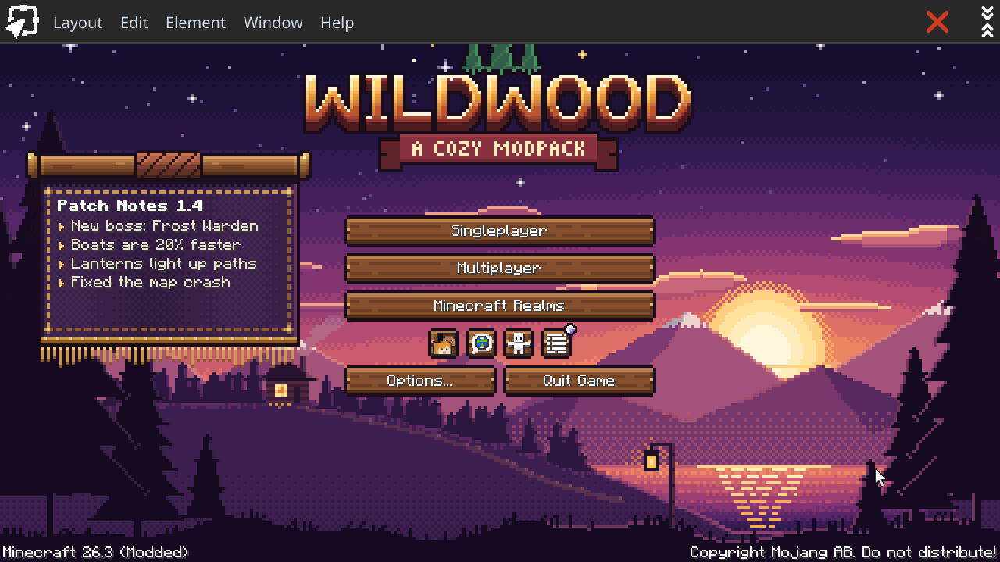

# Élément déplaçable

Un élément déplaçable est une zone invisible que les joueurs peuvent saisir avec la souris et déplacer. Tout ce qui y est ancré se déplace avec lui, par exemple un panneau contenant des notes de mise à jour ou une note avec les règles du serveur. Le menu mémorise l’endroit où les joueurs l’ont laissé, même après un redémarrage.

Les joueurs ne peuvent la déplacer qu’en dehors de l’éditeur de mise en page. Dans l’éditeur, l’élément déplaçable apparaît sous la forme d’un cadre rouge portant son nom (**Couleur dans l’éditeur** dans son menu contextuel permet de modifier le rouge), et tout reste à l’endroit où la mise en page le place.

# Rendre un élément déplaçable

1. Créez les éléments à déplacer, par exemple une image de bannière avec un élément Texte dessus.
2. Faites un clic droit sur une zone libre de l’éditeur de mise en page, puis cliquez sur **Nouvel élément -> Élément déplaçable**.
3. Donnez à l’élément déplaçable la taille de la bannière et placez-le dessus.
4. Faites un clic droit sur l’élément déplaçable, puis cliquez sur **Déplacer d’un niveau vers le bas** jusqu’à ce qu’il se trouve sous tous les éléments de la bannière. Les éléments sélectionnés s’affichent toujours au premier plan ; cliquez donc sur une zone libre pour voir le changement.
5. Ancrez la bannière à l’élément déplaçable : faites glisser la bannière légèrement hors de celui-ci, ramenez-la, puis maintenez-la à cet endroit jusqu’à ce que la barre soit pleine. Pour en savoir plus, consultez [Positionner des éléments](/positioning-elements#anchoring-elements-to-other-elements).
6. Enregistrez la mise en page et essayez-la en dehors de l’éditeur.

Les éléments ancrés à un élément mobile se déplacent eux aussi. Dans le GIF, le texte est ancré à la bannière ; seule la bannière a donc besoin de l’élément déplaçable.

Pour ancrer plusieurs éléments à la fois, faites un clic droit sur l’élément déplaçable et cliquez sur **Copier l’identifiant de l’élément** avant l’étape 4. Sélectionnez ensuite les éléments, faites un clic droit sur l’un d’eux, cliquez sur **Point d’ancrage -> Autre élément**, puis collez l’identifiant.

> [!TIP]
> Les joueurs ne voient pas l’élément déplaçable ; indiquez-leur où saisir l’élément, par exemple avec une barre de titre ou une poignée.

# Enregistrer la position

L’option **Enregistrer le décalage de déplacement de l’utilisateur**, dans le menu contextuel de l’élément déplaçable, est activée par défaut pour les nouveaux éléments.

- **Activée** : la position est enregistrée lorsque le joueur relâche l’élément. Elle est conservée après la fermeture de l’écran et le redémarrage du jeu.
- **Désactivée** : tout reprend sa place dans la mise en page lorsque l’écran s’ouvre à nouveau, ou lorsque la taille de la fenêtre ou l’échelle de l’interface change.

La désactivation de cette option dans l’éditeur efface également la position que les joueurs ont enregistrée pour cet élément déplaçable.

La position de chaque élément déplaçable est enregistrée à l’aide de son [identifiant d’élément](/element-identifiers), dans `fancymenu_data/dragger_metas.json`. Ce dossier ne fait pas partie des [profils](/profiles) : les positions que vous avez définies en faisant des essais ne se retrouveront donc pas dans le dossier `config/fancymenu/` de votre modpack. Consultez [Emplacements de stockage des données](/data-storage-locations#instance-data).

Pour replacer tous les éléments déplaçables à leur position dans la mise en page, supprimez `dragger_metas.json` lorsque le jeu est fermé.

# Ce que les joueurs peuvent saisir

Les joueurs saisissent l’élément déplaçable aux endroits où aucun élément placé dessus n’intercepte le clic :

- Les images placées dessus laissent passer le clic ; les joueurs saisissent donc directement la bannière.
- Les boutons et le texte des éléments Texte placés dessus interceptent le clic ; ils restent donc fonctionnels sur un panneau déplaçable.
- Là où l’élément déplaçable recouvre un bouton, celui-ci ne reçoit aucun clic. C’est pourquoi, dans les étapes ci-dessus, l’élément déplaçable est placé sous la bannière.

Tant que les [conditions](/element-visibility#showing-elements-only-sometimes) masquent l’élément déplaçable, les joueurs ne peuvent pas le saisir.

# Garder l’élément à l’écran

L’option **Rester à l’écran** est activée par défaut pour les nouveaux éléments. Elle arrête l’élément déplaçable aux bords de l’écran afin que les joueurs ne puissent pas le faire sortir du champ de vision. Si l’élément déplaçable a la taille de toute la bannière, celle-ci s’arrête elle aussi au bord de l’écran.

Un élément déplaçable qui ne couvre qu’une partie de l’élément, comme une barre de titre, fonctionne également. Toutefois, les éléments qui y sont ancrés ont leur propre option **Rester à l’écran** : au bord de l’écran, ils s’arrêtent indépendamment tandis que l’élément déplaçable continue d’avancer, et le panneau se désassemble. Désactivez **Rester à l’écran** pour ces éléments afin qu’ils continuent de suivre l’élément déplaçable et que seule la barre de titre reste à l’écran.
