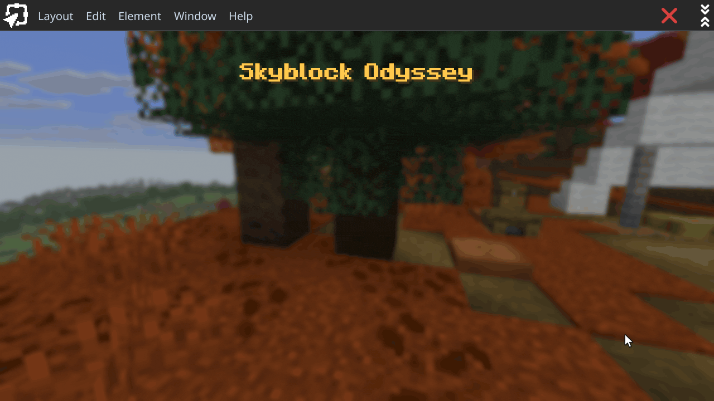
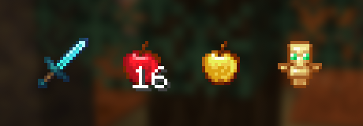

# Éléments

Les éléments sont les composants d’une mise en page : boutons, textes, images, curseurs, musique et bien plus encore. Cette page répertorie tous les types d’éléments et leurs principaux paramètres.

> [!TIP]
> Les boutons et les autres composants présents par défaut sur un écran sont des [éléments Vanilla](/vanilla-elements). Vous pouvez aussi les déplacer, les modifier et les masquer.

# Ajouter des éléments

1. Dans l’éditeur de mise en page, faites un clic droit sur un espace libre, puis cliquez sur **Nouvel élément**. La barre de menus propose la même liste sous **Élément -> Nouveau**.
2. Cliquez sur un type d’élément. Survolez un type pour découvrir son utilité.

L’élément apparaît à l’endroit où vous avez fait un clic droit. Faites-le glisser pour le déplacer, faites glisser ses bords pour le redimensionner et faites un clic droit dessus pour accéder à ses paramètres.



Pour savoir comment sélectionner, déplacer, copier et supprimer des éléments, et découvrir tous les raccourcis de l’éditeur : [Éditeur de mise en page](/layout-editor). Pour que les éléments restent en place quelle que soit la taille de la fenêtre, consultez [Positionner les éléments](/positioning-elements). Pour placer des éléments devant ou derrière d’autres éléments, consultez [Calques et groupes](/layout-editor#layers-and-groups).

# Paramètres communs à tous les éléments

Chaque élément dispose des paramètres suivants dans son menu contextuel, en plus de ceux propres à son type :

| Paramètre | Fonction |
|---|---|
| **Point d’ancrage** | Définit à quoi l’élément est rattaché, par exemple à un coin de l’écran ou à un autre élément. Voir [Positionner les éléments](/positioning-elements). |
| **Positionnement avancé** et **Dimensionnement avancé** | Calcule la position et la taille, par exemple à l’aide de [placeholders](/placeholders). Voir [Positionnement et dimensionnement avancés](/advanced-positioning-sizing). |
| **Conditions de chargement** et **Charger une seule fois par session** | Affiche l’élément uniquement si les [conditions](/conditions) sont remplies, ou une seule fois par lancement du jeu. Voir [Visibilité des éléments](/element-visibility). |
| **Retarder l’apparition** et **Retarder la disparition** | Attend quelques secondes avant d’afficher ou de masquer l’élément. Voir [Visibilité des éléments](/element-visibility#delaying-elements). |
| **Fondu entrant/sortant** et **Opacité** | Applique un fondu à l’élément ou le rend transparent. Voir [Visibilité des éléments](/element-visibility#fading-in-and-out). |
| **Rotation**, **Inclinaison verticale** et **Inclinaison horizontale** | Fait pivoter et incliner l’élément. Voir [Faire pivoter et incliner les éléments](/rotating-elements). |
| **Effet de parallaxe** | Déplace légèrement l’élément avec la souris. Voir [Effet de parallaxe](/parallax). |
| **Copier l’identifiant de l’élément** | Copie l’identifiant utilisé par les actions, les placeholders et les autres éléments pour le retrouver. Voir [Identifiants des éléments](/element-identifiers). |
| **Nom d’affichage dans l’éditeur** | Nom de l’élément dans la liste des calques. |
| **Exporter pour l’IA** | Convertit l’élément en texte destiné aux [assistants IA](/export-for-ai). |

# Tous les éléments

Tous les éléments disponibles dans FancyMenu, classés selon leur fonction.

## Boutons et champs de saisie

### Bouton

Un bouton qui exécute un [script d’action](/action-scripts) lorsqu’on clique dessus, par exemple pour rejoindre un serveur, ouvrir un site Web ou afficher un autre menu.


- **Modifier le script d’action** : définit ce que fait le bouton lorsqu’on clique dessus.
- **Libellé** et **Libellé au survol** : définit son texte et celui qui s’affiche lorsque la souris le survole. Les deux prennent en charge les [placeholders](/placeholders) et la [mise en forme du texte](/text-formatting).
- **Alignement du libellé** : place le libellé à **gauche**, au **centre** ou à **droite** du bouton. Les libellés trop longs défilent d’un côté à l’autre, quel que soit leur alignement.
- **Échelle du libellé**, **Couleur de base du libellé**, **Couleur du libellé au survol**, **Ombre du libellé** et **Souligner le libellé au survol** : définit la taille, les couleurs et l’ombre du libellé.
- **Textures du bouton** et **Textures de l’icône du bouton** : permet d’utiliser vos propres images pour le bouton et son icône, lorsque le bouton est normal, survolé ou inactif. Pour des textures qui s’adaptent proprement au redimensionnement, voir [Découpage en neuf et répétition](/nine-slicing-and-tiling).
- **Son au survol**, **Son à la sortie du survol** et **Son au clic** : définit les sons émis par le bouton.
- **Info-bulle** : texte qui s’affiche lorsque la souris survole le bouton.
- **Contrôler l’état actif** : définit les [conditions](/conditions) à remplir pour pouvoir cliquer sur le bouton. Si elles ne sont pas remplies, le bouton apparaît grisé.
- **Mode modèle** : applique l’apparence de ce bouton aux autres boutons et curseurs de l’écran. Voir [Modèles de boutons et de curseurs](/button-slider-templates).

### Curseur

Un curseur que les joueurs font glisser pour choisir une valeur. Son script d’action s’exécute chaque fois que la valeur change.


- **Type de curseur** :
  - **Liste de valeurs** : parcourt les textes de **Valeurs de la liste**, à raison d’une valeur par ligne. **Valeurs issues d’une variable de liste** les récupère plutôt depuis une [variable de liste](/variables#text-and-list-variables).
  - **Plage d’entiers** : nombres entiers compris entre **Valeur minimale de la plage** et **Valeur maximale de la plage**.
  - **Plage de nombres décimaux** : fonctionne de la même façon, mais avec des nombres décimaux. **Nombre de décimales** définit le nombre de chiffres après la virgule ; `-1` désactive l’arrondi.
- **Libellé du curseur** : son texte. `$$value` affiche la valeur actuelle.
- **Modifier le script d’action** : définit ce qui se produit lorsque la valeur change. `$$value` correspond à la nouvelle valeur.
- **Valeur présélectionnée** : valeur initiale du curseur. Associez-la à la valeur modifiée par le curseur pour afficher la bonne valeur à l’ouverture de l’écran.

Par exemple, un curseur de volume de type **Plage d’entiers**, allant de `0` à `100`, peut avoir pour libellé `Volume de la musique : $$value%` et utiliser une action [**Définir la valeur d’une variable (variable FM)**](/action-scripts#set-variable-value-fm-variable) avec cette valeur :

```
music_volume:$$value
```

Sa **Valeur présélectionnée** est `$$music_volume` : le curseur commence ainsi à la dernière valeur choisie par le joueur.

Les curseurs disposent des mêmes paramètres de libellé, de texture, de son, d’info-bulle et de **Contrôler l’état actif** que les boutons. Vous pouvez donc aussi placer leur libellé à gauche ou à droite avec **Alignement du libellé**.

### Case à cocher

Une case que les joueurs peuvent cocher et décocher. Son script d’action s’exécute chaque fois que son état change.


- Dans son script d’action et les conditions de **Contrôler l’état actif**, `$$value` vaut `true` ou `false`.
- **Mode variable** et **Lier à une variable** : la case affiche la valeur d’une [variable](/variables) et y écrit `true` ou `false`. Si elle est liée à une variable de liste, `true` ou `false` devient son unique entrée.
- Sans le mode variable, la case mémorise son état de manière autonome, séparément pour chaque [profil](/profiles).
- **Textures** : permet d’utiliser vos propres images pour la case et la coche.

Les cases à cocher disposent des mêmes paramètres d’info-bulle, de son et de **Navigation** que les boutons.

### Champ de saisie de texte

Un champ dans lequel les joueurs saisissent du texte, par exemple une adresse de serveur ou un nom.


- **Lier à une variable** : le texte saisi est enregistré dans la [variable](/variables), et le champ affiche sa valeur. Si le champ est lié à une variable de liste, le texte saisi remplace toute la liste.
- **Type de saisie** : **Texte**, **Nombres uniquement**, **Nombres décimaux uniquement** ou **URL**. Les autres caractères ne peuvent pas être saisis.
- **Texte indicatif** et **Couleur du texte indicatif** : texte affiché lorsque le champ est vide.
- **Longueur maximale du texte** : nombre de caractères que le champ peut contenir.
- **Couleur d’arrière-plan**, **Couleur de bordure**, **Rayon d’arrondi de la bordure** et **Couleur du texte** : définit son apparence.

Par exemple, un champ lié à `server_address` et un bouton doté de l’action [**Rejoindre le serveur**](/action-scripts#join-server), auquel est transmise la valeur `$$server_address`, permettent aux joueurs de rejoindre n’importe quel serveur.

Sans variable, le placeholder [**Valeur du champ de saisie de texte**](/placeholders#text-input-field-value) permet de lire le texte, et l’action [**Définir la valeur du champ de saisie de texte**](/action-scripts#set-text-input-field-value) permet de le modifier.

## Textes et info-bulles

### Texte

Un texte de n’importe quelle longueur, d’un court libellé à des règles ou des notes de mise à jour défilantes, avec prise en charge de [Markdown](/text-formatting) et des [placeholders](/placeholders).


- **Mode source** : saisissez le texte ou chargez-le depuis un fichier ou un site Web.
- Choisissez une apparence de départ et activez le défilement lorsque le texte dépasse la taille de l’élément.
- **Arrière-plan** : panneau sombre derrière le texte. Désactivez-le avec **Afficher l’arrière-plan**, ou utilisez une texture personnalisée.

Pour en savoir plus, consultez [Le texte dans les menus](/text-in-menus).

### Info-bulle

Une boîte de texte semblable aux info-bulles du jeu, avec prise en charge de [Markdown](/text-formatting) et des [placeholders](/placeholders).


- L’info-bulle s’affiche à l’endroit où vous l’avez placée, ou près de la souris avec **Suivre la souris**.
- Ses **Conditions de chargement** déterminent quand elle s’affiche, par exemple avec [**Élément survolé**](/conditions#is-element-hovered) pour un bouton.
- **Arrière-plan de l’info-bulle** : remplace la boîte sombre par une texture personnalisée.

Pour en savoir plus, consultez [Le texte dans les menus](/text-in-menus).

### Texte d’accueil

Le texte jaune de l’écran titre, que vous pouvez remplacer par vos propres textes.


- **Mode source** : textes d’accueil Vanilla, texte personnalisé ou ligne aléatoire d’un fichier texte.
- **Rebond**, **Échelle**, **Rotation**, **Couleur du texte** et **Ombre** : définit son apparence.
- **Actualiser à l’ouverture de l’écran** : choisit un nouveau texte d’accueil chaque fois que l’écran s’ouvre.

Pour en savoir plus, consultez [Textes d’accueil](/splash-text).

## Images et médias

### Image

Une image provenant de vos fichiers, d’un site Web ou des ressources du jeu. Les images animées sont également prises en charge.


- **Source de l’image** : définit l’image. Les formats pris en charge sont répertoriés dans [Images](/images).
- **Conserver les proportions** : modifie la largeur pour éviter de déformer l’image.
- **Texture découpée en neuf** et **Répéter la texture** : redimensionne les cadres sans étirer leurs bordures ou répète l’image. Voir [Découpage en neuf et répétition](/nine-slicing-and-tiling).
- **Teinte de l’image [HEX]** : colore l’image.
- **Rayon d’arrondi des coins** : arrondit les coins de l’image.

### Diaporama

Affiche successivement les images d’un diaporama. Créez vos diaporamas dans `config/fancymenu/slideshows/`. Voir [Diaporamas](/slideshows).

- **Diaporama** : définit le diaporama à afficher.
- **Conserver les proportions** : modifie la largeur pour éviter de déformer les images.

### Vidéo

Lit un fichier vidéo, par exemple une bande-annonce ou un arrière-plan animé.

> [!IMPORTANT]
> Les vidéos nécessitent les mods Watermedia V3 et Watermedia Binaries V3. Voir [Vidéos](/video).

- **Source vidéo** : fichier vidéo, lien Web ou ressource du jeu.
- **Mettre la vidéo en boucle**, **Volume** et **Canal audio** : définit la lecture.
- **Lire la vidéo dans l’éditeur de mise en page** : indique si la vidéo est aussi lue pendant l’édition.
- Des actions telles que [**Activer/désactiver la pause de l’élément vidéo**](/action-scripts#toggle-video-element-paused-state) permettent de la mettre en pause, de passer à un instant précis ou de modifier son volume.

**Vidéo [Rinku]** est un ancien élément vidéo qui nécessite le mod Rinku. Il fonctionne toujours dans les anciennes mises en page, mais n’est pas proposé dans **Nouvel élément**.

### Shader GLSL

Exécute votre propre shader GLSL dans l’élément, par exemple pour créer des couleurs animées ou des effets de Shadertoy.


- **Source du shader** : code du shader. Les shaders Shadertoy utilisant `mainImage` fonctionnent tels quels.
- **Mode de compilation** : **Automatique**, **Shadertoy** ou **Fragment direct**.
- **Source du tampon A** à **Source du tampon D** : passes supplémentaires pour les shaders utilisant des tampons.

Pour apprendre à les écrire, consultez l’[API des shaders GLSL](/glsl-shader-api).

### Navigateur

Affiche un site Web en direct, par exemple une carte de serveur ou une page de wiki.

> [!IMPORTANT]
> Le navigateur nécessite le mod [Rinku](https://modrinth.com/mod/rinku) ([CurseForge](https://www.curseforge.com/minecraft/mc-mods/rinku)).

- **URL** : adresse du site Web.
- **Interactif** : permet aux joueurs de cliquer, de faire défiler la page et d’y saisir du texte. L’élément n’est jamais interactif dans l’éditeur de mise en page.
- **Mettre le navigateur en sourdine**, **Volume audio/vidéo**, **Lire les vidéos en boucle** et **Masquer les commandes vidéo** : paramètres des médias de la page.

Pour charger un fichier HTML depuis `config/fancymenu/assets/`, faites commencer l’URL par `file:///` :

```
file:///config/fancymenu/assets/changelog.html
```

Sous Linux, utilisez plutôt le placeholder [**Chemin absolu du fichier/dossier**](/placeholders#absolute-filefolder-path) :

```
file:///{"placeholder":"absolute_path","values":{"short_path":"/config/fancymenu/assets/changelog.html"}}
```

Les sites Web peuvent exécuter des actions et lire des placeholders : [API JavaScript du navigateur](/browser-api).

## Formes, objets et modèles

### Rectangle

Un rectangle d’une seule couleur, par exemple un panneau placé derrière du texte.


- **Couleur** : couleur au format HEX. Deux chiffres supplémentaires permettent de régler la transparence, par exemple `#101828C8`.
- **Rayon d’arrondi des coins** : arrondit tous les coins ou permet de régler chaque coin individuellement.
- **Flou** et **Intensité du flou** : floute ce qui se trouve derrière l’élément.

### Cercle

Un cercle ou un ovale d’une seule couleur, par exemple un voyant d’état.


- **Couleur**, **Flou** et **Intensité du flou** : mêmes paramètres que pour le rectangle.
- **Rondeur** : `2` correspond à un cercle. Les nombres plus grands donnent une forme plus carrée, et les nombres plus petits une forme plus pointue.

### Objet

Affiche un objet de Minecraft ou d’un mod, comme dans l’inventaire.



- **Clé de l’objet** : définit l’objet, par exemple `minecraft:diamond_sword`.
- **Quantité**, **Nom de l’objet**, **Description de l’objet** et **Enchanté** : paramètres similaires à ceux d’un objet réel.
- **Afficher l’info-bulle de l’objet** : affiche l’info-bulle de l’objet lorsque la souris le survole.
- **Données NBT personnalisées** : ajoute des données à l’objet, sous la même forme que la partie d’une commande `/give` située juste après l’objet.

### Modèle JSON de bloc/d’objet

Affiche en 3D un modèle de bloc ou d’objet provenant des ressources du jeu ou d’un fichier JSON personnalisé.


- **Modèle** : définit la **Source du modèle**, par exemple `minecraft:models/block/crafting_table.json`.
- **Texture** : remplace la texture du modèle par la vôtre.
- **Transformation** : permet de redimensionner, faire pivoter et déplacer le modèle.
- **Éclairage** : **Teinte de la lumière [HEX]** colore la lumière du modèle.

### Entité joueur

Affiche un joueur en 3D, par exemple le personnage du joueur sur l’écran titre.


> [!IMPORTANT]
> Les entités joueur nécessitent le mod Fancy Entity Renderer ([CurseForge](https://www.curseforge.com/minecraft/mc-mods/fancy-entity-renderer), [Modrinth](https://modrinth.com/mod/fancy-entity-renderer)). Sans ce mod, elles affichent une erreur à la place du joueur.

- **Copier le joueur client** : affiche le joueur qui joue, avec son skin et son nom.
- **Nom du joueur**, **Texture du skin** et **Texture de la cape** : permet d’afficher un autre joueur ou skin.
- **Posture de l’entité**, **La tête suit la souris** et **Le corps suit la souris** : définit sa posture et son orientation.
- **Armure et outils**, **Perroquet**, **Bébé** et **Afficher le nom du joueur** : définit ce qu’il porte et ce qui est affiché.

Pour en savoir plus, consultez [Entités joueur](/player-entities). Pour afficher uniquement une tête, voir [Têtes de joueur](/player-heads).

### Barre de progression

Une barre qui se remplit, comme une barre de chargement.


- **Source de la valeur de progression** : définit le niveau de remplissage. Utilisez des [placeholders](/placeholders), par exemple [**Progression du chargement du monde**](/placeholders#world-loading-progress) sur un écran de chargement du monde.
- **Mode de valeur de progression** : **POURCENTAGE (0-100)** ou **NOMBRE À VIRGULE FLOTTANTE (0.0-1.0)**.
- **Direction** : côté vers lequel la barre se remplit.
- **Couleur de la barre** et **Couleur d’arrière-plan**, ou **Texture de la barre** et **Texture d’arrière-plan**.
- **Animation de remplissage fluide** : fait glisser la barre vers les nouvelles valeurs au lieu de passer directement à celles-ci.
- **Utiliser la progression comme ancrage de l’élément** : les éléments ancrés à la barre se déplacent avec l’extrémité de la partie remplie.

## Outils de mise en page

### Zone défilante

Contient d’autres éléments et permet de les faire défiler, par exemple pour afficher une liste de serveurs ou une longue page d’informations.


- Déposez des éléments dans la zone depuis l’éditeur de mise en page. Seuls les éléments personnalisés peuvent y être placés, pas les éléments Vanilla.
- **Disposition** : placez les éléments manuellement ou laissez la zone les aligner en pile, en grille ou en flux.
- **Arrière-plan** : panneau sombre derrière la zone. Désactivez-le avec **Afficher l’arrière-plan**, ou utilisez une texture personnalisée.

Pour en savoir plus, consultez [Zones défilantes](/scrollable-areas).

### Déplaceur

Une zone que les joueurs peuvent saisir et déplacer en dehors de l’éditeur. Les éléments qui lui sont ancrés se déplacent avec elle, comme un panneau d’informations mobile. Elle est invisible en dehors de l’éditeur.

**Enregistrer le décalage de déplacement de l’utilisateur** conserve la nouvelle position après la fermeture de l’écran et le redémarrage du jeu. Pour en savoir plus, consultez [Déplaceur](/dragger).

### Animateur d’élément

Déplace et redimensionne d’autres éléments à l’aide d’images clés, par exemple pour faire glisser un panneau dans l’écran. Il est invisible en dehors de l’éditeur.

- **Gérer les éléments cibles** : définit les éléments animés.
- **Modifier les images clés** : ouvre l’éditeur d’images clés.
- **Répéter l’animation** : la relance à la fin.

Pour en savoir plus, consultez [Animateur d’élément](/element-animator).

## Éléments invisibles

Ces éléments sont visibles uniquement dans l’éditeur de mise en page.

### Déclencheur périodique

Exécute son script d’action en boucle tant que l’écran est ouvert.

> [!IMPORTANT]
> Les [planificateurs](/schedulers) sont recommandés pour tout ce qui s’exécute en boucle ou ultérieurement. Utilisez-les plutôt que les déclencheurs périodiques chaque fois que possible. Ils fonctionnent sur tous les écrans, même lorsqu’aucun écran n’est ouvert. Toutes les actions y sont disponibles, et les actions permettent de les démarrer et de les arrêter.

Voici comment remplacer les déclencheurs périodiques par des planificateurs :

- Exécution continue tant qu’un écran est ouvert : utilisez un planificateur avec un **Délai entre les ticks (ms)**. Démarrez-le avec [**Démarrer le planificateur**](/action-scripts#start-scheduler) dans **Modifier le script d’action « Ouverture de l’écran »** de la mise en page, puis arrêtez-le avec [**Arrêter le planificateur**](/action-scripts#stop-scheduler) dans **Modifier le script d’action « Fermeture de l’écran »**. Ces deux options se trouvent dans le menu contextuel de l’arrière-plan de l’éditeur.
- Exécution unique à chaque lancement du jeu : utilisez un planificateur avec **Démarrer au lancement** et **Nombre de ticks à exécuter** réglé sur `1`.
- Exécution unique à chaque ouverture d’un écran : aucun déclencheur périodique ni planificateur n’est nécessaire. Placez les actions dans **Modifier le script d’action « Ouverture de l’écran »**.

Paramètres du déclencheur périodique :

- **Délai entre les ticks [ms]** : délai, en millisecondes, entre deux exécutions. `0` l’exécute à chaque tick, soit 20 fois par seconde.
- **Mode de tick** : **Normal** l’exécute en continu. **Session** ne l’exécute qu’une fois, jusqu’au redémarrage du jeu. **À l’ouverture de l’écran** l’exécute à chaque ouverture de l’écran, y compris lorsque la fenêtre est redimensionnée.
- **Asynchrone** : exécute le script en arrière-plan. La plupart des actions ne peuvent pas s’exécuter de cette façon et affichent une erreur.

### Audio

Lit de la musique ou des sons tant que l’écran est ouvert, avec une piste après l’autre.

- **Gérer les pistes** : définit les fichiers audio, leur ordre et leur **poids** lors de la lecture aléatoire.
- **Mode de lecture** : **Normal** les lit dans l’ordre, tandis que **Aléatoire** les lit dans un ordre aléatoire.
- **Lire les pistes en boucle**, **Volume** et **Canal audio** : définit la lecture.

Pour que la musique continue d’un écran à l’autre, placez l’élément Audio dans une [mise en page universelle](/universal-layouts). Pour en savoir plus, consultez [Musique de fond des menus](/background-music).

### Contrôleur musical

Désactive la musique du jeu sur cet écran.

- **Lire la musique des menus** : musique des menus lorsqu’aucun monde n’est chargé, par exemple sur l’écran titre.
- **Lire la musique du monde** : musique du monde qui continue dans les menus, par exemple dans l’inventaire.

Fonctionne uniquement lorsqu’un écran est ouvert.

### Curseur de souris

Remplace le curseur de la souris par votre propre image tant que l’écran est ouvert.

- **Texture du curseur** : image PNG, par exemple de 32 × 32 pixels.
- **Coordonnée X du point actif** et **Coordonnée Y du point actif** : pixel de l’image qui sert à cliquer, par exemple la pointe d’une flèche.
- **Mode d’aperçu dans l’éditeur** : affiche le curseur dans l’éditeur lorsque la souris survole l’élément.

Pour en savoir plus, consultez [Curseur personnalisé](/custom-cursor).
