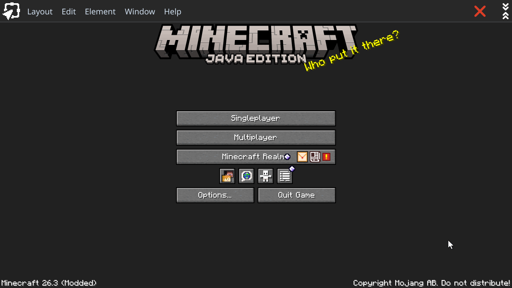

# Premiers pas

FancyMenu vous permet de modifier tous les menus de Minecraft, comme l'écran titre, le menu de pause et les menus d'autres mods. Ajoutez vos propres arrière-plans, logos, boutons, textes, sons et animations, déplacez ou masquez les éléments existants, attribuez de nouvelles actions aux boutons ou créez des menus entièrement nouveaux. Tout se fait dans le jeu, sans écrire de code.

Cette page vous présente les bases pas à pas. Vous allez créer une version plus simple de cet écran titre, et la section [Comment l'exemple a été créé](#comment-lexemple-a-ete-cree) explique ce qu'apporte la version complète.

> [!TIP]
> Vous pouvez utiliser cet écran titre dans votre jeu : téléchargez [wildwood_title_screen.fmp](https://raw.githubusercontent.com/Keksuccino/docs_fancymenu/refs/heads/wiki-2026/assets/wildwood_title_screen.fmp?raw=true), puis [importez](/profiles#importing) et [chargez](/profiles#loading-a-profile) le fichier dans **menu bar -> Customization -> Profiles**. Son utilisation est gratuite, que ce soit pour essayer FancyMenu, apprendre à l'utiliser ou l'intégrer à votre modpack, avec ou sans modifications. Aucune attribution n'est nécessaire.

# La barre de menu

La barre de menu située en haut de chaque menu donne accès à toutes les fonctionnalités de FancyMenu.

- **Customization** : les dispositions du menu dans lequel vous vous trouvez et tous les paramètres de votre configuration, comme les [personnalisations globales](/global-customizations), les [interfaces personnalisées](/custom-guis), les [variables](/variables), les [listeners](/listeners), les [planificateurs](/schedulers), les [profils](/profiles) et les paramètres de FancyMenu.
- **Tools** : des outils pratiques comme [Dummy Screen Instances](/dummy-screen-instances), le [créateur AFMA](/animations#fma-and-afma), **Browse Game Resources** et **Open FancyMenu Directory**, qui ouvre le dossier de votre configuration (voir [Emplacements de stockage des données](/data-storage-locations)).
- **Help** : cette documentation, le serveur Discord, **Report a Bug** et [Export for AI](/export-for-ai).
- L'icône de porte à droite ferme le menu actuel, pour les menus qui ne proposent aucun moyen de le quitter.
- Les deux flèches tout à droite replient la barre de menu en un petit bouton, et permettent de la réafficher.

Les joueurs de votre modpack n'ont pas besoin de la barre de menu. Consultez la section [Modpacks](/modpacks#disabling-the-menu-bar-and-hotkeys) pour savoir comment la désactiver.

## Raccourcis de la barre de menu

Ces raccourcis fonctionnent dans tous les menus, mais pas dans l'éditeur de disposition ni lorsque Modpack Mode est activé. Sur macOS, utilisez `Cmd + Option` au lieu de `Ctrl + Alt`.

| Raccourci | Action |
|---|---|
| `Ctrl + Alt + C` | Afficher ou masquer la barre de menu. Si elle a disparu, ce raccourci la fait réapparaître. |
| `Ctrl + Alt + R` | Recharger FancyMenu, comme avec **menu bar -> Customization -> Reload FancyMenu** |
| `Ctrl + Alt + D` | Afficher ou masquer la **Debug Overlay**, qui indique l'[identifiant](/screen-identifiers) du menu et d'autres informations |
| `Ctrl + Alt + L` | Ouvrir l'[éditeur de disposition](/layout-editor) avec la dernière disposition modifiée |

# Votre première disposition

Une disposition regroupe les modifications apportées à un menu : son arrière-plan, les éléments que vous ajoutez et les changements apportés aux boutons et aux textes déjà présents. Un menu peut avoir plusieurs dispositions, que vous pouvez activer ou désactiver individuellement.

## Créer une disposition

1. Ouvrez le menu que vous souhaitez modifier, par exemple l'écran titre.
2. Cliquez sur **menu bar -> Customization -> Current Screen Customization** pour afficher **Enabled**. FancyMenu ne modifie que les menus pour lesquels cette option est activée.
3. Cliquez sur **menu bar -> Customization -> Layouts -> New -> For Current Screen**.

L'éditeur de disposition s'ouvre. Il affiche le menu tel que les joueurs le voient, ce qui vous permet de constater immédiatement chaque modification. Consultez la page [Éditeur de disposition](/layout-editor) pour tout savoir, notamment sur le déplacement, le redimensionnement et la copie des éléments.

**For All Screens [Universal]** crée plutôt une [disposition universelle](/universal-layouts), qui s'affiche dans tous les menus.

## Définir un arrière-plan

Commencez par placer vos images dans le dossier `config/fancymenu/assets` de votre jeu. **menu bar -> Tools -> Open FancyMenu Directory** ouvre le dossier `config/fancymenu`.

1. Faites un clic droit sur l'arrière-plan de l'éditeur, puis ouvrez **Menu Backgrounds -> Image**.
2. Cliquez sur **Show Background** pour afficher **Enabled**.
3. Cliquez sur **Choose Image**, réglez **Source Type** sur **Local**, puis cliquez sur **Choose Local Resource File**.
4. Cliquez sur votre image, puis sur **OK**. Double-cliquez pour ouvrir les dossiers.

Vous pouvez aussi utiliser des panoramas, des diaporamas, des vidéos, des couleurs et bien d'autres types d'arrière-plan. Consultez la page [Arrière-plans des menus](/menu-backgrounds).

## Ajouter un logo

1. Cliquez sur le logo Minecraft et appuyez sur `Delete`. Faites de même avec le texte jaune.
2. Dans la barre de menu de l'éditeur, cliquez sur **Element -> New -> Image**.
3. Faites un clic droit sur le nouvel élément, cliquez sur **Image Source** et choisissez votre logo, comme pour l'arrière-plan.

Les éléments vanilla supprimés sont simplement masqués. Vous pouvez les rétablir avec **Element -> Deleted Vanilla Elements**.

4. Faites de nouveau un clic droit sur le logo, puis cliquez sur **Restore Aspect Ratio** pour qu'il ne soit plus écrasé. Appuyez sur `Esc` pour fermer le menu.
5. Faites-le glisser à l'emplacement souhaité.

Vous pouvez ajouter bien d'autres éléments, comme des boutons, des textes, des vidéos et des joueurs. Consultez la page [Éléments](/elements).

## Modifier les boutons

1. Cliquez sur le premier bouton, puis maintenez `Ctrl` (`Cmd` sur macOS) enfoncé et cliquez sur les autres pour tous les sélectionner. Un clic droit sur l'un d'eux modifie tous les éléments sélectionnés en même temps.
2. Faites un clic droit sur l'un des boutons, cliquez sur **Button Textures -> Set -> Normal Background**, puis choisissez votre texture, comme pour l'arrière-plan.

3. Faites de même avec **Hover Background**, la texture affichée lorsque le pointeur se trouve sur un bouton.
4. Cliquez sur **Button Textures -> Nine-Slice Custom Background** pour afficher **Enabled**. Les bords de la texture restent nets, quelle que soit la largeur des boutons. Consultez la page [Découpage en neuf zones](/nine-slicing-and-tiling).

Le menu contextuel de plusieurs éléments ne contient que les paramètres communs à tous. Sélectionnez donc uniquement des boutons. Faites un clic droit sur un seul bouton pour accéder à tous ses paramètres, comme son libellé, ses sons, l'action exécutée au clic ([scripts d'action](/action-scripts)) et les conditions d'affichage ([visibilité des éléments](/element-visibility)). Consultez la page [Éléments vanilla et de mods](/vanilla-elements).

## Enregistrer

1. Appuyez sur `Ctrl + S` (`Cmd + S` sur macOS), ou cliquez sur **Layout -> Save**.
2. La première fois, FancyMenu vous demande un nom de fichier. Gardez celui proposé ou saisissez-en un nouveau, puis cliquez sur **Save**.
3. Fermez l'éditeur en cliquant sur le X à droite de sa barre de menu.

Votre disposition s'affiche immédiatement dans le menu. Pour la modifier plus tard, survolez-la dans **menu bar -> Customization -> Layouts**, puis cliquez sur **Edit Layout**, ou appuyez sur `Ctrl + Alt + L`.

# Comment l'exemple a été créé

L'écran titre présenté en haut de cette page ajoute quelques éléments à celui que vous avez créé :

- Le ciel, les collines et les arbres sont trois images qui bougent avec la souris, les arbres se déplaçant le plus. Consultez la page [Effet de parallaxe](/parallax).
- Les collines et les arbres sont des éléments Image aussi grands que l'écran. Pour qu'ils restent derrière les boutons et les textes, l'option **Custom Elements Behind Vanilla** est activée dans le menu contextuel de l'arrière-plan de l'éditeur.
- Les lucioles sont une [superposition décorative](/decoration-overlays#fireflies).
- La taille des collines, des arbres et du logo s'adapte à celle de l'écran grâce au [positionnement et au dimensionnement avancés](/advanced-positioning-sizing) avec des espaces réservés. Le menu s'adapte ainsi à toutes les tailles de fenêtre. Le logo rétrécit sur les écrans peu hauts pour ne jamais masquer les boutons.

Pour examiner tous ces éléments dans l'éditeur de disposition, chargez le [profil d'exemple](#premiers-pas), puis modifiez sa disposition.

# Pour aller plus loin

**Soigner l'apparence**

- [Éléments](/elements) : tout ce que vous pouvez ajouter aux menus.
- [Positionnement des éléments](/positioning-elements) : garder les éléments à leur place, quelle que soit la taille de la fenêtre.
- [Arrière-plans des menus](/menu-backgrounds), [Animations](/animations), [Vidéos](/video), [Superpositions décoratives](/decoration-overlays) et [Musique d'arrière-plan](/background-music).

**Ajouter des fonctionnalités**

- [Scripts d'action](/action-scripts) : les actions effectuées par les boutons et les autres éléments.
- [Visibilité des éléments](/element-visibility) et [Conditions](/conditions) : n'afficher certains éléments que dans des cas précis.
- [Espaces réservés](/placeholders) : afficher des informations dynamiques dans les textes, comme le nom du joueur.
- [Variables](/variables), [Listeners](/listeners) et [Planificateurs](/schedulers) : mémoriser des informations, réagir au jeu et exécuter des actions à intervalles réguliers.

**Créer davantage**

- [Interfaces personnalisées](/custom-guis) : créer des menus entièrement nouveaux.
- [Dispositions universelles](/universal-layouts) : appliquer des modifications à tous les menus.
- [Personnalisations globales](/global-customizations) : ajuster l'ensemble du jeu, par exemple le titre de la fenêtre.
- [Écran de chargement](/loading-screen) et [Introduction du jeu](/game-intro).

**Partager votre création**

- [Modpacks](/modpacks) : intégrer votre configuration à un modpack.
- [Profils](/profiles) : passer d'une configuration à une autre et les exporter.

# Obtenir de l'aide

- La [FAQ](/faq) répond aux questions les plus fréquentes.
- **menu bar -> Help -> Join the Discord** vous permet de rejoindre le serveur Discord de FancyMenu.
- [Export for AI](/export-for-ai) convertit votre configuration en texte à utiliser dans des conversations avec une IA, par exemple avec le bot d'assistance du serveur Discord.
- Cliquez sur **menu bar -> Help -> Report a Bug** si quelque chose ne fonctionne pas comme prévu.

# Pour les développeurs

Pour créer un module complémentaire pour FancyMenu ou l'utiliser dans votre mod, consultez la [documentation pour les développeurs](https://github.com/Keksuccino/FancyMenu-Dev-Docs/wiki).
