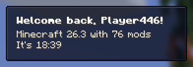

# Espaces réservés

Les espaces réservés sont de courts codes que FancyMenu remplace par une valeur actualisée, comme le nom du joueur, l’heure ou le nombre de joueurs d’un serveur. Ils fonctionnent dans le texte des éléments, les libellés des boutons, les infobulles, les valeurs des actions et des conditions requises, ainsi que dans la plupart des autres textes que vous pouvez saisir.


> [!TIP]
> Vos propres [variables](/variables) fonctionnent dans les mêmes textes, avec `$$` suivi de leur nom, comme `$$coins`.

# Ajouter des espaces réservés

1. Ouvrez le texte dans l’éditeur de texte, par exemple **Text Content** d’un [élément Text](/text-in-menus). Les champs de texte dans les fenêtres, comme les valeurs des actions, possèdent un bouton **Open in Editor** à côté.
2. Cliquez à l’endroit où vous souhaitez insérer l’espace réservé.
3. Cliquez sur **Placeholders** dans le coin supérieur droit de l’éditeur de texte.
4. Cliquez sur une catégorie ou effectuez une recherche par nom, identifiant ou description. **BACK** permet de revenir aux catégories. Les espaces réservés sans catégorie sont répertoriés sous les catégories.
5. Survolez un espace réservé pour voir ce qu’il fait, puis cliquez dessus pour l’ajouter.
6. Remplacez ses valeurs d’exemple, comme l’ID du mod pour **Mod Version**.

Les textes dont l’éditeur ne comporte pas de bouton **Placeholders** ne prennent pas en charge les espaces réservés.

# Fonctionnement des espaces réservés

Un espace réservé se présente ainsi :

```
{"placeholder":"playername"}
```

Les espaces réservés avec des paramètres les indiquent dans `values` :

```
{"placeholder":"modversion","values":{"modid":"fancymenu"}}
```

- L’identifiant, comme `playername`, est sensible à la casse. Chaque espace réservé ci-dessous indique son identifiant et ses valeurs.
- L’ordre des valeurs n’a pas d’importance. Les valeurs facultatives peuvent être omises.
- Si FancyMenu ne peut pas remplacer un espace réservé, par exemple à cause d’une faute de frappe, celui-ci reste dans le texte tel que vous l’avez saisi.
- Les espaces réservés renvoient toujours du texte. Lorsqu’il n’y a rien à afficher, ils renvoient une valeur de remplacement, comme `0`, `0.0`, `---` ou rien du tout.
- Les [codes de mise en forme](/text-formatting) fonctionnent autour des espaces réservés : `&6{"placeholder":"playername"}` affiche le nom en doré.

> [!IMPORTANT]
> Les espaces réservés ressemblent à du JSON, mais n’en sont pas. Ne les faites pas passer dans un formateur ou un validateur JSON, car les espaces réservés imbriqués ne constituent pas du JSON valide.

## Espaces réservés imbriqués

Les valeurs peuvent contenir d’autres espaces réservés et des [variables](/variables#showing-variables-in-text). FancyMenu remplace d’abord ceux qui sont imbriqués. Il n’est pas nécessaire d’échapper les guillemets dans les valeurs.

Voici comment convertir la mémoire RAM maximale de Mo en Go :

```
{"placeholder":"calc","values":{"decimal":"true","expression":"{"placeholder":"maxram"} / 1024"}}
```

Voici comment afficher la variable `rank` en majuscules :

```
{"placeholder":"uppercase_text","values":{"text":"$$rank"}}
```

Lorsqu’un espace réservé renvoie du texte qui contient lui-même des espaces réservés, comme le contenu d’un fichier lu avec [**File Text**](#file-text), FancyMenu les remplace également.

# À savoir

- Les espaces réservés se mettent à jour automatiquement. FancyMenu conserve un texte remplacé pendant 30 millisecondes avant de remplacer à nouveau ses espaces réservés. Modifiez cette durée avec **Placeholder Caching Duration [MS]** dans **menu bar -> Customization -> Settings**. La valeur `0` les remplace à chaque image, ce qui consomme davantage de ressources.
- Les espaces réservés qui lisent des sites Web, des fichiers ou des serveurs, comme **Web Text** ou **Server Status**, chargent les données en arrière-plan. En attendant, ils ne renvoient rien ou affichent une valeur de remplacement.
- Dans les [actions](/action-scripts), les espaces réservés récupèrent leur valeur actuelle au moment où l’action s’exécute.
- Les espaces réservés liés au monde, à l’écran et aux éléments ne fonctionnent que sur le thread principal du jeu. Dans un [Ticker](/elements#ticker) exécuté en arrière-plan (de manière asynchrone), FancyMenu affiche une erreur à la place.
- **Random Number** génère un nouveau nombre chaque fois que le texte est mis à jour. Pour conserver un nombre, enregistrez-le dans une [variable](/variables) avec [**Set Variable Value (FM Variable)**](/action-scripts#set-variable-value-fm-variable).

> [!CAUTION]
> Des espaces réservés comme **JSON Parser**, **File Text** et **Clipboard Content** peuvent lire des fichiers du dossier du jeu et le contenu du presse-papiers. Associés à des actions qui contactent des sites Web, ils peuvent permettre à une disposition d’envoyer ces données ailleurs. N’utilisez que des dispositions auxquelles vous faites confiance.

# Exemples

## Panneau de bienvenue



```
### Bon retour, {"placeholder":"playername"} !
Minecraft {"placeholder":"mcversion"} avec {"placeholder":"loadedmods"} mods
Il est {"placeholder":"realtimehour"}:{"placeholder":"realtimeminute"}
```

## État du serveur et joueurs

```
Survie : {"placeholder":"serverstatus","values":{"ip":"play.example.net"}}&r, {"placeholder":"serverplayercount","values":{"ip":"play.example.net"}} joueurs
```

## Date et heure

```
{"placeholder":"realtimeday"}.{"placeholder":"realtimemonth"}.{"placeholder":"realtimeyear"}, {"placeholder":"realtimehour"}:{"placeholder":"realtimeminute"}
```

## Utilisation de la RAM

```
RAM : {"placeholder":"usedram"} / {"placeholder":"maxram"} Mo ({"placeholder":"percentram"} %)
```

# Tous les espaces réservés

Voici tous les espaces réservés disponibles dans FancyMenu. Les grandes catégories **Advanced** et **World** du menu des espaces réservés sont réparties en groupes plus petits ici.

## Variables et listes

Ces espaces réservés se trouvent dans la catégorie **Advanced**. Consultez la page [Variables](/variables) pour créer des variables et des listes.

### Get Variable Value (FM Variable)

**Identifiant :** `getvariable`

Valeur de l’une de vos variables. Renvoie `0` lorsque la variable est vide ou n’existe pas, ce qui est pratique pour les nombres. Une liste renvoie toutes ses entrées sous forme de tableau JSON, par exemple `["Steve","Alex"]`.

- `name` : nom de la variable, sans `$$`

```
{"placeholder":"getvariable","values":{"name":"clicks"}}
```

### Get List Entry (FM Variable)

**Identifiant :** `list_get`

Une entrée d’une variable de type liste.

- `name` : nom de la liste
- `index` : position de l’entrée. La première entrée est à la position `0`. Les nombres négatifs comptent à partir de la fin : `-1` correspond donc à la dernière entrée.
- `fallback` (facultatif) : valeur renvoyée si aucune entrée n’existe à cet index, ou si aucune liste ne porte ce nom. Vide par défaut.

```
{"placeholder":"list_get","values":{"name":"tips","index":"0","fallback":"No tips yet"}}
```

### List Size (FM Variable)

**Identifiant :** `list_size`

Nombre d’entrées d’une liste. Renvoie `0` si aucune liste ne porte ce nom.

- `name` : nom de la liste

```
{"placeholder":"list_size","values":{"name":"tips"}}
```

### Index of List Entry (FM Variable)

**Identifiant :** `list_index_of`

Index de la première entrée qui correspond exactement à `value`, ou `-1` si la liste ne la contient pas.

- `name` : nom de la liste
- `value` : entrée recherchée
- `ignore_case` (facultatif) : `true` permet de faire correspondre `Apple` et `apple`. La valeur par défaut est `false`.

```
{"placeholder":"list_index_of","values":{"name":"read_news","value":"news_42","ignore_case":"false"}}
```

### Join List Entries (FM Variable)

**Identifiant :** `list_join`

Toutes les entrées d’une liste regroupées dans un seul texte. Renvoie une chaîne vide si aucune liste ne porte ce nom.

- `name` : nom de la liste
- `separator` (facultatif) : texte placé entre les entrées. `\n` correspond à un saut de ligne. La valeur par défaut est `, `.

```
{"placeholder":"list_join","values":{"name":"tips","separator":"\n"}}
```

## Mathématiques

Ces espaces réservés se trouvent dans la catégorie **Advanced**. Les nombres décimaux utilisent un point, comme `2.5`.

### Calculator

**Identifiant :** `calc`

Résout une expression mathématique, comme `2 + 3 * 4`.

- `expression` : calcul à effectuer
- `decimal` (facultatif) : `false` arrondit le résultat à un nombre entier. La valeur par défaut est `true`, ce qui donne des résultats comme `14.0`.

```
{"placeholder":"calc","values":{"decimal":"false","expression":"{"placeholder":"usedram"} * 100 / {"placeholder":"maxram"}"}}
```

| Dans les expressions | Fonction |
|---|---|
| `+` `-` `*` `/` | Addition, soustraction, multiplication, division |
| `^` | Puissance, par exemple `2 ^ 3` pour obtenir 8 |
| `%` | Reste, par exemple `7 % 3` pour obtenir 1 |
| `( )` | Regroupement, par exemple `(2 + 3) * 4` |
| `pi`, `e` | Les nombres π et e |
| `abs(x)` | Valeur absolue de x |
| `sqrt(x)`, `cbrt(x)` | Racine carrée, racine cubique |
| `pow(x, y)` | x à la puissance y |
| `floor(x)`, `ceil(x)` | Arrondi à l’entier inférieur, arrondi à l’entier supérieur |
| `sin(x)`, `cos(x)`, `tan(x)`, `cot(x)` | Fonctions trigonométriques, avec des angles en radians |
| `asin(x)`, `acos(x)`, `atan(x)` | Fonctions trigonométriques réciproques |
| `sinh(x)`, `cosh(x)`, `tanh(x)` | Fonctions hyperboliques |
| `log(x)`, `log2(x)`, `log10(x)` | Logarithmes de base e, 2 et 10 |
| `exp(x)` | e à la puissance x |
| `signum(x)` | `1`, `-1` ou `0`, comme [**Sign (Math)**](#sign-math) |

### Random Number

**Identifiant :** `random_number`

Un nombre entier aléatoire compris entre `min` et `max`. Il change chaque fois que le texte est mis à jour.

- `min`, `max` : valeurs minimale et maximale

```
{"placeholder":"random_number","values":{"min":"1","max":"6"}}
```

### Max Number

**Identifiant :** `maxnum`

La plus grande de deux valeurs.

- `first`, `second` : les nombres

```
{"placeholder":"maxnum","values":{"first":"$$score","second":"$$best_score"}}
```

### Min Number

**Identifiant :** `minnum`

La plus petite de deux valeurs.

- `first`, `second` : les nombres

```
{"placeholder":"minnum","values":{"first":"10","second":"15"}}
```

### Absolute Number

**Identifiant :** `absnum`

La valeur absolue d’un nombre : `-10.5` renvoie `10.5`.

- `num` : le nombre

```
{"placeholder":"absnum","values":{"num":"-10.5"}}
```

### Negate Number

**Identifiant :** `negnum`

Rend négatif un nombre positif : `10.5` renvoie `-10.5`. Les nombres nuls et négatifs restent inchangés.

- `num` : le nombre

```
{"placeholder":"negnum","values":{"num":"10.5"}}
```

### Round (Math)

**Identifiant :** `math_round`

Arrondit un nombre. `2.5` est arrondi à `3`.

- `num` : le nombre
- `decimals` (facultatif) : nombre de décimales à conserver. Par exemple, `2` transforme `3.14159` en `3.14`. La valeur `0`, une valeur négative ou l’absence de valeur arrondit à l’entier.

```
{"placeholder":"math_round","values":{"num":"3.14159","decimals":"2"}}
```

### Floor (Math)

**Identifiant :** `math_floor`

Arrondit un nombre à l’entier inférieur : `3.7` renvoie `3` et `-3.2` renvoie `-4`.

- `num` : le nombre

```
{"placeholder":"math_floor","values":{"num":"3.7"}}
```

### Ceiling (Math)

**Identifiant :** `math_ceil`

Arrondit un nombre à l’entier supérieur : `3.2` renvoie `4` et `-3.7` renvoie `-3`.

- `num` : le nombre

```
{"placeholder":"math_ceil","values":{"num":"3.2"}}
```

### Sign (Math)

**Identifiant :** `math_sign`

Renvoie `1` pour les nombres positifs, `-1` pour les nombres négatifs et `0` pour zéro.

- `num` : le nombre

```
{"placeholder":"math_sign","values":{"num":"-3.14"}}
```

### *pi* (Math)

**Identifiant :** `math_pi`

Le nombre π : `3.141592653589793`.

```
{"placeholder":"math_pi"}
```

### Trigonometric Sine (Math)

**Identifiant :** `math_sin`

Sinus d’un angle exprimé en radians. Pour utiliser des degrés, multipliez-les d’abord par π / 180 avec Calculator.

- `angle` : angle en radians

```
{"placeholder":"math_sin","values":{"angle":"1.5707963267948966"}}
```

### Trigonometric Cosine (Math)

**Identifiant :** `math_cos`

Cosinus d’un angle exprimé en radians.

- `angle` : angle en radians

```
{"placeholder":"math_cos","values":{"angle":"0"}}
```

### Trigonometric Tangent (Math)

**Identifiant :** `math_tan`

Tangente d’un angle exprimé en radians.

- `angle` : angle en radians

```
{"placeholder":"math_tan","values":{"angle":"0.7853981633974483"}}
```

### Hyperbolic Sine (Math)

**Identifiant :** `math_sinh`

Sinus hyperbolique d’un nombre.

- `num` : le nombre

```
{"placeholder":"math_sinh","values":{"num":"1"}}
```

### Hyperbolic Cosine (Math)

**Identifiant :** `math_cosh`

Cosinus hyperbolique d’un nombre.

- `num` : le nombre

```
{"placeholder":"math_cosh","values":{"num":"1"}}
```

### Hyperbolic Tangent (Math)

**Identifiant :** `math_tanh`

Tangente hyperbolique d’un nombre.

- `num` : le nombre

```
{"placeholder":"math_tanh","values":{"num":"1"}}
```

### Number Base Converter

**Identifiant :** `number_base_convert`

Convertit un nombre dans une autre base, par exemple du décimal au binaire ou à l’hexadécimal. Les nombres décimaux sont également pris en charge, avec jusqu’à 16 chiffres après le point. Les lettres du résultat sont en majuscules, comme `FF`.

- `input` : le nombre
- `from_base` (facultatif) : base de `input`, de `2` à `36`. La valeur par défaut est `10`.
- `to_base` (facultatif) : base du résultat, de `2` à `36`. La valeur par défaut est `10`.

```
{"placeholder":"number_base_convert","values":{"input":"255","from_base":"10","to_base":"16"}}
```

## Texte

Ces espaces réservés se trouvent dans la catégorie **Advanced**.

### Uppercase Text

**Identifiant :** `uppercase_text`

Texte en majuscules : `Hello World` devient `HELLO WORLD`. Les [codes de mise en forme](/text-formatting) comme `&a` restent inchangés.

- `text` : le texte

```
{"placeholder":"uppercase_text","values":{"text":"Hello World"}}
```

### Lowercase Text

**Identifiant :** `lowercase_text`

Texte en minuscules : `HELLO WORLD` devient `hello world`. Les codes de mise en forme restent inchangés.

- `text` : le texte

```
{"placeholder":"lowercase_text","values":{"text":"HELLO WORLD"}}
```

### Title Case Text

**Identifiant :** `title_case_text`

Chaque mot commence par une majuscule : `hello world` devient `Hello World`. Les codes de mise en forme restent inchangés.

- `text` : le texte

```
{"placeholder":"title_case_text","values":{"text":"hello world"}}
```

### Sentence Case Text

**Identifiant :** `sentence_case_text`

Chaque phrase commence par une majuscule : `hello world. this is fancymenu!` devient `Hello world. This is fancymenu!`. Les codes de mise en forme restent inchangés.

- `text` : le texte

```
{"placeholder":"sentence_case_text","values":{"text":"hello world. this is fancymenu!"}}
```

### Snake Case Text

**Identifiant :** `snake_case_text`

Texte en minuscules avec `_` entre les mots : `Hello World` devient `hello_world`. Les codes de mise en forme sont supprimés.

- `text` : le texte

```
{"placeholder":"snake_case_text","values":{"text":"Hello World"}}
```

### Kebab Case Text

**Identifiant :** `kebab_case_text`

Texte en minuscules avec `-` entre les mots : `Hello World` devient `hello-world`. Les codes de mise en forme sont supprimés.

- `text` : le texte

```
{"placeholder":"kebab_case_text","values":{"text":"Hello World"}}
```

### Alternating Case Text

**Identifiant :** `alternating_case_text`

Les minuscules et les majuscules alternent : `alternating case` devient `aLtErNaTiNg CaSe`.

- `text` : le texte

```
{"placeholder":"alternating_case_text","values":{"text":"alternating case"}}
```

### Toggle Case Text

**Identifiant :** `toggle_case_text`

Les minuscules deviennent des majuscules et les majuscules des minuscules : `Toggle Case` devient `tOGGLE cASE`.

- `text` : le texte

```
{"placeholder":"toggle_case_text","values":{"text":"Toggle Case"}}
```

### Trim Text

**Identifiant :** `trim_text`

Supprime les espaces au début et à la fin d’un texte. Les espaces à l’intérieur sont conservés.

- `text` : le texte

```
{"placeholder":"trim_text","values":{"text":"  Welcome!  "}}
```

### Crop Text

**Identifiant :** `crop_text`

Supprime un certain nombre de caractères au début et à la fin d’un texte. Pour `hello world`, supprimer un caractère de chaque côté donne `ello worl`.

- `text` : le texte
- `remove_from_start` : nombre de caractères à supprimer au début
- `remove_from_end` : nombre de caractères à supprimer à la fin

```
{"placeholder":"crop_text","values":{"text":"hello world","remove_from_start":"1","remove_from_end":"1"}}
```

### Split Text

**Identifiant :** `split_text`

Sépare un texte et renvoie l’une de ses parties. `Steve,Alex,Notch` séparé à chaque `,` renvoie `Alex` comme partie `1`.

- `input` : le texte
- `regex` : point de séparation, sous forme d’expression régulière. Les caractères comme `.`, `|` et `?` doivent être précédés de `\`, par exemple `\.`.
- `max_parts` (facultatif) : nombre maximal de parties. `-1` (valeur par défaut) sépare le texte à chaque correspondance.
- `split_index` : partie à renvoyer. La première partie porte l’index `0`.

```
{"placeholder":"split_text","values":{"input":"Steve,Alex,Notch","regex":",","max_parts":"-1","split_index":"1"}}
```

### Replace Text

**Identifiant :** `replace_text`

Remplace une partie d’un texte : dans `Hello World!`, remplacer `World` par `FancyMenu` donne `Hello FancyMenu!`.

- `text` : le texte
- `search` : texte à rechercher
- `replacement` (facultatif) : texte de remplacement. Vide par défaut, ce qui supprime le texte trouvé.
- `use_regex` (facultatif) : `true` interprète `search` comme une expression régulière. Dans ce cas, `$1`, `$2`, etc. dans `replacement` représentent les groupes trouvés. La valeur par défaut est `false`.
- `replace_all` (facultatif) : `false` ne remplace que la première correspondance. La valeur par défaut est `true`.

```
{"placeholder":"replace_text","values":{"text":"Hello World!","search":"World","replacement":"FancyMenu","use_regex":"false","replace_all":"true"}}
```

### Switch Case

**Identifiant :** `switch_case`

Renvoie le résultat du cas correspondant à une valeur. Si la variable `difficulty_level` vaut `2`, l’exemple renvoie `Hard Mode`.

- `value` : valeur à vérifier
- `cases` : paires valeur-résultat, comme `1:Easy Mode,2:Hard Mode`. Les valeurs et les résultats ne peuvent pas contenir `,` ni `:`.
- `default` (facultatif) : résultat renvoyé si aucun cas ne correspond. Sans valeur par défaut, l’espace réservé reste inchangé.

```
{"placeholder":"switch_case","values":{"value":"$$difficulty_level","cases":"1:Easy Mode,2:Hard Mode","default":"Normal Mode"}}
```

### Localize Text

**Identifiant :** `local`

Texte correspondant à une clé de traduction dans la langue actuelle du jeu, par exemple `Singleplayer` pour `menu.singleplayer`. Fonctionne avec les clés de Minecraft, celles des mods et vos propres clés (voir [Localisation](/localization)).

- `key` : clé de traduction

```
{"placeholder":"local","values":{"key":"menu.singleplayer"}}
```

### Stringify

**Identifiant :** `stringify`

Remplace les espaces réservés du texte, puis ajoute un `\` devant chaque `"`, `{` et `}`. Ainsi, un texte provenant d’une source externe, comme un site Web, ne peut pas être interprété comme des espaces réservés.

- `text` : le texte

```
{"placeholder":"stringify","values":{"text":"{"placeholder":"webtext","values":{"link":"https://example.com/motd.txt"}}"}}
```

## Données et fichiers

Ces espaces réservés se trouvent dans la catégorie **Advanced**. Les chemins locaux partent du dossier du jeu, par exemple `/config/fancymenu/assets/news.txt`, et ne peuvent pas en sortir (voir [Ressources](/resources#local-resources)).

### JSON Parser

**Identifiant :** `json`

Lit une valeur dans du JSON. Si plusieurs résultats sont trouvés, ils sont affichés un par ligne.

- `source` : texte JSON, fichier JSON dans le dossier du jeu ou URL d’un fichier JSON
- `json_path` : chemin vers la valeur, comme `$.name` ou `$.players[0].name`. Consultez [json.fancymenu.net](https://json.fancymenu.net) pour en savoir plus sur les chemins JSON.

```
{"placeholder":"json","values":{"source":"https://example.com/server_info.json","json_path":"$.news.title"}}
```

Le JSON provenant du Web est chargé une fois, puis de nouveau lorsque FancyMenu est rechargé. Les modifications apportées aux fichiers sont prises en compte immédiatement.

| Chemin | Valeur renvoyée |
|---|---|
| `$.name` | `name` au niveau supérieur |
| `$.player.level` | `level` dans `player` |
| `$.items[0].id` | `id` de la première entrée de `items` |
| `$.scores.*` | Toutes les valeurs de `scores` |

### File Text

**Identifiant :** `file_text`

Texte d’un fichier ou d’une URL. Les fichiers sont relus chaque seconde et les URL toutes les 10 secondes. Renvoie une chaîne vide pendant le chargement ou si la lecture échoue.

- `path_or_url` : fichier dans le dossier du jeu ou URL. Les chemins commençant par `.minecraft/` désignent le dossier Minecraft par défaut.
- `mode` (facultatif) : `all` pour le texte entier ou `last` pour les dernières lignes. `all` par défaut.
- `separator` (facultatif) : texte séparant les lignes. `\n` (saut de ligne) par défaut.
- `last_lines` (facultatif) : nombre de lignes renvoyées avec `last`. `1` par défaut.

```
{"placeholder":"file_text","values":{"path_or_url":"/config/fancymenu/assets/changelog.txt","mode":"all","separator":"\n","last_lines":"1"}}
```

### File Size

**Identifiant :** `file_size`

Taille d’un fichier en octets. Renvoie `0` si le fichier n’existe pas. Les chemins commençant par `.minecraft/` désignent le dossier Minecraft par défaut.

- `path` : fichier

```
{"placeholder":"file_size","values":{"path":"/config/fancymenu/assets/news.txt"}}
```

### File MD5

**Identifiant :** `file_md5`

Empreinte MD5 d’un fichier, comme `d41d8cd98f00b204e9800998ecf8427e`. Renvoie une chaîne vide si le fichier n’existe pas. Les chemins commençant par `.minecraft/` désignent le dossier Minecraft par défaut.

- `path` : fichier

```
{"placeholder":"file_md5","values":{"path":"/config/fancymenu/assets/menu_music.ogg"}}
```

### Encode To Base64

**Identifiant :** `base64_encode`

Texte encodé en Base64 : `Hello World` devient `SGVsbG8gV29ybGQ=`.

- `text` : le texte

```
{"placeholder":"base64_encode","values":{"text":"Hello World"}}
```

### Decode From Base64

**Identifiant :** `base64_decode`

Décode du Base64 en texte : `SGVsbG8gV29ybGQ=` devient `Hello World`.

- `text` : texte en Base64

```
{"placeholder":"base64_decode","values":{"text":"SGVsbG8gV29ybGQ="}}
```

### Get NBT Data (Client-Side)

**Identifiant :** `nbt_data_get`

Lit les données NBT, comme avec `/data get`, à partir des informations dont dispose votre jeu sur le monde. C’est rapide, mais les serveurs ne transmettent pas toutes les données aux joueurs.

- `source_type` : `entity` ou `block`
- `entity_selector` : pour `entity`, sélecteur comme `@s` (vous), `@p`, `@e[type=minecraft:horse,limit=1,sort=nearest]`, ou nom ou UUID d’une entité. Les sélecteurs peuvent utiliser `type`, `name`, `tag`, `limit`, `sort`, `distance`, `x`, `y`, `z`, `dx`, `dy` et `dz`. Seule la première correspondance est prise en compte.
- `block_pos` : pour `block`, position d’une entité de bloc, comme un coffre : `120 64 -35`
- `nbt_path` : chemin NBT, comme `foodLevel` ou `Inventory[0].id`
- `scale` (facultatif) : facteur multiplicateur des nombres. `1.0` par défaut.
- `return_type` (facultatif) : `value` (nombres et textes tels quels), `string`, `snbt` ou `json`. `value` par défaut.

```
{"placeholder":"nbt_data_get","values":{"source_type":"entity","entity_selector":"@s","nbt_path":"foodLevel","scale":"1.0","return_type":"value"}}
```

### Get NBT Data (Server-Side)

**Identifiant :** `nbt_data_get_server`

Lit les données NBT du serveur, exactement comme `/data get`. FancyMenu doit être installé sur le serveur. En solo, cet espace réservé fonctionne toujours. Il ne renvoie rien avant la réponse du serveur, puis se met à jour environ toutes les 100 millisecondes.

- `source_type` : `entity`, `block` ou `storage`
- `entity_selector` : pour `entity`, tout sélecteur de `/data get` qui trouve une seule entité, comme `@s` ou `@e[type=minecraft:villager,limit=1,sort=nearest]`
- `block_pos` : pour `block`, position comme `120 64 -35`, `~ ~-1 ~` ou `^ ^ ^1`
- `storage_id` : pour `storage`, ID d’un stockage de commandes, comme `mypack:quests`
- `nbt_path` (facultatif) : chemin NBT. Sans chemin, toutes les données sont renvoyées.
- `scale` (facultatif) : facteur multiplicateur des nombres. `1.0` par défaut.
- `return_type` (facultatif) : `value`, `string`, `snbt` ou `json`. `value` par défaut.

```
{"placeholder":"nbt_data_get_server","values":{"source_type":"storage","storage_id":"mypack:quests","nbt_path":"completed","return_type":"value"}}
```

## Audio

Ces espaces réservés lisent les [éléments Audio](/elements#audio) du menu ouvert. Dans l’éditeur de disposition, faites un clic droit sur un élément Audio, puis cliquez sur **Copy Element ID** pour copier son ID.

### Audio Element Volume

**Identifiant :** `audio_element_vol`

Volume de l’élément Audio, de `0.0` (0 %) à `1.0` (100 %).

- `element_identifier` : ID de l’élément Audio

```
{"placeholder":"audio_element_vol","values":{"element_identifier":"5f1c2a9e-7b3d-4c8e-9a21-6d0f4e8b3c17-1732456789012"}}
```

### Current Audio Track

**Identifiant :** `audio_element_current_track`

Nom du fichier de la piste en cours de lecture, comme `menu_theme.ogg`. Renvoie `---` si aucune piste n’est en cours de lecture.

- `element_identifier` : ID de l’élément Audio
- `display_name_mappings` (facultatif) : noms à afficher à la place des noms de fichiers. `=>` sépare le nom de fichier du nom affiché, et `%:%` sépare les paires.

```
{"placeholder":"audio_element_current_track","values":{"element_identifier":"5f1c2a9e-7b3d-4c8e-9a21-6d0f4e8b3c17-1732456789012","display_name_mappings":"menu_theme.ogg=>Menu Theme%:%credits.ogg=>Credits Theme"}}
```

### Audio Duration

**Identifiant :** `audio_duration`

Durée de la piste en cours, comme `03:45`. Renvoie `00:00` pendant le chargement.

- `element_identifier` : ID de l’élément Audio

```
{"placeholder":"audio_duration","values":{"element_identifier":"5f1c2a9e-7b3d-4c8e-9a21-6d0f4e8b3c17-1732456789012"}}
```

### Audio Play Time

**Identifiant :** `audio_playtime`

Position de lecture de la piste en cours, comme `01:30`. Renvoie `00:00` (ou `0`) lorsqu’elle est arrêtée.

- `element_identifier` : ID de l’élément Audio
- `show_percentage` (facultatif) : `true` renvoie plutôt la progression de `0` à `100`. La valeur par défaut est `false`.

```
{"placeholder":"audio_playtime","values":{"element_identifier":"5f1c2a9e-7b3d-4c8e-9a21-6d0f4e8b3c17-1732456789012","show_percentage":"false"}}
```

### Audio Playing State

**Identifiant :** `audio_playing_state`

Renvoie `true` lorsque l’élément Audio est en lecture et `false` lorsqu’il est en pause ou arrêté.

- `element_identifier` : ID de l’élément Audio

```
{"placeholder":"audio_playing_state","values":{"element_identifier":"5f1c2a9e-7b3d-4c8e-9a21-6d0f4e8b3c17-1732456789012"}}
```

## Client

Ces espaces réservés concernent le jeu et ses mods.

### Minecraft Version

**Identifiant :** `mcversion`

Version de Minecraft, comme `1.21.1`.

```
{"placeholder":"mcversion"}
```

### Mod Loader Name

**Identifiant :** `loadername`

Nom du chargeur de mods, comme `Fabric` ou `NeoForge`.

```
{"placeholder":"loadername"}
```

### Mod Loader Version

**Identifiant :** `loaderver`

Version du chargeur de mods, comme `0.16.14`.

```
{"placeholder":"loaderver"}
```

### Mod Version

**Identifiant :** `modversion`

Version d’un mod installé, comme `3.11.0`. Renvoie `0.0.0` si le mod n’est pas installé.

- `modid` : ID du mod, comme `fancymenu`

```
{"placeholder":"modversion","values":{"modid":"fancymenu"}}
```

### Active Mods Count

**Identifiant :** `loadedmods`

Nombre de mods chargés. Les bibliothèques et les mods intégrés à d’autres mods sont également comptés. Le résultat est donc souvent supérieur au nombre de fichiers de mods.

```
{"placeholder":"loadedmods"}
```

### Total Mods Count

**Identifiant :** `totalmods`

Nombre approximatif de mods installés, calculé une fois au démarrage du jeu à partir des fichiers `.jar` du dossier `mods`. Ce nombre n’est jamais inférieur à **Active Mods Count**.

```
{"placeholder":"totalmods"}
```

### World Loading Progress

**Identifiant :** `world_load_progress`

Progression du chargement d’un monde, de `0` à `100`, lorsque l’écran de chargement est affiché. Pratique pour les barres de chargement. Renvoie `0` sur tous les autres écrans.

```
{"placeholder":"world_load_progress"}
```

### Minecraft Option Value

**Identifiant :** `minecraft_option_value`

Valeur d’une option Minecraft telle qu’elle est enregistrée dans le fichier `options.txt` du dossier du jeu, par exemple `12` pour `renderDistance`. Renvoie une chaîne vide si aucune option ne porte ce nom.

- `name` : nom de l’option dans `options.txt`

```
{"placeholder":"minecraft_option_value","values":{"name":"renderDistance"}}
```

### Keybind Key

**Identifiant :** `keybind_key`

Touche actuellement associée à une commande, comme dans l’écran des contrôles : `Space` pour sauter. Renvoie une chaîne vide si aucune commande ne porte ce nom.

- `keybind` : nom de la commande, comme `key.jump` ou `key.inventory`. Ces noms figurent dans `options.txt`, sans le préfixe `key_` : `key_key.jump` devient `key.jump`.

```
Appuyez sur {"placeholder":"keybind_key","values":{"keybind":"key.inventory"}} pour ouvrir votre inventaire !
```

### Last World or Server

**Identifiant :** `last_world_server`

Dernier monde ou serveur rejoint par le joueur. Les serveurs sont affichés sous la forme `play.example.net:25565`.

- `type` : `both` pour les mondes et les serveurs, `world` pour les mondes uniquement ou `server` pour les serveurs uniquement. Avec `world` ou `server`, une chaîne vide est renvoyée si le dernier endroit rejoint était de l’autre type.
- `full_world_path` (facultatif) : `false` renvoie uniquement le nom du monde, comme `New World`. `true` renvoie le chemin de son dossier. Valeur par défaut : `true`.

```
{"placeholder":"last_world_server","values":{"type":"world","full_world_path":"false"}}
```

## Interface graphique

Ces espaces réservés concernent l’écran ouvert et ses éléments. Ceux qui portent sur un élément utilisent son ID : dans l’éditeur de disposition, faites un clic droit sur l’élément, puis cliquez sur **Copy Element ID**.

### Screen Width

**Identifiant :** `guiwidth`

Largeur de l’écran en pixels d’interface. Il s’agit de la taille utilisée par les éléments, et non de la résolution du moniteur.

```
{"placeholder":"guiwidth"}
```

### Screen Height

**Identifiant :** `guiheight`

Hauteur de l’écran en pixels d’interface.

```
{"placeholder":"guiheight"}
```

### GUI Scale

**Identifiant :** `guiscale`

Échelle de l’interface du jeu, comme `2`.

```
{"placeholder":"guiscale"}
```

### Current Screen Identifier

**Identifiant :** `screenid`

[Identifiant](/screen-identifiers) de l’écran ouvert, comme `title_screen`. Renvoie une chaîne vide si aucun écran n’est ouvert.

```
{"placeholder":"screenid"}
```

### Element Width

**Identifiant :** `elementwidth`

Largeur d’un élément en pixels d’interface. Renvoie `1` si aucun élément ne porte cet ID.

- `id` : ID de l’élément

```
{"placeholder":"elementwidth","values":{"id":"5f1c2a9e-7b3d-4c8e-9a21-6d0f4e8b3c17-1732456789012"}}
```

### Element Height

**Identifiant :** `elementheight`

Hauteur d’un élément en pixels d’interface. Renvoie `1` si aucun élément ne porte cet ID.

- `id` : ID de l’élément

```
{"placeholder":"elementheight","values":{"id":"5f1c2a9e-7b3d-4c8e-9a21-6d0f4e8b3c17-1732456789012"}}
```

### Element X Position

**Identifiant :** `elementposx`

Position du bord gauche d’un élément en pixels d’interface, mesurée depuis le bord gauche de l’écran. Renvoie `1` si aucun élément ne porte cet ID.

- `id` : ID de l’élément

```
{"placeholder":"elementposx","values":{"id":"5f1c2a9e-7b3d-4c8e-9a21-6d0f4e8b3c17-1732456789012"}}
```

### Element Y Position

**Identifiant :** `elementposy`

Position du bord supérieur d’un élément en pixels d’interface, mesurée depuis le haut de l’écran. Renvoie `1` si aucun élément ne porte cet ID.

- `id` : ID de l’élément

```
{"placeholder":"elementposy","values":{"id":"5f1c2a9e-7b3d-4c8e-9a21-6d0f4e8b3c17-1732456789012"}}
```

### Text Element Content Height

**Identifiant :** `text_element_content_height`

Hauteur nécessaire à un [élément Text](/text-in-menus) pour afficher tout son texte sans défilement, en pixels d’interface. Le calcul tient compte des lignes renvoyées à la ligne, de l’échelle du texte et de l’interligne. C’est donc utile pour adapter un arrière-plan au texte. Renvoie `0` si l’élément n’est pas un élément Text.

- `element_identifier` : ID de l’élément Text

```
{"placeholder":"text_element_content_height","values":{"element_identifier":"5f1c2a9e-7b3d-4c8e-9a21-6d0f4e8b3c17-1732456789012"}}
```

### Element Scroll Position

**Identifiant :** `scroll_area_scroll_position`

Position de défilement du contenu d’une [zone défilante](/scrollable-areas) ou d’un élément Text, en pixels d’interface depuis son début. Renvoie `0` pour les autres éléments.

- `element_identifier` : ID de l’élément
- `axis` : `vertical` ou `horizontal`. Toute autre valeur indique l’axe de défilement de l’élément.

```
{"placeholder":"scroll_area_scroll_position","values":{"element_identifier":"5f1c2a9e-7b3d-4c8e-9a21-6d0f4e8b3c17-1732456789012","axis":"vertical"}}
```

### Element Scroll Percent

**Identifiant :** `scroll_area_scroll_percent`

Progression du défilement du contenu d’une zone défilante ou d’un élément Text, de `0` (début) à `100` (fin). Renvoie `0` pour les autres éléments et lorsqu’il n’y a rien à faire défiler.

- `element_identifier` : ID de l’élément
- `axis` : `vertical` ou `horizontal`. Toute autre valeur indique l’axe de défilement de l’élément.

```
{"placeholder":"scroll_area_scroll_percent","values":{"element_identifier":"5f1c2a9e-7b3d-4c8e-9a21-6d0f4e8b3c17-1732456789012","axis":"vertical"}}
```

### Element Scroll Content Size

**Identifiant :** `scroll_area_content_size`

Taille du contenu d’une zone défilante ou d’un élément Text : sa hauteur pour `vertical`, sa largeur pour `horizontal`. Renvoie `0` pour les autres éléments.

- `element_identifier` : ID de l’élément
- `axis` : `vertical` ou `horizontal`. Toute autre valeur indique l’axe de défilement de l’élément.

```
{"placeholder":"scroll_area_content_size","values":{"element_identifier":"5f1c2a9e-7b3d-4c8e-9a21-6d0f4e8b3c17-1732456789012","axis":"vertical"}}
```

### Text Input Field Value

**Identifiant :** `text_input_field_value`

Texte saisi dans un [champ de saisie](/elements#text-input-field) ou un champ de texte de l’écran d’origine. Renvoie une chaîne vide si l’élément n’est pas un champ de texte.

- `element_identifier` : ID de l’élément

```
{"placeholder":"text_input_field_value","values":{"element_identifier":"5f1c2a9e-7b3d-4c8e-9a21-6d0f4e8b3c17-1732456789012"}}
```

### Vanilla Widget Label/Text

**Identifiant :** `vanillabuttonlabel`

Libellé d’un bouton ou d’un autre composant de l’écran d’origine, comme `Options...`. Dans l’éditeur de disposition, faites un clic droit sur le composant, puis cliquez sur **Copy Widget Locator** pour copier son localisateur.

- `locator` : localisateur du composant

```
{"placeholder":"vanillabuttonlabel","values":{"locator":"title_screen:mc_titlescreen_options_button"}}
```

### Mouse X Position

**Identifiant :** `mouseposx`

Position de la souris en pixels d’interface, mesurée depuis le bord gauche de l’écran. Dans l’éditeur de disposition, la valeur est toujours `10`, afin que les éléments qui suivent la souris restent à un endroit où vous pouvez les modifier.

```
{"placeholder":"mouseposx"}
```

### Mouse Y Position

**Identifiant :** `mouseposy`

Position de la souris en pixels d’interface, mesurée depuis le haut de l’écran. Dans l’éditeur de disposition, la valeur est toujours `10`.

```
{"placeholder":"mouseposy"}
```

### Clicks Per Second

**Identifiant :** `clicks_per_second`

Nombre de clics effectués avec un bouton de la souris au cours de la dernière seconde.

- `mouse_button` (facultatif) : `left` ou `right`. `left` par défaut.

```
{"placeholder":"clicks_per_second","values":{"mouse_button":"left"}}
```

## Joueur

### Player Name

**Identifiant :** `playername`

Nom du joueur, comme `Steve`.

```
{"placeholder":"playername"}
```

### Player UUID

**Identifiant :** `playeruuid`

UUID du joueur, comme `c8cde7fe-7ced-11eb-9439-0242ac130002`.

```
{"placeholder":"playeruuid"}
```

### Last Death Message

**Identifiant :** `lastdeathmessage`

Dernier message de mort du joueur depuis le démarrage du jeu, comme `Steve was slain by Zombie`. Renvoie une chaîne vide avant la première mort.

- `as_json_component` (facultatif) : `true` renvoie un composant de texte JSON avec ses couleurs. La valeur par défaut est `false`.

```
{"placeholder":"lastdeathmessage","values":{"as_json_component":"false"}}
```

## Temps réel

Ces espaces réservés concernent l’heure sur votre ordinateur. Ceux qui portent sur la date et l’heure acceptent le paramètre facultatif `timezone` : `system` pour le fuseau horaire de l’ordinateur (valeur par défaut), ou un identifiant comme `UTC`, `Europe/Berlin` ou `America/New_York`. Consultez [nodatime.org/TimeZones](https://nodatime.org/TimeZones) pour la liste complète des identifiants.

### Realtime Year

**Identifiant :** `realtimeyear`

Année, comme `2026`.

```
{"placeholder":"realtimeyear","values":{"timezone":"system"}}
```

### Realtime Month

**Identifiant :** `realtimemonth`

Mois, de `01` à `12`.

```
{"placeholder":"realtimemonth","values":{"timezone":"system"}}
```

### Realtime Day

**Identifiant :** `realtimeday`

Jour du mois, de `01` à `31`.

```
{"placeholder":"realtimeday","values":{"timezone":"system"}}
```

### Realtime Hour

**Identifiant :** `realtimehour`

Heure, de `00` à `23`.

- `twelve_hour_format` (facultatif) : `true` affiche plutôt une valeur de `01` à `12`. La valeur par défaut est `false`.

```
{"placeholder":"realtimehour","values":{"twelve_hour_format":"false","timezone":"Europe/Berlin"}}
```

### Realtime Minute

**Identifiant :** `realtimeminute`

Minute, de `00` à `59`.

```
{"placeholder":"realtimeminute","values":{"timezone":"system"}}
```

### Realtime Second

**Identifiant :** `realtimesecond`

Seconde, de `00` à `59`.

```
{"placeholder":"realtimesecond","values":{"timezone":"system"}}
```

### Current Time in Millis (Unix Timestamp)

**Identifiant :** `unix_time`

Nombre de millisecondes écoulées depuis le 1er janvier 1970 (UTC), comme `1732456789012`. Pratique pour créer des minuteurs : enregistrez la valeur dans une variable, puis soustrayez-la d’une valeur ultérieure avec Calculator.

```
{"placeholder":"unix_time"}
```

## Serveur

Ces espaces réservés interrogent un serveur pour obtenir son état, comme dans la liste des serveurs. Tant qu’un écran personnalisé est ouvert, FancyMenu effectue une requête toutes les 30 secondes. Avant la première réponse, le serveur est considéré comme hors ligne.

- `ip` : adresse du serveur, avec le port s’il ne s’agit pas du port par défaut, comme `play.example.net` ou `play.example.net:25566`

### Server Status

**Identifiant :** `serverstatus`

Renvoie `Online` en vert ou `Offline` en rouge.

```
{"placeholder":"serverstatus","values":{"ip":"play.example.net"}}
```

### Server Player Count

**Identifiant :** `serverplayercount`

Nombre de joueurs connectés et nombre maximal de joueurs, comme `12/100`. Renvoie `0/0` avant la réponse du serveur.

```
{"placeholder":"serverplayercount","values":{"ip":"play.example.net"}}
```

### Server MOTD

**Identifiant :** `servermotd`

L’une des lignes du message du jour du serveur.

- `line` : `1` ou `2`

```
{"placeholder":"servermotd","values":{"ip":"play.example.net","line":"1"}}
```

### Server PING

**Identifiant :** `serverping`

Latence du serveur en millisecondes, comme `54`. Renvoie `-1` lorsque le serveur est hors ligne.

```
{"placeholder":"serverping","values":{"ip":"play.example.net"}}
```

### Server Version

**Identifiant :** `serverversion`

Version de Minecraft utilisée par le serveur, comme `1.21.1`. Certains serveurs affichent leur propre texte ici. Renvoie `---` avant la réponse du serveur.

```
{"placeholder":"serverversion","values":{"ip":"play.example.net"}}
```

## Vidéo

Ces espaces réservés lisent les [éléments Video et les arrière-plans vidéo des menus](/video) du menu ouvert. Pour un élément Video, faites un clic droit dessus dans l’éditeur de disposition, puis cliquez sur **Copy Element ID**. Pour un arrière-plan, faites un clic droit sur l’arrière-plan de l’éditeur, puis cliquez sur **Copy Background Identifier**.

### Video Element Volume

**Identifiant :** `video_element_vol`

Volume d’un élément Video, de `0.0` (0 %) à `1.0` (100 %).

- `element_identifier` : ID de l’élément Video

```
{"placeholder":"video_element_vol","values":{"element_identifier":"5f1c2a9e-7b3d-4c8e-9a21-6d0f4e8b3c17-1732456789012"}}
```

### Video Element Duration

**Identifiant :** `video_element_duration`

Durée de la vidéo d’un élément Video, comme `02:00`. Renvoie `00:00` (ou `0`) pendant le chargement.

- `element_identifier` : ID de l’élément Video
- `output_as_timestamp` (facultatif) : `true` renvoie plutôt la durée en millisecondes, comme `120000`. La valeur par défaut est `false`.

```
{"placeholder":"video_element_duration","values":{"element_identifier":"5f1c2a9e-7b3d-4c8e-9a21-6d0f4e8b3c17-1732456789012","output_as_timestamp":"false"}}
```

### Video Element Play Time

**Identifiant :** `video_element_playtime`

Position de lecture de la vidéo d’un élément Video, comme `00:45`. Renvoie `00:00` (ou `0`) pendant le chargement.

- `element_identifier` : ID de l’élément Video
- `show_percentage` (facultatif) : `true` renvoie la progression de `0` à `100`. La valeur par défaut est `false`.
- `output_as_timestamp` (facultatif) : `true` renvoie la durée en millisecondes. Si les deux options valent `true`, `show_percentage` est prioritaire. La valeur par défaut est `false`.

```
{"placeholder":"video_element_playtime","values":{"element_identifier":"5f1c2a9e-7b3d-4c8e-9a21-6d0f4e8b3c17-1732456789012","show_percentage":"false","output_as_timestamp":"false"}}
```

### Video Element Paused State

**Identifiant :** `video_element_paused_state`

Renvoie `true` lorsque la vidéo d’un élément Video est en pause, et `false` dans les autres cas.

- `element_identifier` : ID de l’élément Video

```
{"placeholder":"video_element_paused_state","values":{"element_identifier":"5f1c2a9e-7b3d-4c8e-9a21-6d0f4e8b3c17-1732456789012"}}
```

### Video Background Volume

**Identifiant :** `video_background_vol`

Volume d’un arrière-plan vidéo de menu, de `0.0` (0 %) à `1.0` (100 %).

- `background_identifier` : identifiant de l’arrière-plan du menu

```
{"placeholder":"video_background_vol","values":{"background_identifier":"8c2e4f6a-1b3d-4e5f-8a7b-9c0d1e2f3a4b-1732456789012"}}
```

### Video Background Duration

**Identifiant :** `video_background_duration`

Durée de la vidéo d’un arrière-plan de menu, comme `03:00`. Renvoie `00:00` (ou `0`) pendant le chargement.

- `background_identifier` : identifiant de l’arrière-plan du menu
- `output_as_timestamp` (facultatif) : `true` renvoie la durée en millisecondes. La valeur par défaut est `false`.

```
{"placeholder":"video_background_duration","values":{"background_identifier":"8c2e4f6a-1b3d-4e5f-8a7b-9c0d1e2f3a4b-1732456789012","output_as_timestamp":"false"}}
```

### Video Background Play Time

**Identifiant :** `video_background_playtime`

Position de lecture de la vidéo d’un arrière-plan de menu, comme `01:00`. Renvoie `00:00` (ou `0`) pendant le chargement.

- `background_identifier` : identifiant de l’arrière-plan du menu
- `show_percentage` (facultatif) : `true` renvoie la progression de `0` à `100`. La valeur par défaut est `false`.
- `output_as_timestamp` (facultatif) : `true` renvoie la durée en millisecondes. Si les deux options valent `true`, `show_percentage` est prioritaire. La valeur par défaut est `false`.

```
{"placeholder":"video_background_playtime","values":{"background_identifier":"8c2e4f6a-1b3d-4e5f-8a7b-9c0d1e2f3a4b-1732456789012","show_percentage":"true","output_as_timestamp":"false"}}
```

### Video Background Paused State

**Identifiant :** `video_background_paused_state`

Renvoie `true` lorsque la vidéo de l’arrière-plan du menu est en pause, et `false` dans les autres cas.

- `background_identifier` : identifiant de l’arrière-plan du menu

```
{"placeholder":"video_background_paused_state","values":{"background_identifier":"8c2e4f6a-1b3d-4e5f-8a7b-9c0d1e2f3a4b-1732456789012"}}
```

## Monde : statistiques du joueur

La catégorie **World** concerne le monde dans lequel vous jouez. La plupart de ses espaces réservés nécessitent un monde chargé. En dehors d’un monde, ils renvoient `0`, `0.0` ou rien.

### Current Player Health

**Identifiant :** `current_player_health`

Santé du joueur, comme `20.0`. Chaque cœur vaut `2.0`.

```
{"placeholder":"current_player_health"}
```

### Max Player Health

**Identifiant :** `max_player_health`

Santé maximale du joueur, comme `20.0`.

```
{"placeholder":"max_player_health"}
```

### Current Player Health (Percent)

**Identifiant :** `current_player_health_percent`

Santé du joueur en pourcentage, de `0` à `100`.

```
{"placeholder":"current_player_health_percent"}
```

### Current Player Absorption Health

**Identifiant :** `current_player_absorption_health`

Santé d’absorption du joueur (les cœurs dorés), comme `4.0`.

```
{"placeholder":"current_player_absorption_health"}
```

### Max Player Absorption Health

**Identifiant :** `max_player_absorption_health`

Santé d’absorption maximale du joueur, comme `4.0`.

```
{"placeholder":"max_player_absorption_health"}
```

### Current Player Absorption Health (Percent)

**Identifiant :** `current_player_absorption_health_percent`

Santé d’absorption du joueur en pourcentage, de `0` à `100`.

```
{"placeholder":"current_player_absorption_health_percent"}
```

### Current Player Food Level

**Identifiant :** `current_player_hunger`

Niveau de nourriture du joueur, de `0.0` à `20.0`.

```
{"placeholder":"current_player_hunger"}
```

### Max Player Food Level

**Identifiant :** `max_player_hunger`

Niveau de nourriture maximal des joueurs : toujours `20.0`.

```
{"placeholder":"max_player_hunger"}
```

### Current Player Food Level (Percent)

**Identifiant :** `current_player_hunger_percent`

Niveau de nourriture du joueur en pourcentage, de `0` à `100`.

```
{"placeholder":"current_player_hunger_percent"}
```

### Current Player Hunger Saturation

**Identifiant :** `current_player_hunger_saturation`

Saturation du joueur, comme `5.0`. Le niveau de nourriture ne diminue qu’une fois la saturation épuisée.

```
{"placeholder":"current_player_hunger_saturation"}
```

### Current Player Armor

**Identifiant :** `current_player_armor`

Points d’armure du joueur, de `0.0` à `20.0`.

```
{"placeholder":"current_player_armor"}
```

### Max Player Armor

**Identifiant :** `max_player_armor`

Nombre maximal de points de la barre d’armure : toujours `20.0`.

```
{"placeholder":"max_player_armor"}
```

### Current Player Armor (Percent)

**Identifiant :** `current_player_armor_percent`

Points d’armure du joueur en pourcentage, de `0` à `100`.

```
{"placeholder":"current_player_armor_percent"}
```

### Player Armor Toughness

**Identifiant :** `player_armor_toughness`

Solidité de l’armure du joueur, comme `8.0` avec une armure en diamant complète.

```
{"placeholder":"player_armor_toughness"}
```

### Current Player Oxygen Level

**Identifiant :** `current_player_oxygen`

Réserve d’air du joueur sous l’eau, de `0.0` à `300.0`.

```
{"placeholder":"current_player_oxygen"}
```

### Max Player Oxygen Level

**Identifiant :** `max_player_oxygen`

Réserve d’air maximale du joueur, comme `300.0`.

```
{"placeholder":"max_player_oxygen"}
```

### Current Player Oxygen Level (Percent)

**Identifiant :** `current_player_oxygen_percent`

Réserve d’air du joueur en pourcentage, de `0` à `100`.

```
{"placeholder":"current_player_oxygen_percent"}
```

### Current Player Level

**Identifiant :** `current_player_level`

Niveau d’expérience du joueur, comme `30`.

```
{"placeholder":"current_player_level"}
```

### Current Player Experience

**Identifiant :** `current_player_exp`

Nombre total de points d’expérience du joueur, comme `1395.0`. Il ne s’agit pas du niveau.

```
{"placeholder":"current_player_exp"}
```

### Player Experience Progress (Percent)

**Identifiant :** `current_player_exp_progress`

Progression de la barre d’expérience, de `0` à `100`.

```
{"placeholder":"current_player_exp_progress"}
```

### Player Attack Strength (Percent)

**Identifiant :** `player_attack_strength`

Niveau de charge de la prochaine attaque, de `0` à `100`, comme l’indicateur d’attaque.

```
{"placeholder":"player_attack_strength"}
```

### Player Game Mode

**Identifiant :** `player_gamemode`

`survival`, `creative`, `adventure` ou `spectator`.

```
{"placeholder":"player_gamemode"}
```

### Player Item Use Progress (FM)

**Identifiant :** `player_item_use_progress_fm`

Progression de l’utilisation d’un objet par le joueur, par exemple lorsqu’il mange, boit ou bande un arc, de `0.0` à `1.0`.

```
{"placeholder":"player_item_use_progress_fm"}
```

### Current Mount Health

**Identifiant :** `current_mount_health`

Santé de la créature chevauchée par le joueur, comme un cheval, par exemple `30.0`.

```
{"placeholder":"current_mount_health"}
```

### Max Mount Health

**Identifiant :** `max_mount_health`

Santé maximale de la créature chevauchée par le joueur.

```
{"placeholder":"max_mount_health"}
```

### Current Mount Health (Percent)

**Identifiant :** `current_mount_health_percent`

Santé de la créature chevauchée par le joueur en pourcentage, de `0` à `100`.

```
{"placeholder":"current_mount_health_percent"}
```

### Current Mount Jump Meter (Percent)

**Identifiant :** `current_mount_jump_meter`

Niveau de charge du saut d’un cheval, de `0` à `100`.

```
{"placeholder":"current_mount_jump_meter"}
```

### Active Effects Count

**Identifiant :** `effects_count`

Nombre d’effets actuellement appliqués au joueur.

```
{"placeholder":"effects_count"}
```

### Active Effect

**Identifiant :** `active_effect`

ID d’un effet appliqué au joueur, comme `minecraft:speed`, selon l’ordre des icônes d’effet en haut à droite. Renvoie une chaîne vide si aucun effet ne se trouve à cet index.

- `effect_index` : position de l’effet. Le premier est à l’index `0`.

```
{"placeholder":"active_effect","values":{"effect_index":"0"}}
```

## Monde : inventaire et objets

Ces espaces réservés se trouvent dans la catégorie **World**. Numéros des emplacements : `0` à `8` pour la barre rapide, `9` à `35` pour le reste de l’inventaire, `36` à `39` pour l’armure, des bottes au casque, et `40` pour la main secondaire.

### Selected Hotbar Slot

**Identifiant :** `active_hotbar_slot`

Emplacement sélectionné de la barre rapide, de `0` à `8`.

```
{"placeholder":"active_hotbar_slot"}
```

### Slot Item

**Identifiant :** `slot_item`

ID de l’objet dans un emplacement, comme `minecraft:diamond_sword`. Les emplacements vides renvoient `minecraft:air`.

- `slot` : numéro de l’emplacement

```
{"placeholder":"slot_item","values":{"slot":"0"}}
```

### Slot Item Count

**Identifiant :** `slot_item_count`

Nombre d’objets dans un emplacement, comme `64`.

- `slot` : numéro de l’emplacement

```
{"placeholder":"slot_item_count","values":{"slot":"0"}}
```

### Slot Item Durability

**Identifiant :** `slot_item_durability`

Durabilité de l’objet dans un emplacement. Renvoie `0` pour les objets sans durabilité.

- `slot` : numéro de l’emplacement
- `format` (facultatif) : `current` (durabilité restante), `max`, `damage` (durabilité perdue) ou `percentage` (durabilité restante, de `0` à `100`). `current` par défaut.

```
{"placeholder":"slot_item_durability","values":{"slot":"39","format":"percentage"}}
```

### Slot Item Display Name (FM)

**Identifiant :** `slot_item_display_name_fm`

Nom de l’objet dans un emplacement sous forme de composant de texte JSON, avec la couleur correspondant à sa rareté, comme `{"text":"Diamond Sword","color":"aqua"}`. En mode spectateur, les emplacements de la barre rapide renvoient les noms du menu de spectateur.

- `slot` : numéro de l’emplacement
- `ignore_spectator` (facultatif) : `true` renvoie également les noms des objets en mode spectateur. La valeur par défaut est `false`.

```
{"placeholder":"slot_item_display_name_fm","values":{"slot":"0","ignore_spectator":"false"}}
```

### Inventory Item Count

**Identifiant :** `inventory_item_count`

Nombre d’objets d’un type que le joueur possède dans l’ensemble de son inventaire.

- `item` : ID de l’objet, comme `minecraft:diamond`. Une valeur vide compte tous les objets.

```
{"placeholder":"inventory_item_count","values":{"item":"minecraft:diamond"}}
```

### Inventory Slot Food Point Restore Amount

**Identifiant :** `inventory_slot_food_point_restore_amount`

Nombre de points de nourriture que l’objet d’un emplacement restaure lorsqu’il est mangé, comme `4.0` pour une pomme. Renvoie `0.0` pour les objets qui ne sont pas de la nourriture.

- `slot` : numéro de l’emplacement

```
{"placeholder":"inventory_slot_food_point_restore_amount","values":{"slot":"0"}}
```

### Item Category

**Identifiant :** `item_category`

Onglet de l’inventaire créatif auquel appartient un objet, comme `Combat`. Renvoie `UNKNOWN` pour les objets sans onglet.

- `item` : ID de l’objet
- `as_key` (facultatif) : `true` renvoie l’ID de l’onglet, comme `minecraft:combat`. La valeur par défaut est `false`.

```
{"placeholder":"item_category","values":{"item":"minecraft:diamond_sword","as_key":"false"}}
```

### Hovered Inventory Item

**Identifiant :** `hovered_inventory_item`

ID de l’objet survolé par la souris dans un écran d’inventaire, comme `minecraft:apple`. Renvoie une chaîne vide si aucun objet n’est survolé.

```
{"placeholder":"hovered_inventory_item"}
```

## Monde : interface et boss

Ces espaces réservés se trouvent dans la catégorie **World**. Ceux qui concernent les raids lisent le raid dont la barre est affichée en haut de l’écran et nécessitent que FancyMenu soit installé sur le serveur. En solo, ils fonctionnent toujours. En l’absence de raid, ils renvoient `0` ou rien.

### Action Bar Message (FM)

**Identifiant :** `action_bar_message_fm`

Message affiché au-dessus de la barre rapide, sous forme de composant de texte JSON, comme `{"text":"You may not rest now","color":"red"}`. Renvoie une chaîne vide s’il n’y en a pas.

```
{"placeholder":"action_bar_message_fm"}
```

### Action Bar Message Time (FM)

**Identifiant :** `action_bar_message_time_fm`

Nombre de ticks pendant lesquels le message au-dessus de la barre rapide reste affiché. 20 ticks correspondent à une seconde.

```
{"placeholder":"action_bar_message_time_fm"}
```

### Highlighted Item Time (FM)

**Identifiant :** `highlighted_item_time_fm`

Nombre de ticks pendant lesquels le nom de l’objet sélectionné reste affiché au-dessus de la barre rapide.

```
{"placeholder":"highlighted_item_time_fm"}
```

### Current HUD Title/Subtitle

**Identifiant :** `current_title`

Titre ou sous-titre actuellement affiché, par exemple avec `/title`. Renvoie une chaîne vide s’il n’y en a pas.

- `is_subtitle` (facultatif) : `true` renvoie le sous-titre. La valeur par défaut est `false`.
- `as_json` (facultatif) : `true` renvoie un composant de texte JSON. La valeur par défaut est `false`.

```
{"placeholder":"current_title","values":{"is_subtitle":"false","as_json":"false"}}
```

### Bosses Count

**Identifiant :** `boss_count`

Nombre de barres de boss actuellement affichées.

```
{"placeholder":"boss_count"}
```

### Boss Name

**Identifiant :** `boss_name`

Nom d’une barre de boss, comme `Ender Dragon`. Renvoie une chaîne vide si aucune barre de boss ne se trouve à cet index.

- `boss_index` : position de la barre de boss. La barre du haut est à l’index `0`.
- `as_json` (facultatif) : `true` renvoie un composant de texte JSON. La valeur par défaut est `false`.

```
{"placeholder":"boss_name","values":{"boss_index":"0","as_json":"false"}}
```

### Current Boss Health (Percent)

**Identifiant :** `current_boss_health`

Progression de la barre de boss, de `0` à `100`.

- `boss_index` : position de la barre de boss. La barre du haut est à l’index `0`.

```
{"placeholder":"current_boss_health","values":{"boss_index":"0"}}
```

### Total Active Raid Waves

**Identifiant :** `active_raid_total_waves`

Nombre total de vagues du raid, vague bonus comprise.

```
{"placeholder":"active_raid_total_waves"}
```

### Remaining Active Raid Waves

**Identifiant :** `active_raid_remaining_waves`

Nombre de vagues du raid restant à venir.

```
{"placeholder":"active_raid_remaining_waves"}
```

### Current Active Raid Wave

**Identifiant :** `active_raid_current_wave`

Numéro de la dernière vague, par exemple `1` lorsque la première vague attaque. Renvoie `0` avant la première vague.

```
Vague {"placeholder":"active_raid_current_wave"} sur {"placeholder":"active_raid_total_waves"}
```

### Active Raid Alive Raiders Count

**Identifiant :** `active_raid_alive_raiders_count`

Nombre de pillards encore en vie dans le raid.

```
{"placeholder":"active_raid_alive_raiders_count"}
```

### Active Raid Alive Raiders List

**Identifiant :** `active_raid_alive_raiders_list`

Liste de tous les pillards encore en vie, séparés par des virgules. Chaque entrée contient l’ID de la créature et l’UUID du pillard, comme `minecraft:pillager#0d9a4b2e-5f1c-4a8e-9b3d-6c2f1e7a8b90`.

```
{"placeholder":"active_raid_alive_raiders_list"}
```

## Monde : position et caméra

Ces espaces réservés se trouvent dans la catégorie **World**.

### Player X Coordinate

**Identifiant :** `player_x_coordinate`

Coordonnée X du bloc occupé par le joueur, comme `125`.

```
{"placeholder":"player_x_coordinate"}
```

### Player Y Coordinate

**Identifiant :** `player_y_coordinate`

Coordonnée Y du bloc occupé par le joueur, comme `64`.

```
{"placeholder":"player_y_coordinate"}
```

### Player Z Coordinate

**Identifiant :** `player_z_coordinate`

Coordonnée Z du bloc occupé par le joueur, comme `-250`.

```
{"placeholder":"player_z_coordinate"}
```

### Player View Direction

**Identifiant :** `player_view_direction`

Direction dans laquelle regarde le joueur : `north`, `east`, `south` ou `west`.

```
{"placeholder":"player_view_direction"}
```

### Player Position Delta X (FM)

**Identifiant :** `player_position_delta_x_fm`

Distance parcourue par le joueur sur l’axe X depuis le tick précédent, en blocs, comme `0.12`. La valeur est négative si le joueur se déplace dans l’autre sens.

```
{"placeholder":"player_position_delta_x_fm"}
```

### Player Position Delta Y (FM)

**Identifiant :** `player_position_delta_y_fm`

Distance parcourue par le joueur sur l’axe Y depuis le tick précédent, comme `-0.08` lorsqu’il tombe.

```
{"placeholder":"player_position_delta_y_fm"}
```

### Player Position Delta Z (FM)

**Identifiant :** `player_position_delta_z_fm`

Distance parcourue par le joueur sur l’axe Z depuis le tick précédent.

```
{"placeholder":"player_position_delta_z_fm"}
```

### Camera Rotation X (FM)

**Identifiant :** `camera_rotation_x_fm`

Inclinaison verticale de la caméra, en degrés, de `-90.0` (droit vers le haut) à `90.0` (droit vers le bas).

```
{"placeholder":"camera_rotation_x_fm"}
```

### Camera Rotation Y (FM)

**Identifiant :** `camera_rotation_y_fm`

Orientation de la caméra, en degrés de `-180.0` à `180.0`. `0.0` correspond au sud.

```
{"placeholder":"camera_rotation_y_fm"}
```

### Camera Rotation Delta X (FM)

**Identifiant :** `camera_rotation_delta_x_fm`

Angle de rotation verticale de la caméra depuis le tick précédent, en degrés.

```
{"placeholder":"camera_rotation_delta_x_fm"}
```

### Camera Rotation Delta Y (FM)

**Identifiant :** `camera_rotation_delta_y_fm`

Angle de rotation horizontale de la caméra depuis le tick précédent, en degrés.

```
{"placeholder":"camera_rotation_delta_y_fm"}
```

## Monde : informations sur le monde

Ces espaces réservés se trouvent dans la catégorie **World**.

### World Day Time

**Identifiant :** `world_daytime`

Heure de la journée dans le monde, exprimée en ticks. Une journée compte 24 000 ticks et commence à 6 h. Le compteur continue d’un jour à l’autre : dans Calculator, `{"placeholder":"world_daytime"} % 24000` renvoie l’heure du jour actuel.

```
{"placeholder":"world_daytime"}
```

### World Day Time Hour

**Identifiant :** `world_daytime_hour`

Heure de la journée dans le monde, de `00` à `23`.

- `twelve_hour_format` (facultatif) : `true` affiche plutôt une valeur de `01` à `12`. La valeur par défaut est `false`.

```
{"placeholder":"world_daytime_hour","values":{"twelve_hour_format":"false"}}
```

### World Day Time Minute

**Identifiant :** `world_daytime_minute`

Minute de la journée dans le monde, de `00` à `59`.

```
{"placeholder":"world_daytime_hour"}:{"placeholder":"world_daytime_minute"}
```

### World Game Time

**Identifiant :** `game_time`

Nombre total de ticks écoulés dans le monde. Contrairement à l’heure de la journée, les commandes comme `/time set` ne le modifient pas.

```
{"placeholder":"game_time"}
```

### World Difficulty

**Identifiant :** `world_difficulty`

`peaceful`, `easy`, `normal` ou `hard`.

```
{"placeholder":"world_difficulty"}
```

### Current Dimension

**Identifiant :** `current_dimension`

Dimension dans laquelle se trouve le joueur, comme `minecraft:overworld`.

- `as_key` (facultatif) : `false` renvoie son nom, comme `Overworld`. Les dimensions sans nom renvoient leur ID. La valeur par défaut est `true`.

```
{"placeholder":"current_dimension","values":{"as_key":"false"}}
```

### Current Biome

**Identifiant :** `current_biome`

Biome dans lequel se trouve le joueur, comme `minecraft:plains`.

- `as_key` (facultatif) : `false` renvoie son nom, comme `Plains`. La valeur par défaut est `true`.

```
{"placeholder":"current_biome","values":{"as_key":"false"}}
```

### Current World Seed

**Identifiant :** `current_world_seed`

Graine du monde solo, comme `-4172144997902289642`. Renvoie une chaîne vide sur les serveurs.

```
{"placeholder":"current_world_seed"}
```

### Gamerule Value

**Identifiant :** `gamerule_value`

Valeur d’une règle de jeu, comme `true` ou `3`. En solo, cet espace réservé fonctionne toujours. Sur un serveur, FancyMenu doit être installé côté serveur. Renvoie une chaîne vide si aucune règle ne porte ce nom.

- `name` : nom de la règle, comme `keep_inventory`. Dans Minecraft 1.21.10 et les versions antérieures, les règles de jeu portent des noms comme `keepInventory`. Ces anciens noms fonctionnent aussi dans les versions plus récentes.

```
{"placeholder":"gamerule_value","values":{"name":"keep_inventory"}}
```

### Current Server IP

**Identifiant :** `current_server_ip`

Adresse du serveur auquel le joueur est connecté, comme `play.example.net`. Renvoie une chaîne vide en solo.

```
{"placeholder":"current_server_ip"}
```

### World Players List

**Identifiant :** `world_players_list`

Noms des joueurs du monde dont votre jeu a connaissance, triés par ordre alphabétique, comme `Alex, Notch, Steve`.

- `separator` (facultatif) : texte séparant les noms. `, ` par défaut.

```
{"placeholder":"world_players_list","values":{"separator":", "}}
```

## Monde : sauvegardes de mondes

Ces espaces réservés se trouvent dans la catégorie **World** et fonctionnent dans tous les menus, même sans monde chargé.

### World Save Count

**Identifiant :** `level_save_count`

Nombre de mondes solo.

```
{"placeholder":"level_save_count"}
```

### World Save Names

**Identifiant :** `level_save_names`

Noms de tous les mondes solo, dans l’ordre de la liste des mondes, comme `Survival World, Creative Test`.

- `separator` (facultatif) : texte séparant les noms. `, ` par défaut.

```
{"placeholder":"level_save_names","values":{"separator":", "}}
```

### World Save Data

**Identifiant :** `level_save_data`

Toutes les données d’un monde solo au format JSON, comme `{"file_name":"Survival World","game_type":"survival","difficulty":"normal",...}`. Elles comprennent `file_name`, `display_name`, `game_type`, `difficulty`, `allow_commands`, `last_played` (sous forme d’horodatage Unix), `minecraft_version_name`, etc. Utilisez [**JSON Parser**](#json-parser) pour lire des valeurs individuelles.

- `level_name` : nom du monde, exactement comme dans la liste des mondes

```
{"placeholder":"json","values":{"source":"{"placeholder":"level_save_data","values":{"level_name":"Survival World"}}","json_path":"$.game_type"}}
```

## Autres

Ces espaces réservés n’ont pas de catégorie : le menu les répertorie donc sous les catégories.

### FPS (Frames Per Second)

**Identifiant :** `fps`

Nombre d’images par seconde, comme `120`.

```
{"placeholder":"fps"}
```

### Used RAM in MB

**Identifiant :** `usedram`

Quantité de RAM actuellement utilisée par le jeu, en Mo, comme `4096`.

```
{"placeholder":"usedram"}
```

### Max RAM in MB

**Identifiant :** `maxram`

Quantité maximale de RAM que le jeu peut utiliser, en Mo, comme `8192`.

```
{"placeholder":"maxram"}
```

### Used RAM in %

**Identifiant :** `percentram`

RAM utilisée par le jeu, en pourcentage de la RAM maximale, comme `50`.

```
{"placeholder":"percentram"}
```

### CPU Usage (JVM)

**Identifiant :** `jvmcpu`

Part du processeur utilisée par le jeu, en pourcentage, comme `25.5`.

```
{"placeholder":"jvmcpu"}
```

### CPU Usage (OS)

**Identifiant :** `oscpu`

Part du processeur utilisée par l’ensemble de l’ordinateur, en pourcentage, comme `42.8`.

```
{"placeholder":"oscpu"}
```

### CPU Info

**Identifiant :** `cpuinfo`

Nom du processeur, comme `Intel(R) Core(TM) i7-10700K CPU @ 3.80GHz`.

```
{"placeholder":"cpuinfo"}
```

### GPU Info

**Identifiant :** `gpuinfo`

Nom du processeur graphique utilisé par le jeu, comme `NVIDIA GeForce RTX 3080`.

```
{"placeholder":"gpuinfo"}
```

### OpenGL Version

**Identifiant :** `glver`

Informations sur le pilote du processeur graphique utilisé par le jeu, comme `4.6.0 NVIDIA 566.36`.

```
{"placeholder":"glver"}
```

### Java Version

**Identifiant :** `javaver`

Version de Java utilisée par le jeu, comme `21.0.5`.

```
{"placeholder":"javaver"}
```

### Java Virtual Machine

**Identifiant :** `jvmname`

Nom de la machine virtuelle Java, comme `OpenJDK 64-Bit Server VM`.

```
{"placeholder":"jvmname"}
```

### Operating System Name

**Identifiant :** `osname`

Nom du système d’exploitation, comme `Windows 11`.

```
{"placeholder":"osname"}
```

### Uptime Duration

**Identifiant :** `uptime_duration`

Durée d’exécution du jeu, en secondes, comme `742`.

- `output_as_millis` (facultatif) : `true` renvoie plutôt la durée en millisecondes. La valeur par défaut est `false`.

```
{"placeholder":"uptime_duration","values":{"output_as_millis":"false"}}
```

### Random Text

**Identifiant :** `randomtext`

Ligne aléatoire d’un fichier texte, d’une URL ou d’un texte que vous saisissez, par exemple une astuce aléatoire. Les fichiers et les URL sont relus toutes les 30 secondes.

- `source` : fichier `.txt` dans le dossier du jeu, URL ou lignes séparées par `\n`, comme `Tip 1\nTip 2\nTip 3`
- `interval` (facultatif) : délai en secondes avant de choisir une nouvelle ligne. `0` choisit une ligne par session de jeu. `10` par défaut.

```
{"placeholder":"randomtext","values":{"source":"/config/fancymenu/assets/tips.txt","interval":"10"}}
```

### Web Text

**Identifiant :** `webtext`

Première ligne du texte d’une page Web, comme un fichier texte sur votre site. Elle est chargée une fois, puis à nouveau lorsque FancyMenu est rechargé. Renvoie une chaîne vide pendant le chargement.

- `link` : URL de la page

```
{"placeholder":"webtext","values":{"link":"https://example.com/motd.txt"}}
```

### Absolute File/Folder Path

**Identifiant :** `absolute_path`

Chemin absolu d’un fichier ou d’un dossier dans le dossier du jeu, comme `C:/Users/Steve/AppData/Roaming/.minecraft/config/fancymenu`.

- `short_path` : chemin à l’intérieur du dossier du jeu

```
{"placeholder":"absolute_path","values":{"short_path":"config/fancymenu"}}
```

### Text Character Count

**Identifiant :** `text_character_count`

Nombre de caractères d’un texte : `Hello World!` en contient `12`.

- `text` : le texte

```
{"placeholder":"text_character_count","values":{"text":"$$player_nickname"}}
```

### Text Width

**Identifiant :** `text_width`

Largeur d’un texte en pixels d’interface : `Hello World!` mesure `57`. Les codes de mise en forme comme `&l` sont pris en compte comme dans le jeu : le texte en gras est donc plus large.

- `text` : le texte

```
{"placeholder":"text_width","values":{"text":"Hello World!"}}
```

### Text Height

**Identifiant :** `text_height`

Hauteur d’un texte en pixels d’interface, en comptant toutes ses lignes. Les sauts de ligne s’écrivent `\n`. Pour ajuster un élément à un élément Text, utilisez [**Text Element Content Height**](#text-element-content-height), qui tient également compte de l’échelle du texte, de l’interligne et des retours à la ligne automatiques.

- `text` : le texte

```
{"placeholder":"text_height","values":{"text":"First line\nSecond line"}}
```

### Clipboard Content

**Identifiant :** `clipboard_content`

Texte contenu dans le presse-papiers de votre ordinateur. Renvoie une chaîne vide s’il n’y en a pas.

```
{"placeholder":"clipboard_content"}
```
