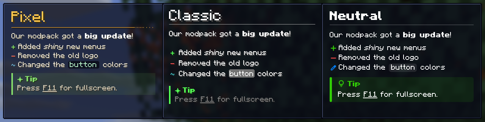

# Texte dans les menus

FancyMenu propose deux éléments pour afficher du texte :

- **Text** affiche du texte directement dans votre menu, d’une simple ligne à de longues pages défilantes, comme des journaux des modifications, des règles ou des actualités.
- **Tooltip** affiche un encadré de texte à un emplacement fixe ou à côté de la souris, par exemple au survol d’un bouton.

Les deux éléments prennent en charge le [Markdown](/text-formatting) et les [placeholders](/placeholders), et partagent les mêmes paramètres d’apparence et de style.

> [!TIP]
> Cette page présente les éléments et leurs paramètres. Pour découvrir tout ce que vous pouvez écrire dans votre texte, comme des titres, des listes, des liens et des couleurs, consultez la page [Mise en forme du texte](/text-formatting).

# Ajouter du texte

1. Ouvrez une disposition dans l’éditeur de disposition.
2. Faites un clic droit sur l’arrière-plan de l’éditeur et sélectionnez **New Element -> Text**.
3. Faites un clic droit sur le nouvel élément et sélectionnez **Text Content**.
4. Rédigez votre texte, puis cliquez sur **Done**.

# Contenu du texte

## Mode source

Faites un clic droit sur l’élément et définissez le **Source Mode** :

- **Direct** : vous saisissez le texte vous-même dans l’éditeur de texte.
- **Resource** : le texte provient d’un fichier texte. Cliquez sur **Text Source** pour choisir un fichier local dans `<game-directory>/config/fancymenu/assets/`, une URL Web ou un fichier de pack de ressources. Consultez la page [Ressources](/resources).

Les sources Web sont idéales pour les journaux des modifications ou les actualités qui doivent toujours être à jour, sans avoir à mettre à jour votre modpack.

FancyMenu conserve le texte des fichiers et des sources Web en mémoire jusqu’à la fermeture du jeu. Pour le recharger, rechargez FancyMenu avec **menu bar -> Customization -> Reload FancyMenu**.

## Texte dynamique

Le texte peut afficher des valeurs en temps réel à l’aide de [placeholders](/placeholders), par exemple `Bienvenue, {"placeholder":"playername"} !`. Il peut également afficher les valeurs des [variables](/variables). Le texte se met automatiquement à jour lorsque ces valeurs changent.

## L’éditeur de texte

Cliquez sur **Text Content** pour ouvrir l’éditeur de texte. Cliquez sur **Placeholders**, en haut à droite, pour parcourir tous les placeholders et en ajouter à votre texte.

### Raccourcis de mise en forme

L’éditeur de texte des éléments Text et Tooltip propose des raccourcis pour les mises en forme courantes. Sur macOS, utilisez `Cmd` à la place de `Ctrl`.

| Raccourci | Action |
|---|---|
| `Ctrl + B` | Gras |
| `Ctrl + I` | Italique |
| `Ctrl + U` | Souligné |
| `Ctrl + L` | Aligner à gauche |
| `Ctrl + E` | Centrer |
| `Ctrl + R` | Aligner à droite |

- Sélectionnez d’abord le texte à mettre en forme. Appuyez de nouveau sur le même raccourci pour supprimer la mise en forme.
- Sans sélection, le raccourci ajoute les caractères de mise en forme et place le curseur entre eux, pour que vous puissiez continuer à saisir votre texte.
- Les raccourcis d’alignement s’appliquent aux lignes sélectionnées ou à la ligne où se trouve le curseur. Si les lignes sont déjà alignées, `Ctrl + E` ou `Ctrl + R` les aligne de nouveau à gauche.
- Faites un clic droit dans l’éditeur, puis ouvrez **Formatting** pour retrouver tous ces raccourcis dans un menu.

### Autres raccourcis

Le même éditeur de texte s’ouvre pour la plupart des textes dans FancyMenu, comme les valeurs d’action et de nombreux paramètres d’éléments. Ces raccourcis fonctionnent dans tous ces champs. Sur macOS, utilisez `Cmd` à la place de `Ctrl`.

| Raccourci | Action |
|---|---|
| `Ctrl + C` | Copier le texte sélectionné |
| `Ctrl + X` | Couper le texte sélectionné |
| `Ctrl + V` | Coller |
| `Ctrl + A` | Sélectionner tout le texte |
| `Ctrl + Z` | Annuler |
| `Ctrl + Y` | Rétablir |
| `Ctrl + D` | Dupliquer la ligne où se trouve le curseur |
| `Alt + Flèche vers le haut` / `Alt + Flèche vers le bas` | Déplacer la ligne où se trouve le curseur vers le haut ou le bas |
| `Maj + touches fléchées` | Sélectionner du texte |
| `Ctrl + Home` / `Ctrl + End` | Aller au début ou à la fin du texte |
| `Ctrl + G` | Aller à une ligne : saisissez son numéro et appuyez sur `Entrée` |
| `Ctrl + S` | Équivaut à **Done** |

Pour connaître les raccourcis de l’éditeur de disposition, consultez la page [Éditeur de disposition](/layout-editor#shortcuts).

# Apparence et styles

Faites un clic droit sur l’élément, puis ouvrez **Markdown** pour modifier l’apparence du texte.

## Apparence

Un **Look** définit d’un seul coup toutes les options de style du texte :

- **Pixel** : un style pixel art conçu pour la police de Minecraft, avec des couleurs chaudes, des détails dorés et des marqueurs dessinés à la main.
- **Classic** : le style classique de FancyMenu, avec du texte blanc, des encadrés gris et des lignes grises.
- **Neutral** : un style épuré reprenant les couleurs du thème actuel de l’interface FancyMenu. Les couleurs sont enregistrées avec l’élément et restent donc les mêmes lorsque vous changez de thème par la suite.

Les nouveaux éléments utilisent l’apparence Pixel. Les éléments des anciennes dispositions conservent l’apparence Classic qu’ils ont toujours eue.

> [!NOTE]
> Choisir une apparence remplace vos modifications de style personnalisées. Vous changez d’avis ? Annulez simplement avec `Ctrl + Z`.

## Options de style

Après avoir choisi une apparence, vous pouvez toujours en ajuster chaque aspect. Le menu **Markdown** propose des options pour le **Text**, les **Headlines**, les **Lists**, les **Links**, le **Code**, les **Quotes**, les **Callouts**, les **Tables**, les **Images** et les **Separators**. Survolez une option pour découvrir son effet.

La section **Markdown -> Text** regroupe les paramètres de base, comme la couleur du texte, son ombre, l’interligne et l’espace entre le texte et les bords de l’élément.

## Désactiver Markdown

Si vous n’avez pas besoin de Markdown, désactivez **Markdown -> Markdown Parser**. Le texte s’affiche alors exactement comme vous l’avez saisi, ce qui est aussi un peu plus rapide pour les textes très longs.

## Autres paramètres du texte

Faites un clic droit sur l’élément pour trouver également les paramètres suivants :

- **Text Scale** agrandit ou réduit le texte.
- **Case Mode** affiche le texte normalement, tout en majuscules ou tout en minuscules.
- **Auto Line Wrapping** renvoie à la ligne les lignes trop longues pour l’élément. Lorsque cette option est désactivée, les longues lignes continuent sans retour à la ligne.
- **Remove HTML Line Breaks** supprime les sauts de ligne HTML (` `) du texte, ce qui est pratique pour le texte provenant de sites Web.

# Arrière-plan

Les éléments Text peuvent afficher un panneau derrière leur texte. Ouvrez **Background** dans le menu contextuel de l’élément :

- **Show Background** active ou désactive le panneau. Cette option est activée par défaut pour les nouveaux éléments Text.
- Par défaut, il s’agit d’un panneau sombre intégré. Vous pouvez utiliser votre propre texture grâce au [découpage en neuf parties](/nine-slicing-and-tiling) et au pavage, afin de préserver la forme de ses bords.
- **Padding** définit la distance entre le texte et le bord de l’arrière-plan.
- **Reach Behind Scroll Bars** permet à l’arrière-plan de recouvrir également les barres de défilement. Lorsque cette option est désactivée, les barres de défilement se trouvent juste à côté du panneau.

Les info-bulles ont leur propre menu **Background**, où vous pouvez définir une texture et son découpage en neuf parties.

# Défilement

Un élément Text défile lorsque son texte ne tient pas à l’intérieur. Utilisez la molette de la souris pour faire défiler le texte. Maintenez `Maj` enfoncée pour le faire défiler horizontalement.

**Scroll Direction** définit si le texte défile à la verticale (**Vertical**), à l’horizontale (**Horizontal**) ou dans les deux sens (**Both**). Dans les directions où le défilement n’est pas activé, tout ce qui ne tient pas est coupé.

## Paramètres de défilement

Ouvrez **Scrolling** dans le menu contextuel de l’élément :

| Paramètre | Action |
|---|---|
| **Let Players Scroll** | Définit si les joueurs peuvent faire défiler le texte eux-mêmes. Lorsque cette option est désactivée, le texte défile uniquement de façon automatique ou au moyen d’actions. |
| **Scroll Speed** | Définit la distance parcourue à chaque cran de la molette. |
| **Smooth Scrolling** | Fait glisser le texte au lieu de le déplacer par à-coups. |
| **Drag to Scroll** | Permet aux joueurs de saisir le texte avec la souris et de le faire glisser, comme sur un écran tactile. |
| **Scroll with Keyboard** | Lorsque la souris se trouve sur le texte, `Page Up` et `Page Down` font défiler une page, tandis que `Home` et `End` vont respectivement au début et à la fin. |
| **Snap** | Définit le point où le texte s’arrête : n’importe où (**Off**), avec une ligne entière en haut (**To Lines**), avec un titre en haut (**To Headlines**) ou par page entière (**To Pages**). |
| **Start At** | Définit si le texte commence au **début** (**Start**) ou à la **fin** (**End**). La fin est pratique pour les journaux, où les entrées les plus récentes se trouvent en dernier. |
| **Reset When Screen Opens** | Replace le texte au début à chaque ouverture de l’écran. Lorsque cette option est désactivée, le texte garde sa position de défilement jusqu’à la fermeture du jeu. |

## Défilement automatique

Ouvrez **Auto-Scroll** pour faire défiler lentement le texte automatiquement, comme un générique ou un bandeau d’actualités :

- **Scroll on Its Own** active le défilement automatique.
- **Speed [Pixels per Second]** définit la vitesse de défilement.
- **Start Over at the End** recommence depuis le début une fois arrivé à la fin.
- **Pause While Hovered** suspend le défilement lorsque la souris se trouve sur le texte, afin que les joueurs puissent le lire tranquillement.

## Barres de défilement

Ouvrez **Scroll Bars** pour modifier les barres :

- **Show** définit quand les barres apparaissent : **Always**, uniquement **While Scrolling** ou **Never**. Avec **Never**, la molette de la souris permet toujours de faire défiler le texte.
- **Thickness** définit l’épaisseur des barres.
- **Vertical Bar on the Left** et **Horizontal Bar on Top** déplacent les barres de l’autre côté.
- **Scroll Grabber Style** définit l’apparence des poignées : **Theme Bar** (aux couleurs du thème actuel de l’interface FancyMenu) ou **Pixel Handle** (un élément en pixel art qui s’accorde parfaitement avec l’apparence Pixel).
- **Scroll Grabber Textures** et **Scroll Grabber Color [HEX]** remplacent les poignées par vos propres textures ou couleurs.
- **Scroll Bar Backgrounds** ajoute des textures derrière les poignées, le long de leur trajectoire.

## Contrôler le défilement avec des actions

Vous pouvez aussi contrôler le défilement et en suivre l’état depuis d’autres parties de FancyMenu :

- L’[action](/action-scripts) **Scroll an Element** fait défiler un élément Text jusqu’à son début, sa fin, une position ou un numéro de ligne, ou jusqu’à la première ligne contenant un texte donné.
- Les [placeholders](/placeholders) **Element Scroll Position**, **Element Scroll Percent** et **Element Scroll Content Size** indiquent la position de défilement du texte et sa taille.
- La [condition](/conditions) **Is Element Scrolled to End** vérifie si le texte a atteint sa fin. Elle permet, par exemple, d’activer un bouton « Accepter » uniquement après la lecture des règles.
- Les [listeners](/listeners) **On Element Scrolled**, **On Element Scrolled to Start** et **On Element Scrolled to End** exécutent des actions pendant le défilement du texte.

Tous ces éléments nécessitent l’[identifiant d’élément](/element-identifiers) de l’élément Text.

# Laisser passer les clics sur les éléments Text

Les éléments Text réagissent à la souris pour permettre l’utilisation de leurs liens et de leurs barres de défilement. Ils interceptent donc aussi les clics : les boutons placés derrière ou devant un élément Text risquent de ne pas les recevoir.

Si cela pose problème, faites un clic droit sur l’élément Text et désactivez **Interactable**. Le texte ne pourra alors plus défiler et ses liens ne pourront plus être cliqués.

# Info-bulles

Les éléments Tooltip fonctionnent comme les éléments Text, mais sans défilement :

- Leurs paramètres de texte, d’apparence et de style sont les mêmes que ceux des éléments Text.
- **Follow Mouse** permet à l’info-bulle de suivre la souris.
- Utilisez des [conditions](/conditions) pour décider quand l’info-bulle apparaît, comme la condition [**Is Element Hovered**](/conditions#is-element-hovered), qui l’affiche au survol d’un bouton.
