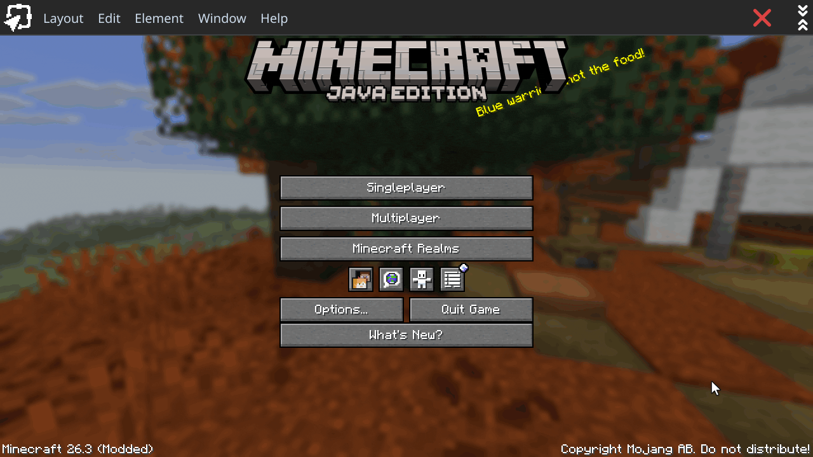

# アクションスクリプト

アクションスクリプトは、ボタンのクリックやメニューの表示など、何かが起きたときにFancyMenuが実行する処理のリストです。各処理はアクションと呼ばれ、メニューを開く、サーバーに参加する、メッセージを表示する、サウンドを再生するなど、さまざまな動作を行います。IFやWHILEなどのステートメントを使うと、どのアクションを実行するか、何回実行するかを決められます。

> [!CAUTION]
> アクションスクリプトは、ファイルの変更、サーバーへの接続、リンクの表示、コマンドの実行を行う場合があります。信頼できるレイアウトのスクリプトだけを使用してください。



# アクションスクリプトの作成

1. レイアウトエディターでボタンを右クリックし、**Edit Action Script**をクリックします。
2. `A`キーを押してアクション選択画面を開きます。
3. アクションを検索してクリックし、**Next Step**をクリックします。
4. 表示されたウィンドウでアクションを設定し、**Done**をクリックします。設定項目のないアクションは、選択画面で**Done**をクリックするだけです。
5. スクリプトエディターで**Done**をクリックし、レイアウトを保存します。

エディターを閉じた状態では、ボタンをクリックするとスクリプトが実行されます。


> [!TIP]
> スクリプト領域を右クリックし、**Add Action**を開くと、すべてのアクションを一覧できます。一覧内のアクションを右クリックしてお気に入りにすると、一覧の上部に表示されます。

# アクションスクリプトを使える場所

| 場所 | 実行されるタイミング | 編集方法 |
|---|---|---|
| [ボタン](/elements#button) | ボタンがクリックされたとき。 | ボタンを右クリック -> **Edit Action Script** |
| [スライダー](/elements#slider) | スライダーの値が変わったとき。`$$value`は新しい値です。 | スライダーを右クリック -> **Edit Action Script** |
| [チェックボックス](/elements#checkbox) | チェックボックスがオンまたはオフになったとき。`$$value`は新しい状態（`true`または`false`）です。 | チェックボックスを右クリック -> **Edit Action Script** |
| [Ticker](/elements#ticker) | **Tick Mode**の設定に応じて、繰り返し、ゲームセッションごとに1回、またはメニューの読み込み時に1回実行されます。 | Tickerを右クリック -> **Edit Action Script** |
| メニューを開くとき | レイアウトのメニューが開いたとき。 | エディターの背景を右クリック -> **Edit 'Open Screen' Action Script** |
| メニューを閉じるとき | レイアウトのメニューが閉じたとき。 | エディターの背景を右クリック -> **Edit 'Close Screen' Action Script** |
| [リスナー](/listeners) | キー入力やチャットメッセージなど、イベントが発生したとき。 | **メニューバー -> Customization -> Manage Listeners** |
| [スケジューラー](/schedulers) | メニューが開いていないときも、設定したタイマーに従って実行されます。 | **メニューバー -> Customization -> Manage Schedulers** |

メニューの開閉スクリプトは、エディターの**Layout -> Layout Properties**メニューからも編集できます。

# スクリプトエディター

- アクションは上から順に実行されます。ステートメントやフォルダーの中にある項目は、インデントして表示されます。
- 新しい項目は、選択中の項目の下に追加されます。ステートメントまたはフォルダーを選択している場合は、その先頭に追加されます。
- 値をダブルクリックすると、リスト上で直接編集できます。短い概要が表示されている値は、代わりに専用ウィンドウが開きます。
- 項目をドラッグして移動できます。IFの連鎖、ループ、フォルダーは、手前にある小さな切り替えボタンで折りたためます。これは表示方法だけを変更します。
- 右側のバーはスクリプト全体のマップです。クリックすると該当箇所に移動できます。
- スクリプト領域を右クリックすると、ステートメントの追加や**Export Action Script for AI**（[AI向けエクスポート](/export-for-ai)を参照）など、その他の操作を行えます。
- **Cancel**をクリックするかウィンドウを閉じると、変更は破棄されます。変更がある場合は、確認メッセージが表示されます。

## ショートカット

macOSでは`Ctrl`の代わりに`Cmd`を使います。

| ショートカット | 動作 |
|---|---|
| `A` | アクション選択画面を開きます。 |
| `Enter` | 選択中の項目を編集します。 |
| `Delete` | 選択中の項目を削除します。 |
| `Up` / `Down` | 1つ上または下の項目を選択します。 |
| `Shift + Up` / `Shift + Down` | 選択中の項目を上または下に移動します。 |
| `Ctrl + C` / `Ctrl + V` | アクションをコピーして貼り付けます。ステートメントとブロックはコピーできません。 |
| `Ctrl + Z` | 操作を元に戻します。 |
| `Ctrl + Y`または`Ctrl + Shift + Z` | 操作をやり直します。 |
| `Ctrl + S` | **Done**と同様に、スクリプトを保存してエディターを閉じます。 |

# ステートメント

ステートメントを使うと、実行するアクションとその実行回数を決められます。スクリプト領域を右クリックして追加します。

## If、Else-If、Else

**Add IF Statement**を選ぶと、[条件](/conditions)を設定できます。IFの中にあるアクションは、条件を満たした場合にのみ実行されます。

IFを右クリックすると、連鎖に項目を追加できます。

- **Append ELSE-IF Statement**：上のIFが実行されなかった場合に、この項目の条件を確認します。
- **Append ELSE Statement**：連鎖内の上の項目がどれも実行されなかった場合に実行します。

たとえば、**Is Layout Enabled**を条件にしたIFを使うと、冬のレイアウトが有効な間だけトーストを表示し、そうでない場合はELSEでサウンドを再生できます。

## Whileループ

**Add WHILE Loop**を選ぶと、[条件](/conditions)を満たしている間、内側のアクションを繰り返し実行します。

実行は毎回3秒後に停止するため、終わらないループがゲームをフリーズさせることはありません。これはタイマーではありません。後で実行したり、繰り返し実行したりする処理には、[Execute Later](#execute-later)、[Ticker](/elements#ticker)、または[Scheduler](/schedulers)を使ってください。

## For Eachループ

**Add FOR EACH Loop**を選ぶと、[リスト変数](/variables#text-and-list-variables)の各項目に対して、先頭から末尾まで順にアクションを1回ずつ実行します。

- `$$list_entry`は現在の項目、`$$list_index`はそのインデックスです。先頭の項目のインデックスは0です。
- ループ内では、アクションの値と条件の両方でこれらを使えます。
- リストの名前は`$$`を付けずに入力します（例：`quest_log`）。名前にはプレースホルダーも使えます。
- ループ開始時にリストを読み込むため、ループ内のアクションで安全にリストを変更できます。
- WHILEループと同様、実行は毎回3秒後に停止します。

例については[リストの処理](/variables#going-through-a-list)を参照してください。

# ブロック

ブロックを使うと、アクションの実行タイミングを変えたり、スクリプトを整理したりできます。スクリプト領域を右クリックして追加します。

## Delay Gate

**Add DELAY GATE Block**を選ぶと、指定した時間（ミリ秒）が経過するまで、内側のアクションの実行を保留します（`1000`は1秒です）。

- スクリプトが初めてゲートに到達すると、タイマーを開始して内側のアクションをスキップします。スクリプトの残りの部分はすぐに実行されます。
- 時間が経過する前にスクリプトが再びゲートに到達した場合も、アクションはスキップされます。
- タイマーが終了した後は、スクリプトがゲートに到達するたびに内側のアクションが実行されます。
- 要素のスクリプトでは、メニューを再度開いたとき、またはサイズを変更したときにタイマーがリセットされます。

メニューを開いてから数秒後にだけ何かを表示するなど、[Ticker](/elements#ticker)で使うのに適しています。ブロック自体が何かを実行することはありません。その用途にはExecute Laterを使ってください。

## Execute Later

**Add EXECUTE LATER Block**を選ぶと、指定した時間（ミリ秒）が経過した後に、内側のアクションを1回実行します。スクリプトの残りの部分はすぐに実行されます。

スクリプトがこのブロックに到達するたびに、新しいカウントダウンが始まります。ボタンのクリックやメニューを開くときなど、1回だけ実行されるスクリプトに適しています。

## フォルダー

**Add Folder**を選ぶと、名前を付けたグループにアクションをまとめられます。中にあるすべての項目を実行しますが、長いスクリプトを整理するためだけの機能です。フォルダー名をダブルクリックすると、名前を変更できます。

## コメント

**Add Comment**を選ぶと、自分用のメモを追加できます。実行される処理はありません。ダブルクリックすると編集できます。

# スクリプトの実行方法

- アクションは上から順に実行されます。アクションが失敗するとゲームログにエラーが記録されますが、スクリプトの残りの部分は引き続き実行されます。
- 値に含まれるプレースホルダーは、アクションの実行時に現在の値へ置き換えられます。そのため、アクションはそれより前に実行されたアクションによる変更を確認できます。
- ダウンロード、ZIPファイルの展開、Webリクエストはバックグラウンドで完了します。次のアクションは完了を待ちません。処理の完了後にアクションを実行するには、リスナーの[**On File Downloaded via Action**](/listeners#on-file-downloaded-via-action)や[**On ZIP Extracted via Action**](/listeners#on-zip-extracted-via-action)、または[**Send HTTP Request**](#send-http-request)のレスポンス変数を使ってください。

# アクションの値

ほとんどのアクションでは、サーバーアドレスなどの値が必要です。単純な値はテキストで入力します。設定項目が多いアクションには専用のウィンドウがあります。

## プレースホルダー

値にはプレイヤー名などの[プレースホルダー](/placeholders)を含められます。アクションの実行時にプレースホルダーが置き換えられます。

```
/say Welcome back, {"placeholder":"playername"}!
```

## $$変数

`$$`の後に変数名を入力すると、アクションや条件でその変数の値を使えます。変数名の大文字と小文字は区別されます。次の2種類の変数を使えます。

### 自分で作成した変数

**メニューバー -> Customization -> Manage Variables**で作成したすべての変数は、`$$`と変数名を使って参照できます。`coins`という名前の変数は、すべてのスクリプトで`$$coins`として使えます。たとえば、**Display In Chat [Client-Side]**に次の値を指定すると、プレイヤーが所持しているコイン数を表示できます。

```
&6You have $$coins coins!
```

変数の作成や変更については[変数](/variables)を参照してください。

### スクリプトの変数

機能によっては、そのスクリプト専用の変数が用意されています。

- [スライダー](/elements#slider)は、新しい値を`$$value`として渡します。
- [チェックボックス](/elements#checkbox)は、新しい状態（`true`または`false`）を`$$value`として渡します。
- [For Eachループ](#for-each-loop)は、`$$list_entry`と`$$list_index`を渡します。
- 各[リスナー](/listeners#listener-variables)には、押されたキーなど、渡される変数が記載されています。

これらの変数は、スクリプトの実行中だけ存在します。自分で作成した変数と名前が同じ場合、`$$name`はスクリプトの変数を指します。

# すべてのアクション

FancyMenuで使えるすべてのアクションを、動作別に紹介します。

## 画面とメニュー

### 画面またはカスタムGUIを開く

**識別子：** `opengui`

ゲームやMODのメニュー、または[カスタムGUI](/custom-guis)を開きます。

**値：** `options_screen`などの[画面識別子](/screen-identifiers)

大文字と小文字は区別されます。この方法では開けないMODメニューもあります。その場合は、メニューを開くボタンに[**Mimic Vanilla/Mod Button**](#mimic-vanillamod-button)を使ってください。

### 画面を閉じる

**識別子：** `closegui`

開いているメニューを閉じます。ワールドの外にいる場合は、タイトル画面が開きます。

**値：** なし

### 画面を更新

**識別子：** `update_screen`

ウィンドウのサイズ変更時と同様に、開いているメニューを再構築します。GUIスケールなどの設定を変更した後に便利です。

**値：** なし

### 前の画面に戻る

**識別子：** `back_to_last_screen`

直前に開いていたメニューに戻ります。[カスタムGUI](/custom-guis)の場合は、そのGUIを開く前に表示されていたメニューに戻ります。

**値：** なし

### トーストを表示

**識別子：** `show_toast`

右上にトースト通知を表示します。専用ウィンドウで次の項目を設定します。

- **Toast Width**：120～320ピクセル。
- **Duration (ms)**：表示時間。1秒（`1000`）から10分まで指定できます。
- **Title**および**Message**：[書式コード](/text-formatting#minecraft-text-formatting)を含むテキスト、またはMinecraftのテキストコンポーネントJSONを指定します。
- **Icon Texture Source**および**Background Texture Source**：任意の[画像](/resources)を指定します。アイコンは20x20ピクセル、背景は高さ32ピクセルで、トーストと同じ幅にすると見栄えがよくなります。

### Vanilla／MODのボタンを再現

**識別子：** `mimicbutton`

プレイヤーがクリックしたときと同じように、ゲームまたはMODのボタンをクリックします。

**値：** `title_screen:mc_titlescreen_options_button`などのボタンの[ウィジェットロケーター](/widget-locators)

取得するには、エディターでボタンを右クリックし、**Copy Widget Locator**をクリックします。

## レイアウトと要素

### レイアウトを切り替え

**識別子：** `toggle_layout`

有効なレイアウトを無効にし、無効なレイアウトを有効にします。

**値：** `winter_title_screen`など、`.txt`を除いたレイアウト名

### レイアウトを有効化

**識別子：** `enable_layout`

レイアウトを有効にします。

**値：** `.txt`を除いたレイアウト名

### レイアウトを無効化

**識別子：** `disable_layout`

レイアウトを無効にします。

**値：** `.txt`を除いたレイアウト名

これら3つのレイアウトアクションは、変更を保存し、開いているメニューをすぐに更新します。名前の大文字と小文字は区別されます。

### Element Animatorを切り替え

**識別子：** `toggle_element_animator`

[Element Animator](/element-animator)が無効なら有効にし、有効なら無効にします。アニメーションは最初から再生されます。状態は保存されます。

**値：** Element Animatorの識別子

### Element Animatorを有効化

**識別子：** `enable_element_animator`

[Element Animator](/element-animator)を有効にします。無効だった場合は、アニメーションが最初から再生されます。

**値：** Element Animatorの識別子

### Element Animatorを無効化

**識別子：** `disable_element_animator`

[Element Animator](/element-animator)を無効にし、アニメーションをリセットします。

**値：** Element Animatorの識別子

### Element Animatorをリセット

**識別子：** `reset_element_animator`

[Element Animator](/element-animator)を有効または無効にせずに、アニメーションを最初から再生します。

**値：** Element Animatorの識別子

### テキスト入力欄の値を設定

**識別子：** `set_text_input_field_value`

FancyMenuまたはゲームの[テキスト入力欄](/elements#text-input-field)にテキストを設定します。

**値：** `element_identifier|||text|||force`

`force`を`true`にすると、入力欄が無効（非アクティブ）でもテキストが変更されます。

### 要素をスクロール

**識別子：** `scroll_scroll_area`

[スクロール可能な領域](/scrollable-areas)または[テキスト](/elements#text)要素をスクロールします。専用ウィンドウで次の項目を設定します。

- **Identifier of the Element to Scroll**：スクロールする領域またはテキストの識別子。
- **Scroll To**：
  - **Start**または**End**。
  - **Position**：ピクセル単位の**Horizontal Position**と**Vertical Position**。一方を空欄にすると、その方向の位置は維持されます。
  - **Element**（領域のみ）：**Identifier of the Element to Scroll To**で指定した要素が先頭に来るまでスクロールします。
  - **Line Number**（テキストのみ）：先頭行は`1`です。
  - **Line with Text**（テキストのみ）：**Text in the Line**を含む最初の行までスクロールします。大文字と小文字は区別されません。
- **Glide There**：ジャンプではなく、滑らかにスクロールします。要素のスムーズスクロールが有効である必要があります。

該当する要素がない場合は何も起こりません。

## 音声と動画

### 次のトラック

**識別子：** `audio_next_track`

[Audio要素](/elements#audio)の次のトラックに進みます。

**値：** `menu_music`などのAudio要素の識別子

### 前のトラック

**識別子：** `audio_previous_track`

[Audio要素](/elements#audio)の前のトラックに戻ります。

**値：** Audio要素の識別子

### トラックの音量を設定

**識別子：** `set_audio_element_volume`

[Audio要素](/elements#audio)の音量を`0.0`（0%）から`1.0`（100%）の範囲で設定します。

**値：** `element_identifier:volume`（例：`menu_music:0.5`）

### トラックの再生／一時停止を切り替え

**識別子：** `audio_toggle_play`

再生中の[Audio要素](/elements#audio)を一時停止するか、一時停止中のものを再生します。

**値：** Audio要素の識別子

### 音声を再生

**識別子：** `play_audio`

音声ファイルを1回再生します。専用ウィンドウで**Audio Source**、**Sound Channel**、**Base Volume**（最大100%）を設定します。

- FancyMenuは音声の読み込みを最大10秒間待ちます。
- バックグラウンドで実行される（非同期の）[Ticker](/elements#ticker)では動作しません。その場合、FancyMenuはエラーを表示します。

このアクションで再生した音声は、[**Stop All Action Audios**](#stop-all-action-audios)で停止できます。

### アクションの音声をすべて停止

**識別子：** `stop_all_action_audios`

[**Play Audio**](#play-audio)で再生した音声をすべて停止します。Audio要素、メニュー音、ボタン音の再生は継続します。

**値：** なし

### 動画要素の音量を設定

**識別子：** `set_video_element_volume`

[Video要素](/video)の音量を`0.0`（0%）から`1.0`（100%）の範囲で設定します。

**値：** `video_element_identifier:volume`

### 動画要素の再生位置を設定

**識別子：** `set_video_element_play_time`

[Video要素](/video)の再生位置をミリ秒単位で変更します。

**値：** `video_element_identifier:time_in_ms`（例：`intro_video:30000`）

### 動画要素の一時停止状態を切り替え

**識別子：** `toggle_video_element_pause_state`

再生中の[Video要素](/video)を一時停止するか、一時停止中のものを再生します。

**値：** Video要素の識別子

### 動画メニュー背景の音量を設定

**識別子：** `set_video_menu_background_volume`

[動画メニュー背景](/video)の音量を`0.0`（0%）から`1.0`（100%）の範囲で設定します。

**値：** `background_identifier:volume`

> [!NOTE]
> メニュー背景の識別子を取得するには、エディターの背景を右クリックし、**Copy Background Identifier**をクリックします。

### 動画メニュー背景の再生位置を設定

**識別子：** `set_video_menu_background_play_time`

[動画メニュー背景](/video)の再生位置をミリ秒単位で変更します。

**値：** `background_identifier:time_in_ms`

### 動画メニュー背景の一時停止状態を切り替え

**識別子：** `toggle_video_menu_background_pause_state`

再生中の[動画メニュー背景](/video)を一時停止するか、一時停止中のものを再生します。

**値：** メニュー背景の識別子

## ワールドとサーバー

### サーバーに参加

**識別子：** `joinserver`

Minecraftサーバーに接続します。

**値：** `address`または`address:port`（例：`play.example.net`）

ポートを指定しない場合は`25565`が使われます。ワールドまたはサーバーを読み込み中の場合は、代わりにエラーが表示されます。サーバーリストにないサーバーはリストに追加されます。

### ワールドに入る

**識別子：** `loadworld`

シングルプレイのワールドを読み込みます。

**値：** `saves`内のワールドフォルダー名（例：`Survival Island`）

該当するワールドがない場合は何も起こりません。ワールドまたはサーバーを読み込み中の場合は、代わりにエラーが表示されます。

### 前回のワールド／サーバーに入る

**識別子：** `join_last_world`

プレイヤーが最後にプレイしたワールドを読み込むか、最後に参加したサーバーに接続します。

**値：** なし

ワールドまたはサーバーを読み込み中の場合は、代わりにエラーが表示されます。サーバーリストにないサーバーはリストに追加されます。

### ワールドまたはサーバーから退出

**識別子：** `disconnect_server_or_world`

ワールドまたはサーバーから退出し、メニューを開きます。

**値：** 開くメニューの[画面識別子](/screen-identifiers)（例：`title_screen`）

ワールドを読み込み中の場合のみ動作します。[カスタムGUI](/custom-guis)も使用できます。メニューを開けない場合は、タイトル画面が開きます。

## チャットとコマンド

### チャットメッセージ／コマンドを送信

**識別子：** `sendmessage`

プレイヤーが入力した場合と同じように、チャットメッセージを送信するか、コマンドを実行します。

**値：** メッセージ、または`/spawn`のように`/`で始まるコマンド

### 統合サーバーとしてコマンドを実行

**識別子：** `execute_command_as_integrated_server`

シングルプレイで、プレイヤーの権限やチート設定に関係なく、サーバーとしてコマンドを実行します。

**値：** `/give @p minecraft:diamond 1`のようなコマンド

> [!WARNING]
> ワールドがLANに公開されていないシングルプレイでのみ動作します。それ以外の状況では何も起こりません。

### チャットに貼り付け

**識別子：** `paste_to_chat`

ワールドを読み込み中に、チャット入力欄へテキストを入力します。チャットが開いていない場合は、テキストを入力した状態で開きます。

**値：** `true:text`は入力済みのテキストに追加し、`false:text`は置き換えます。

### チャットに表示［クライアント側］

**識別子：** `display_in_chat_client_side`

このプレイヤーにだけ表示されるチャットメッセージを表示します。サーバーには送信されません。

**値：** [書式コード](/text-formatting#minecraft-text-formatting)を含むテキスト、またはMinecraftのテキストコンポーネントJSON（例：`&aWelcome back!`）

ワールドが読み込まれていない場合は何も起こりません。

## 変数とリスト

### 変数の値を設定（FM Variable）

**識別子：** `set_variable`

[変数](/variables)の値を設定します。

**値：** `variable_name:value`（例：`coins:100`）

- 名前と値を分けるのは、最初の`:`だけです。
- [リスト変数](/variables#text-and-list-variables)はリストのままです。JSON配列（例：`["a","b"]`）は各要素がリスト項目になり、それ以外のテキストは1つの項目になり、空のテキストを指定するとリストが空になります。

### 変数を削除（FM Variable）

**識別子：** `delete_variable`

[変数](/variables)を完全に削除します。他の変数はそのまま残ります。変数を空にするだけの場合は、[**変数の値を設定（FM Variable）**](#set-variable-value-fm-variable)を使ってください。

**値：** 変数名

### すべての変数を消去（FM Variable）

**識別子：** `clear_variables`

テキスト変数とリスト変数を含む、すべての[変数](/variables)を削除します。

**値：** なし

### リストに追加（FM Variable）

**識別子：** `add_to_list`

[リスト変数](/variables#list-actions)に項目を追加します。

- **List Variable**：リスト名。この名前の変数がまだない場合は、アクションがリストを作成します。
- **New Entry**：追加する項目のテキスト。
- **Index (Optional)**：項目を追加する位置。空欄の場合は末尾に追加されます。追加位置以降の項目は1つ後ろに移動します。
- **Skip If Already in List**：同じテキストの項目がリストにすでにある場合、追加しません。**Ignore Case**を有効にすると、`Apple`と`apple`を同じものとして扱います。

### リスト項目を設定（FM Variable）

**識別子：** `set_list_entry`

[リスト変数](/variables#list-actions)の**Index**で指定した項目を、**New Value**で置き換えます。指定位置に項目がない場合は何も起こりません。

### リストから削除（FM Variable）

**識別子：** `remove_from_list`

[リスト変数](/variables#list-actions)から項目を削除します。**Remove**で削除方法を選びます。

- **Entry at Index**：指定したインデックスの項目。
- **First Match**：**Value to Remove**と完全に一致する最初の項目。
- **All Matches**：一致するすべての項目。

**Ignore Case**を有効にすると、`Apple`と`apple`を同じものとして扱います。

### リストを消去（FM Variable）

**識別子：** `clear_list`

[リスト変数](/variables#list-actions)からすべての項目を削除します。空のリストはそのまま残ります。

### リストを設定（FM Variable）

**識別子：** `set_list`

[リスト変数](/variables#list-actions)のすべての項目を置き換えます。**Entries From**で項目の取得元を選びます。

- **Split Text**：**Text to Split**を**Separator**（例：`,`）で分割します。区切り文字を空にすると、改行で分割されます。**Trim Entries**を有効にすると各項目の先頭と末尾の空白が削除され、**Skip Empty Entries**を有効にすると空の項目が除外されます。
- **JSON Array**：`["Diamonds","Emeralds"]`のような配列の要素を使います。`$$other_list`を指定すると、別のリストをコピーできます。それ以外のテキストは1つの項目になり、空のテキストを指定するとリストが空になります。

ウィンドウには項目のプレビューが表示されます。

### リストを並べ替え（FM Variable）

**識別子：** `arrange_list`

[リスト変数](/variables#list-actions)の順序を変更します。**Arrangement**で次の操作を選びます。

- **Sort A–Z**と**Sort Z–A**：アルファベット順に並べ替えます。
- **Numbers, Smallest First**と**Numbers, Biggest First**：数値順に並べ替えます。数値ではない項目は末尾に移動します。
- **Reverse Order**：最後の項目を先頭に移動します。
- **Shuffle**：ランダムな順序に並べ替えます。
- **Remove Duplicates**：各値の最初の項目だけを残します。

すべてのリストアクションで、先頭の項目のインデックスは`0`、末尾の項目は`-1`です。リスト名にはプレースホルダーを含められます。また、名前の前に`$$`を付けると、その変数の値をリスト名として使います。値のあるテキスト変数はリストに変換されず、そのまま残ります。その場合、アクションはゲームログに警告を記録します。

## Webとネットワーク

### ブラウザーでURLを開く

**識別子：** `openlink`

確認を表示せず、既定のブラウザーでリンクを開きます。

**値：** `https://discord.gg/example`のようなリンク

信頼できるリンクだけを使用してください。

### HTTPリクエストを送信

**識別子：** `send_http_request`

バックグラウンドでWebリクエストを送信します。応答をゲームログに記録したり、変数に保存したりできます。

| 設定 | 動作 |
|---|---|
| URL | HTTPまたはHTTPSのアドレス。 |
| Method | `GET`、`POST`、`PUT`、`DELETE`、`PATCH`、`HEAD`、`OPTIONS`のいずれか。 |
| Body | 送信するデータ。`GET`と`HEAD`では送信されません。 |
| Content type | リクエスト本文の`Content-Type`（例：`application/json`）。 |
| Timeout | 接続と応答を待つ秒数。 |
| Log response | 応答をゲームログに記録します。 |
| Response variable | 応答が届いたときに、その内容をこの変数に保存します。 |
| Single-line response | 保存前に応答から改行を削除します。 |
| Authentication | 認証方式。None、Basic、Bearer、API keyから選びます。 |
| Headers | リクエストに追加するヘッダー。 |

次のアクションは応答を待ちません。エラー応答もログに記録され、変数に保存されます。パスワードやアクセストークンをアクションに記載しないでください。レイアウトを持っている人なら誰でも内容を読めます。

### FM Dataをサーバーに送信

**識別子：** `send_fm_data_to_server`

[FМ Data](/fm-data)をサーバーに送信します。サーバー側にもFancyMenuが必要です。

**値：** `data_identifier||data`

### リモートサーバーに接続

**識別子：** `connect_to_remote_server`

リモートサーバーに接続します。すでに接続が開いている場合は、その接続を使います。

**値：** `wss://example.com/ws`のようなサーバーアドレス

使用できるアドレスについては、[リモートサーバー通信](/remote-server-communication#url-modes)を参照してください。

### リモートサーバーにデータを送信

**識別子：** `send_data_to_remote_server`

リモートサーバーにテキストを送信します。必要に応じて、先に接続します。

**値：** `server_address||data`

### リモートサーバー接続を閉じる

**識別子：** `close_remote_server_connection`

リモートサーバーへの接続を1つ閉じます。

**値：** リクエストID。[**On Remote Server Connected**](/listeners#on-remote-server-connected)の`$$request_id`を使うのが一般的です。

### すべてのリモートサーバー接続を閉じる

**識別子：** `close_all_remote_server_connections`

FancyMenuが開いたリモートサーバーへの接続をすべて閉じます。

**値：** なし

## ファイル

### ゲームディレクトリにファイルを作成

**識別子：** `create_file_in_game_dir`

空のファイルを作成します。存在しないフォルダーも作成されます。ファイルがすでに存在する場合は変更されません。

**値：** `config/mymodpack/first_start.txt`のようなファイルパス

すべてのファイルアクションはゲームフォルダー（インスタンスフォルダー）内でのみ動作します。`.minecraft/`で始まるパスは、代わりに既定の`.minecraft`フォルダーを使用します。別のフォルダーを指す場合もあります。

### ゲームディレクトリのファイル／フォルダーを削除

**識別子：** `delete_file_in_game_dir`

ファイル、または中身も含めたフォルダーを削除します。

**値：** `config/mymodpack/cache.txt`のようなパス

`config/downloads/*`のように末尾に`*`を付けると、そのフォルダー内にあるファイルをすべて削除します。フォルダー自体と、その中のフォルダーは残ります。

### ゲームディレクトリのファイル／フォルダーをコピー

**識別子：** `copy_file_in_game_dir`

ファイル、または中身も含めたフォルダーをコピーします。

**値：** `source||destination`（例：`config/presets/default.json||config/mymod/settings.json`）

- コピー元の末尾に`*`を付けると（例：`config/presets/*||config/mymod/`）、そのフォルダー内にあるファイルだけをコピーし、フォルダーはコピーしません。この場合、コピー先はフォルダーとなり、必要に応じて作成されます。
- 既存のファイルは上書きされません。コピー先にすでにファイルがある場合、アクションは失敗します。

### ゲームディレクトリのファイル／フォルダーを移動

**識別子：** `move_file_in_game_dir`

ファイル、または中身も含めたフォルダーを移動します。

**値：** `source||destination`

コピー元の末尾に付ける`*`は、[**ゲームディレクトリのファイル／フォルダーをコピー**](#copy-filefolder-in-game-directory)と同じように機能します。既存のファイルは上書きされません。

### ゲームディレクトリのファイル／フォルダー名を変更

**識別子：** `rename_file_in_game_dir`

ファイルまたはフォルダーの名前を変更します。変更後の名前がすでに存在する場合は失敗します。

**値：** `path||new_name`（例：`config/mymod/old_name.txt||new_name.txt`）

### ゲームディレクトリにファイルをダウンロード

**識別子：** `download_file_to_game_dir`

ファイルをフォルダーにバックグラウンドでダウンロードします。

**値：** `url||target_folder`（例：`https://example.com/pack.zip||downloads`）

- 2つ目の値はファイル名ではなくフォルダーです。FancyMenuはダウンロード情報またはリンクからファイル名を取得します。
- 同じ名前のファイルがある場合は上書きされます。
- ダウンロードが完了または失敗すると、[**On File Downloaded via Action**](/listeners#on-file-downloaded-via-action)が実行されます。成功した場合、`$$target_file_path`には保存されたファイルのパスが入ります。

### ゲームディレクトリでZIPファイルを展開

**識別子：** `extract_zip_file_in_game_dir`

ZIPファイルをフォルダーにバックグラウンドで展開します。

**値：** `zip_path||target_folder`（例：`downloads/pack.zip||resourcepacks/MyPack`）

同じ名前のファイルは置き換えられ、ZIPファイル名と同じ追加フォルダーは作成されません。展開が終わると[**On ZIP Extracted via Action**](/listeners#on-zip-extracted-via-action)が実行されます。信頼できるZIPファイルだけを展開してください。

### ゲームディレクトリのファイル／フォルダーを開く

**識別子：** `open_file_folder_in_game_dir`

システムでそのファイルやフォルダーに関連付けられているプログラムを使って開きます。

**値：** `screenshots`のようなパス

### ゲームディレクトリのファイルに書き込む

**識別子：** `write_file_in_game_dir`

ファイルにテキストを書き込みます。必要に応じてファイルとフォルダーが作成されます。

**値：** `path|||text|||append`（例：`config/mymodpack/log.txt|||Joined the server\n|||true`）

`\n`は改行を表します。`append`を`true`にするとテキストをファイルの末尾に追加し、`false`にすると既存の内容を置き換えます。

### システムからファイルを選択

**識別子：** `select_file_to_game_dir`

システムのファイル選択画面を開き、選択したファイルをゲームフォルダーにコピーします。

**値：** `target_path|||filter_name|||extensions|||overwrite`（例：`config/fancymenu/assets/background.png|||Images|||png;jpg|||true`）

- `target_path`は、ファイル名を含むコピー先の完全なパスです。
- 拡張子は`;`または`,`で区切ります。拡張子を指定しない場合は、すべてのファイルを選択できます。
- `overwrite`を`false`にすると、ファイルがすでに存在する場合にアクションが失敗します。

ファイルのコピー、ファイル選択画面のキャンセル、またはエラーが発生したときに[**On File Selected**](/listeners#on-file-selected)が実行されます。

## ゲームとFancyMenu

### Minecraftを終了

**識別子：** `quitgame`

ゲームを終了します。

**値：** なし

### Minecraftの設定を変更

**識別子：** `edit_minecraft_option`

描画距離やGUIスケールなど、Minecraftの設定を変更します。

**値：** `option_name:value`（例：`renderDistance:12`）

設定名については[Minecraftの設定](/minecraft-options)を参照してください。

### キーバインドを再現

**識別子：** `mimic_keybind`

ジャンプやスニークなど、Minecraftのキーバインドを押します。キーを押し続けることもできます。

**値：** `keybind|||hold|||duration_ms`（例：`key.jump|||false|||1000`）

| 部分 | 説明 |
|---|---|
| `keybind` | キーバインドのID（例：`key.jump`または`key.sneak`）。 |
| `hold` | `true`はキーを押し続け、`false`は1回だけ押します。 |
| `duration_ms` | キーを押し続ける時間（ミリ秒）。省略した場合は`1000`です。 |

### リソースパックを管理

**識別子：** `manage_resource_pack`

専用ウィンドウで設定したリソースパックを有効または無効にします。

- **Target Resource Pack**：リソースパック画面に表示されるパック名。大文字と小文字は区別されません。
- **Action Mode**：**Enable**、**Disable**、**Toggle**から選択します。
- **Reload Resources**：変更後すぐにリソースパックを再読み込みします。これをオフにすると、[**Reload Resource Packs**](#reload-resource-packs)などを使って後から再読み込みできます。

ゲームが必要とするパックは無効にできません。

### リソースパックを再読み込み

**識別子：** `reload_resource_packs`

`F3 + T`と同様に、リソースパックを再読み込みします。再読み込み後5秒間はこのアクションが何も行わないため、繰り返し再読み込みされることはありません。

**値：** なし

### FancyMenuを再読み込み

**識別子：** `reloadmenu`

FancyMenuのレイアウト、[カスタムGUI](/custom-guis)、[パノラマ](/panoramas)、[スライドショー](/slideshows)、設定、ファイルを再読み込みします。リソースパックは再読み込みされません。

**値：** なし

> [!WARNING]
> 再読み込みには少し時間がかかります。ボタンでのみ使用し、頻繁に実行される[Ticker](/elements#ticker)や[リスナー](/listeners)では使わないでください。

### スケジューラーを開始

**識別子：** `start_scheduler`

[スケジューラー](/schedulers)を開始します。

**値：** スケジューラーの識別子

### スケジューラーを停止

**識別子：** `stop_scheduler`

[スケジューラー](/schedulers)を停止します。

**値：** スケジューラーの識別子

### テキストをクリップボードにコピー

**識別子：** `copytoclipboard`

テキストをクリップボードにコピーします。

**値：** `play.example.net`のようなテキスト

### ゲームログに出力

**識別子：** `print_to_log`

ゲームログに1行書き込みます。スクリプトの動作確認に便利です。

**値：** テキスト
