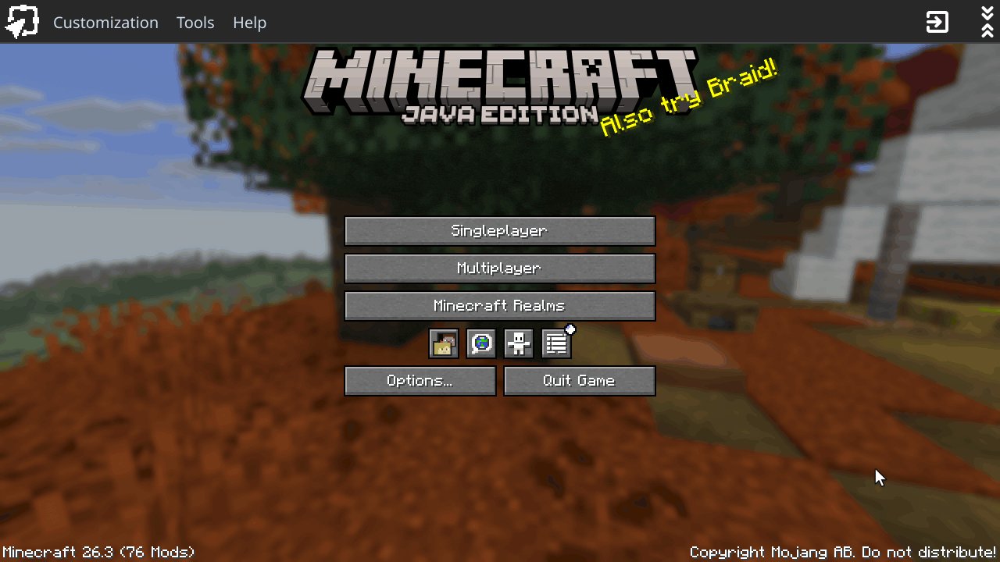

# カスタムGUI

カスタムGUIは、Modパックの情報画面、サーバーのロビー、ルールページなど、自分で作成するメニューです。最初は空なので、ほかのメニューと同じように[レイアウト](/layout-editor)を使って内容を追加します。作成したカスタムGUIは、ボタン・キー・コマンドから開けます。

# カスタムGUIの作成

1. **メニューバー -> カスタマイズ -> カスタムGUI -> カスタムGUIの管理**を開きます。
2. **新しいGUI**をクリックします。
3. `modpack_info`のような**カスタムGUI識別子**を入力し、[設定](#settings)を行って**完了**をクリックします。
4. リストから新しいカスタムGUIを選び、**GUIを開く**をクリックします。
5. **完了**をクリックして**カスタムGUIの管理**を閉じます。

**カスタムGUIの管理**で変更が保存されるのは、**完了**または**GUIを開く**をクリックしたときだけです。**キャンセル**すると変更は破棄されます。

## 識別子

ボタン、コマンド、レイアウトは、識別子を使ってカスタムGUIを見つけます。

- 使用できるのは小文字、数字、`.`、`_`、`-`のみです。カスタムGUIごとに異なる識別子を指定してください。
- `title_screen`など、ほかの[画面の識別子](/screen-identifiers)は使わないでください。その画面とレイアウトを共有することになります。
- 識別子を後から変更すると、レイアウトや、旧識別子を使っているボタン・コマンドからカスタムGUIを見つけられなくなります。識別子を元に戻すと、再び見つけられるようになります。

## レイアウトの作成

1. カスタムGUIを開きます。
2. **メニューバー -> カスタマイズ -> レイアウト -> 新規 -> 現在の画面用**をクリックします。カスタムGUIでは常にカスタマイズが有効です。
3. 要素を追加してレイアウトを保存します。[レイアウトエディター](/layout-editor)を参照してください。

カスタムGUIには何も入っていません。戻るボタンもありません。プレイヤーが画面を閉じられるように、[ボタン](/elements#button)を追加してアクションに[**最後の画面に戻る**](/action-scripts#back-to-last-screen)を設定するか、**ESCキーでGUIを閉じる**を有効にしておきましょう。

# 設定

**カスタムGUIの管理**で**GUIを編集**をクリックすると、選択したカスタムGUIの設定を変更できます。

| 設定 | 説明 |
|---|---|
| **カスタムGUI識別子** | カスタムGUIの名前です。[識別子](#the-identifier)を参照してください。 |
| **画面タイトル（任意）** | GUI上部に白いタイトルを表示します。空欄にすると表示されません。[プレースホルダー](/placeholders)を使用できます。また、ゲーム・Mod・リソースパックのローカライズキーは、プレイヤーの言語で表示されます。 |
| **ESCキーでGUIを閉じる** | `Esc`キーでGUIを閉じます。デフォルトで有効です。 |
| **ゲーム／ワールドを一時停止** | GUIを開いている間、シングルプレイのワールドを一時停止します。デフォルトで有効です。 |
| **ワールド背景を描画** | プレイ中にGUIの背後にワールドを表示します。ワールド外の場合、またはこの設定がオフの場合は、Minecraftのパノラマが表示されます。デフォルトで有効です。 |
| **ワールド背景のオーバーレイを描画** | ポーズメニューのように、GUIの背後にあるワールドやパノラマをぼかして暗くします。**ワールド背景を描画**が有効な場合にのみ機能します。この設定がオフの場合、パノラマは常にぼかされ、暗く表示されます。デフォルトで有効です。 |
| **ポップアップモード** | カスタムGUIを、開いた元のメニューの上に表示します。[ポップアップモード](#popup-mode)を参照してください。 |
| **ポップアップモードの背景オーバーレイ** | ポップアップの背後にあるメニューをぼかします。**ポップアップモード**が有効な場合にのみ機能します。デフォルトで有効です。 |

- ぼかしの強さは、Minecraftの**メニュー背景のぼかし**設定と同じです。
- レイアウトに[メニュー背景](/menu-backgrounds)を設定すると、ワールド、パノラマ、ポップアップの背後にあるメニューのすべてが覆われます。
- レイアウトエディターでは、カスタムGUIのタイトル（**カスタム画面タイトル**）を変更できません。代わりに**画面タイトル（任意）**を変更してください。独自のフォント、色、位置でタイトルを表示するには、ここを空欄にして[テキスト要素](/elements#text)を追加します。

## ポップアップモード

**ポップアップモード**では、カスタムGUIを開いた元のメニューが、レイアウトとともに背後に表示されたままになります。ポップアップを開いている間、背後のメニューはクリックできません。

- ポップアップは、情報ボックス、確認画面、設定パネルなど、小さなものに向いています。背後のメニューが見えるように、空きスペースを残しておきましょう。
- ポップアップのレイアウトにメニュー背景を設定しないでください。背後のメニューが見えなくなります。
- プレイ中にキーを押すなど、メニューが開いていない状態でカスタムGUIを開いた場合、背後に表示するメニューはありません。その場合は通常の背景が表示されます。

# カスタムGUIを開く

画面を開く機能なら、識別子を指定してカスタムGUIを開けます。

- **ボタン：**アクションに[**画面またはカスタムGUIを開く**](/action-scripts#open-screen-or-custom-gui)を指定し、値に`modpack_info`を設定します。
- **キー：**[**キーボードキーが押されたとき**リスナー](/listeners#listener-variables)に同じアクションを設定します。メニュー内でもプレイ中でもカスタムGUIを開けます。
- **コマンド：**`/openguiscreen modpack_info`。サーバー、コマンドブロック、クエスト報酬からも実行できます。[コマンド](/commands#openguiscreen)を参照してください。
- **ワールドから退出するとき：**[**ワールドまたはサーバーから退出**](/action-scripts#leave-world-or-server)アクションに識別子を指定すると、退出後にカスタムGUIが開きます。

カスタムGUIは、各プレイヤーのFancyMenu設定に含まれます。サーバーが開けるのは、そのプレイヤーが持っているカスタムGUIだけです。たとえば、Modパックに含まれているカスタムGUIが対象になります。

カスタムGUIを閉じる方法：

- **ESCキーでGUIを閉じる**が有効なら、`Esc`キーで閉じられます。**最後の画面に戻る**アクションを使った場合も、開く前のメニューに戻ります。メニューが開いていなかった場合、`Esc`キーを押すとゲームに戻ります。
- [**画面を閉じる**](/action-scripts#close-screen)アクションを使うと閉じられます。ワールド外の場合は、タイトル画面が開きます。

# 既存の画面を置き換える

カスタムGUIで、ゲームやModのメニューを置き換えられます。置き換えたメニューが開くはずだったときは、代わりにカスタムGUIが開きます。

> [!WARNING]
> 置き換えられたメニューは一切開かないため、そのメニューが行う処理も実行されず、メニューを必要とするほかのModが正常に動作しなくなる可能性があります。可能な限り、通常のレイアウトでメニューを変更してください。レイアウトでは実現できない場合にのみ、メニューを置き換えてください。

1. **メニューバー -> カスタマイズ -> 設定 -> 高度なカスタマイズモード**を有効にします。
2. 置き換えたいメニューを開きます。
3. **メニューバー -> カスタマイズ -> カスタムGUI -> 現在の画面をカスタムGUIで置き換える**をクリックします。
4. 警告を確認し、**カスタムGUIを選択**でカスタムGUIを選びます。

カスタムGUIがすぐに開きます。GUI内で`Esc`キーを押すか、**最後の画面に戻る**を実行すると、置き換え前に開いていたメニューに戻ります。

置き換えを取り消すには、**メニューバー -> カスタマイズ -> カスタムGUI -> 置き換えた画面の管理**を開き、画面の下にある**置き換えルールを削除**をクリックしてから、**完了**をクリックします。

> [!TIP]
> [変数](/variables)が設定されている場合だけ置き換えるなど、特定の条件でのみメニューを置き換えるには、代わりに[IF文](/listeners#on-screen-opened)を使った[**画面が開かれたとき**リスナー](/listeners#on-screen-opened)を使用してください。

# カスタムGUIの管理

- **カスタムGUIの管理**にある**新しいGUI**、**GUIを編集**、**GUIを開く**を使って、カスタムGUIを追加・変更・表示できます。
- **GUIを削除**をクリックすると、確認後に選択したカスタムGUIが削除されます。レイアウトは残り、同じ識別子を持つ新しいカスタムGUIを作成すると再び表示されます。
- 検索バーを使うと、識別子でカスタムGUIを検索できます。
- **メニューバー -> ヘルプ -> AI向けにエクスポート -> カスタムGUI**を使うと、すべてのカスタムGUIと置き換えルールを[AIチャット](/export-for-ai)用にエクスポートできます。

カスタムGUIと置き換えルールは`config/fancymenu/custom_gui_screens.txt`に保存されます。レイアウトは、ほかのレイアウトと同様に`config/fancymenu/customization/`に保存されます（[データの保存場所](/data-storage-locations)を参照）。[プロファイル](/profiles)ごとに独自のカスタムGUIがあります。
