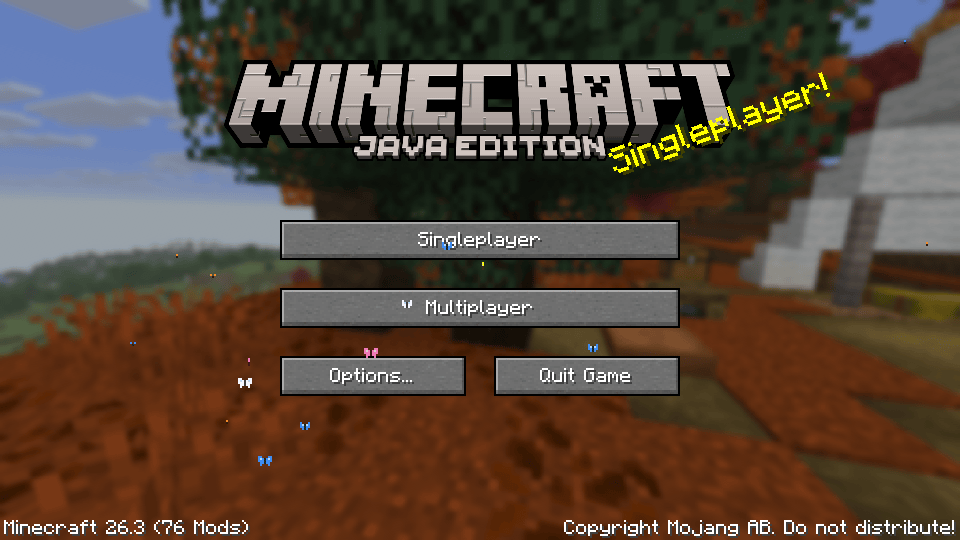
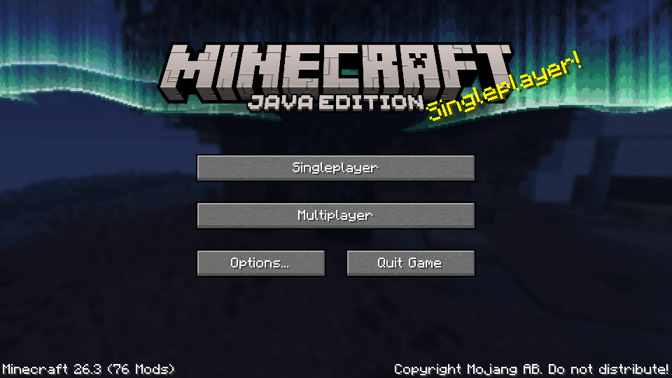

# 装飾オーバーレイ

装飾オーバーレイは、画面全体に表示されるアニメーション効果です。降り積もる雪やホタル、霧、ストリングライトなどがあります。メニューと連動するものも多く、ボタンに雪が積もったり、鳥がボタンに止まったり、マウスの周りの霧が晴れたりします。


# オーバーレイを追加する

1. レイアウトエディターでレイアウトを開きます。
2. エディターの背景を右クリックし、**装飾オーバーレイ**を開きます。
3. **降雪**などのオーバーレイを開きます。
4. **オーバーレイを表示**をクリックして有効にします。

有効なオーバーレイには一覧で ✔ が表示されます。レイアウトには、好きなだけオーバーレイを表示できます。オーバーレイや設定にカーソルを合わせると、機能の説明が表示されます。

オーバーレイはレイアウトエディターでも再生されますが、実際のメニューにある要素に反応するのは、メニューを開いたときだけです。レイアウトを保存し、メニューを開いてすべての動作を確認してください。

同じ画面に複数のレイアウトがあり、それぞれにオーバーレイが設定されている場合、同じオーバーレイが重複していてもすべて再生されます。[ユニバーサルレイアウト](/universal-layouts)も対象です。

# すべてのオーバーレイに共通する設定

すべてのオーバーレイには、次の2つの設定があります。

- **オーバーレイを表示**：オーバーレイを有効または無効にします。
- **レイヤー**：オーバーレイの描画位置を設定します。
  - **背景と前景**：遠くに見える部分は要素の背後に、近くに見える部分は要素の手前に描画され、奥行きが感じられます。これがデフォルトの設定です。
  - **背景のみ**：すべての部分が要素の背後、メニュー背景の手前に描画されます。
  - **前景のみ**：すべての部分が要素の手前に描画されます。

ボタンに積もる雪のように、オーバーレイが要素に直接表示するものは、常に要素の上に留まります。

多くのオーバーレイには、次の設定もあります。

| 設定 | 機能 |
|---|---|
| **量（%）** | 表示量を25%から300%の範囲で設定します。100%が標準の量です。 |
| **サイズ** | ピクセルアートを2倍または3倍の大きさにします。各ピクセルはくっきりとした正方形のままです。 |
| **見た目** | **詳細**では、陰影や追加効果を含むピクセルアート全体を表示します。**シンプル**では、より平坦でクラシックな見た目になります。 |

# オーバーレイと要素

多くのオーバーレイは、要素と連動します。雪や灰、紙吹雪が要素に積もったり、つららが垂れ下がったり、苔が生えたり、鳥が止まったりします。

連動する要素を選ぶには、要素を右クリックして**装飾オーバーレイの影響を受ける**を設定します。

- ボタン、スライダー、チェックボックス、入力フィールド、[バニラ要素](/vanilla-elements)では、デフォルトで有効です。
- タイトル画面のロゴ、スプラッシュテキスト、ブランド表示、著作権表示も対象です。何も重ねたくない場合は、これらの要素で無効にしてください。
- 非表示の要素は対象外です。また、[スクロール可能領域](/scrollable-areas)によって隠れている要素の部分も対象外です。

> [!TIP]
> 要素同士の間隔は、少なくとも13ピクセル空けてください。要素に積もるものや要素の下に垂れ下がるものの大きさは、次の要素までの間隔によって制限されます。

泡、霜、紙吹雪など、一部のオーバーレイはクリックに反応します。その場合も、ボタンはすべてのクリックを受け取ります。

# すべての装飾オーバーレイ

FancyMenuにある装飾オーバーレイをテーマ別に紹介します。

## 天候

### 降雪

雪が降り、ボタンや画面の下端にゆっくり積もります。


- **雪を積もらせる**を有効にすると、雪が積もります。
- **雪の色 [HEX]**、**降雪速度**、**量（%）**、**サイズ**で雪の見た目を調整できます。

### 降雨

雨が降り、薄い水たまりに波紋が広がり、ボタンから水滴が垂れます。


- **水たまり**を有効にすると、要素や画面下端に濡れた膜ができ、水滴が当たると波紋が広がります。
- **水滴**を有効にすると、水滴が要素から垂れ下がり、落ちるようになります。
- **雷光**を有効にすると、枝分かれする稲妻と柔らかな閃光が時々表示されます。**雷光の明るさ**で明るさを調整できます。
- **雨の色 [HEX]**、**量（%）**、**サイズ**で雨を調整できます。

> [!WARNING]
> **雷光**を有効にすると、画面が点滅します。光の点滅に敏感なプレイヤーがいる場合は、無効にしてください。

### 霧

薄い霧の層が画面や要素の上を漂います。地面に近いほど濃くなります。


- **ポインター周辺を晴らす**を有効にすると、マウスの周りで霧が分かれます。

### 霜

メニューが凍りつきます。画面の縁や隅、要素の上に氷が広がります。氷をクリックすると、かけらを砕いて取り除けます。


- **画面の縁**、**隅**、**要素の上**を切り替えると、それぞれの場所に氷を表示または非表示にできます。要素のラベルは氷に隠れません。

## 自然

### 落ち葉

葉が舞い落ち、突風に吹き飛ばされます。


- **見た目**で、**詳細**と**シンプル**の葉を切り替えます。
- **色**では、**秋色ミックス**（暖色系の秋色5色）または**カスタム範囲**（**葉の開始色 [HEX]**から**葉の終了色 [HEX]**までの5色）を選びます。
- **風を吹かせる**で、強い突風を有効または無効にします。**風の強さ**で風の強さを設定します。
- **葉の密度**、**落葉速度**、**葉のオーバーレイの拡大率**で葉を調整できます。

### 桜の花びら

画面上部の隅から花の咲いた枝が伸び、花びらが舞い落ちます。


- **左の枝**と**右の枝**で、それぞれの枝を表示または非表示にできます。
- **見た目**と**量（%）**で花びらを調整できます。

### 草木の繁茂

メニューが自然に覆われていきます。苔やつる、草、花がゆっくりと広がります。


- **草**、**左のつる**、**右のつる**、**要素の上**で、それぞれの植物を表示または非表示にできます。要素のラベルは隠れません。
- **つるに咲く花**、**要素に咲く花**、**草むらの花**で、それぞれの場所に花を咲かせます。**花の量（%）**で花の数を設定します。

### 雲

ふわふわしたピクセルアートの雲が、奥行きの異なる3つのレイヤーで要素の背後を流れていきます。雲に個別の設定はありません。


### 日差し

画面外にある太陽から光が扇状に差し込み、光の中でほこりが舞います。


- **太陽の位置**で、太陽が隠れている画面の縁を設定します。**太陽の角度（°）**で、その縁に沿って位置を調整します。
- **日差しの色 [HEX]**と**強度（%）**で光を調整できます。
- **太陽の光彩**を有効にすると、太陽から柔らかな光が広がります。
- **ほこり**を有効にすると、光の筋の中をほこりが漂います。マウスでほこりをかき立てることもできます。
- **要素に当てる**を有効にすると、光の筋が要素の位置で止まり、要素の縁を照らして影を落とします。無効にすると、光の筋は要素の手前に表示されます。

### 泡

泡が揺れながら流れとなって上昇し、要素の下面に沿って動きます。クリックすると泡が弾けます。泡に個別の設定はありません。


## 動物

### 鳥

小鳥が飛んできて要素の上を跳ね回り、マウスが近づくと飛び立ちます。


### 蝶

色とりどりの蝶が飛び回り、要素に止まったり、マウスを避けたりします。



### コウモリ

小さな群れを作ったコウモリが画面を飛び回り、要素の下で眠ります。近づきすぎると目を覚まします。


鳥、蝶、コウモリには**量（%）**と**サイズ**の設定があります。

### ホタル

ホタルの群れが光りながら飛び回り、一部は要素に止まります。


- **見た目**で、**詳細**と**シンプル**のホタルを切り替えます。**消灯時の体**を有効にすると、光っていないときに小さな黒い体が表示されます。
- **マウスを追う**を有効にすると、マウスが近づいたときに群れが追いかけます。
- **着地**を有効にすると、ホタルが時々要素に止まります。
- **ホタルの色 [HEX]**、**群れの数**、**群れの密度**、**群れのサイズ**、**ホタルのスケール**でホタルを調整できます。

### バディ

バディはメニューの下部に住む小さなバーチャルペットです。歩き回り、思考吹き出しで必要なものを知らせ、一緒に遊ぶと反応します。ゲームを終了しても、すべての状態を記憶しています。


#### バディのお世話

バディには、`0`から`100`までの4つの欲求があります。

- **空腹**は時間とともに減ります。食べ物を与えると回復します。
- **幸福度**は時間とともに下がります。撫でたり、食べ物をあげたり、一緒に遊んだりすると上がります。
- **エネルギー**は起きている間に減り、眠っている間に回復します。
- **楽しさ**は時間とともに減ります。一緒に遊ぶと上がります。

バディのお世話をするには、次の操作を行います。

- バディを左クリックすると撫でられます。この方法で起こすと、幸福度が少し下がります。
- バディを右クリックするとステータス画面が開きます。**ステータス**タブには欲求、レベル、経験値が表示されます。**実績**タブには獲得した実績が表示されます。
- ステータス画面で**食べさせる**をクリックし、食べ物をバディまでドラッグします。
- ステータス画面で**遊ぶ**をクリックし、ボールをドラッグして離すと投げられます。バディがボールを追いかけて捕まえます。
- **眠る**をクリックすると、バディが休みます。エネルギーがとても低くなると、自分から眠ることもあります。
- バディは時々フンをします。フンを左クリックすると片付けられます。フンが3つ以上あると、バディの幸福度が下がり続けます。

#### レベルと実績

バディのお世話をすると経験値を獲得します。バディのレベルは1から30まで上がります。レベルが高いほど空腹、幸福度、エネルギーの減少が遅くなり、レベル30では減少速度が半分になります。

#### バディが死んだ場合

空腹または幸福度が`0`のまま現実時間で10時間経過すると、バディは死んで墓石を残します。墓石を左クリックすると、新しいバディを迎えてやり直せます。**バディが死ぬ可能性を有効にする**を無効にすると、バディが死なないようにできます。

**バディのセーブデータをリセット**すると、いつでも最初からやり直せます。

> [!WARNING]
> バディをリセットすると、欲求、レベル、経験値、実績、フンが完全に削除されます。

#### 保存とカスタマイズ

バディのデータは約2分ごと、およびステータス画面を閉じたときに`<game-directory>/fancymenu_data/buddy/`へ保存されます。バディのオーバーレイごとに別のセーブデータが作成されます。[データの保存場所](/data-storage-locations)を参照してください。

- **カスタムテクスチャ**を使うと、バディのスプライト、アイテム、アイコン、ステータス画面、墓石を独自のテクスチャに置き換えられます。
- **ステータスの調整**では、欲求の減少速度、各アクティビティで消費・獲得する値、周囲に置けるフンの最大数（**フンの最大数**）を変更できます。

## 夜空

### オーロラ

光り輝くオーロラが空の上部に広がり、要素の背後でゆっくりとうねります。



- **縁の色 [HEX]**で明るい下端の色を設定します。**先端の色 [HEX]**で、光の筋がフェードしていく色を設定します。

### 流れ星

要素の背後に星空がきらめき、数秒ごとに流れ星が現れ、時には流星群が見られます。流れ星に個別の設定はありません。


### スカイランタン

光る紙製のランタンが夜空へ浮かび上がります。一度にいくつも飛び立つこともあります。スカイランタンには**量（%）**と**サイズ**の設定があります。


## パーティー

### 紙吹雪

画面下部の隅にあるクラッカーから、数秒ごとに紙吹雪が飛び出します。紙吹雪は要素の上に積もります。


- **隅のクラッカー**で、クラッカーを有効または無効にします。
- **クリック時に発射**を有効にすると、クリックした場所で少量の紙吹雪が飛び散ります。
- **色のミックスモード**を有効にすると、ランダムな色が使われます。無効にすると、すべての紙吹雪に**紙吹雪の色 [HEX]**が適用されます。
- **着地した粒子の上限**で、一度に画面上に残る紙吹雪の量を設定します。
- **量（%）**、**サイズ**、**紙吹雪の落下速度**で紙吹雪を調整できます。

### 花火

ロケットが打ち上がり、花火となって弾けます。


- **ロケットの軌跡を表示**を有効にすると、打ち上がるロケットが表示されます。
- **量（%）**、**サイズ**、**爆発の大きさ**で花火を調整できます。

### ストリングライト

ライトの連なりがメニューの上に吊るされ、風に揺れます。


- **見た目**で、**シンプル**と**詳細**のライトを切り替えます。**松のガーランド**を有効にすると、ワイヤーが松の葉と飾り玉に置き換わります。
- **ライトの点灯パターン**でライトの光り方や点滅を設定します（下記参照）。
- **ストリングライトのスケール**、**風の強さ**、**ちらつきの速度**は、すべてのライトに適用されます。
- **ストリング**には、ライトを吊るせる8か所それぞれの設定があります。**ストリングライトを表示**で有効にします。

各ストリングには、次の設定があります。

- **ライトの数**で、ストリングに吊るすライトの数を設定します。`0`にすると、ストリングの長さに合わせてライトが並びます。
- **ライトの色 [HEX]**でライトの色を設定します。**クリスマスライトモード**を有効にすると、ライトに複数の色が使われます。
- **ストリングの色 [HEX]**でワイヤーの色を設定します。アルファチャンネルで透明度を調整したり、非表示にしたりできます。
- **ライトごとの色**と**ライトごとのサイズ**では、カンマ区切りのリストを使ってライトごとに色やサイズを指定できます。ライトの数より値が少ない場合、リストは先頭から繰り返されます。

```
#FF0000, #00FF00, #0000FF
```

| 点灯パターン | ライトの動作 |
|---|---|
| **点灯** | すべてのライトが点灯し、実際のライトのように、時々どれかがわずかに暗くなります。 |
| **最大輝度** | すべてのライトが最大の明るさで点灯します。 |
| **半分の明るさ** | すべてのライトが半分の明るさで点灯します。 |
| **消灯** | すべてのライトが消灯します。 |
| **サイクル** | きらめき、追いかけ点灯、交互点灯、呼吸点灯を再生し、7秒ごとに切り替えます。 |
| **きらめき** | ライトがランダムにちらつきます。 |
| **追いかけ点灯** | 明るい光がストリングに沿って走ります。 |
| **交互点灯** | 1つおきにライトが点灯し、次に残りのライトが点灯します。 |
| **呼吸点灯** | すべてのライトがゆっくりと一緒に明るくなり、暗くなります。 |

## 不気味

### クモの巣

画面上部の隅にほこりをかぶったクモの巣が張られ、糸から小さなクモがぶら下がります。


- **左のクモの巣**と**右のクモの巣**で、それぞれのクモの巣とクモを表示または非表示にできます。
- **クモ**を有効にすると、クモが糸を伝って降り、しばらくとどまってから上へ戻ります。マウスが近づくと逃げます。
- **糸の端を閉じる**を有効にすると、糸の端が縁でつながり、画面に糸の端が残らないようになります。

### 残り火

下から光る残り火が舞い上がり、灰が降り積もります。


- **床に灰を表示**を有効にすると、画面下端に厚く灰が積もり、くすぶる場所や光る炭が表示されます。
- **要素に灰を表示**を有効にすると、要素の上に灰が積もります。

## カスタム

### ブラウザー

ブラウザーオーバーレイを使うと、画面全体にウェブサイトを表示できます。

> [!IMPORTANT]
> ブラウザーオーバーレイを使うには、[Rinku](https://modrinth.com/mod/rinku) MODが必要です。

- **URL**で表示するウェブサイトを指定します。
- **マウスクリックを消費**、**マウススクロールを消費**、**キーボード入力を消費**を有効にすると、入力が背後のメニューに届かなくなります。
- **マウスクリックを処理**、**マウススクロールを処理**、**キーボード入力を処理**を有効にすると、ブラウザー自体が入力に反応します。
- **動画コントロールを非表示**、**動画をループ再生**、**ブラウザーをミュート**、**音声／動画の音量**で、ウェブサイトの動画や音声を調整できます。

「消費」と「処理」の設定はデフォルトで有効になっているため、ブラウザーはメニューの手前で通常のブラウザーのように動作します。ウェブサイトを背景として表示するだけなら、これらの設定をすべて無効にしてください。

ウェブサイトではFancyMenuのアクションを実行したり、プレースホルダーを読み取ったりすることもできます。[ブラウザーJavaScript API](/browser-api)を参照してください。

### GLSLシェーダー

GLSLシェーダーオーバーレイでは、画面全体に独自のシェーダーを描画し、アニメーション効果や静止画効果を作成できます。シェーダーコードを**シェーダーソース**に貼り付けてください。

FancyMenu用のシェーダーの書き方は、[GLSLシェーダーAPI](/glsl-shader-api)を参照してください。
