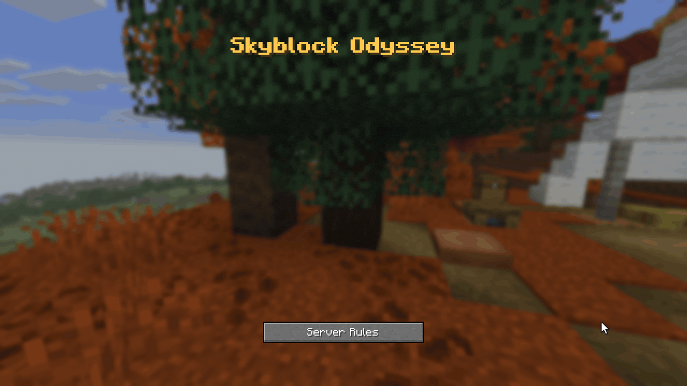

# 要素の表示設定

要素を常に表示しておく必要はありません。特定の状況でのみ表示したり、少し遅れて表示したり、フェードイン・フェードアウトさせたり、ボタンで表示・非表示を切り替えたりできます。



レイアウトエディター内では、要素は編集できるよう常に表示されます。このページの設定は、エディターの外で有効になります。

> [!TIP]
> すべての要件は[要件](/conditions)に記載されています。

# 要素を特定の状況でのみ表示する

要素を右クリックし、**読み込み要件**をクリックします。要素は、[要件](/conditions)がすべて満たされている間だけ表示されます。たとえば、「マウスがこのボタンの上にある」「12月である」「変数の値が指定した値である」といった条件です。FancyMenuは要件を常に確認するため、要素はすぐに表示・非表示に切り替わります。

- **要件モード**の「反転」を使うと、要件を逆にできます。たとえば、「12月ではない」のようになります。
- グループを使うと、「これ、またはあれ」という条件を設定できます。
- バニラの要素にも**読み込み要件**があります。要素を完全に削除する方法については、[バニラ要素の削除](/deleted-vanilla-elements)を参照してください。

要件の追加と組み合わせ方については、[要件](/conditions#adding-a-requirement)を参照してください。

## セッションごとに一度だけ読み込む

要素を右クリックし、**セッションごとに一度だけ読み込む**を有効にします。画面が最初に開いたときに要素が表示されます。プレイヤーが別の画面に移動すると、その後はゲームを再起動するまで非表示になります。

「F1キーを押すと操作方法が表示されます」のように、ゲーム起動ごとに一度だけ表示したいヒントに便利です。アクションスクリプトで同じ仕組みを使うには、[**セッションごとに一度だけ**](/conditions#only-once-per-session)要件を使用します。

# 要素の表示を遅らせる

## 表示を遅らせる

要素を右クリックし、**表示を遅らせる**をクリックします。

- **遅延**:
  - **遅延なし**: すぐに表示します。
  - **初回のみ**: ゲーム起動後、要素が初めて表示されるときだけ待機します。
  - **毎回**: 画面が開くたび、また要件が再び満たされるたびに待機します。
- **遅延時間（秒）**: 待機する時間を指定します。例: `1.5`

ウィンドウのサイズを変更しても、遅延は最初からやり直されません。

## 非表示にするまでの時間を遅らせる

要素を右クリックし、**非表示を遅らせる**をクリックします。要件が満たされなくなっても、要素は**遅延時間（秒）**の間表示されたままになり、その後非表示になります。**遅延**の選択肢は上記と同じです。

たとえば、ボタンに対する[**要素にマウスカーソルが重なっている**](/conditions#is-element-hovered)要件を設定した情報ボックスは、マウスがボタンから離れた後も1秒間表示されます。

# フェードイン・フェードアウト

要素を右クリックし、**フェードイン/アウト**をクリックします。

- **フェードイン**と**フェードアウト**:
  - **フェードなし**: すぐに表示・非表示にします。
  - **初回のみ**: ゲーム起動後、最初の一度だけフェードします。
  - **毎回**: 表示・非表示のたびにフェードします。
- **フェードイン速度**と**フェードアウト速度**: `1`の場合、フェードに2.5秒かかります。`2`なら2倍の速さです。

画面が開いたときや、要件が満たされたときに要素がフェードインします。**表示を遅らせる**を設定している場合、遅延後にフェードが始まります。

要件によって要素が非表示になる場合にのみフェードアウトします。画面を閉じるときにはフェードアウトしません。

# 透明度

要素を右クリックし、**透明度**をクリックします。`1.0`は完全に表示、`0.5`は半透明、`0.0`は非表示です。ほとんどの要素で設定できます。

透明度には、`$$panel_opacity`のような[プレースホルダー](/placeholders)や[変数](/variables)を指定できます。フェードインは、要素に設定した透明度で止まります。

# ボタンで要素の表示を切り替える

GIFのルールパネルのように、ボタンで要素を表示・非表示にできます。[変数](/variables)を使って、パネルが表示されているかどうかを記憶します。

1. パネルを右クリックし、**読み込み要件**をクリックします。変数`show_rules`、値`true`で[**変数の値（FM変数）**](/conditions#is-variable-value-fm-variable)を追加します。
2. ボタンを右クリックし、**アクションスクリプトを編集**をクリックします。
3. スクリプト領域を右クリックし、**IF文を追加**をクリックします。パネルと同じ要件を設定します。
4. IF文の中に[**変数の値を設定（FM変数）**](/action-scripts#set-variable-value-fm-variable)を追加し、次の値を設定します。

   ```
   show_rules:false
   ```

5. IF文を右クリックし、**ELSE文を追加**をクリックします。ELSE文の中に**変数の値を設定（FM変数）**を追加し、次の値を設定します。

   ```
   show_rules:true
   ```

クリックするたびに変数が切り替わります。表示中のパネルは非表示になり、非表示のパネルは表示されます。同じ要件を持つ要素は、すべて一緒に表示・非表示になります。滑らかに切り替えるには、パネルの**フェードイン**と**フェードアウト**を**毎回**に設定します。

IFとELSEについて詳しくは、[アクションスクリプト](/action-scripts#if-else-if-and-else)を参照してください。

> [!NOTE]
> 変数はゲームを終了した後も保持されるため、次回起動時にもパネルは開いたままになります。毎回起動時に閉じるには、**変数を管理**で変数を右クリックし、**ゲーム起動時に変数をクリア**を有効にします。

## バージョンを切り替える

ボタンを使って、3種類の背景のように2つを超えるバージョンを切り替えることもできます。

1. **メニューバー -> カスタマイズ -> 変数を管理**で、テキスト変数`background`を値`0`で追加します。
2. 3つの[画像要素](/elements#image)に、変数`background`に対する**変数の値（FM変数）**要件を設定し、値をそれぞれ`0`、`1`、`2`にします。
3. ボタンに**変数の値を設定（FM変数）**を設定し、次の値を指定します。`0`、`1`、`2`と数えた後、再び`0`から始まります。

   ```
   background:{"placeholder":"calc","values":{"decimal":"false","expression":"({"placeholder":"getvariable","values":{"name":"background"}} + 1) % 3"}}
   ```

バージョンを増やすには、末尾の`3`を変更します。計算方法については[**計算機**](/placeholders#calculator)を参照してください。

# レイアウトの有効・無効を切り替える

レイアウト全体を表示・非表示にするには、次の方法があります。

- エディターの背景を右クリックしたメニューにある**読み込み要件 [レイアウト全体]**は、要素の要件と同じように機能します。[レイアウト全体の要件](/conditions#layout-wide-requirements)を参照してください。
- [**レイアウトを切り替える**](/action-scripts#toggle-layout)、[**レイアウトを有効にする**](/action-scripts#enable-layout)、[**レイアウトを無効にする**](/action-scripts#disable-layout)アクションを使うと、名前を指定してレイアウトの有効・無効を切り替えられます。

ボタンは、無効にするレイアウトとは別のレイアウトに配置してください。同じレイアウトに置くと、レイアウトと一緒にボタンも消えてしまい、再び有効にできなくなります。
