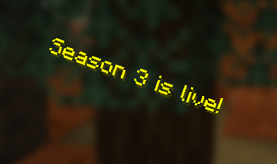

# 要素

要素とは、ボタン、テキスト、画像、スライダー、音楽など、レイアウトを構成するパーツです。このページでは、すべての要素タイプと主な設定を紹介します。

> [!TIP]
> ボタンなど、画面にデフォルトで表示されるパーツは[バニラ要素](/vanilla-elements)です。これらも移動、変更、非表示にできます。

# 要素の追加

1. レイアウトエディターで何もない場所を右クリックし、**New Element**をクリックします。メニューバーの**Element -> New**からも同じ一覧を開けます。
2. 要素タイプをクリックします。タイプにカーソルを合わせると、用途が表示されます。

右クリックした場所に要素が表示されます。ドラッグして移動し、端をドラッグしてサイズを変更します。設定を開くには、要素を右クリックします。


要素の選択、移動、コピー、削除の方法と、エディターのショートカット一覧については、[レイアウトエディター](/layout-editor)を参照してください。どのウィンドウサイズでも要素の位置を保つ方法は、[要素の配置](/positioning-elements)を参照してください。要素を前面または背面に配置する方法は、[レイヤーとグループ](/layout-editor#layers-and-groups)を参照してください。

# すべての要素に共通する設定

各要素の右クリックメニューには、要素タイプ固有の設定に加えて、次の設定があります。

| 設定 | 機能 |
|---|---|
| **Anchor Point** | 要素を画面の隅や別の要素など、どこに固定するかを設定します。[要素の配置](/positioning-elements)を参照してください。 |
| **Advanced Positioning** と **Advanced Sizing** | [プレースホルダー](/placeholders)などを使って、位置とサイズを計算します。[高度な位置指定とサイズ設定](/advanced-positioning-sizing)を参照してください。 |
| **Loading Requirements** と **Load Once Per Session** | [条件](/conditions)を満たしたときだけ要素を表示するか、ゲームの起動ごとに一度だけ表示します。[要素の表示設定](/element-visibility)を参照してください。 |
| **Delay Appearance** と **Delay Disappearance** | 要素が表示または非表示になるまで、指定した秒数だけ待機します。[要素の表示設定](/element-visibility#delaying-elements)を参照してください。 |
| **Fading In/Out** と **Opacity** | 要素をフェードイン／フェードアウトさせたり、半透明にしたりします。[要素の表示設定](/element-visibility#fading-in-and-out)を参照してください。 |
| **Rotation**、**Vertical Tilt**、**Horizontal Tilt** | 要素を回転させたり、傾けたりします。[要素の回転と傾き](/rotating-elements)を参照してください。 |
| **Parallax Effect** | マウスの動きに合わせて要素を少し動かします。[視差効果](/parallax)を参照してください。 |
| **Copy Element ID** | アクション、プレースホルダー、ほかの要素がこの要素を識別するためのIDをコピーします。[要素ID](/element-identifiers)を参照してください。 |
| **In-Editor Display Name** | レイヤー一覧に表示する要素名です。 |
| **Export for AI** | 要素を[AIアシスタント](/export-for-ai)向けのテキストに変換します。 |

# すべての要素

FancyMenuで使用できる要素を、用途別に紹介します。

## ボタンと入力欄

### ボタン

クリックすると[アクションスクリプト](/action-scripts)を実行するボタンです。サーバーへの接続、ウェブサイトや別のメニューを開く操作などを設定できます。


- **Edit Action Script**: ボタンをクリックしたときに実行する処理です。
- **Label** と **Hover Label**: 通常時と、マウスカーソルを合わせたときに表示するテキストです。どちらも[プレースホルダー](/placeholders)と[テキスト書式](/text-formatting)に対応しています。
- **Label Alignment**: ボタンのラベルを**Left**（左）、**Centered**（中央）、**Right**（右）に配置します。ボタンの幅に収まらないラベルは、配置位置にかかわらず左右にスクロールします。
- **Label Scale**、**Label Base Color**、**Label Hover Color**、**Label Shadow**、**Underline Label On Hover**: ラベルのサイズ、色、影を設定します。
- **Button Textures** と **Button Icon Textures**: 通常時、マウスオーバー時、無効時のボタン画像や、ボタン上に表示するアイコン画像を設定します。きれいに拡大縮小できるテクスチャについては、[ナインスライスとタイル表示](/nine-slicing-and-tiling)を参照してください。
- **Hover Sound**、**Unhover Sound**、**Click Sound**: ボタンから再生するサウンドです。
- **Tooltip**: マウスカーソルをボタンに合わせたときに表示するテキストです。
- **Control Active State**: ボタンをクリック可能にするための[条件](/conditions)です。条件を満たしていない場合、ボタンはグレーアウトします。
- **Template Mode**: 画面内のほかのボタンやスライダーに、このボタンの外観を適用します。[ボタンとスライダーのテンプレート](/button-slider-templates)を参照してください。

### スライダー

プレイヤーがドラッグして値を選ぶスライダーです。値が変わるたびにアクションスクリプトを実行します。


- **Slider Type**:
  - **Value List**: **List Values**に1行ずつ入力したテキストから選択します。**Values From List Variable**を使うと、代わりに[リスト変数](/variables#text-and-list-variables)から値を取得します。
  - **Integer Range**: **Minimum Range Value**から**Maximum Range Value**までの整数を選択します。
  - **Decimal Range**: 小数を含む範囲を選択します。**Rounding Decimal Place**で小数点以下の桁数を設定します。`-1`の場合は丸めません。
- **Slider Label**: スライダーのラベルです。`$$value`で現在の値を表示できます。
- **Edit Action Script**: 値が変わったときに実行します。`$$value`は変更後の値です。
- **Pre-Selected Value**: スライダーの初期値です。スライダーが変更する値を指定すると、画面を開いたときに正しい値が表示されます。

たとえば、**Integer Range**タイプで範囲を`0`～`100`にした音量スライダーの場合、ラベルを`Music Volume: $$value%`に設定し、次の値を使って[**Set Variable Value (FM Variable)**](/action-scripts#set-variable-value-fm-variable)アクションを設定します。

```
music_volume:$$value
```

**Pre-Selected Value**には`$$music_volume`を指定します。これにより、プレイヤーが前回選んだ値が初期値になります。

スライダーにはボタンと同じラベル、テクスチャ、サウンド、ツールチップ、**Control Active State**の設定があります。**Label Alignment**を使ってラベルを左または右に配置することもできます。

### チェックボックス

プレイヤーがチェックを付けたり外したりするためのボックスです。状態が変わるたびにアクションスクリプトを実行します。


- アクションスクリプトと**Control Active State**の条件では、`$$value`は`true`または`false`になります。
- **Variable Mode** と **Link To Variable**: チェックボックスに[変数](/variables)の値を表示し、チェックボックスの状態に応じて変数に`true`または`false`を書き込みます。リスト変数にリンクした場合、リストの唯一の項目として`true`または`false`が設定されます。
- Variable Modeを使わない場合、チェックボックスは状態を個別に記憶します。この状態は[プロファイル](/profiles)ごとに保存されます。
- **Textures**: ボックスとチェックマークに使う画像を設定します。

チェックボックスには、ボタンと同じツールチップ、サウンド、**Navigable**の設定があります。

### テキスト入力欄

サーバーアドレスや名前などをプレイヤーが入力するための欄です。


- **Link To Variable**: 入力された内容を[変数](/variables)に保存し、欄にはその値を表示します。リスト変数にリンクした場合、入力したテキストでリスト全体が置き換えられます。
- **Input Type**: **Text**、**Only Numbers**、**Only Decimal Numbers**、**URL**から選択します。指定したタイプ以外の文字は入力できません。
- **Hint Text** と **Hint Text Color**: 入力欄が空のときに表示するテキストと、その色です。
- **Max Text Length**: 入力できる最大文字数です。
- **Background Color**、**Border Color**、**Border Rounding Radius**、**Text Color**: 入力欄の外観を設定します。

たとえば、`server_address`にリンクした入力欄と、[**Join Server**](/action-scripts#join-server)アクションを設定したボタンを用意します。ボタンの値に`$$server_address`を指定すると、プレイヤーが任意のサーバーに参加できるようになります。

変数を使わない場合は、[**Text Input Field Value**](/placeholders#text-input-field-value)プレースホルダーで入力内容を取得し、[**Set Text Input Field Value**](/action-scripts#set-text-input-field-value)アクションで内容を変更できます。

## テキストとツールチップ

### テキスト

短いラベルから、スクロールできるルールや更新履歴まで、あらゆる長さのテキストを表示できます。[Markdown](/text-formatting)と[プレースホルダー](/placeholders)に対応しています。


- **Source Mode**: テキストを直接入力するか、ファイルまたはウェブサイトから読み込みます。
- 表示スタイルのベースを選択できます。テキストが要素より大きい場合はスクロールできます。
- **Background**: テキストの背後に暗いパネルを表示します。**Show Background**でオフにするか、独自のテクスチャを使うこともできます。

詳しくは[メニュー内のテキスト](/text-in-menus)を参照してください。

### ツールチップ

ゲーム内のツールチップのようなテキストボックスです。[Markdown](/text-formatting)と[プレースホルダー](/placeholders)に対応しています。


- 配置した場所に表示するか、**Follow Mouse**を使ってマウスカーソルに追従させます。
- **Loading Requirements**で表示条件を設定します。たとえばボタンに対する[**Is Element Hovered**](/conditions#is-element-hovered)を指定できます。
- **Tooltip Background**: 暗いボックスの代わりに使う独自のテクスチャです。

詳しくは[メニュー内のテキスト](/text-in-menus)を参照してください。

### スプラッシュテキスト

タイトル画面に黄色で表示されるテキストに、独自の文章を設定できます。



- **Source Mode**: バニラのスプラッシュテキスト、独自のテキスト、テキストファイルからランダムに選んだ1行から設定します。
- **Bouncing**、**Scale**、**Rotation**、**Text Color**、**Shadow**: 表示スタイルを設定します。
- **Refresh On Screen Load**: 画面を開くたびに新しいスプラッシュテキストを選びます。

詳しくは[スプラッシュテキスト](/splash-text)を参照してください。

## 画像とメディア

### 画像

ファイル、ウェブサイト、ゲームのリソースから画像を表示します。アニメーション画像も再生できます。


- **Image Source**: 表示する画像です。対応ファイルについては[画像](/images)を参照してください。
- **Restore Aspect Ratio**: 画像が引き伸ばされないよう、幅を調整します。
- **Nine-Slice Texture** と **Repeat Texture**: 枠を引き伸ばさずに拡大縮小するか、画像をタイル状に並べます。[ナインスライスとタイル表示](/nine-slicing-and-tiling)を参照してください。
- **Image Tint [HEX]**: 画像に色を付けます。
- **Corner Rounding Radius**: 角を丸くします。

### スライドショー

スライドショーの画像を順番に表示します。スライドショーは`config/fancymenu/slideshows/`で作成できます。詳しくは[スライドショー](/slideshows)を参照してください。

- **Slideshow**: 表示するスライドショーを選択します。
- **Restore Aspect Ratio**: 画像が引き伸ばされないよう、幅を調整します。

### 動画

トレーラーや動く背景などの動画ファイルを再生します。

> [!IMPORTANT]
> 動画の再生には、Watermedia V3とWatermedia Binaries V3のmodが必要です。詳しくは[動画](/video)を参照してください。

- **Video Source**: 動画ファイル、ウェブリンク、ゲームのリソースを指定します。
- **Loop Video**、**Volume**、**Sound Channel**: 再生方法を設定します。
- **Play Video In Layout Editor**: 編集中にも動画を再生するかどうかを設定します。
- [**Toggle Video Element Paused State**](/action-scripts#toggle-video-element-paused-state)などのアクションで、一時停止、再生位置への移動、音量の変更ができます。

**Video [Rinku]**は、Rinku modが必要な旧式の動画要素です。古いレイアウトでは引き続き動作しますが、**New Element**には表示されません。

### GLSLシェーダー

要素内で独自のGLSLシェーダーを実行します。アニメーションカラーやShadertoyのエフェクトなどを作成できます。


- **Shader Source**: シェーダーコードです。`mainImage`を使うShadertoyシェーダーは、そのまま動作します。
- **Compile Mode**: **Auto**、**Shadertoy**、**Direct Fragment**から選択します。
- **Buffer A Source**から**Buffer D Source**: バッファを使うシェーダー用の追加パスです。

作成方法については、[GLSL Shader API](/glsl-shader-api)を参照してください。

### ブラウザー

サーバーマップやWikiのページなど、ウェブサイトをリアルタイムで表示します。

> [!IMPORTANT]
> ブラウザーを使うには、[Rinku](https://modrinth.com/mod/rinku) ([CurseForge](https://www.curseforge.com/minecraft/mc-mods/rinku)) modが必要です。

- **URL**: 表示するウェブサイトです。
- **Interactable**: プレイヤーがクリック、スクロール、文字入力できるようにします。レイアウトエディター内では操作できません。
- **Mute Browser**、**Audio/Video Volume**、**Loop Videos**、**Hide Video Controls**: ページ内のメディアを設定します。

`config/fancymenu/assets/`のHTMLファイルを読み込むには、URLの先頭に`file:///`を付けます。

```
file:///config/fancymenu/assets/changelog.html
```

Linuxでは、代わりに[**Absolute File/Folder Path**](/placeholders#absolute-filefolder-path)プレースホルダーを使います。

```
file:///{"placeholder":"absolute_path","values":{"short_path":"/config/fancymenu/assets/changelog.html"}}
```

ウェブサイトからアクションを実行したり、プレースホルダーを読み取ったりできます。[ブラウザーJavaScript API](/browser-api)を参照してください。

## 図形、アイテム、モデル

### 長方形

テキストの背後に置くパネルなど、単色の長方形を表示します。


- **Color**: HEX形式の色です。末尾に2桁を追加すると、`#101828C8`のように半透明になります。
- **Corner Rounding Radius**: すべての角、または角ごとに丸みを設定します。
- **Blur** と **Blur Intensity**: 背後にあるものをぼかします。

### 円

ステータスランプなどに使える、単色の円または楕円を表示します。


- **Color**、**Blur**、**Blur Intensity**: 長方形と同じ設定です。
- **Roundness**: `2`で円になります。数値を大きくすると四角に近づき、小さくすると先が尖ります。

### アイテム

インベントリのように、Minecraftやmodのアイテムを表示します。


- **Item Key**: `minecraft:diamond_sword`のように、表示するアイテムを指定します。
- **Item Count**、**Item Name**、**Item Lore**、**Enchanted**: 実際のアイテムと同じように設定します。
- **Show Item Tooltip**: マウスカーソルをアイテムに合わせたとき、ツールチップを表示します。
- **Custom NBT Data**: アイテムの追加データです。`/give`コマンドでアイテム名の直後に続く部分と同じ形式で記述します。

### ブロック／アイテムJSONモデル

ゲームのリソースまたは独自のJSONファイルから、ブロックやアイテムのモデルを3Dで表示します。


- **Model**: `minecraft:models/block/crafting_table.json`のように、**Model Source**を指定します。
- **Texture**: モデルのテクスチャを独自のものに置き換えます。
- **Transform**: モデルの拡大縮小、回転、移動を設定します。
- **Lighting**: **Light Hue [HEX]**でモデルに当たる光の色を設定します。

### プレイヤーエンティティ

タイトル画面にプレイヤー自身のキャラクターを表示するように、プレイヤーを3Dで表示します。


> [!IMPORTANT]
> プレイヤーエンティティにはFancy Entity Renderer modが必要です（[CurseForge](https://www.curseforge.com/minecraft/mc-mods/fancy-entity-renderer)、[Modrinth](https://modrinth.com/mod/fancy-entity-renderer)）。このmodがない場合、プレイヤーの代わりにエラーが表示されます。

- **Copy Client Player**: プレイヤー自身のスキンと名前を表示します。
- **Player Name**、**Skin Texture**、**Cape Texture**: 別のプレイヤーやスキンを指定します。
- **Entity Pose**、**Head Follows Mouse**、**Body Follows Mouse**: ポーズや視線を設定します。
- **Armor and Tools**、**Parrot**、**Is Baby**、**Show Player Name**: 装備や表示内容を設定します。

詳しくは[プレイヤーエンティティ](/player-entities)を参照してください。頭だけを表示する場合は、[プレイヤーヘッド](/player-heads)を参照してください。

### プログレスバー

ロードバーのように、値に応じて伸びるバーを表示します。


- **Progress Value Source**: 進行状況を指定します。[プレースホルダー](/placeholders)を使えます。たとえば、ワールドのロード画面では[**World Loading Progress**](/placeholders#world-loading-progress)を使います。
- **Progress Value Mode**: **PERCENTAGE (0-100)**または**FLOATING POINT (0.0-1.0)**を選択します。
- **Direction**: バーが伸びる方向を設定します。
- **Bar Color** と **Background Color**、または **Bar Texture** と **Background Texture**: バーと背景の色またはテクスチャを設定します。
- **Smooth Filling Animation**: 値が変わったときに、瞬時に切り替えず滑らかに移動させます。
- **Use Progress for Element Anchor**: このバーを基準に配置された要素を、バーの進行状況に合わせて動かします。

## レイアウト補助

### スクロール領域

サーバー一覧や長い情報ページのように、ほかの要素を入れてスクロールできる領域です。


- レイアウトエディターで要素を領域内にドラッグします。バニラ要素は入れられず、独自要素のみ追加できます。
- **Arrangement**: 要素を自分で配置するか、縦積み、グリッド、フロー形式で自動整列させます。
- **Background**: 領域の背後に暗いパネルを表示します。**Show Background**でオフにするか、独自のテクスチャを使うこともできます。

詳しくは[スクロール領域](/scrollable-areas)を参照してください。

### ドラッガー

エディター外でプレイヤーがつかんで移動できる領域です。ここに固定された要素も一緒に移動するため、移動可能な情報パネルなどを作成できます。エディター外では表示されません。

**Save User Drag Offset**を有効にすると、画面を閉じたりゲームを再起動したりしても、移動後の位置が保持されます。詳しくは[ドラッガー](/dragger)を参照してください。

### 要素アニメーター

キーフレームを使ってほかの要素を移動・サイズ変更します。パネルを画面内に滑り込ませるような演出を作成できます。エディター外では表示されません。

- **Manage Target Elements**: アニメーションさせる要素を管理します。
- **Edit Keyframes**: キーフレームエディターを開きます。
- **Loop Animation**: 最後まで再生したあと、最初から繰り返します。

詳しくは[要素アニメーター](/element-animator)を参照してください。

## エディター内のみ表示される要素

これらの要素はレイアウトエディター内でのみ表示されます。

### ティッカー

画面が開いている間、アクションスクリプトを繰り返し実行します。

> [!IMPORTANT]
> 繰り返し実行する処理や、指定した時間後に実行する処理には、[スケジューラー](/schedulers)の使用を推奨します。可能な限りティッカーの代わりに使ってください。スケジューラーはすべての画面で、画面が開いていないときにも動作し、すべてのアクションを実行できます。また、アクションから開始・停止できます。

ティッカーでできる処理をスケジューラーで実行する方法は次のとおりです。

- 画面を開いている間ずっと実行する: **Tick Delay (ms)**を設定したスケジューラーを使います。レイアウトの**Edit 'Open Screen' Action Script**で[**Start Scheduler**](/action-scripts#start-scheduler)を実行して開始し、**Edit 'Close Screen' Action Script**で[**Stop Scheduler**](/action-scripts#stop-scheduler)を実行して停止します。どちらもエディターの背景を右クリックすると表示されます。
- ゲーム起動ごとに一度実行する: **Start on Launch**を有効にし、**Ticks to Run**を`1`にしたスケジューラーを使います。
- 画面を開くたびに一度実行する: ティッカーもスケジューラーも必要ありません。アクションを**Edit 'Open Screen' Action Script**に追加します。

ティッカーの設定:

- **Tick Delay [ms]**: 実行間隔をミリ秒で指定します。`0`の場合は毎ティック、つまり1秒に20回実行します。
- **Tick Mode**: **Normal**は常に実行します。**Session**はゲームを再起動するまで一度だけ実行します。**On Load Screen**は画面を開くたびに実行し、ウィンドウのサイズ変更時にも実行します。
- **Async**: バックグラウンドで実行します。この方法では実行できないアクションが多く、エラーが表示されます。

### オーディオ

画面を開いている間、音楽やサウンドを1トラックずつ再生します。

- **Manage Tracks**: 音声ファイル、その再生順、シャッフル時に使う**Track Weight**を管理します。
- **Play Mode**: **Normal**は順番に、**Shuffle**はランダムな順番で再生します。
- **Loop Tracks**、**Volume**、**Sound Channel**: 再生方法を設定します。

画面を切り替えても音楽を再生し続けるには、オーディオ要素を[ユニバーサルレイアウト](/universal-layouts)に配置します。詳しくは[メニューのBGM](/background-music)を参照してください。

### ミュージックコントローラー

この画面でゲーム本来の音楽を停止します。

- **Play Menu Music**: タイトル画面のように、ワールドが読み込まれていないときにメニューで流れる音楽です。
- **Play World Music**: インベントリ画面のように、メニューを開いている間も流れ続けるワールドの音楽です。

画面が開いている間だけ動作します。

### カーソル

画面を開いている間、マウスカーソルを独自の画像に置き換えます。

- **Cursor Texture**: 32×32ピクセルなどのPNG画像を指定します。
- **Hotspot X-Coordinate** と **Hotspot Y-Coordinate**: 矢印の先端のように、クリック判定に使う画像上のピクセルを指定します。
- **Editor Preview Mode**: マウスカーソルが要素上にあるとき、エディター内でカーソルを表示します。

詳しくは[カスタムカーソル](/custom-cursor)を参照してください。
