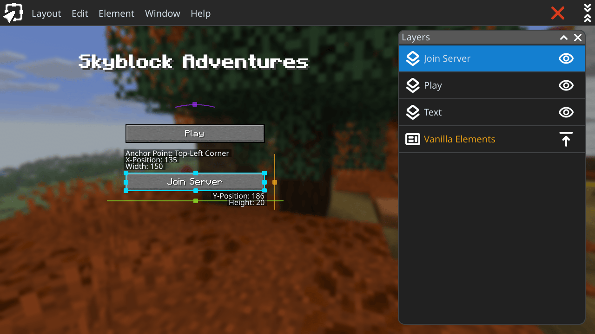

# レイアウトエディター

レイアウトエディターでは、[レイアウト](/home#your-first-layout)を作成できます。要素の追加、移動、サイズ変更をしたり、要素の周りにあるメニューを変更したりできます。プレイヤーに見える状態でメニューが表示されるため、見た目をすぐに確認できます。

# エディターを開く

1. タイトル画面など、変更したいメニューを開きます。
2. **メニューバー -> カスタマイズ -> 現在の画面をカスタマイズ**をクリックし、**有効**と表示されていることを確認します。
3. **メニューバー -> カスタマイズ -> レイアウト -> 新規作成 -> 現在の画面用**をクリックします。

- **すべての画面用 [ユニバーサル]**を選ぶと、すべてのメニューに表示される[ユニバーサルレイアウト](/universal-layouts)が作成されます。
- 作成済みのレイアウトも**レイアウト**に表示されます。レイアウトにカーソルを合わせ、**レイアウトを編集**をクリックしてください。
- どのメニューでも、`Ctrl + Alt + L`を押すと、最後に編集したレイアウトが開きます。[メニューバーのショートカット](/home#menu-bar-shortcuts)を参照してください。

# エディターの概要

- 背景を右クリックすると、レイアウト全体の設定を開いたり、**新しい要素**から要素を追加したりできます。
- 要素を右クリックすると、その要素の設定を開けます。[要素](/elements#settings-of-all-elements)を参照してください。
- 右側の**レイヤー**には、レイアウトのすべての要素が表示されます。[レイヤーとグループ](#layers-and-groups)を参照してください。
- 上部のメニューバーには、次の項目があります。

| メニュー | 内容 |
|---|---|
| **レイアウト** | **新規作成**、**開く**、**保存**、**名前を付けて保存**、**AI用にレイアウトをエクスポート**、**レイアウトのプロパティ**（背景の右クリックメニューと同じ）、**設定**、**エディターを閉じる** |
| **編集** | **元に戻す**、**やり直す**、**コピー**、**貼り付け**、**すべて選択** |
| **要素** | 要素を追加する**新規作成**と、[削除したバニラ要素](/deleted-vanilla-elements)を復元する**削除済みバニラ要素** |
| **ウィンドウ** | **エディターウィジェット**、[グリッド](#grid-and-anchor-overlay)、[アンカーオーバーレイ](#grid-and-anchor-overlay)、**要素の回転コントロール**、**要素の傾きコントロール** |

## レイアウト設定

背景の右クリックメニューには、レイアウト自体に関する設定がすべてあります。たとえば、次の項目です。

- [**メニュー背景**](/menu-backgrounds)と[**装飾オーバーレイ**](/decoration-overlays)
- 一部のメニュー上部にある「オプション」などのテキストを設定する**カスタム画面タイトル**。ここでは[プレースホルダー](/placeholders)を使用できます。
- [スクロール可能な画面](/customizing-scrollable-screens)の**ヘッダー／フッターのカスタマイズ**
- [1つのメニューで複数のレイアウトを使う](/randomize-layouts)ための**レイアウトインデックス [複数レイアウトの順序]**と**ランダムモード**
- **読み込み要件 [レイアウト全体]**。[要件](/conditions#layout-wide-requirements)を参照してください。
- **「画面を開く」アクションスクリプトを編集**と**「画面を閉じる」アクションスクリプトを編集**。[アクションスクリプト](/action-scripts)を参照してください。
- **ユニバーサルレイアウトのオプション**。これは[ユニバーサルレイアウト](/universal-layouts)でのみ使用できます。

# 要素の操作

## 選択

- 要素をクリックすると選択できます。背景をクリックすると、すべての選択が解除されます。
- 背景上をドラッグすると、矩形内のすべての要素を選択できます。
- `Ctrl`を押しながらクリックすると、要素を選択に追加したり、選択済みの要素を選択から外したりできます。
- `Ctrl + A`ですべての要素を選択できます。

クリック、矩形選択、`Ctrl + A`では、[レイヤーで非表示にした](#hiding-and-renaming)要素は選択されません。

## 移動

- 要素をドラッグすると移動できます。複数の選択済み要素を移動するには、ドラッグを開始するときに`Ctrl`を押し続けます。`Ctrl`を押さずにクリックすると、クリックした要素だけが選択されます。
- 矢印キーを押すと、選択した要素を1ピクセルずつ移動できます。
- ドラッグ中はアンカーポイントが表示されます。要素を別のアンカーポイントまたは要素の上に置くと、そこにアンカーできます。[要素の配置](/positioning-elements)を参照してください。
- 要素を[スクロール可能な領域](/scrollable-areas)にドロップすると、その中に配置できます。

## サイズ変更

選択した要素の辺または角をドラッグします。縦横比を維持するには、`Shift`を押し続けます。

サイズを変更できるのは、要素を1つだけ選択しているときです。

## 回転と傾き

回転や傾きに対応した要素を選択すると、[回転と傾き](/rotating-elements)を調整するコントロールが表示されます。コントロールをドラッグしながら`Shift`を押すと、角度を段階的に調整できます。回転は45°刻み、傾きは15°刻みです。

**ウィンドウ -> 要素の回転コントロール**と**要素の傾きコントロール**で、コントロールの表示を切り替えられます。

## コピー、貼り付け、削除

- `Ctrl + C`で選択した要素をコピーし、`Ctrl + V`で貼り付けます。複製した要素は元の要素の上に配置され、選択状態になるため、すぐにドラッグして移動できます。
- ゲームを閉じるまでは、別のレイアウトにも貼り付けられます。
- `Delete`で選択した要素を削除します。バニラ要素は非表示になるだけです。**要素 -> 削除済みバニラ要素**から復元できます。
- スクロール可能な領域を削除すると、その中のコンテンツも削除するか、レイアウトに残すかを確認するメッセージが表示されます。

## 元に戻す／やり直す

`Ctrl + Z`で直前の変更を元に戻し、`Ctrl + Y`でやり直します。どちらも**編集**メニューから実行できます。

## 不可視の要素

プレイヤーには、[オーディオ](/elements#audio)、[ドラッガー](/dragger)、[要素アニメーター](/element-animator)、[ミュージックコントローラー](/elements#music-controller)、[ティッカー](/elements#ticker)の各要素は表示されません。エディターでは名前付きの色付きボックスとして表示されるため、見つけたり、移動したり、サイズを変更したりできます。

- 右クリックメニューの**エディター内の色**でボックスの色を変更できます。たとえば、複数のティッカーを見分けるのに便利です。色は`#RRGGBB`形式、または透明度を含む`#RRGGBBAA`形式で指定します。`#E30E2366`のような半透明の色では、ボックスの背後にあるものが透けて見えます。
- ボックス内の名前は要素のレイヤー名です。[非表示と名前の変更](#hiding-and-renaming)を参照してください。

プレイヤーにボックスやその色、名前が見えることはありません。

# レイヤーとグループ

**レイヤー**には、レイアウトのすべての要素が上から順に一覧表示されます。一覧の上にある要素ほど、下にある要素より手前に表示されます。**ウィンドウ -> エディターウィジェット -> レイヤー**で表示を切り替えられます。

## 順序の変更

- レイヤーをクリックして要素を選択し、上下にドラッグします。移動先は線で示されます。選択したレイヤーはすべて一緒に移動します。
- または、要素かそのレイヤーを右クリックし、**レイヤーを1つ上へ移動**または**レイヤーを1つ下へ移動**をクリックします。

エディターでは、選択した要素は常にほかの要素より手前に表示されます。実際の順序を確認するには、選択を解除してください。

一部のMinecraftのバージョンでは、[プレイヤーエンティティ](/elements#player-entity)と[アイテム](/elements#item)の要素は、レイヤーに関係なく常にすべての要素より手前に表示されます。[既知の問題](/known-issues#1-player-entity--item-elements-are-always-in-front-of-everything)を参照してください。

## バニラ要素

**バニラ要素**の行は、メニュー自体のボタンなど、メニューに含まれるすべての要素を表します。これらの順序は変更できませんが、行の右側にあるボタンを使うと、追加した要素をバニラ要素の背後または手前に配置できます。これは、背景の右クリックメニューにある**カスタム要素をバニラ要素の背後に配置**と同じ機能です。

## 非表示と名前の変更

- レイヤーの目のアイコンをクリックすると、エディター内で要素が非表示になり、ほかの要素を編集するときに邪魔になりません。もう一度クリックすると要素が表示されます。
- 非表示の要素はクリック、移動、コピー、削除できません。プレイヤーには引き続き表示され、エディター内だけで非表示になります。レイアウトには、非表示にした要素が記録されます。
- レイヤーを右クリックして**レイヤー名を変更**をクリックすると、「`News Panel`」のように見つけやすい名前を付けられます。これは要素の**エディター内表示名**と同じもので、プレイヤーには表示されません。

## グループ

グループを使うと、ニュースパネルのすべてのパーツなど、関連するレイヤーを1つの名前の下にまとめられます。グループは一覧を整理するだけのもので、要素の表示や動作は変わりません。

- レイヤー内を右クリックして**グループを追加**をクリックします。グループはレイヤーの下に表示されます。
- レイヤーをグループにドラッグすると、そのグループに追加できます。グループの外へドラッグすると、グループから外せます。
- グループをクリックすると、その中のすべての要素が選択されます。グループをドラッグすると、中の要素をまとめて上下に移動できます。
- グループの矢印をクリックすると、中のレイヤーを折りたたんだり展開したりできます。目のアイコンで、すべての要素を非表示または表示にできます。
- グループを右クリックすると、名前の変更、1つ上または下への移動、削除ができます。**グループを削除**しても、中の要素は残ります。

**レイヤーを1つ上へ移動**と**レイヤーを1つ下へ移動**では、要素はグループ内に留まります。グループから外すには、そのレイヤーをグループの外へドラッグしてください。

レイアウトには、グループと、折りたたまれているかどうかが保存されます。

## スクロール可能な領域

[スクロール可能な領域](/scrollable-areas)内の要素は、その領域のレイヤーの下にインデントされて表示されます。

- 要素を領域内に入れるには、レイヤーを領域のレイヤーの下半分にドラッグします。ほかのレイヤーの間にドラッグすると、領域から外せます。画面上の位置は変わりません。
- 領域のレイヤーの矢印をクリックすると、中の要素を折りたたんだり展開したりできます。
- 領域内の要素はグループに属しません。領域と一緒に移動します。

# グリッドとアンカーオーバーレイ

**ウィンドウ**メニューでは、エディターの補助機能を設定できます。

- **グリッド**を有効にするとグリッド線が表示されます。`Ctrl + G`で表示を切り替えられます。**グリッドサイズ**では線の間隔を設定します。
- **グリッドにスナップ**を有効にすると、グリッドの表示中にドラッグした要素がグリッド線に吸着します。**グリッドへのスナップ強度**で吸着の強さを設定します。
- **アンカーオーバーレイの表示**では、アンカーポイントを表示するタイミングを設定します。
  - **要素のドラッグ中に表示**：要素をドラッグしている間に表示します。
  - **常に表示**：常に表示します。
  - **キーを押したときに表示 (キー「O」)**：`O`を押している間に表示します。
  - **無効**：表示しません。
- **アンカー領域へのホバー**では、要素をアンカーポイントの上に置いたときにアンカーが変更されるかを設定します。**アンカー要素へのホバー**を有効にすると、ほかの要素もアンカーポイントに加わります。この機能を使うには、**アンカー領域へのホバー**も有効にする必要があります。

# 保存と終了

- `Ctrl + S`または**レイアウト -> 保存**でレイアウトを保存します。初回保存時には、FancyMenuからファイル名を尋ねられます。
- **レイアウト -> 名前を付けて保存**を選ぶと、新しいファイルとしてレイアウトを保存できます。
- 保存されていない変更がある間は、メニューバーに**\* 未保存の変更があります！ \***と表示されます。
- メニューバー右側のX、または**レイアウト -> エディターを閉じる**でエディターを終了します。未保存の変更がある場合は、終了する前に確認メッセージが表示されます。

# ショートカット

macOSでは、`Ctrl`の代わりに`Cmd`を使用してください。

| ショートカット | 動作 |
|---|---|
| `Ctrl + S` | 保存 |
| `Ctrl + Z` | 元に戻す |
| `Ctrl + Y` | やり直す |
| `Ctrl + C` | 選択した要素をコピー |
| `Ctrl + V` | 貼り付け |
| `Ctrl + A` | すべての要素を選択 |
| `Delete` | 選択した要素を削除 |
| 矢印キー | 選択した要素を1ピクセル移動 |
| `Ctrl` + クリック | 要素を選択に追加、または選択から外す |
| `Ctrl` + ドラッグ | 選択した複数の要素を移動 |
| `Shift` + サイズ変更 | 縦横比を維持 |
| `Shift` + 回転または傾き | 段階的に調整 |
| `Ctrl + G` | グリッドの表示を切り替え |
| `O`を押し続ける | **キーを押したときに表示 (キー「O」)**の設定でアンカーポイントを表示 |

> [!TIP]
> テキストエディターには独自のショートカットがあります。[メニュー内のテキスト](/text-in-menus#the-text-editor)を参照してください。[アクションスクリプト](/action-scripts#shortcuts)などのウィンドウでは、それぞれのページにショートカットが記載されています。
