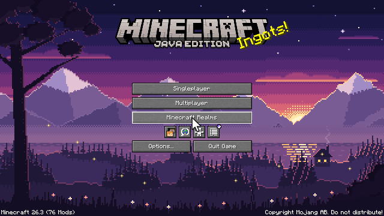

# パララックス効果

パララックス効果を使うと、マウスの動きに合わせてメニューの背景や要素を少し動かせます。遠くのレイヤーは少なく、近くのレイヤーは大きく動かすと、メニューに奥行きが生まれます。

[要素](/elements)と、**画像**および**動画**の[メニュー背景](/menu-backgrounds)で使用できます。

# 要素

1. レイアウトエディターで要素を右クリックし、下にスクロールして**パララックス効果**を探します。
2. **パララックス効果**をクリックして、**有効**にします。
3. **パララックス強度（X）**と**パララックス強度（Y）**をクリックし、移動する距離を設定します。
4. レイアウトを保存して、エディターを閉じます。要素が動くのはエディターの外だけです。

複数の要素に一度に効果を設定するには、まず要素を[選択](/layout-editor#selecting)してから（`Ctrl`を押しながらクリックすると、要素を選択に追加できます）、いずれかの要素を右クリックします。

| 設定 | 説明 |
|---|---|
| **パララックス効果** | 効果を有効にします。 |
| **パララックス強度（X）** | 要素が左右に移動する距離です。`0.0`（まったく動かない）から`1.0`まで設定できます。新しい要素の初期値は`0.5`です。 |
| **パララックス強度（Y）** | 上下方向の移動距離です。 |
| **パララックスの動きを反転** | 要素をマウスと同じ方向に動かします。有効にしない場合は、反対方向に動きます。 |

強度が`1.0`の場合、マウスが画面の端にあると、要素は左右に画面幅の最大5%、上下に画面高さの最大5%移動します。画面の中央では、要素は配置した位置にとどまります。

- [アンカー](/positioning-elements)で効果のある要素に固定された要素は、その要素と一緒に動きます。さらに、固定された要素自身の効果も加わります。
- **画面内にとどめる**を有効にしても、効果のある要素は画面内にとどまりません。画面の端を越えて移動する場合があります。
- 引き伸ばされた要素は、引き伸ばされている方向には動きません。
- [バニラのボタンとスライダー](/vanilla-elements)は、移動させた後にのみ動きます。アンカーポイントを**バニラ（オリジナル）**にすると、ゲームが配置した場所にとどまります。
- ボタンは、表示されている場所でクリックできます。
- [スクロール可能エリア](/scrollable-areas)、その中の要素、ツールチップ要素にはパララックス効果がありません。

# メニュー背景

1. エディターの背景を右クリックし、**メニュー背景 -> 画像**（または**動画**）を開きます。
2. **パララックス効果**をクリックして、**有効**にします。
3. **パララックス効果の強度（X）を設定**と**パララックス効果の強度（Y）を設定**を設定します。

背景は要素よりも大きく動きます。背景は強度に応じて拡大されるため、端が見えることはありません。強度が`1.0`の場合、背景は画面の2倍の大きさになり、左右に画面の半分まで移動します。値は小さく設定してください。新しい背景の初期値は`0.02`で、`0.01`から`0.1`の範囲が適しています。

- **パララックスの動きを反転**すると、背景がマウスと同じ方向に動きます。
- **横長画像を左から右へスライド**と**パララックス効果**は同時に有効にできません。
- **テクスチャを繰り返す**と**背景の縦横比を維持**は、パララックス効果と併用できます。
- 背景はレイアウトエディター内でも動きます。

# 奥行きのあるシーンを作る

ページ上部のシーンは、タイトル画面に空と3つのレイヤーを配置して作られています。

1. 空、山、丘、手前の景色のように、遠くから近くへ順にレイヤーを描きます。空以外のレイヤーは、透明部分のあるPNG画像にします。
2. 空をメニュー背景の**画像**として設定し、パララックス効果を有効にします。
3. それ以外のレイヤーは、遠いものから順に[画像要素](/elements#image)として追加し、最も近いレイヤーが一番上に来るようにします。
4. 移動時に端が見えないよう、レイヤーを画面より少し大きくします。強度が`1.0`のレイヤーには、左右に画面幅の5%、上下に画面高さの5%分の余白が必要です。画面の端より外側に配置するには、**画面内にとどめる**を無効にします。
5. すべてのレイヤーでパララックス効果を有効にします。遠いレイヤーは強度を低く、近いレイヤーは高く設定します。
6. エディターの背景を右クリックし、**カスタム要素をバニラ要素の背面に表示**を**有効**にします。これにより、レイヤーがボタンやロゴの背面に表示されます。

シーンの各レイヤーの強度は次のとおりです。

| レイヤー | 強度（X） | 強度（Y） |
|---|---|---|
| 空（メニュー背景） | `0.02` | `0.01` |
| 山 | `0.35` | `0.2` |
| 丘 | `0.6` | `0.3` |
| 手前の景色 | `1.0` | `0.5` |

> [!TIP]
> Y方向の強度は、X方向の強度の半分程度にします。そうすると、風景の地面が上下に大きく揺れなくなります。

# 知っておくと便利なこと

- すべての動きはGUIのピクセル単位で処理されるため、強度が低い場合は小刻みに動きます。
- 強度の設定には[プレースホルダー](/placeholders)を使えます。プレースホルダーを指して、その横に表示される小さなメニューで**プレーンテキストとして設定**をクリックしてください。[変数](/variables)を使えば、プレイヤーが自分の設定メニューで効果を弱められるようにできます。
