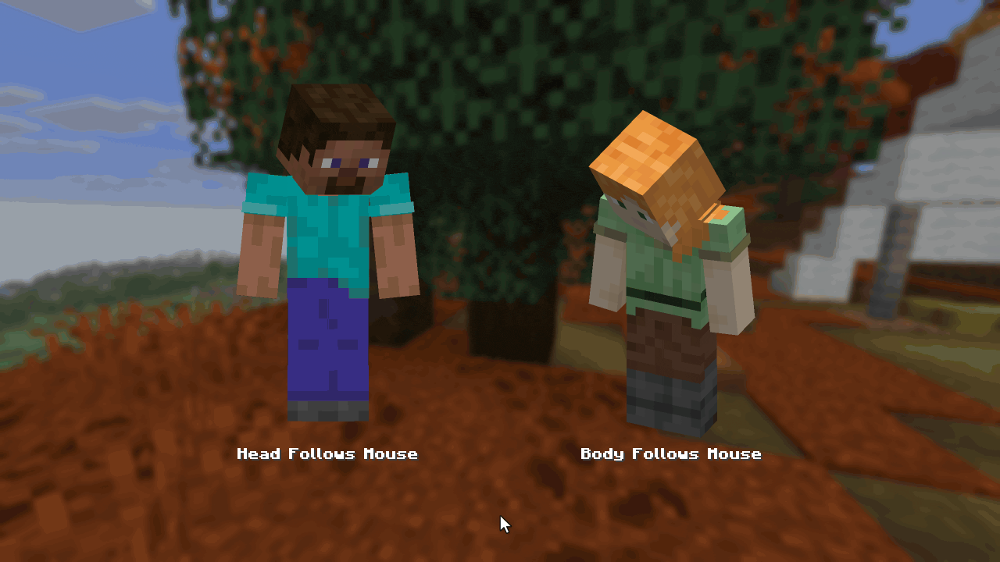

# プレイヤーエンティティ

Player Entity要素は、タイトル画面のボタンの横に表示されるプレイヤー自身のキャラクターのように、プレイヤーを3Dで表示します。操作中のプレイヤーを表示したり、ほかのプレイヤーを表示したり、独自のスキン、マント、名前を持つキャラクターとして使ったりできます。

> [!IMPORTANT]
> Minecraft 1.20.1以降では、Player Entityの表示にmod Fancy Entity Renderer（[CurseForge](https://www.curseforge.com/minecraft/mc-mods/fancy-entity-renderer)、[Modrinth](https://modrinth.com/mod/fancy-entity-renderer)）が必要です。このmodがない場合、赤いボックスが表示されます。使用中のMinecraftバージョンに対応したビルドがまだない場合、そのバージョンではPlayer Entityを表示できません。

# Player Entityの追加

エディターの背景を右クリックし、**New Element -> Player Entity**をクリックします。ハンドルをドラッグしてサイズを変更します。プレイヤーのサイズは要素の高さに合わせて変わります。

以下の設定はすべて、要素の右クリックメニューにあります。

# 表示するプレイヤー

- **Copy Client Player**を有効にすると、操作中のプレイヤーが名前、スキン、マントとともに表示されます。有効にしている間は、名前、スキン、マントの設定がロックされます。
- **Player Name**には任意の名前を指定できます。実在のプレイヤーの名前である必要はありません。[プレースホルダー](/placeholders)にも対応しています。
- **Show Player Name**を有効にすると、頭上にネームタグが表示されます。**Nametag Rotation**をオフにすると、ネームタグはプレイヤーの向きに合わせて回転しません。

## スキンとマント

- **Auto Skin**と**Auto Cape**は、**Player Name**に指定したプレイヤーのスキンとマントを読み込みます。インターネット接続が必要です。
- **Skin Texture**と**Cape Texture**では、[アセット](/resources)にあるスキンのように、自分のスキンやマントのファイルを使用できます。スキンには通常のMinecraftのスキンファイルを使います。
- **Slim Skin**は、Alexのような腕が細いスキンに使います。**Auto Skin**と**Copy Client Player**では、スキンの種類が自動的に判別されます。

# ポーズと動き

- **Head Follows Mouse**と**Body Follows Mouse**を有効にすると、プレイヤーがマウスポインターを見るようになります。新しいPlayer Entityでは、どちらも有効になっています。
- **Pose**では、体のポーズを**Standing**、**Crouching**、**Sleeping**、**Swimming**、**Dying**、**Spin Attack**から選択できます。
- **Body Movement**を有効にすると、ポーズに動きが加わります。

## エンティティのポーズ

**Entity Pose**をクリックするとウィンドウが開き、**Head**、**Body**、**Left Arm**、**Right Arm**、**Left Leg**、**Right Leg**のX、Y、Z軸の回転を`-180`から`180`の範囲で設定できます。

スライダーの横にある**Advanced Mode**を有効にすると、[プレースホルダー](/placeholders)に対応したテキスト値に切り替わります。`$$arm_angle`のような[変数](/variables)を使うと、[スケジューラー](/schedulers)でその変数を変更してプレイヤーをアニメーションさせることができます。

# アーマー、アイテムなど

- **Armor and Tools**を使うと、プレイヤーにアイテムを装備させられます。設定できるのは**Head Armor**、**Chest Armor**、**Legs Armor**、**Feet Armor**、**Left Hand Tool**、**Right Hand Tool**です。`minecraft:diamond_sword`のようなアイテムIDを指定してください。アイテムIDにはプレースホルダーを使えます。**Enchant Head Armor**やほかの「Enchant」スイッチを有効にすると、エンチャントの輝きが追加されます。
- **Is Baby**を有効にすると、プレイヤーが子どものように小さくなります。
- **Parrot**を使うと、右肩にオウムが乗ります。**Parrot On Left Shoulder**を有効にすると左肩に乗ります。

# 知っておくと便利なこと

- Player Entityは回転、傾斜、フェード、半透明化ができません。
- プレイヤーの頭だけを表示する場合は、[Player Heads](/player-heads)を参照してください。
- Minecraft 1.19.2では、Player EntityにFancy Entity Rendererは必要ありません。ただし設定項目が少なく、**Pose**の代わりに**Crouching**があり、**Nametag Rotation**、**Body Movement**、**Armor and Tools**はありません。サイズは要素のサイズではなく**Entity Scale**で決まり、デフォルト値は`30`です。`60`にすると2倍の大きさになります。
