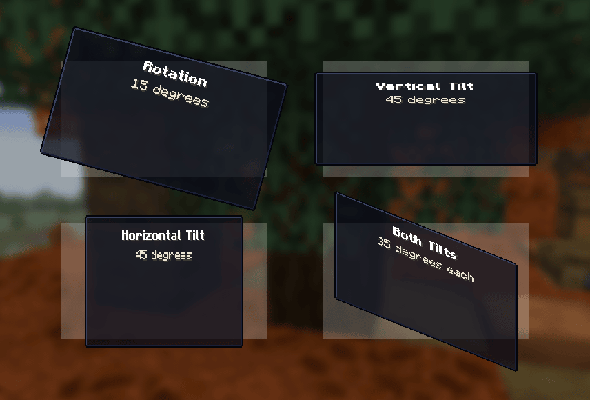

# 要素の回転と傾斜

ほとんどの要素は回転・傾斜させることができます。どちらも要素の中心を基準に行われ、位置やサイズは変わりません。

- **回転**は、時計の針のように要素を回します。
- **垂直傾斜**は要素を後ろに倒し、**水平傾斜**は横に向けます。傾斜した要素には遠近感が加わらず、高さが低くなるか幅が狭くなるだけです。両方の傾斜を設定すると、さらに斜めになります。



# レイアウトエディターでの操作


[レイアウトエディター](/layout-editor)で要素を選択し、ハンドルをドラッグします。

- 要素を囲む円上のハンドルで回転させます。
- 要素の右側の線上にあるハンドルで**垂直傾斜**を、下側の線上にあるハンドルで**水平傾斜**を設定します。線の中央は傾斜なしです。

ドラッグ中の操作:

- `Shift`を押したまま操作すると、一定の角度ごとにスナップします。回転は45度刻み、傾斜は15度刻みです。
- 0度に近づくとハンドルが0度にスナップするので、要素を簡単にまっすぐに戻せます。
- 要素の左上に回転と傾斜の値が表示されます。

補足:

- 選択枠はまっすぐなままです。枠内をクリックすると、要素を選択または移動できます。
- ハンドルは要素を1つだけ選択しているときに表示されます。
- 円や線が表示されない要素は回転・傾斜できません。[回転・傾斜できない要素](#elements-without-rotation-or-tilt)を参照してください。
- **メニューバー -> ウィンドウ -> 要素の回転コントロール**と**要素の傾斜コントロール**で、すべての要素のハンドルを非表示にできます。

# 正確な値

要素を右クリックすると、次の設定が表示されます。それぞれに**数値ピッカーで設定**、**プレーンテキストとして設定**、**デフォルトにリセット**があります。

| 設定 | 説明 |
|---|---|
| **回転** | 時計回りに回転する角度です。たとえば`90`なら4分の1回転します。負の値を指定すると反時計回りに回転します。 |
| **垂直傾斜** | 要素を後ろに倒す角度です。`-60`度から`60`度まで設定できます。 |
| **水平傾斜** | 要素を横に向ける角度です。`-60`度から`60`度まで設定できます。 |

傾斜を片方だけ設定した場合、正の値でも負の値でも見た目は同じです。両方の傾斜を設定した場合は、値の符号によって要素が傾く方向が決まります。

## プレースホルダーを使う

[変数](/variables)や別の[プレースホルダー](/placeholders)を使って要素を回転・傾斜させるには:

1. 要素を右クリックし、**高度な回転モード**、**高度な垂直傾斜モード**、または**高度な水平傾斜モード**を有効にします。
2. **回転**、**垂直傾斜**、または**水平傾斜**をクリックし、**プレーンテキストとして設定**を選んで、プレースホルダーを入力します。

高度なモードでは個別の値が保持され、ハンドルは非表示になります。そのため、ドラッグしてもプレースホルダーが置き換えられることはありません。モードをオフにすると、要素には以前の値が戻ります。

**高度な回転モード**で次の**回転**を設定すると、ロゴが3.6秒ごとに1回転します。`10`より大きな数で割ると、回転が遅くなります:

```
{"placeholder":"calc","values":{"expression":"{"placeholder":"unix_time"} / 10 % 360"}}
```

変数`needle_angle`の値が示す方向を向く針です。この値はボタンや[スライダー](/elements#slider)で設定できます:

```
{"placeholder":"getvariable","values":{"name":"needle_angle"}}
```

# クリックとマウス操作


ボタン、スライダー、テキスト要素内のリンクやスクロールバーは、回転・傾斜していても、画面上に表示されている位置でマウスに反応します。条件の[**要素にマウスカーソルが重なっている**](/conditions#is-element-hovered)、[**いずれかの要素にマウスカーソルが重なっている**](/conditions#is-any-element-hovered)、[**いずれかのボタンにマウスカーソルが重なっている**](/conditions#is-any-button-hovered)も同様です。

> [!NOTE]
> チェックボックス、テキスト入力欄、ドラッガー、ブラウザーは、回転・傾斜がない場合の枠内で引き続き反応します。これらはまっすぐな状態で使用してください。

# 回転・傾斜できない要素

- 回転も傾斜もできない要素:[スクロール可能領域](/scrollable-areas)、[GLSLシェーダー](/elements#glsl-shader)、[ブロック/アイテムのJSONモデル](/elements#blockitem-json-model)、[プレイヤーエンティティ](/player-entities)、[バニラ要素](/vanilla-elements)（画面自体のボタンなど）。
- 回転はできるが傾斜できない要素:[ツールチップ](/elements#tooltip)と[アイテム](/elements#item)。

スクロール可能領域内の要素は回転・傾斜できますが、領域そのものはできません。

[スプラッシュテキスト](/splash-text)要素には、右クリックメニューの下の方に、典型的な斜め表示を設定する独自の**回転**項目もあります。このページで説明している回転と併用できます。
