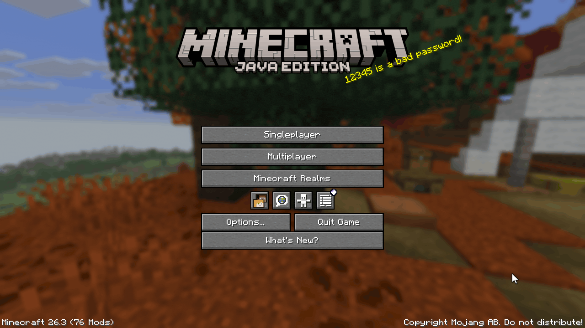

# 액션 스크립트

액션 스크립트는 버튼을 클릭하거나 메뉴를 여는 등의 일이 발생했을 때 FancyMenu가 수행할 작업을 나열한 것입니다. 각 작업은 액션입니다. 메뉴 열기, 서버 접속, 메시지 표시, 사운드 재생 등 다양한 액션을 사용할 수 있습니다. IF와 WHILE 같은 문은 어떤 액션을 실행할지, 몇 번 실행할지 결정합니다.

> [!CAUTION]
> 액션 스크립트는 파일을 변경하거나, 서버에 접속하거나, 링크를 열고 명령어를 실행할 수 있습니다. 신뢰할 수 있는 레이아웃의 스크립트만 사용하세요.


# 액션 스크립트 만들기

1. 레이아웃 편집기에서 버튼을 마우스 오른쪽 버튼으로 클릭하고 **Edit Action Script**를 클릭합니다.
2. `A`를 눌러 액션 선택 창을 엽니다.
3. 액션을 검색하고 클릭한 다음 **Next Step**을 클릭합니다.
4. 액션 설정 창에서 설정한 다음 **Done**을 클릭합니다. 설정이 필요 없는 액션은 선택 창에서 **Done**만 클릭하면 됩니다.
5. 스크립트 편집기에서 **Done**을 클릭한 다음 레이아웃을 저장합니다.

편집기 밖에서는 버튼을 클릭하면 스크립트가 실행됩니다.



> [!TIP]
> 스크립트 영역을 마우스 오른쪽 버튼으로 클릭하고 **Add Action**을 열면 모든 액션 목록을 볼 수 있습니다. 목록에서 액션을 마우스 오른쪽 버튼으로 클릭해 즐겨찾기에 추가하면 목록 맨 위에 표시됩니다.

# 액션 스크립트를 사용할 수 있는 곳

| 위치 | 실행 시점 | 편집 방법 |
|---|---|---|
| [버튼](/elements#button) | 버튼을 클릭할 때 | 버튼을 마우스 오른쪽 버튼으로 클릭 -> **Edit Action Script** |
| [슬라이더](/elements#slider) | 슬라이더 값이 변경될 때. `$$value`는 새 값입니다. | 슬라이더를 마우스 오른쪽 버튼으로 클릭 -> **Edit Action Script** |
| [체크박스](/elements#checkbox) | 체크박스를 선택하거나 선택 해제할 때. `$$value`는 새 상태인 `true` 또는 `false`입니다. | 체크박스를 마우스 오른쪽 버튼으로 클릭 -> **Edit Action Script** |
| [티커](/elements#ticker) | **Tick Mode**에 설정된 대로 반복 실행, 게임 세션당 한 번 또는 메뉴를 불러올 때 한 번 실행됩니다. | 티커를 마우스 오른쪽 버튼으로 클릭 -> **Edit Action Script** |
| 메뉴 열기 | 레이아웃의 메뉴를 열 때 | 편집기 배경을 마우스 오른쪽 버튼으로 클릭 -> **Edit 'Open Screen' Action Script** |
| 메뉴 닫기 | 레이아웃의 메뉴를 닫을 때 | 편집기 배경을 마우스 오른쪽 버튼으로 클릭 -> **Edit 'Close Screen' Action Script** |
| [리스너](/listeners) | 키 입력이나 채팅 메시지처럼 리스너의 이벤트가 발생할 때 | **메뉴 바 -> Customization -> Manage Listeners** |
| [스케줄러](/schedulers) | 메뉴가 열려 있지 않아도 설정된 타이머가 끝날 때 | **메뉴 바 -> Customization -> Manage Schedulers** |

열기 및 닫기 스크립트는 편집기의 **Layout -> Layout Properties** 메뉴에서도 찾을 수 있습니다.

# 스크립트 편집기

- 액션은 위에서 아래 순서로 실행됩니다. 문이나 폴더 안의 항목은 그 아래에 들여쓰기되어 표시됩니다.
- 새 항목은 선택한 항목 아래에 추가됩니다. 문이나 폴더를 선택한 경우에는 그 시작 부분에 추가됩니다.
- 값을 두 번 클릭하면 목록에서 바로 편집할 수 있습니다. 간단한 요약이 표시되는 값은 해당 설정 창이 열립니다.
- 항목을 드래그해 이동할 수 있습니다. IF 문 체인, 루프와 폴더는 앞에 있는 작은 토글을 눌러 접거나 펼칠 수 있습니다. 이는 표시 방식만 변경합니다.
- 오른쪽 막대는 전체 스크립트의 축약된 모습입니다. 클릭하면 해당 부분으로 이동합니다.
- 스크립트 영역을 마우스 오른쪽 버튼으로 클릭하면 문 추가, **Export Action Script for AI** 등 다른 기능을 사용할 수 있습니다([AI용 내보내기](/export-for-ai) 참고).
- **Cancel**을 누르거나 창을 닫으면 변경 사항이 취소됩니다. 변경 사항이 있으면 먼저 확인 메시지가 표시됩니다.

## 단축키

macOS에서는 `Ctrl` 대신 `Cmd`를 사용합니다.

| 단축키 | 기능 |
|---|---|
| `A` | 액션 선택 창을 엽니다. |
| `Enter` | 선택한 항목을 편집합니다. |
| `Delete` | 선택한 항목을 삭제합니다. |
| `Up` / `Down` | 위나 아래 항목을 선택합니다. |
| `Shift + Up` / `Shift + Down` | 선택한 항목을 위나 아래로 이동합니다. |
| `Ctrl + C` / `Ctrl + V` | 액션을 복사하고 붙여넣습니다. 문과 블록은 복사할 수 없습니다. |
| `Ctrl + Z` | 실행 취소합니다. |
| `Ctrl + Y` 또는 `Ctrl + Shift + Z` | 다시 실행합니다. |
| `Ctrl + S` | **Done**과 마찬가지로 스크립트를 저장하고 편집기를 닫습니다. |

# 문

문은 어떤 액션을 실행할지, 몇 번 실행할지 결정합니다. 스크립트 영역을 마우스 오른쪽 버튼으로 클릭해 추가하세요.

## If, Else-If, Else

**Add IF Statement**를 선택하면 [조건](/conditions)을 설정하라는 창이 열립니다. IF 안의 액션은 조건이 충족될 때만 실행됩니다.

IF를 마우스 오른쪽 버튼으로 클릭하면 체인에 문을 더 추가할 수 있습니다.

- **Append ELSE-IF Statement**: 위의 IF가 실행되지 않은 경우 자체 조건을 확인합니다.
- **Append ELSE Statement**: 체인에서 위에 있는 문이 하나도 실행되지 않은 경우 실행됩니다.

예를 들어 **Is Layout Enabled** 조건이 있는 IF를 사용하면 겨울 레이아웃이 켜져 있을 때만 토스트를 표시하고, ELSE에서는 그 외의 경우 사운드를 재생할 수 있습니다.

## While 루프

**Add WHILE Loop**는 [조건](/conditions)이 충족되는 동안 내부 액션을 반복합니다.

반복 실행은 3초가 지나면 중단되므로 끝나지 않는 루프가 게임을 멈추게 할 수 없습니다. 타이머 기능은 아닙니다. 나중에 실행하거나 계속 반복해야 하는 작업에는 [Execute Later](#execute-later), [티커](/elements#ticker) 또는 [스케줄러](/schedulers)를 사용하세요.

## For Each 루프

**Add FOR EACH Loop**는 [목록 변수](/variables#text-and-list-variables)의 첫 항목부터 마지막 항목까지, 항목마다 한 번씩 내부 액션을 실행합니다.

- `$$list_entry`는 현재 항목이고 `$$list_index`는 해당 항목의 인덱스입니다. 첫 항목의 인덱스는 0입니다.
- 두 변수 모두 루프 안의 액션 값과 조건에서 사용할 수 있습니다.
- 목록의 이름은 `$$` 없이 입력합니다(예: `quest_log`). 이름에는 플레이스홀더도 사용할 수 있습니다.
- 루프가 시작될 때 목록을 한 번 읽으므로 내부 액션에서 목록을 안전하게 변경할 수 있습니다.
- WHILE 루프와 마찬가지로 반복 실행은 3초가 지나면 중단됩니다.

예시는 [목록 순회하기](/variables#going-through-a-list)를 참고하세요.

# 블록

블록은 액션의 실행 시점을 변경하거나 스크립트를 정리하는 데 사용합니다. 스크립트 영역을 마우스 오른쪽 버튼으로 클릭해 추가하세요.

## Delay Gate

**Add DELAY GATE Block**은 액션 실행을 지정된 시간(밀리초)만큼 지연합니다(`1000`은 1초입니다).

- 스크립트가 게이트에 처음 도달하면 타이머를 시작하고 내부 액션을 건너뜁니다. 나머지 스크립트는 바로 계속 실행됩니다.
- 시간이 다 되기 전에 스크립트가 다시 게이트에 도달할 때마다 내부 액션을 또 건너뜁니다.
- 시간이 지난 후에는 스크립트가 게이트에 도달할 때마다 내부 액션이 실행됩니다.
- 요소 스크립트에서는 메뉴를 다시 열거나 크기를 조정할 때 타이머가 초기화됩니다.

몇 초 동안 메뉴를 열어 둔 뒤에만 특정 항목을 표시하는 [티커](/elements#ticker) 같은 기능에 적합합니다. 이 블록은 스스로 액션을 실행하지 않습니다. 그런 작업에는 Execute Later를 사용하세요.

## Execute Later

**Add EXECUTE LATER Block**은 지정된 시간(밀리초)이 지난 후 내부 액션을 한 번 실행합니다. 나머지 스크립트는 바로 계속 실행됩니다.

스크립트가 이 블록에 도달할 때마다 새로운 카운트다운이 시작됩니다. 버튼 클릭이나 메뉴 열기처럼 한 번만 실행되는 스크립트에 적합합니다.

## Folder

**Add Folder**는 액션을 이름이 지정된 그룹으로 묶습니다. 폴더 안의 모든 액션을 실행하며, 긴 스크립트를 정리하는 기능만 합니다. 이름을 두 번 클릭해 변경할 수 있습니다.

## Comment

**Add Comment**는 메모를 추가합니다. 아무 작업도 하지 않습니다. 두 번 클릭해 편집할 수 있습니다.

# 스크립트 실행 방식

- 액션은 위에서 아래 순서로 실행됩니다. 액션이 실패하면 게임 로그에 오류가 기록되지만, 나머지 스크립트는 계속 실행됩니다.
- 값에 포함된 플레이스홀더는 액션이 실행되는 바로 그 시점의 값으로 바뀝니다. 따라서 액션은 앞서 실행된 액션이 변경한 값을 확인할 수 있습니다.
- 다운로드, ZIP 파일 압축 해제 및 웹 요청은 백그라운드에서 완료됩니다. 다음 액션은 작업이 끝날 때까지 기다리지 않습니다. 작업 완료 후 액션을 실행하려면 [**On File Downloaded via Action**](/listeners#on-file-downloaded-via-action) 및 [**On ZIP Extracted via Action**](/listeners#on-zip-extracted-via-action) 리스너를 사용하거나 [**Send HTTP Request**](#send-http-request)의 응답 변수를 사용하세요.

# 액션 값

대부분의 액션에는 서버 주소처럼 값이 필요합니다. 간단한 값은 직접 입력하는 텍스트입니다. 설정이 더 필요한 액션에는 별도의 설정 창이 있습니다.

## 플레이스홀더

값에는 플레이어 이름과 같은 [플레이스홀더](/placeholders)를 넣을 수 있습니다. 액션이 실행될 때 플레이스홀더가 실제 값으로 바뀝니다.

```
/say 다시 오신 것을 환영합니다, {"placeholder":"playername"}!
```

## $$ 변수

`$$` 뒤에 변수 이름을 입력하면 액션이나 조건에서 해당 변수의 값을 사용할 수 있습니다. 변수 이름은 대소문자를 구분합니다. 다음 두 종류의 변수에서 사용할 수 있습니다.

### 사용자 변수

**메뉴 바 -> Customization -> Manage Variables**에서 만든 모든 변수는 `$$`와 변수 이름을 사용해 참조할 수 있습니다. `coins`라는 변수는 모든 스크립트에서 `$$coins`로 사용할 수 있습니다. 예를 들어 **Display In Chat [Client-Side]**에 아래 값을 입력하면 플레이어가 가진 코인 수를 알려줍니다.

```
&6코인 $$개를 보유하고 있습니다!
```

변수를 만들고 변경하는 방법은 [변수](/variables)를 참고하세요.

### 스크립트 변수

일부 기능은 해당 스크립트에서 사용할 수 있는 변수를 제공합니다.

- [슬라이더](/elements#slider)는 새 값인 `$$value`를 제공합니다.
- [체크박스](/elements#checkbox)는 새 상태인 `true` 또는 `false`를 `$$value`로 제공합니다.
- [For Each 루프](#for-each-루프)는 `$$list_entry`와 `$$list_index`를 제공합니다.
- 각 [리스너](/listeners#listener-variables)는 눌린 키와 같이 제공하는 변수를 안내합니다.

이 변수들은 스크립트가 실행되는 동안에만 존재합니다. 사용자 변수와 이름이 같은 스크립트 변수가 있으면 `$$name`은 스크립트 변수를 가리킵니다.

# 모든 액션

FancyMenu의 모든 액션을 기능별로 정리했습니다.

## 화면과 메뉴

### 화면 또는 커스텀 GUI 열기

**Identifier:** `opengui`

게임이나 모드의 메뉴 또는 [커스텀 GUI](/custom-guis)를 엽니다.

**Value:** `options_screen`과 같은 [화면 식별자](/screen-identifiers)

대소문자를 구분합니다. 일부 모드 메뉴는 이 방법으로 열 수 없습니다. 이 경우 해당 메뉴를 여는 버튼에서 [**Mimic Vanilla/Mod Button**](#mimic-vanillamod-button)을 사용하세요.

### 화면 닫기

**Identifier:** `closegui`

열려 있는 메뉴를 닫습니다. 월드에 들어가 있지 않으면 타이틀 화면이 열립니다.

**Value:** 없음

### 화면 업데이트

**Identifier:** `update_screen`

창 크기를 조정한 것처럼 열려 있는 메뉴를 다시 구성합니다. GUI 배율이나 기타 옵션을 변경한 후 유용합니다.

**Value:** 없음

### 이전 화면으로 돌아가기

**Identifier:** `back_to_last_screen`

이전에 열려 있던 메뉴로 돌아갑니다. [커스텀 GUI](/custom-guis)라면 해당 GUI를 열기 전에 있던 메뉴로 돌아갑니다.

**Value:** 없음

### 토스트 표시

**Identifier:** `show_toast`

설정 창에서 구성한 토스트 알림을 화면 오른쪽 위에 표시합니다.

- **Toast Width**: 너비를 120~320픽셀로 설정합니다.
- **Duration (ms)**: 표시 시간을 설정합니다. 1초(`1000`)부터 10분까지 설정할 수 있습니다.
- **Title** 및 **Message**: [서식 코드](/text-formatting#minecraft-text-formatting)를 사용한 텍스트 또는 Minecraft 텍스트 컴포넌트 JSON을 입력합니다.
- **Icon Texture Source** 및 **Background Texture Source**: 선택 사항인 [이미지](/resources)를 지정합니다. 아이콘은 20x20픽셀, 배경은 높이 32픽셀에 토스트 너비만큼 넓은 이미지가 가장 적합합니다.

### 바닐라/모드 버튼 흉내 내기

**Identifier:** `mimicbutton`

플레이어가 직접 누른 것처럼 게임이나 모드의 버튼을 클릭합니다.

**Value:** `title_screen:mc_titlescreen_options_button`과 같은 버튼 [위젯 로케이터](/widget-locators)

편집기에서 버튼을 마우스 오른쪽 버튼으로 클릭하고 **Copy Widget Locator**를 선택하면 로케이터를 가져올 수 있습니다.

## 레이아웃과 요소

### 레이아웃 전환

**Identifier:** `toggle_layout`

레이아웃이 켜져 있으면 끄고, 꺼져 있으면 켭니다.

**Value:** `winter_title_screen`처럼 `.txt`를 제외한 레이아웃 이름

### 레이아웃 켜기

**Identifier:** `enable_layout`

레이아웃을 켭니다.

**Value:** `.txt`를 제외한 레이아웃 이름

### 레이아웃 끄기

**Identifier:** `disable_layout`

레이아웃을 끕니다.

**Value:** `.txt`를 제외한 레이아웃 이름

세 가지 레이아웃 액션은 모두 변경 사항을 저장하고 열려 있는 메뉴를 즉시 업데이트합니다. 레이아웃 이름은 대소문자를 구분합니다.

### 요소 애니메이터 전환

**Identifier:** `toggle_element_animator`

[요소 애니메이터](/element-animator)가 꺼져 있으면 켜고, 켜져 있으면 끕니다. 애니메이션은 처음부터 시작합니다. 상태는 저장됩니다.

**Value:** 요소 애니메이터의 식별자

### 요소 애니메이터 켜기

**Identifier:** `enable_element_animator`

[요소 애니메이터](/element-animator)를 켭니다. 꺼져 있었다면 애니메이션이 처음부터 시작됩니다.

**Value:** 요소 애니메이터의 식별자

### 요소 애니메이터 끄기

**Identifier:** `disable_element_animator`

[요소 애니메이터](/element-animator)를 끄고 애니메이션을 초기화합니다.

**Value:** 요소 애니메이터의 식별자

### 요소 애니메이터 초기화

**Identifier:** `reset_element_animator`

[요소 애니메이터](/element-animator)를 켜거나 끄지 않고 애니메이션을 처음부터 시작합니다.

**Value:** 요소 애니메이터의 식별자

### 텍스트 입력 필드 값 설정

**Identifier:** `set_text_input_field_value`

FancyMenu 또는 게임의 [텍스트 입력 필드](/elements#text-input-field)에 입력된 텍스트를 설정합니다.

**Value:** `element_identifier|||text|||force`

`force`를 `true`로 설정하면 필드가 비활성화된 상태에서도 텍스트가 변경됩니다.

### 요소 스크롤

**Identifier:** `scroll_scroll_area`

설정 창에서 구성한 [스크롤 가능 영역](/scrollable-areas) 또는 [텍스트](/elements#text) 요소를 스크롤합니다.

- **Identifier of the Element to Scroll**: 스크롤할 영역 또는 텍스트의 식별자입니다.
- **Scroll To**:
  - **Start** 또는 **End**: 시작 또는 끝으로 이동합니다.
  - **Position**: 픽셀 단위의 **Horizontal Position** 및 **Vertical Position**을 설정합니다. 한쪽 값을 비워 두면 해당 위치는 유지됩니다.
  - **Element**(영역만 해당): **Identifier of the Element to Scroll To**에 지정된 요소가 시작 부분에 오도록 스크롤합니다.
  - **Line Number**(텍스트만 해당): 첫 줄은 `1`입니다.
  - **Line with Text**(텍스트만 해당): **Text in the Line**을 포함하는 첫 번째 줄로 이동합니다. 대소문자는 구분하지 않습니다.
- **Glide There**: 바로 이동하는 대신 부드럽게 이동합니다. 요소의 부드러운 스크롤 기능이 켜져 있어야 합니다.

해당 요소가 없으면 아무 작업도 하지 않습니다.

## 오디오와 비디오

### 다음 트랙

**Identifier:** `audio_next_track`

[오디오 요소](/elements#audio)의 다음 트랙으로 이동합니다.

**Value:** `menu_music`과 같은 오디오 요소의 식별자

### 이전 트랙

**Identifier:** `audio_previous_track`

[오디오 요소](/elements#audio)의 이전 트랙으로 돌아갑니다.

**Value:** 오디오 요소의 식별자

### 트랙 볼륨 설정

**Identifier:** `set_audio_element_volume`

[오디오 요소](/elements#audio)의 볼륨을 `0.0`(0%)부터 `1.0`(100%)까지 설정합니다.

**Value:** `element_identifier:volume` 형식입니다. 예: `menu_music:0.5`

### 트랙 재생/일시 정지 전환

**Identifier:** `audio_toggle_play`

재생 중인 [오디오 요소](/elements#audio)는 일시 정지하고, 일시 정지된 요소는 재생합니다.

**Value:** 오디오 요소의 식별자

### 오디오 재생

**Identifier:** `play_audio`

설정 창에서 지정한 오디오 파일을 한 번 재생합니다. **Audio Source**, **Sound Channel** 및 **Base Volume**(최대 100%)을 설정할 수 있습니다.

- FancyMenu는 오디오가 로드될 때까지 최대 10초 동안 기다립니다.
- 백그라운드에서 실행되는(비동기) [티커](/elements#ticker)에서는 작동하지 않습니다. 대신 FancyMenu에 오류가 표시됩니다.

[**Stop All Action Audios**](#stop-all-action-audios)로 이 액션이 시작한 오디오를 중지할 수 있습니다.

### 액션 오디오 모두 중지

**Identifier:** `stop_all_action_audios`

[**Play Audio**](#play-audio)로 시작한 모든 오디오를 중지합니다. 오디오 요소, 메뉴 사운드 및 버튼 사운드는 계속 재생됩니다.

**Value:** 없음

### 비디오 요소 볼륨 설정

**Identifier:** `set_video_element_volume`

[비디오 요소](/video)의 볼륨을 `0.0`(0%)부터 `1.0`(100%)까지 설정합니다.

**Value:** `video_element_identifier:volume`

### 비디오 요소 재생 시간 설정

**Identifier:** `set_video_element_play_time`

[비디오 요소](/video)의 재생 위치를 지정한 시간(밀리초)으로 이동합니다.

**Value:** `video_element_identifier:time_in_ms` 형식입니다. 예: `intro_video:30000`

### 비디오 요소 일시 정지 상태 전환

**Identifier:** `toggle_video_element_pause_state`

재생 중인 [비디오 요소](/video)는 일시 정지하고, 일시 정지된 요소는 재생합니다.

**Value:** 비디오 요소의 식별자

### 비디오 배경 볼륨 설정

**Identifier:** `set_video_menu_background_volume`

[비디오 메뉴 배경](/video)의 볼륨을 `0.0`(0%)부터 `1.0`(100%)까지 설정합니다.

**Value:** `background_identifier:volume`

> [!NOTE]
> 메뉴 배경의 식별자를 확인하려면 편집기 배경을 마우스 오른쪽 버튼으로 클릭하고 **Copy Background Identifier**를 선택하세요.

### 비디오 배경 재생 시간 설정

**Identifier:** `set_video_menu_background_play_time`

[비디오 메뉴 배경](/video)의 재생 위치를 지정한 시간(밀리초)으로 이동합니다.

**Value:** `background_identifier:time_in_ms`

### 비디오 배경 일시 정지 상태 전환

**Identifier:** `toggle_video_menu_background_pause_state`

재생 중인 [비디오 메뉴 배경](/video)은 일시 정지하고, 일시 정지된 배경은 재생합니다.

**Value:** 메뉴 배경의 식별자

## 월드와 서버

### 서버 접속

**Identifier:** `joinserver`

Minecraft 서버에 접속합니다.

**Value:** `play.example.net`과 같은 `주소` 또는 `주소:포트`

포트를 지정하지 않으면 `25565`를 사용합니다. 월드나 서버에 접속한 상태에서는 오류가 표시됩니다. 서버 목록에 없는 서버는 목록에 추가됩니다.

### 월드 입장

**Identifier:** `loadworld`

싱글플레이 월드를 불러옵니다.

**Value:** `Survival Island`와 같은 `saves` 폴더 안 월드 폴더 이름

해당 월드가 없으면 아무 작업도 하지 않습니다. 월드나 서버에 접속한 상태에서는 오류가 표시됩니다.

### 마지막 월드/서버 입장 또는 접속

**Identifier:** `join_last_world`

플레이어가 마지막으로 플레이한 월드를 불러오거나 서버에 접속합니다.

**Value:** 없음

월드나 서버에 접속한 상태에서는 오류가 표시됩니다. 서버 목록에 없는 서버는 목록에 추가됩니다.

### 월드 또는 서버 나가기

**Identifier:** `disconnect_server_or_world`

월드나 서버에서 나간 다음 메뉴를 엽니다.

**Value:** `title_screen`과 같은 열려는 메뉴의 [화면 식별자](/screen-identifiers)

월드에 접속한 상태에서만 작동합니다. [커스텀 GUI](/custom-guis)도 열 수 있습니다. 메뉴를 열 수 없으면 타이틀 화면이 열립니다.

## 채팅과 명령어

### 채팅 메시지/명령어 전송

**Identifier:** `sendmessage`

플레이어가 직접 입력한 것처럼 채팅 메시지를 보내거나 명령어를 실행합니다.

**Value:** 메시지 또는 `/spawn`처럼 `/`로 시작하는 명령어

### 통합 서버 권한으로 명령어 실행

**Identifier:** `execute_command_as_integrated_server`

싱글플레이에서 플레이어 권한이나 치트 설정과 관계없이 서버 권한으로 명령어를 실행합니다.

**Value:** `/give @p minecraft:diamond 1`과 같은 명령어

> [!WARNING]
> 싱글플레이에서 월드가 LAN에 공개되지 않은 경우에만 작동합니다. 그 외에는 아무 작업도 하지 않습니다.

### 채팅에 붙여넣기

**Identifier:** `paste_to_chat`

월드에 접속한 상태에서 채팅 입력창에 텍스트를 입력합니다. 채팅이 열려 있지 않으면 텍스트를 입력한 채로 채팅을 엽니다.

**Value:** `true:text`는 이미 입력된 텍스트 뒤에 내용을 추가하고, `false:text`는 기존 내용을 바꿉니다.

### 채팅에 표시 [클라이언트 측]

**Identifier:** `display_in_chat_client_side`

이 플레이어에게만 보이는 채팅 메시지를 표시합니다. 서버로 전송되는 내용은 없습니다.

**Value:** `&a다시 오신 것을 환영합니다!`와 같은 텍스트. [서식 코드](/text-formatting#minecraft-text-formatting)를 사용하거나 Minecraft 텍스트 컴포넌트 JSON으로 지정할 수 있습니다.

월드에 접속하지 않은 상태에서는 아무 작업도 하지 않습니다.

## 변수와 목록

### 변수 값 설정(FM 변수)

**Identifier:** `set_variable`

[변수](/variables)를 설정합니다.

**Value:** `variable_name:value` 형식입니다. 예: `coins:100`

- 첫 번째 `:`만 이름과 값을 구분합니다.
- [목록 변수](/variables#text-and-list-variables)는 목록 상태를 유지합니다. `["a","b"]`와 같은 JSON 배열은 목록의 항목이 되고, 다른 텍스트는 하나의 항목이 됩니다. 빈 텍스트를 지정하면 목록이 비워집니다.

### 변수 삭제(FM 변수)

**Identifier:** `delete_variable`

[변수](/variables)를 완전히 삭제합니다. 다른 변수에는 영향을 주지 않습니다. 변수만 비우려면 [**변수 값 설정(FM 변수)**](#변수-값-설정fm-변수)을 사용하세요.

**Value:** 변수 이름

### 모든 변수 지우기(FM 변수)

**Identifier:** `clear_variables`

텍스트 변수와 목록 변수를 포함한 모든 [변수](/variables)를 삭제합니다.

**Value:** 없음

### 목록에 추가(FM 변수)

**Identifier:** `add_to_list`

[목록 변수](/variables#list-actions)에 항목을 추가합니다.

- **List Variable**: 목록 이름입니다. 해당 이름의 변수가 아직 없으면 액션이 목록을 만듭니다.
- **New Entry**: 추가할 항목의 텍스트입니다.
- **Index (Optional)**: 항목을 추가할 위치입니다. 비워 두면 끝에 추가됩니다. 해당 위치부터 뒤에 있는 항목은 한 칸씩 뒤로 이동합니다.
- **Skip If Already in List**: 목록에 같은 텍스트의 항목이 이미 있으면 추가하지 않습니다. **Ignore Case**를 사용하면 `Apple`과 `apple`을 같은 값으로 취급합니다.

### 목록 항목 설정(FM 변수)

**Identifier:** `set_list_entry`

[목록 변수](/variables#list-actions)의 **Index**에 있는 항목을 **New Value**로 바꿉니다. 해당 위치에 항목이 없으면 아무 작업도 하지 않습니다.

### 목록에서 제거(FM 변수)

**Identifier:** `remove_from_list`

[목록 변수](/variables#list-actions)에서 항목을 제거합니다. **Remove**에서 제거할 항목을 선택합니다.

- **Entry at Index**: 지정한 인덱스의 항목을 제거합니다.
- **First Match**: **Value to Remove**와 정확히 일치하는 첫 항목을 제거합니다.
- **All Matches**: 일치하는 모든 항목을 제거합니다.

**Ignore Case**를 사용하면 `Apple`과 `apple`을 같은 값으로 취급합니다.

### 목록 비우기(FM 변수)

**Identifier:** `clear_list`

[목록 변수](/variables#list-actions)의 모든 항목을 제거합니다. 빈 목록은 그대로 유지됩니다.

### 목록 설정(FM 변수)

**Identifier:** `set_list`

[목록 변수](/variables#list-actions)의 모든 항목을 바꿉니다. **Entries From**에서 항목을 가져올 위치를 선택합니다.

- **Split Text**: **Text to Split**의 텍스트를 `,`와 같은 **Separator**를 기준으로 나눕니다. 구분자를 비워 두면 줄바꿈을 기준으로 나눕니다. **Trim Entries**를 선택하면 항목의 앞뒤 공백이 제거되고, **Skip Empty Entries**를 선택하면 빈 항목을 제외합니다.
- **JSON Array**: `["Diamonds","Emeralds"]`와 같은 배열의 항목을 사용하거나 `$$other_list`로 다른 목록을 복사합니다. 그 외의 텍스트는 하나의 항목이 되고, 빈 텍스트를 지정하면 목록이 비워집니다.

창에 항목 미리보기가 표시됩니다.

### 목록 정렬(FM 변수)

**Identifier:** `arrange_list`

[목록 변수](/variables#list-actions)의 항목 순서를 변경합니다. **Arrangement**에서 다음 작업을 선택합니다.

- **Sort A–Z** 및 **Sort Z–A**: 알파벳순으로 정렬합니다.
- **Numbers, Smallest First** 및 **Numbers, Biggest First**: 숫자를 기준으로 정렬합니다. 숫자가 아닌 항목은 끝으로 이동합니다.
- **Reverse Order**: 마지막 항목을 첫 번째로 이동합니다.
- **Shuffle**: 무작위로 정렬합니다.
- **Remove Duplicates**: 각 값의 첫 번째 항목만 남깁니다.

모든 목록 액션에서 첫 항목의 인덱스는 `0`이고 `-1`은 마지막 항목을 가리킵니다. 목록 이름에는 플레이스홀더를 사용할 수 있으며, 앞에 `$$`를 붙이면 해당 변수의 값을 목록 이름으로 사용합니다. 값이 있는 텍스트 변수는 그대로 유지되며, 액션이 게임 로그에 경고를 기록합니다.

## 웹과 네트워크

### 브라우저에서 URL 열기

**Identifier:** `openlink`

확인 창 없이 기본 브라우저에서 링크를 엽니다.

**Value:** `https://discord.gg/example`과 같은 링크

신뢰할 수 있는 링크만 사용하세요.

### HTTP 요청 보내기

**Identifier:** `send_http_request`

백그라운드에서 웹 요청을 보냅니다. 응답을 게임 로그에 기록하거나 변수에 저장할 수 있습니다.

| 설정 | 기능 |
|---|---|
| URL | HTTP 또는 HTTPS 주소입니다. |
| Method | `GET`, `POST`, `PUT`, `DELETE`, `PATCH`, `HEAD` 또는 `OPTIONS`입니다. |
| Body | 전송할 데이터입니다. `GET` 및 `HEAD` 요청에는 전송되지 않습니다. |
| Content type | `application/json`과 같은 본문의 `Content-Type`입니다. |
| Timeout | 연결 및 응답을 기다릴 시간(초)입니다. |
| Log response | 응답을 게임 로그에 기록합니다. |
| Response variable | 응답이 도착하면 이 변수에 저장합니다. |
| Single-line response | 저장하기 전에 응답에서 줄바꿈을 제거합니다. |
| Authentication | 인증 없음, Basic, Bearer 또는 API 키 중에서 선택합니다. |
| Headers | 추가 요청 헤더입니다. |

다음 액션은 응답을 기다리지 않습니다. 오류 응답도 로그에 기록되고 변수에 저장됩니다. 비밀번호나 액세스 토큰을 액션에 입력하지 마세요. 레이아웃을 가진 사람은 누구나 이를 읽을 수 있습니다.

### FM 데이터 서버로 보내기

**Identifier:** `send_fm_data_to_server`

[FM 데이터](/fm-data)를 서버로 보냅니다. 서버에도 FancyMenu가 설치되어 있어야 합니다.

**Value:** `data_identifier||data`

### 원격 서버에 연결

**Identifier:** `connect_to_remote_server`

원격 서버에 연결하거나 이미 열린 연결을 사용합니다.

**Value:** `wss://example.com/ws`와 같은 서버 주소

사용 가능한 주소 형식은 [원격 서버 통신](/remote-server-communication#url-modes)을 참고하세요.

### 원격 서버로 데이터 보내기

**Identifier:** `send_data_to_remote_server`

원격 서버에 텍스트를 보냅니다. 필요한 경우 먼저 서버에 연결합니다.

**Value:** `server_address||data`

### 원격 서버 연결 닫기

**Identifier:** `close_remote_server_connection`

원격 서버 연결 하나를 닫습니다.

**Value:** 요청 ID입니다. 일반적으로 [**On Remote Server Connected**](/listeners#on-remote-server-connected)에서 제공하는 `$$request_id`를 사용합니다.

### 모든 원격 서버 연결 닫기

**Identifier:** `close_all_remote_server_connections`

FancyMenu가 연 모든 원격 서버 연결을 닫습니다.

**Value:** 없음

## 파일

### 게임 디렉터리에 파일 만들기

**Identifier:** `create_file_in_game_dir`

빈 파일을 만듭니다. 필요한 경우 폴더도 함께 생성합니다. 기존 파일은 변경되지 않습니다.

**Value:** `config/mymodpack/first_start.txt`와 같은 파일 경로

모든 파일 액션은 게임 폴더(인스턴스 폴더) 안에서만 작동합니다. `.minecraft/`로 시작하는 경로는 기본 `.minecraft` 폴더를 사용하며, 이 폴더는 다른 위치에 있을 수 있습니다.

### 게임 디렉터리의 파일/폴더 삭제

**Identifier:** `delete_file_in_game_dir`

파일이나 그 안의 모든 항목이 포함된 폴더를 삭제합니다.

**Value:** `config/mymodpack/cache.txt`와 같은 경로

`config/downloads/*`처럼 경로 끝에 `*`를 붙이면 해당 폴더 바로 안에 있는 모든 파일을 삭제합니다. 폴더 자체와 그 안의 폴더는 유지됩니다.

### 게임 디렉터리의 파일/폴더 복사

**Identifier:** `copy_file_in_game_dir`

파일이나 그 안의 모든 항목이 포함된 폴더를 복사합니다.

**Value:** `config/presets/default.json||config/mymod/settings.json`과 같은 `원본||대상` 형식

- `config/presets/*||config/mymod/`처럼 원본 경로 끝에 `*`를 붙이면 해당 폴더 바로 안의 파일을 모두 복사하지만 폴더는 복사하지 않습니다. 이 경우 대상은 폴더이며, 필요한 경우 생성됩니다.
- 기존 항목을 덮어쓰지 않습니다. 대상이 이미 있으면 액션이 실패합니다.

### 게임 디렉터리의 파일/폴더 이동

**Identifier:** `move_file_in_game_dir`

파일이나 그 안의 모든 항목이 포함된 폴더를 이동합니다.

**Value:** `source||destination`

원본 경로 끝의 `*`는 [**게임 디렉터리의 파일/폴더 복사**](#게임-디렉터리의-파일폴더-복사)와 같은 방식으로 작동합니다. 기존 항목은 덮어쓰지 않습니다.

### 게임 디렉터리의 파일/폴더 이름 변경

**Identifier:** `rename_file_in_game_dir`

파일이나 폴더의 이름을 변경합니다. 새 이름의 항목이 이미 있으면 실패합니다.

**Value:** `config/mymod/old_name.txt||new_name.txt`와 같은 `경로||새 이름` 형식

### 게임 디렉터리에 파일 다운로드

**Identifier:** `download_file_to_game_dir`

백그라운드에서 파일을 폴더에 다운로드합니다.

**Value:** `https://example.com/pack.zip||downloads`와 같은 `URL||대상 폴더` 형식

- 두 번째 부분은 파일 이름이 아니라 폴더입니다. FancyMenu가 다운로드 응답이나 링크에서 파일 이름을 가져옵니다.
- 같은 이름의 파일이 있으면 덮어씁니다.
- 다운로드가 완료되거나 실패하면 [**On File Downloaded via Action**](/listeners#on-file-downloaded-via-action)이 실행됩니다. 다운로드에 성공하면 `$$target_file_path`에 저장된 파일의 경로가 들어갑니다.

### 게임 디렉터리의 ZIP 파일 압축 해제

**Identifier:** `extract_zip_file_in_game_dir`

백그라운드에서 ZIP 파일을 폴더에 압축 해제합니다.

**Value:** `downloads/pack.zip||resourcepacks/MyPack`과 같은 `ZIP 경로||대상 폴더` 형식

이름이 같은 파일은 덮어쓰며 ZIP 파일 이름을 딴 추가 폴더는 생성되지 않습니다. 완료되면 [**On ZIP Extracted via Action**](/listeners#on-zip-extracted-via-action)이 실행됩니다. 신뢰할 수 있는 ZIP 파일만 압축 해제하세요.

### 게임 디렉터리의 파일/폴더 열기

**Identifier:** `open_file_folder_in_game_dir`

시스템에서 해당 파일이나 폴더에 사용하는 프로그램으로 엽니다.

**Value:** `screenshots`와 같은 경로

### 게임 디렉터리에 파일 쓰기

**Identifier:** `write_file_in_game_dir`

텍스트를 파일에 씁니다. 필요한 경우 파일과 폴더를 생성합니다.

**Value:** `config/mymodpack/log.txt|||서버에 접속했습니다\n|||true`와 같은 `경로|||텍스트|||append` 형식

`\n`은 새 줄을 시작합니다. `append`를 `true`로 설정하면 파일 끝에 텍스트를 추가하고, `false`로 설정하면 기존 내용을 바꿉니다.

### 시스템에서 파일 선택

**Identifier:** `select_file_to_game_dir`

시스템의 파일 선택 창을 열고 선택한 파일을 게임 폴더로 복사합니다.

**Value:** `config/fancymenu/assets/background.png|||이미지|||png;jpg|||true`와 같은 `target_path|||filter_name|||extensions|||overwrite` 형식

- `target_path`는 파일 이름을 포함한 복사 대상의 전체 경로입니다.
- 확장자는 `;` 또는 `,`로 구분합니다. 확장자를 지정하지 않으면 모든 파일을 선택할 수 있습니다.
- `overwrite`를 `false`로 설정했을 때 대상 파일이 이미 있으면 액션이 실패합니다.

파일 복사가 완료되거나, 파일 선택 창이 취소되거나, 오류가 발생하면 [**On File Selected**](/listeners#on-file-selected)가 실행됩니다.

## 게임과 FancyMenu

### Minecraft 종료

**Identifier:** `quitgame`

게임을 종료합니다.

**Value:** 없음

### Minecraft 옵션 설정

**Identifier:** `edit_minecraft_option`

렌더 거리나 GUI 배율 같은 Minecraft 옵션을 변경합니다.

**Value:** `renderDistance:12`와 같은 `option_name:value` 형식

옵션 이름은 [Minecraft 옵션](/minecraft-options)을 참고하세요.

### 키 지정 동작 흉내 내기

**Identifier:** `mimic_keybind`

점프나 웅크리기 같은 Minecraft 키 지정 동작을 누릅니다. 키를 누른 상태로 유지할 수도 있습니다.

**Value:** `key.jump|||false|||1000`과 같은 `keybind|||hold|||duration_ms` 형식

| 부분 | 설명 |
|---|---|
| `keybind` | `key.jump` 또는 `key.sneak`과 같은 키 지정 동작 ID입니다. |
| `hold` | `true`이면 키를 누른 상태로 유지하고, `false`이면 한 번 누릅니다. |
| `duration_ms` | 키를 누른 상태로 유지할 시간(밀리초)입니다. 생략하면 `1000`을 사용합니다. |

### 리소스 팩 관리

**Identifier:** `manage_resource_pack`

설정 창에서 지정한 리소스 팩을 켜거나 끕니다.

- **Target Resource Pack**: 리소스 팩 화면에 표시되는 팩 이름입니다. 대소문자는 구분하지 않습니다.
- **Action Mode**: **Enable**, **Disable** 또는 **Toggle**을 선택합니다.
- **Reload Resources**: 변경 직후 리소스 팩을 다시 불러옵니다. 나중에 [**Reload Resource Packs**](#reload-resource-packs) 같은 액션으로 다시 불러오려면 이 옵션을 끄세요.

게임에서 필요한 팩은 끌 수 없습니다.

### 리소스 팩 다시 불러오기

**Identifier:** `reload_resource_packs`

`F3 + T`와 마찬가지로 리소스 팩을 다시 불러옵니다. 다시 불러온 뒤 5초 동안은 액션이 작동하지 않아 반복해서 다시 불러올 수 없습니다.

**Value:** 없음

### FancyMenu 다시 불러오기

**Identifier:** `reloadmenu`

레이아웃, [커스텀 GUI](/custom-guis), [파노라마](/panoramas), [슬라이드쇼](/slideshows), FancyMenu 설정 및 파일을 다시 불러옵니다. 리소스 팩은 다시 불러오지 않습니다.

**Value:** 없음

> [!WARNING]
> 다시 불러오는 데 시간이 걸립니다. 버튼에 연결해 사용하고, 자주 실행되는 [티커](/elements#ticker)나 [리스너](/listeners)에서는 사용하지 마세요.

### 스케줄러 시작

**Identifier:** `start_scheduler`

[스케줄러](/schedulers)를 시작합니다.

**Value:** 스케줄러의 식별자

### 스케줄러 중지

**Identifier:** `stop_scheduler`

[스케줄러](/schedulers)를 중지합니다.

**Value:** 스케줄러의 식별자

### 텍스트를 클립보드에 복사

**Identifier:** `copytoclipboard`

텍스트를 클립보드에 복사합니다.

**Value:** `play.example.net`과 같은 텍스트

### 게임 로그에 출력

**Identifier:** `print_to_log`

게임 로그에 한 줄을 기록합니다. 스크립트의 동작을 파악할 때 유용합니다.

**Value:** 텍스트
