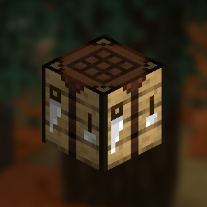
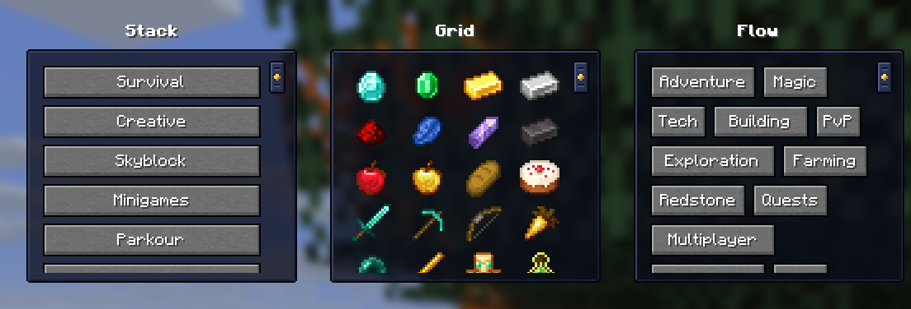

# 요소

요소는 레이아웃을 구성하는 부분입니다. 버튼, 텍스트, 이미지, 슬라이더, 음악 등이 여기에 해당합니다. 이 페이지에서는 모든 요소 유형과 주요 설정을 소개합니다.

> [!TIP]
> 화면에 기본으로 표시되는 버튼과 기타 요소는 [바닐라 요소](/vanilla-elements)입니다. 이 요소들도 이동하거나 변경하고 숨길 수 있습니다.

# 요소 추가하기

1. 레이아웃 편집기에서 빈 곳을 마우스 오른쪽 버튼으로 클릭한 다음 **새 요소**를 클릭합니다. 메뉴 표시줄의 **요소 -> 새로 만들기**에서도 같은 목록을 볼 수 있습니다.
2. 요소 유형을 클릭합니다. 유형에 마우스를 올리면 용도를 확인할 수 있습니다.

요소는 마우스 오른쪽 버튼을 클릭한 위치에 나타납니다. 드래그해서 이동하고, 가장자리를 드래그해서 크기를 조절한 다음, 마우스 오른쪽 버튼을 클릭해 설정을 엽니다.


요소를 선택하고 이동하고 복사하고 삭제하는 방법과 편집기의 모든 단축키는 [레이아웃 편집기](/layout-editor)를 참고하세요. 모든 창 크기에서 요소를 같은 위치에 유지하려면 [요소 위치 지정](/positioning-elements)을 읽어보세요. 요소를 다른 요소 앞이나 뒤에 배치하려면 [레이어와 그룹](/layout-editor#layers-and-groups)을 참고하세요.

# 모든 요소에 적용되는 설정

모든 요소에는 유형별 설정과 함께 마우스 오른쪽 버튼 메뉴에 다음 설정이 있습니다.

| 설정 | 기능 |
|---|---|
| **기준점** | 화면 모서리나 다른 요소 등 요소가 기준으로 삼을 위치입니다. [요소 위치 지정](/positioning-elements)을 참고하세요. |
| **고급 위치 지정** 및 **고급 크기 조정** | [자리표시자](/placeholders) 등을 사용해 위치와 크기를 계산합니다. [고급 위치 지정 및 크기 조정](/advanced-positioning-sizing)을 참고하세요. |
| **표시 조건** 및 **세션당 한 번만 불러오기** | [조건](/conditions)을 충족할 때만 요소를 표시하거나, 게임을 시작할 때 한 번만 표시합니다. [요소 표시 여부](/element-visibility)를 참고하세요. |
| **표시 지연** 및 **숨김 지연** | 요소가 나타나거나 사라지기 전에 몇 초간 기다립니다. [요소 표시 여부](/element-visibility#delaying-elements)를 참고하세요. |
| **페이드 인/아웃** 및 **불투명도** | 요소를 서서히 나타내거나 사라지게 하고, 투명하게 만듭니다. [요소 표시 여부](/element-visibility#fading-in-and-out)를 참고하세요. |
| **회전**, **수직 기울기** 및 **수평 기울기** | 요소를 회전하거나 기울입니다. [요소 회전 및 기울이기](/rotating-elements)를 참고하세요. |
| **시차 효과** | 마우스 움직임에 따라 요소를 약간 움직입니다. [시차 효과](/parallax)를 참고하세요. |
| **요소 ID 복사** | 액션, 자리표시자 및 다른 요소가 해당 요소를 찾을 때 사용하는 식별자를 복사합니다. [요소 식별자](/element-identifiers)를 참고하세요. |
| **편집기 표시 이름** | 레이어 목록에 표시되는 요소 이름입니다. |
| **AI용 내보내기** | 요소를 [AI 어시스턴트](/export-for-ai)용 텍스트로 변환합니다. |

# 모든 요소

용도별로 분류한 FancyMenu의 모든 요소입니다.

## 버튼과 입력

### 버튼

클릭하면 [액션 스크립트](/action-scripts)를 실행하는 버튼입니다. 서버 접속, 웹사이트 열기, 다른 메뉴 열기 등의 동작을 할 수 있습니다.


- **액션 스크립트 편집**: 버튼을 클릭했을 때 실행할 동작입니다.
- **레이블** 및 **마우스 오버 레이블**: 버튼에 표시되는 텍스트와 마우스를 올렸을 때 표시되는 텍스트입니다. 둘 다 [자리표시자](/placeholders)와 [텍스트 서식](/text-formatting)을 지원합니다.
- **레이블 정렬**: 버튼 레이블을 **왼쪽**, **가운데** 또는 **오른쪽**에 배치합니다. 버튼 너비보다 긴 레이블은 정렬 위치와 관계없이 좌우로 스크롤됩니다.
- **레이블 크기**, **레이블 기본 색상**, **레이블 마우스 오버 색상**, **레이블 그림자** 및 **마우스 오버 시 레이블 밑줄 표시**: 레이블의 크기, 색상 및 그림자를 설정합니다.
- **버튼 텍스처** 및 **버튼 아이콘 텍스처**: 버튼과 버튼에 표시할 아이콘에 사용할 사용자 지정 이미지를 설정합니다. 일반 상태, 마우스 오버 상태, 비활성 상태별로 설정할 수 있습니다. 크기를 자연스럽게 조정하는 텍스처는 [나인 슬라이싱 및 타일링](/nine-slicing-and-tiling)을 참고하세요.
- **마우스 오버 사운드**, **마우스 오버 해제 사운드** 및 **클릭 사운드**: 버튼에서 재생할 사운드입니다.
- **툴팁**: 버튼 위에 마우스를 올렸을 때 표시할 텍스트입니다.
- **활성 상태 제어**: 버튼을 클릭할 수 있게 하는 [조건](/conditions)입니다. 조건을 충족하지 않으면 버튼이 회색으로 표시됩니다.
- **템플릿 모드**: 화면의 다른 버튼과 슬라이더에 이 버튼의 스타일을 적용합니다. [버튼 및 슬라이더 템플릿](/button-slider-templates)을 참고하세요.

### 슬라이더

드래그해서 값을 선택하는 슬라이더입니다. 값이 바뀔 때마다 액션 스크립트를 실행합니다.


- **슬라이더 유형**:
  - **값 목록**: **목록 값**에 한 줄씩 입력한 텍스트를 순서대로 선택합니다. **목록 변수에서 값 가져오기**를 사용하면 [목록 변수](/variables#text-and-list-variables)에서 값을 가져옵니다.
  - **정수 범위**: **최솟값**부터 **최댓값**까지의 정수입니다.
  - **소수 범위**: 정수 대신 소수를 사용합니다. **반올림할 소수 자릿수**로 소수점 이하 자릿수를 지정합니다. `-1`은 반올림하지 않습니다.
- **슬라이더 레이블**: 슬라이더에 표시할 텍스트입니다. `$$value`를 사용하면 현재 값이 표시됩니다.
- **액션 스크립트 편집**: 값이 바뀔 때 실행할 스크립트입니다. `$$value`는 새 값을 나타냅니다.
- **초기 선택 값**: 슬라이더가 처음 표시될 때 사용할 값입니다. 슬라이더가 변경하는 값에 연결하면 화면이 열릴 때 올바른 값이 표시됩니다.

예를 들어 **정수 범위** 유형이고 범위가 `0`부터 `100`까지인 볼륨 슬라이더의 레이블을 `음악 볼륨: $$value%`로 설정하고, [**변수 값 설정(FM 변수)**](/action-scripts#set-variable-value-fm-variable) 액션에 다음 값을 지정할 수 있습니다.

```
music_volume:$$value
```

**초기 선택 값**은 `$$music_volume`으로 설정하면 플레이어가 마지막으로 선택한 값으로 시작합니다.

슬라이더에는 버튼과 같은 레이블, 텍스처, 사운드, 툴팁 및 **활성 상태 제어** 설정이 있습니다. 따라서 **레이블 정렬**을 사용해 레이블을 왼쪽이나 오른쪽에 배치할 수도 있습니다.

### 체크박스

플레이어가 체크하거나 체크 해제할 수 있는 상자입니다. 상태가 바뀔 때마다 액션 스크립트를 실행합니다.


- 액션 스크립트와 **활성 상태 제어** 조건에서 `$$value`는 `true` 또는 `false`입니다.
- **변수 모드** 및 **변수 연결**: 체크박스에 [변수](/variables)의 값이 표시되고, 변수에 `true` 또는 `false`를 기록합니다. 목록 변수에 연결하면 `true` 또는 `false`가 목록의 유일한 항목이 됩니다.
- 변수 모드를 사용하지 않으면 체크박스는 [프로필](/profiles)마다 별도로 상태를 기억합니다.
- **텍스처**: 상자와 체크 표시 아이콘에 사용할 사용자 지정 이미지를 지정합니다.

체크박스에는 버튼과 같은 툴팁, 사운드 및 **탐색 가능** 설정이 있습니다.

### 텍스트 입력 필드

서버 주소나 이름처럼 플레이어가 텍스트를 입력하는 필드입니다.


- **변수 연결**: 플레이어가 입력한 텍스트를 [변수](/variables)에 저장하고 변수의 값을 필드에 표시합니다. 목록 변수에 연결하면 입력한 텍스트가 목록 전체를 대체합니다.
- **입력 유형**: **텍스트**, **숫자만**, **소수만** 또는 **URL**입니다. 선택한 유형에 맞지 않는 문자는 입력할 수 없습니다.
- **안내 텍스트** 및 **안내 텍스트 색상**: 필드가 비어 있을 때 표시할 텍스트와 색상입니다.
- **최대 텍스트 길이**: 필드에 입력할 수 있는 최대 문자 수입니다.
- **배경색**, **테두리 색상**, **테두리 둥글기 반경** 및 **텍스트 색상**: 필드의 모양을 설정합니다.

예를 들어 필드를 `server_address`에 연결하고 버튼에 [**서버 접속**](/action-scripts#join-server) 액션과 `$$server_address` 값을 지정하면 플레이어가 원하는 서버에 접속할 수 있습니다.

변수에 연결하지 않은 경우 [**텍스트 입력 필드 값**](/placeholders#text-input-field-value) 자리표시자로 텍스트를 읽고, [**텍스트 입력 필드 값 설정**](/action-scripts#set-text-input-field-value) 액션으로 텍스트를 변경할 수 있습니다.

## 텍스트와 툴팁

### 텍스트

짧은 레이블부터 스크롤 가능한 규칙이나 패치 노트까지, 어떤 길이의 텍스트든 표시할 수 있습니다. [Markdown](/text-formatting)과 [자리표시자](/placeholders)를 지원합니다.


- **소스 모드**: 텍스트를 직접 입력하거나 파일 또는 웹사이트에서 불러옵니다.
- 원하는 모양을 시작점으로 선택할 수 있으며, 텍스트가 요소보다 길면 스크롤할 수 있습니다.
- **배경**: 텍스트 뒤에 어두운 패널을 표시합니다. **배경 표시**를 끄거나 사용자 지정 텍스처를 사용할 수 있습니다.

자세한 내용은 [메뉴의 텍스트](/text-in-menus)를 참고하세요.

### 툴팁

게임의 툴팁처럼 텍스트 상자를 표시합니다. [Markdown](/text-formatting)과 [자리표시자](/placeholders)를 지원합니다.


- 요소가 배치된 위치에 표시하거나 **마우스 따라가기**를 사용해 마우스 위치에 표시합니다.
- 버튼의 [**요소에 마우스 올림**](/conditions#is-element-hovered) 같은 **표시 조건**으로 표시 시점을 정할 수 있습니다.
- **툴팁 배경**: 어두운 상자 대신 사용자 지정 텍스처를 사용합니다.

자세한 내용은 [메뉴의 텍스트](/text-in-menus)를 참고하세요.

### 스플래시 텍스트

타이틀 화면에 표시되는 노란색 문구를 사용자 지정 텍스트로 바꿉니다.


- **소스 모드**: 바닐라 스플래시 문구, 직접 작성한 텍스트 또는 텍스트 파일의 임의 문장을 사용합니다.
- **튀어 오르기**, **크기**, **회전**, **텍스트 색상** 및 **그림자**: 표시 모양을 설정합니다.
- **화면을 불러올 때 새로 고침**: 화면을 열 때마다 새 스플래시 문구를 선택합니다.

자세한 내용은 [스플래시 텍스트](/splash-text)를 참고하세요.

## 이미지와 미디어

### 이미지

파일, 웹사이트 또는 게임 리소스의 이미지를 표시합니다. 애니메이션 이미지도 재생됩니다.


- **이미지 소스**: 표시할 이미지입니다. 지원하는 파일은 [이미지](/images)에 나와 있습니다.
- **종횡비 유지**: 이미지가 늘어나지 않도록 너비를 조정합니다.
- **나인 슬라이스 텍스처** 및 **텍스처 반복**: 테두리를 늘이지 않고 프레임 크기를 조정하거나 이미지를 타일처럼 반복합니다. [나인 슬라이싱 및 타일링](/nine-slicing-and-tiling)을 참고하세요.
- **이미지 색조 [HEX]**: 이미지에 색을 입힙니다.
- **모서리 둥글기 반경**: 이미지의 모서리를 둥글게 만듭니다.

### 슬라이드쇼

슬라이드쇼의 이미지를 차례대로 표시합니다. `config/fancymenu/slideshows/`에서 슬라이드쇼를 만들 수 있습니다. [슬라이드쇼](/slideshows)를 참고하세요.

- **슬라이드쇼**: 표시할 슬라이드쇼를 선택합니다.
- **종횡비 유지**: 이미지가 늘어나지 않도록 너비를 조정합니다.

### 동영상

트레일러나 움직이는 배경처럼 동영상 파일을 재생합니다.

> [!IMPORTANT]
> 동영상을 재생하려면 Watermedia V3 및 Watermedia Binaries V3 모드가 필요합니다. [동영상](/video)을 참고하세요.

- **동영상 소스**: 동영상 파일, 웹 링크 또는 게임 리소스입니다.
- **동영상 반복**, **볼륨** 및 **사운드 채널**: 재생 방식을 설정합니다.
- **레이아웃 편집기에서 동영상 재생**: 편집 중에도 동영상을 재생할지 설정합니다.
- [**동영상 요소 일시 정지 상태 전환**](/action-scripts#toggle-video-element-paused-state) 같은 액션으로 재생을 일시 정지하거나 특정 시점으로 이동하고 볼륨을 변경할 수 있습니다.

**동영상 [Rinku]**는 Rinku 모드가 필요한 이전 버전의 동영상 요소입니다. 기존 레이아웃에서는 계속 작동하지만 **새 요소** 목록에는 표시되지 않습니다.

### GLSL 셰이더

요소 안에서 사용자 지정 GLSL 셰이더를 실행합니다. Shadertoy의 움직이는 색상이나 효과 등을 사용할 수 있습니다.


- **셰이더 소스**: 셰이더 코드입니다. `mainImage`가 포함된 Shadertoy 셰이더는 그대로 사용할 수 있습니다.
- **컴파일 모드**: **자동**, **Shadertoy** 또는 **직접 프래그먼트**입니다.
- **버퍼 A 소스**부터 **버퍼 D 소스**까지: 버퍼를 사용하는 셰이더에 필요한 추가 패스입니다.

작성 방법은 [GLSL 셰이더 API](/glsl-shader-api)를 참고하세요.

### 브라우저

서버 지도나 위키 페이지처럼 웹사이트를 실시간으로 표시합니다.

> [!IMPORTANT]
> 브라우저를 사용하려면 [Rinku](https://modrinth.com/mod/rinku) 모드가 필요합니다([CurseForge](https://www.curseforge.com/minecraft/mc-mods/rinku)).

- **URL**: 웹사이트 주소입니다.
- **상호작용 가능**: 플레이어가 웹페이지에서 클릭하고 스크롤하고 입력할 수 있도록 합니다. 레이아웃 편집기에서는 상호작용할 수 없습니다.
- **브라우저 음소거**, **오디오/비디오 볼륨**, **동영상 반복** 및 **동영상 컨트롤 숨기기**: 페이지의 미디어를 설정합니다.

`config/fancymenu/assets/`의 HTML 파일을 불러오려면 URL을 `file:///`로 시작합니다.

```
file:///config/fancymenu/assets/changelog.html
```

Linux에서는 대신 [**절대 파일/폴더 경로**](/placeholders#absolute-filefolder-path) 자리표시자를 사용합니다.

```
file:///{"placeholder":"absolute_path","values":{"short_path":"/config/fancymenu/assets/changelog.html"}}
```

웹사이트에서는 액션을 실행하고 자리표시자를 읽을 수 있습니다. [브라우저 JavaScript API](/browser-api)를 참고하세요.

## 도형, 아이템 및 모델

### 사각형 도형

텍스트 뒤의 패널처럼 단색 사각형을 표시합니다.


- **색상**: HEX 색상입니다. 뒤에 두 자릿수를 더하면 `#101828C8`처럼 투명도를 설정할 수 있습니다.
- **모서리 둥글기 반경**: 모든 모서리를 한꺼번에 또는 각각 둥글게 만듭니다.
- **흐림** 및 **흐림 강도**: 뒤에 있는 것을 흐리게 표시합니다.

### 원형 도형

상태 표시등처럼 단색 원이나 타원을 표시합니다.


- **색상**, **흐림** 및 **흐림 강도**: 사각형 도형과 동일합니다.
- **둥근 정도**: `2`는 원을 만듭니다. 값이 크면 사각형에 가까워지고, 작으면 더 뾰족해집니다.

### 아이템

인벤토리에서처럼 Minecraft 또는 모드 아이템을 표시합니다.


- **아이템 키**: 아이템을 지정합니다. 예: `minecraft:diamond_sword`.
- **아이템 개수**, **아이템 이름**, **아이템 설명** 및 **마법 부여됨**: 실제 아이템과 같은 속성입니다.
- **아이템 툴팁 표시**: 마우스를 아이템 위에 올리면 툴팁을 표시합니다.
- **사용자 지정 NBT 데이터**: 아이템 데이터를 추가합니다. `/give` 명령어에서 아이템 바로 뒤에 오는 부분과 같은 형식으로 작성합니다.

### 블록/아이템 JSON 모델

게임 리소스나 사용자 지정 JSON 파일의 블록 또는 아이템 모델을 3D로 표시합니다.



- **모델**: `minecraft:models/block/crafting_table.json` 같은 **모델 소스**입니다.
- **텍스처**: 모델의 텍스처를 사용자 지정 텍스처로 대체합니다.
- **변환**: 모델의 크기를 조정하고 회전하고 이동합니다.
- **조명**: **광원 색조 [HEX]**로 모델에 비추는 빛의 색상을 설정합니다.

### 플레이어 엔티티

타이틀 화면에 플레이어 캐릭터를 표시하는 것처럼 플레이어를 3D로 보여줍니다.


> [!IMPORTANT]
> 플레이어 엔티티를 사용하려면 Fancy Entity Renderer 모드가 필요합니다([CurseForge](https://www.curseforge.com/minecraft/mc-mods/fancy-entity-renderer), [Modrinth](https://modrinth.com/mod/fancy-entity-renderer)). 모드가 없으면 플레이어 대신 오류가 표시됩니다.

- **클라이언트 플레이어 복사**: 게임을 플레이 중인 사용자의 스킨과 이름을 표시합니다.
- **플레이어 이름**, **스킨 텍스처** 및 **망토 텍스처**: 다른 플레이어나 스킨을 지정합니다.
- **엔티티 자세**, **머리가 마우스를 따라감** 및 **몸이 마우스를 따라감**: 서 있는 자세와 시선을 설정합니다.
- **방어구와 도구**, **앵무새**, **아기 엔티티** 및 **플레이어 이름 표시**: 착용하거나 표시할 항목을 설정합니다.

자세한 내용은 [플레이어 엔티티](/player-entities)를 참고하세요. 머리만 표시하려면 [플레이어 머리](/player-heads)를 참고하세요.

### 진행 표시줄

로딩 표시줄처럼 채워지는 막대입니다.


- **진행 값 소스**: 채워진 정도를 지정합니다. 여기서 [자리표시자](/placeholders)를 사용할 수 있습니다. 예를 들어 월드 로딩 화면에서 [**월드 로딩 진행률**](/placeholders#world-loading-progress)을 사용할 수 있습니다.
- **진행 값 모드**: **백분율(0-100)** 또는 **부동 소수점(0.0-1.0)**입니다.
- **방향**: 막대가 채워지는 방향입니다.
- **막대 색상** 및 **배경색**, 또는 **막대 텍스처** 및 **배경 텍스처**를 설정합니다.
- **부드러운 채우기 애니메이션**: 값이 바뀔 때 바로 이동하지 않고 부드럽게 움직입니다.
- **진행 상태를 요소 기준점으로 사용**: 막대에 고정된 요소가 채워진 부분의 끝을 따라 이동합니다.

## 레이아웃 보조 요소

### 스크롤 영역

서버 목록이나 긴 정보 페이지처럼 다른 요소를 담고 스크롤할 수 있는 영역입니다.



- 레이아웃 편집기에서 요소를 스크롤 영역 안으로 끌어다 놓습니다. 사용자 지정 요소만 넣을 수 있으며 바닐라 요소는 넣을 수 없습니다.
- **배치 방식**: 요소를 직접 배치하거나 영역에서 세로 목록, 격자 또는 흐름 형태로 정렬하도록 설정합니다.
- **배경**: 영역 뒤에 어두운 패널을 표시합니다. **배경 표시**를 끄거나 사용자 지정 텍스처를 사용할 수 있습니다.

자세한 내용은 [스크롤 영역](/scrollable-areas)을 참고하세요.

### 드래거

편집기 밖에서 플레이어가 잡고 이동할 수 있는 영역입니다. 이 영역에 고정된 요소도 함께 움직여 이동식 정보 패널처럼 사용할 수 있습니다. 편집기 밖에서는 표시되지 않습니다.

**사용자 드래그 오프셋 저장**을 사용하면 화면을 닫고 게임을 다시 시작한 뒤에도 새 위치가 유지됩니다. 자세한 내용은 [드래거](/dragger)를 참고하세요.

### 요소 애니메이터

키프레임을 사용해 다른 요소를 이동하고 크기를 조정합니다. 예를 들어 패널이 화면 안으로 미끄러져 들어오게 만들 수 있습니다. 편집기 밖에서는 표시되지 않습니다.

- **대상 요소 관리**: 애니메이션을 적용할 요소를 지정합니다.
- **키프레임 편집**: 키프레임 편집기를 엽니다.
- **애니메이션 반복**: 애니메이션이 끝나면 다시 시작합니다.

자세한 내용은 [요소 애니메이터](/element-animator)를 참고하세요.

## 보이지 않는 요소

이 요소들은 레이아웃 편집기에서만 표시됩니다.

### 티커

화면이 열려 있는 동안 액션 스크립트를 반복 실행합니다.

> [!IMPORTANT]
> 반복 실행하거나 일정 시간이 지난 뒤 실행할 작업에는 [스케줄러](/schedulers)를 사용하는 것이 좋습니다. 가능하면 티커 대신 스케줄러를 사용하세요. 스케줄러는 모든 화면에서, 화면이 없을 때도 작동합니다. 모든 액션을 사용할 수 있으며 액션으로 스케줄러를 시작하고 중지할 수 있습니다.

티커로 실행하던 작업을 스케줄러로 구현하는 방법은 다음과 같습니다.

- 화면이 열려 있는 동안 계속 실행: **틱 지연(ms)**을 지정한 스케줄러를 사용합니다. 레이아웃의 **'화면 열기' 액션 스크립트 편집**에서 [**스케줄러 시작**](/action-scripts#start-scheduler)으로 시작하고, **'화면 닫기' 액션 스크립트 편집**에서 [**스케줄러 중지**](/action-scripts#stop-scheduler)로 중지합니다. 두 설정 모두 편집기 배경의 마우스 오른쪽 버튼 메뉴에 있습니다.
- 게임을 시작할 때 한 번 실행: **시작 시 실행**과 **실행할 틱 수**를 `1`로 설정한 스케줄러를 사용합니다.
- 화면을 열 때마다 한 번 실행: 티커나 스케줄러가 필요하지 않습니다. **'화면 열기' 액션 스크립트 편집**에 액션을 넣습니다.

티커 설정:

- **틱 지연[ms]**: 두 번 실행되는 사이의 시간입니다. 단위는 밀리초입니다. `0`으로 설정하면 틱마다 실행되며 초당 20회 실행됩니다.
- **틱 모드**: **일반**은 계속 실행합니다. **세션**은 게임을 다시 시작할 때까지 한 번만 실행합니다. **화면 불러올 때**는 창 크기가 바뀌는 경우를 포함해 화면을 열 때마다 한 번 실행합니다.
- **비동기**: 백그라운드에서 실행합니다. 대부분의 액션은 이 방식으로 실행할 수 없으며 오류가 표시됩니다.

### 오디오

화면이 열려 있는 동안 음악이나 사운드를 트랙 순서에 따라 재생합니다.

- **트랙 관리**: 오디오 파일과 재생 순서, 무작위 재생을 위한 **트랙 가중치**를 설정합니다.
- **재생 모드**: **일반**은 순서대로 재생하고, **셔플**은 무작위 순서로 재생합니다.
- **트랙 반복**, **볼륨** 및 **사운드 채널**: 재생 방식을 설정합니다.

화면이 바뀌어도 음악을 계속 재생하려면 오디오 요소를 [범용 레이아웃](/universal-layouts)에 넣으세요. 자세한 내용은 [메뉴 배경 음악](/background-music)을 참고하세요.

### 음악 컨트롤러

현재 화면에서 게임 자체의 음악을 끕니다.

- **메뉴 음악 재생**: 월드가 불러와지지 않은 동안 타이틀 화면처럼 메뉴에서 재생되는 음악입니다.
- **월드 음악 재생**: 인벤토리처럼 메뉴에 진입한 뒤에도 계속 재생되는 월드 음악입니다.

화면이 열려 있는 동안에만 작동합니다.

### 커서

화면이 열려 있는 동안 마우스 커서를 사용자 지정 이미지로 바꿉니다.

- **커서 텍스처**: 32×32픽셀 같은 PNG 이미지입니다.
- **핫스팟 X 좌표** 및 **핫스팟 Y 좌표**: 화살표 끝부분처럼 클릭이 인식되는 이미지상의 픽셀을 지정합니다.
- **편집기 미리 보기 모드**: 마우스가 요소 위에 있을 때 편집기에 커서를 표시합니다.

자세한 내용은 [사용자 지정 커서](/custom-cursor)를 참고하세요.
