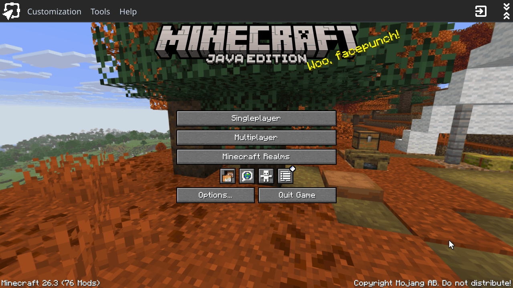
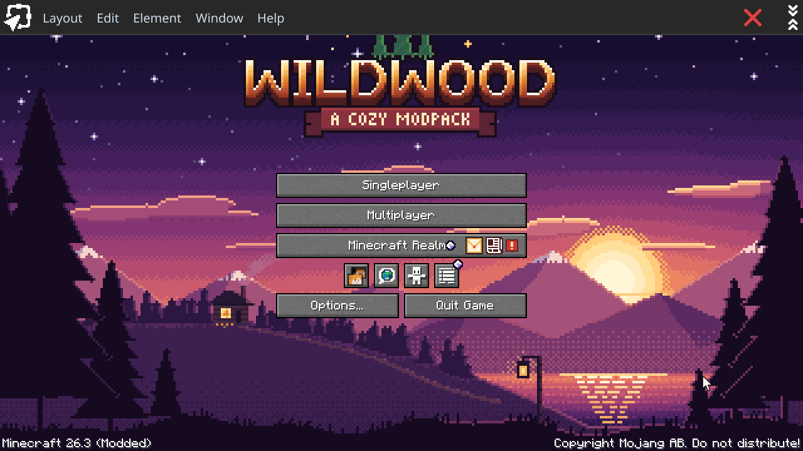

# 시작하기

FancyMenu를 사용하면 Minecraft의 모든 메뉴를 바꿀 수 있습니다. 타이틀 화면, 일시 정지 메뉴, 다른 모드의 메뉴도 포함됩니다. 나만의 배경, 로고, 버튼, 텍스트, 사운드, 애니메이션을 추가하고, 기존 요소를 이동하거나 숨기고, 버튼에 새로운 기능을 지정하거나 완전히 새로운 메뉴를 만들 수도 있습니다. 이 모든 작업은 코드 없이 게임 안에서 할 수 있습니다.

이 페이지에서는 기본 기능을 단계별로 살펴봅니다. 따라 하면서 이 타이틀 화면의 간단한 버전을 만들고, [예시 화면 만들기](#how-the-example-is-made)에서 완성본에 추가된 요소를 확인할 수 있습니다.

> [!TIP]
> 이 타이틀 화면을 자신의 게임에서 사용해 보세요. [wildwood_title_screen.fmp](https://raw.githubusercontent.com/Keksuccino/docs_fancymenu/refs/heads/wiki-2026/assets/wildwood_title_screen.fmp?raw=true)를 다운로드한 다음, **메뉴 표시줄 -> 사용자 지정 -> 프로필**에서 [가져오기](/profiles#importing)한 뒤 [불러오세요](/profiles#loading-a-profile). FancyMenu를 체험하거나, 배우거나, 모드팩을 만드는 등 어떤 용도로든 무료로 사용할 수 있으며 수정해도 됩니다. 출처를 표시하지 않아도 됩니다.

# 메뉴 표시줄

모든 메뉴의 맨 위에 있는 메뉴 표시줄에서 FancyMenu의 모든 기능을 사용할 수 있습니다.

- **사용자 지정**: 현재 메뉴의 레이아웃과 전체 설정을 관리합니다. [전역 사용자 지정](/global-customizations), [사용자 지정 GUI](/custom-guis), [변수](/variables), [리스너](/listeners), [스케줄러](/schedulers), [프로필](/profiles), FancyMenu 설정 등이 있습니다.
- **도구**: [더미 화면 인스턴스](/dummy-screen-instances), [AFMA 생성기](/animations#fma-and-afma), **게임 리소스 둘러보기**, **FancyMenu 디렉터리 열기** 등의 도구를 제공합니다. 마지막 항목을 누르면 설정 폴더가 열립니다([데이터 저장 위치](/data-storage-locations) 참고).
- **도움말**: 이 문서, Discord 서버, **버그 신고**, [AI용으로 내보내기](/export-for-ai)를 이용할 수 있습니다.
- 오른쪽의 문 아이콘은 나갈 방법이 없는 메뉴를 닫습니다.
- 맨 오른쪽의 양방향 화살표를 누르면 메뉴 표시줄을 작은 버튼으로 접거나 다시 펼칠 수 있습니다.

모드팩을 플레이하는 데 메뉴 표시줄은 필요하지 않습니다. 끄는 방법은 [모드팩](/modpacks#disabling-the-menu-bar-and-hotkeys)을 참고하세요.

## 메뉴 표시줄 바로 가기

이 바로 가기는 레이아웃 편집기와 모드팩 모드가 켜져 있을 때를 제외한 모든 메뉴에서 작동합니다. macOS에서는 `Ctrl + Alt` 대신 `Cmd + Option`을 사용하세요.

| 바로 가기 | 기능 |
|---|---|
| `Ctrl + Alt + C` | 메뉴 표시줄을 표시하거나 숨깁니다. 갑자기 메뉴 표시줄이 사라졌다면 이 바로 가기로 다시 표시하세요. |
| `Ctrl + Alt + R` | **메뉴 표시줄 -> 사용자 지정 -> FancyMenu 다시 불러오기**와 같이 FancyMenu를 다시 불러옵니다. |
| `Ctrl + Alt + D` | 메뉴의 [식별자](/screen-identifiers) 등을 보여 주는 **디버그 오버레이**를 표시하거나 숨깁니다. |
| `Ctrl + Alt + L` | 마지막으로 편집한 레이아웃을 [레이아웃 편집기](/layout-editor)에서 엽니다. |

# 첫 레이아웃 만들기

레이아웃에는 메뉴에 적용한 변경 사항이 저장됩니다. 배경, 추가한 요소, 기존 버튼과 텍스트에 적용한 변경 사항이 포함됩니다. 메뉴 하나에 여러 레이아웃을 만들고 각각 켜거나 끌 수 있습니다.

## 레이아웃 만들기

1. 타이틀 화면처럼 변경하려는 메뉴를 엽니다.
2. **메뉴 표시줄 -> 사용자 지정 -> 현재 화면 사용자 지정**을 눌러 **활성화됨**으로 표시되게 합니다. FancyMenu는 이 기능이 켜진 메뉴만 변경합니다.
3. **메뉴 표시줄 -> 사용자 지정 -> 레이아웃 -> 새로 만들기 -> 현재 화면용**을 누릅니다.

레이아웃 편집기가 열립니다. 플레이어에게 보이는 모습 그대로 메뉴가 표시되므로 변경 사항을 바로 확인할 수 있습니다. 요소 이동, 크기 조절, 복사 등 편집기의 모든 기능은 [레이아웃 편집기](/layout-editor)를 참고하세요.

**모든 화면용 [범용]**을 선택하면 모든 메뉴에 표시되는 [범용 레이아웃](/universal-layouts)이 만들어집니다.

## 배경 설정하기

먼저 게임의 `config/fancymenu/assets` 폴더에 이미지를 넣습니다. **메뉴 표시줄 -> 도구 -> FancyMenu 디렉터리 열기**를 누르면 `config/fancymenu` 폴더가 열립니다.

1. 편집기 배경을 마우스 오른쪽 버튼으로 클릭한 다음 **메뉴 배경 -> 이미지**를 엽니다.
2. **배경 표시**를 눌러 **활성화됨**으로 표시되게 합니다.
3. **이미지 선택**을 누르고 **소스 유형**을 **로컬**로 설정한 뒤 **로컬 리소스 파일 선택**을 누릅니다.
4. 이미지를 선택하고 **확인**을 누릅니다. 폴더는 두 번 클릭해서 엽니다.

배경으로 파노라마, 슬라이드 쇼, 동영상, 단색 등을 사용할 수도 있습니다. [메뉴 배경](/menu-backgrounds)을 참고하세요.

## 로고 추가하기

1. Minecraft 로고를 클릭하고 `Delete`를 누릅니다. 노란색 스플래시 텍스트도 똑같이 삭제합니다.
2. 편집기의 메뉴 표시줄에서 **요소 -> 새로 만들기 -> 이미지**를 누릅니다.
3. 새 요소를 마우스 오른쪽 버튼으로 클릭하고 **이미지 소스**를 누른 다음, 배경 이미지를 선택한 것처럼 로고를 선택합니다.

기본 게임 요소를 삭제해도 실제로는 숨겨집니다. **요소 -> 삭제된 기본 게임 요소**에서 다시 표시할 수 있습니다.

4. 로고를 다시 마우스 오른쪽 버튼으로 클릭하고 **종횡비 복원**을 눌러 눌린 모양을 바로잡습니다. `Esc`를 누르면 메뉴가 닫힙니다.
5. 로고를 원하는 위치로 끌어다 놓습니다.

버튼, 텍스트, 동영상, 플레이어 등 다양한 요소를 더 추가할 수 있습니다. [요소](/elements)를 참고하세요.

## 버튼 변경하기

1. 첫 번째 버튼을 클릭한 뒤 `Ctrl`(`Cmd`는 macOS)을 누른 채 나머지 버튼을 클릭해 모두 선택합니다. 선택한 버튼 중 하나를 마우스 오른쪽 버튼으로 클릭하면 선택된 버튼을 한꺼번에 변경할 수 있습니다.
2. 버튼 중 하나를 마우스 오른쪽 버튼으로 클릭하고 **버튼 텍스처 -> 설정 -> 기본 배경**을 누른 뒤, 배경 이미지를 선택한 것처럼 텍스처를 선택합니다.

3. 마우스를 버튼 위에 올렸을 때 사용할 텍스처인 **마우스 오버 배경**에도 같은 작업을 합니다.
4. **버튼 텍스처 -> 9분할 사용자 지정 배경**을 눌러 **활성화됨**으로 표시되게 합니다. 버튼 너비가 달라져도 텍스처 가장자리를 선명하게 유지합니다. [9분할](/nine-slicing-and-tiling)을 참고하세요.

여러 요소를 선택한 상태에서 마우스 오른쪽 버튼을 클릭하면, 모든 요소에 공통으로 적용되는 설정만 표시됩니다. 버튼만 선택하세요. 버튼 하나를 마우스 오른쪽 버튼으로 클릭하면 레이블, 사운드, 클릭했을 때 실행할 동작([액션 스크립트](/action-scripts)), 표시 조건([요소 표시 여부](/element-visibility)) 등 모든 설정을 확인할 수 있습니다. [기본 게임/모드 요소](/vanilla-elements)를 참고하세요.

## 저장하기

1. `Ctrl + S`(macOS에서는 `Cmd + S`)를 누르거나 **레이아웃 -> 저장**을 클릭합니다.
2. 처음 저장할 때는 FancyMenu에서 파일 이름을 입력하라고 합니다. 기존 이름을 사용하거나 새 이름을 입력한 뒤 **저장**을 누릅니다.
3. 편집기 메뉴 표시줄 오른쪽의 X를 눌러 편집기를 닫습니다.

레이아웃은 즉시 메뉴에 표시됩니다. 나중에 변경하려면 **메뉴 표시줄 -> 사용자 지정 -> 레이아웃**에서 레이아웃 위에 마우스를 올리고 **레이아웃 편집**을 클릭하거나 `Ctrl + Alt + L`을 누릅니다.

# 예시 화면 만들기

페이지 위쪽의 타이틀 화면에는 직접 만든 화면에 다음 요소가 더해져 있습니다.

- 하늘, 언덕, 나무는 각각 이미지로 되어 있으며 마우스 움직임에 따라 움직입니다. 나무가 가장 크게 움직입니다. [시차 효과](/parallax)를 참고하세요.
- 언덕과 나무는 화면만큼 큰 이미지 요소입니다. 따라서 버튼과 텍스트 뒤에 표시됩니다. 편집기 배경을 마우스 오른쪽 버튼으로 클릭했을 때 나오는 메뉴에서 **기본 게임 요소 뒤에 사용자 지정 요소 표시**가 켜져 있습니다.
- 반딧불이는 [장식 오버레이](/decoration-overlays#fireflies)입니다.
- 언덕, 나무, 로고의 크기는 화면 크기에 따라 달라집니다. 자리 표시자를 사용한 [고급 위치 지정 및 크기 조절](/advanced-positioning-sizing)을 통해 모든 창 크기에 맞게 표시됩니다. 로고는 화면이 낮을수록 작아져 버튼을 가리지 않습니다.

레이아웃 편집기에서 모든 요소를 확인하려면 [예시 프로필](#getting-started)을 불러온 다음 해당 레이아웃을 편집하세요.

# 다음 단계

**멋진 모습 만들기**

- [요소](/elements): 메뉴에 추가할 수 있는 모든 항목입니다.
- [요소 배치](/positioning-elements): 모든 창 크기에서 요소를 제자리에 유지합니다.
- [메뉴 배경](/menu-backgrounds), [애니메이션](/animations), [동영상](/video), [장식 오버레이](/decoration-overlays), [배경 음악](/background-music).

**기능 추가하기**

- [액션 스크립트](/action-scripts): 버튼과 다른 요소가 수행하는 동작을 설정합니다.
- [요소 표시 여부](/element-visibility)와 [조건](/conditions): 특정 상황에서만 요소를 표시합니다.
- [자리 표시자](/placeholders): 플레이어 이름처럼 실시간으로 바뀌는 정보를 텍스트에 표시합니다.
- [변수](/variables), [리스너](/listeners), [스케줄러](/schedulers): 값을 저장하고, 게임에 반응하며, 일정 시간 간격으로 작업을 실행합니다.

**더 많은 기능 만들기**

- [사용자 지정 GUI](/custom-guis): 완전히 새로운 메뉴를 만듭니다.
- [범용 레이아웃](/universal-layouts): 모든 메뉴에 적용할 변경 사항을 설정합니다.
- [전역 사용자 지정](/global-customizations): 창 제목처럼 게임 전체에 적용되는 설정을 변경합니다.
- [로딩 화면](/loading-screen)과 [게임 인트로](/game-intro).

**공유하기**

- [모드팩](/modpacks): 설정을 모드팩에 포함합니다.
- [프로필](/profiles): 설정을 전환하고 내보냅니다.

# 도움말 보기

- [FAQ](/faq)에서 자주 묻는 질문의 답변을 확인할 수 있습니다.
- **메뉴 표시줄 -> 도움말 -> Discord 참여**를 클릭하면 FancyMenu Discord 서버로 이동합니다.
- [AI용으로 내보내기](/export-for-ai)를 사용하면 Discord 서버의 지원 봇처럼 AI 채팅에 사용할 수 있도록 설정을 텍스트로 변환합니다.
- 문제가 발생하면 **메뉴 표시줄 -> 도움말 -> 버그 신고**를 선택하세요.

# 개발자 안내

FancyMenu 애드온을 만들거나 자신의 모드에서 FancyMenu를 사용하려면 [개발자 문서](https://github.com/Keksuccino/FancyMenu-Dev-Docs/wiki)를 참고하세요.
