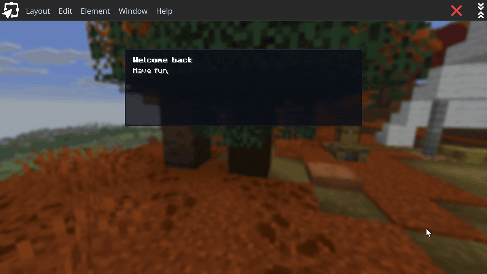

# 자리표시자

자리표시자는 FancyMenu가 플레이어 이름, 시간, 서버 플레이어 수와 같은 실시간 값으로 바꿔 주는 짧은 코드입니다. 요소의 텍스트, 버튼 레이블, 툴팁, 작업 및 요구 사항의 값과 입력할 수 있는 대부분의 텍스트에서 사용할 수 있습니다.



> [!TIP]
> 직접 만든 [변수](/variables)도 같은 텍스트에서 사용할 수 있습니다. `$$` 뒤에 변수 이름을 입력하세요. 예: `$$coins`.

# 자리표시자 추가하기

1. 텍스트 편집기에서 텍스트를 엽니다. 예를 들어 [텍스트 요소](/text-in-menus)의 **Text Content**를 엽니다. 작업의 값처럼 창에 있는 텍스트 필드 옆에는 **Open in Editor** 버튼이 있습니다.
2. 자리표시자를 넣을 위치를 클릭합니다.
3. 텍스트 편집기의 오른쪽 위에서 **Placeholders**를 클릭합니다.
4. 카테고리를 클릭하거나 이름, 식별자 또는 설명으로 검색합니다. **BACK**을 클릭하면 카테고리 목록으로 돌아갑니다. 카테고리가 없는 자리표시자는 카테고리 아래에 표시됩니다.
5. 자리표시자 위에 마우스를 올려 기능을 확인한 다음 클릭하여 추가합니다.
6. **Mod Version**의 모드 ID처럼 예시로 입력된 값을 바꿉니다.

텍스트 편집기에 **Placeholders** 버튼이 없는 텍스트에서는 자리표시자를 사용할 수 없습니다.

# 자리표시자의 작동 방식

자리표시자는 다음과 같은 형식입니다.

```
{"placeholder":"playername"}
```

설정이 있는 자리표시자의 값은 `values`에 지정합니다.

```
{"placeholder":"modversion","values":{"modid":"fancymenu"}}
```

- `playername`과 같은 식별자는 대소문자를 구분합니다. 아래 각 자리표시자에는 식별자와 값이 나와 있습니다.
- 값의 순서는 중요하지 않습니다. 선택 사항으로 표시된 값은 생략할 수 있습니다.
- 오타가 있는 경우처럼 FancyMenu가 바꿀 수 없는 자리표시자는 입력한 그대로 텍스트에 남습니다.
- 자리표시자는 항상 텍스트를 반환합니다. 표시할 값이 없으면 `0`, `0.0`, `---` 또는 빈 문자열과 같은 대체 값을 반환합니다.
- [서식 코드](/text-formatting)는 자리표시자 앞뒤에서 사용할 수 있습니다. `&6{"placeholder":"playername"}`은 이름을 금색으로 표시합니다.

> [!IMPORTANT]
> 자리표시자는 JSON처럼 보이지만 JSON이 아닙니다. 자리표시자를 JSON 포매터나 검사기에 넣지 마세요. 다른 자리표시자 안에 포함된 자리표시자는 유효한 JSON이 아닙니다.

## 자리표시자 안의 자리표시자

값에는 다른 자리표시자와 [변수](/variables#showing-variables-in-text)를 넣을 수 있습니다. FancyMenu는 안쪽에 있는 항목부터 바꿉니다. 값 안의 따옴표는 이스케이프할 필요가 없습니다.

다음 예시는 최대 RAM 값을 MB에서 GB로 변환합니다.

```
{"placeholder":"calc","values":{"decimal":"true","expression":"{"placeholder":"maxram"} / 1024"}}
```

다음 예시는 `rank` 변수를 대문자로 표시합니다.

```
{"placeholder":"uppercase_text","values":{"text":"$$rank"}}
```

자리표시자가 [**File Text**](#file-text)로 읽은 파일처럼 자리표시자가 포함된 텍스트를 반환하면 FancyMenu는 그 안의 자리표시자도 바꿉니다.

# 알아 두면 좋은 점

- 자리표시자는 자동으로 갱신됩니다. FancyMenu는 바꾼 텍스트를 30밀리초 동안 캐시한 다음 자리표시자를 다시 바꿉니다. **menu bar -> Customization -> Settings**에서 **Placeholder Caching Duration [MS]**를 변경할 수 있습니다. 값을 `0`으로 설정하면 매 프레임마다 바뀌므로 성능 부담이 커집니다.
- **Web Text**나 **Server Status**처럼 웹사이트, 파일 또는 서버를 읽는 자리표시자는 백그라운드에서 로드됩니다. 로드가 끝날 때까지 빈 값이나 대체 값을 반환합니다.
- [작업](/action-scripts)에서는 작업이 실행되는 순간의 값을 반환합니다.
- 월드, 화면, 요소와 관련된 자리표시자는 게임의 메인 스레드에서만 작동합니다. 백그라운드에서 실행되는 비동기 [Ticker](/elements#ticker)에서는 FancyMenu가 오류를 표시합니다.
- **Random Number**는 텍스트가 갱신될 때마다 새 숫자를 반환합니다. 숫자를 유지하려면 [**Set Variable Value (FM Variable)**](/action-scripts#set-variable-value-fm-variable)를 사용해 [변수](/variables)에 저장하세요.

> [!CAUTION]
> **JSON Parser**, **File Text**, **Clipboard Content**와 같은 자리표시자는 게임 폴더의 파일과 클립보드를 읽을 수 있습니다. 웹사이트에 연결하는 작업과 함께 사용하면 레이아웃이 해당 데이터를 외부로 전송할 수 있습니다. 신뢰할 수 있는 레이아웃만 사용하세요.

# 예시

## 환영 패널


```
### Welcome back, {"placeholder":"playername"}!
Minecraft {"placeholder":"mcversion"} with {"placeholder":"loadedmods"} mods
It's {"placeholder":"realtimehour"}:{"placeholder":"realtimeminute"}
```

## 서버 상태 및 플레이어 수

```
Survival: {"placeholder":"serverstatus","values":{"ip":"play.example.net"}}&r, {"placeholder":"serverplayercount","values":{"ip":"play.example.net"}} players
```

## 날짜 및 시간

```
{"placeholder":"realtimeday"}.{"placeholder":"realtimemonth"}.{"placeholder":"realtimeyear"}, {"placeholder":"realtimehour"}:{"placeholder":"realtimeminute"}
```

## RAM 사용량

```
RAM: {"placeholder":"usedram"} / {"placeholder":"maxram"} MB ({"placeholder":"percentram"}%)
```

# 모든 자리표시자

FancyMenu에서 사용할 수 있는 모든 자리표시자입니다. 자리표시자 메뉴의 큰 **Advanced** 및 **World** 카테고리는 여기에서 더 작은 그룹으로 나누었습니다.

## 변수 및 목록

이 항목은 **Advanced** 카테고리에 있습니다. 변수와 목록을 만드는 방법은 [변수](/variables)를 참조하세요.

### 변수 값 가져오기 (FM Variable)

**식별자:** `getvariable`

변수의 값입니다. 변수가 비어 있거나 존재하지 않으면 `0`을 반환하므로 숫자를 다룰 때 유용합니다. 목록은 `["Steve","Alex"]`와 같은 JSON 배열로 모든 항목을 반환합니다.

- `name`: `$$`를 제외한 변수 이름

```
{"placeholder":"getvariable","values":{"name":"clicks"}}
```

### 목록 항목 가져오기 (FM Variable)

**식별자:** `list_get`

목록 변수의 항목 하나를 가져옵니다.

- `name`: 목록 이름
- `index`: 항목의 위치입니다. 첫 항목은 `0`이며, 음수는 끝에서부터 셉니다. 따라서 `-1`은 마지막 항목입니다.
- `fallback`(선택 사항): 해당 위치에 항목이 없거나 이름이 일치하는 목록이 없을 때 반환할 값입니다. 기본값은 빈 문자열입니다.

```
{"placeholder":"list_get","values":{"name":"tips","index":"0","fallback":"No tips yet"}}
```

### 목록 크기 (FM Variable)

**식별자:** `list_size`

목록에 있는 항목 수입니다. 해당 이름의 목록이 없으면 `0`을 반환합니다.

- `name`: 목록 이름

```
{"placeholder":"list_size","values":{"name":"tips"}}
```

### 목록 항목의 인덱스 (FM Variable)

**식별자:** `list_index_of`

`value`와 완전히 일치하는 첫 번째 항목의 인덱스입니다. 목록에 해당 항목이 없으면 `-1`을 반환합니다.

- `name`: 목록 이름
- `value`: 찾을 항목
- `ignore_case`(선택 사항): `true`이면 `Apple`과 `apple`을 같은 값으로 처리합니다. 기본값은 `false`입니다.

```
{"placeholder":"list_index_of","values":{"name":"read_news","value":"news_42","ignore_case":"false"}}
```

### 목록 항목 합치기 (FM Variable)

**식별자:** `list_join`

목록의 모든 항목을 하나의 텍스트로 반환합니다. 해당 이름의 목록이 없으면 빈 문자열을 반환합니다.

- `name`: 목록 이름
- `separator`(선택 사항): 항목 사이에 넣을 텍스트입니다. `\n`은 줄바꿈입니다. 기본값은 `, `입니다.

```
{"placeholder":"list_join","values":{"name":"tips","separator":"\n"}}
```

## 수학

이 항목은 **Advanced** 카테고리에 있습니다. 소수점에는 `2.5`처럼 점을 사용합니다.

### 계산기

**식별자:** `calc`

`2 + 3 * 4`와 같은 수식을 계산합니다.

- `expression`: 계산할 수식
- `decimal`(선택 사항): `false`이면 결과를 정수로 반올림합니다. 기본값은 `true`이며, 이 경우 `14.0`과 같은 결과를 반환합니다.

```
{"placeholder":"calc","values":{"decimal":"false","expression":"{"placeholder":"usedram"} * 100 / {"placeholder":"maxram"}"}}
```

| 수식에서 사용 | 기능 |
|---|---|
| `+` `-` `*` `/` | 더하기, 빼기, 곱하기, 나누기 |
| `^` | 거듭제곱. 예: `2 ^ 3`은 8 |
| `%` | 나머지. 예: `7 % 3`은 1 |
| `( )` | 계산 순서를 묶습니다. 예: `(2 + 3) * 4` |
| `pi`, `e` | π와 e 값 |
| `abs(x)` | 부호를 제외한 숫자 |
| `sqrt(x)`, `cbrt(x)` | 제곱근, 세제곱근 |
| `pow(x, y)` | x의 y제곱 |
| `floor(x)`, `ceil(x)` | 내림, 올림 |
| `sin(x)`, `cos(x)`, `tan(x)`, `cot(x)` | 삼각 함수. 각도는 라디안 단위입니다. |
| `asin(x)`, `acos(x)`, `atan(x)` | 역삼각 함수 |
| `sinh(x)`, `cosh(x)`, `tanh(x)` | 쌍곡선 함수 |
| `log(x)`, `log2(x)`, `log10(x)` | 밑이 각각 e, 2, 10인 로그 |
| `exp(x)` | e의 x제곱 |
| `signum(x)` | [**Sign (Math)**](#sign-math)와 같이 `1`, `-1` 또는 `0`을 반환합니다. |

### 난수

**식별자:** `random_number`

`min`과 `max` 사이의 임의의 정수입니다. 텍스트가 갱신될 때마다 값이 바뀝니다.

- `min`, `max`: 최솟값과 최댓값

```
{"placeholder":"random_number","values":{"min":"1","max":"6"}}
```

### 최댓값

**식별자:** `maxnum`

두 숫자 중 더 큰 값을 반환합니다.

- `first`, `second`: 비교할 숫자

```
{"placeholder":"maxnum","values":{"first":"$$score","second":"$$best_score"}}
```

### 최솟값

**식별자:** `minnum`

두 숫자 중 더 작은 값을 반환합니다.

- `first`, `second`: 비교할 숫자

```
{"placeholder":"minnum","values":{"first":"10","second":"15"}}
```

### 절댓값

**식별자:** `absnum`

부호를 제외한 숫자를 반환합니다. 예를 들어 `-10.5`는 `10.5`가 됩니다.

- `num`: 숫자

```
{"placeholder":"absnum","values":{"num":"-10.5"}}
```

### 숫자 부호 반전

**식별자:** `negnum`

양수를 음수로 바꿉니다. 예를 들어 `10.5`는 `-10.5`가 됩니다. 0과 음수는 그대로 유지됩니다.

- `num`: 숫자

```
{"placeholder":"negnum","values":{"num":"10.5"}}
```

### 반올림 (Math)

**식별자:** `math_round`

숫자를 반올림합니다. `2.5`는 `3`으로 반올림됩니다.

- `num`: 숫자
- `decimals`(선택 사항): 유지할 소수 자릿수입니다. 예를 들어 `2`이면 `3.14159`가 `3.14`가 됩니다. `0`, `-1` 또는 빈 값이면 정수로 반올림합니다.

```
{"placeholder":"math_round","values":{"num":"3.14159","decimals":"2"}}
```

### 내림 (Math)

**식별자:** `math_floor`

숫자를 정수로 내림합니다. 예를 들어 `3.7`은 `3`, `-3.2`는 `-4`가 됩니다.

- `num`: 숫자

```
{"placeholder":"math_floor","values":{"num":"3.7"}}
```

### 올림 (Math)

**식별자:** `math_ceil`

숫자를 정수로 올림합니다. 예를 들어 `3.2`는 `4`, `-3.7`은 `-3`이 됩니다.

- `num`: 숫자

```
{"placeholder":"math_ceil","values":{"num":"3.2"}}
```

### 부호 (Math)

**식별자:** `math_sign`

양수이면 `1`, 음수이면 `-1`, 0이면 `0`을 반환합니다.

- `num`: 숫자

```
{"placeholder":"math_sign","values":{"num":"-3.14"}}
```

### *pi* (Math)

**식별자:** `math_pi`

π 값인 `3.141592653589793`을 반환합니다.

```
{"placeholder":"math_pi"}
```

### 사인 (Math)

**식별자:** `math_sin`

라디안 단위 각도의 사인 값입니다. 도 단위를 사용하려면 계산기에서 먼저 π / 180을 곱하세요.

- `angle`: 라디안 단위의 각도

```
{"placeholder":"math_sin","values":{"angle":"1.5707963267948966"}}
```

### 코사인 (Math)

**식별자:** `math_cos`

라디안 단위 각도의 코사인 값입니다.

- `angle`: 라디안 단위의 각도

```
{"placeholder":"math_cos","values":{"angle":"0"}}
```

### 탄젠트 (Math)

**식별자:** `math_tan`

라디안 단위 각도의 탄젠트 값입니다.

- `angle`: 라디안 단위의 각도

```
{"placeholder":"math_tan","values":{"angle":"0.7853981633974483"}}
```

### 쌍곡선 사인 (Math)

**식별자:** `math_sinh`

숫자의 쌍곡선 사인 값입니다.

- `num`: 숫자

```
{"placeholder":"math_sinh","values":{"num":"1"}}
```

### 쌍곡선 코사인 (Math)

**식별자:** `math_cosh`

숫자의 쌍곡선 코사인 값입니다.

- `num`: 숫자

```
{"placeholder":"math_cosh","values":{"num":"1"}}
```

### 쌍곡선 탄젠트 (Math)

**식별자:** `math_tanh`

숫자의 쌍곡선 탄젠트 값입니다.

- `num`: 숫자

```
{"placeholder":"math_tanh","values":{"num":"1"}}
```

### 진법 변환

**식별자:** `number_base_convert`

10진수에서 2진수나 16진수로 바꾸는 것처럼 숫자의 진법을 변환합니다. 소수도 변환할 수 있으며 소수점 뒤 최대 16자리까지 지원합니다. 결과의 알파벳은 `FF`처럼 대문자로 표시됩니다.

- `input`: 숫자
- `from_base`(선택 사항): `input`의 진법. `2`부터 `36`까지 지정할 수 있으며 기본값은 `10`입니다.
- `to_base`(선택 사항): 결과의 진법. `2`부터 `36`까지 지정할 수 있으며 기본값은 `10`입니다.

```
{"placeholder":"number_base_convert","values":{"input":"255","from_base":"10","to_base":"16"}}
```

## 텍스트

이 항목은 **Advanced** 카테고리에 있습니다.

### 대문자로 변환

**식별자:** `uppercase_text`

텍스트를 대문자로 바꿉니다. `Hello World`는 `HELLO WORLD`가 됩니다. `&a`와 같은 [서식 코드](/text-formatting)는 그대로 유지됩니다.

- `text`: 텍스트

```
{"placeholder":"uppercase_text","values":{"text":"Hello World"}}
```

### 소문자로 변환

**식별자:** `lowercase_text`

텍스트를 소문자로 바꿉니다. `HELLO WORLD`는 `hello world`가 됩니다. 서식 코드는 그대로 유지됩니다.

- `text`: 텍스트

```
{"placeholder":"lowercase_text","values":{"text":"HELLO WORLD"}}
```

### 각 단어의 첫 글자를 대문자로

**식별자:** `title_case_text`

각 단어의 첫 글자를 대문자로 바꿉니다. `hello world`는 `Hello World`가 됩니다. 서식 코드는 그대로 유지됩니다.

- `text`: 텍스트

```
{"placeholder":"title_case_text","values":{"text":"hello world"}}
```

### 문장 첫 글자를 대문자로

**식별자:** `sentence_case_text`

각 문장의 첫 글자를 대문자로 바꿉니다. `hello world. this is fancymenu!`는 `Hello world. This is fancymenu!`가 됩니다. 서식 코드는 그대로 유지됩니다.

- `text`: 텍스트

```
{"placeholder":"sentence_case_text","values":{"text":"hello world. this is fancymenu!"}}
```

### 스네이크 케이스로 변환

**식별자:** `snake_case_text`

소문자로 바꾸고 단어 사이에 `_`를 넣습니다. `Hello World`는 `hello_world`가 됩니다. 서식 코드는 제거됩니다.

- `text`: 텍스트

```
{"placeholder":"snake_case_text","values":{"text":"Hello World"}}
```

### 케밥 케이스로 변환

**식별자:** `kebab_case_text`

소문자로 바꾸고 단어 사이에 `-`를 넣습니다. `Hello World`는 `hello-world`가 됩니다. 서식 코드는 제거됩니다.

- `text`: 텍스트

```
{"placeholder":"kebab_case_text","values":{"text":"Hello World"}}
```

### 대소문자 번갈아 표시

**식별자:** `alternating_case_text`

소문자와 대문자를 번갈아 표시합니다. `alternating case`는 `aLtErNaTiNg CaSe`가 됩니다.

- `text`: 텍스트

```
{"placeholder":"alternating_case_text","values":{"text":"alternating case"}}
```

### 대소문자 반전

**식별자:** `toggle_case_text`

소문자는 대문자로, 대문자는 소문자로 바꿉니다. `Toggle Case`는 `tOGGLE cASE`가 됩니다.

- `text`: 텍스트

```
{"placeholder":"toggle_case_text","values":{"text":"Toggle Case"}}
```

### 텍스트 앞뒤 공백 제거

**식별자:** `trim_text`

텍스트의 시작과 끝에 있는 공백을 제거합니다. 텍스트 안쪽의 공백은 그대로 유지됩니다.

- `text`: 텍스트

```
{"placeholder":"trim_text","values":{"text":"  Welcome!  "}}
```

### 텍스트 일부 자르기

**식별자:** `crop_text`

텍스트의 시작과 끝에서 지정한 수의 문자를 제거합니다. `hello world`에서 양쪽 끝의 문자 하나씩 제거하면 `ello worl`이 됩니다.

- `text`: 텍스트
- `remove_from_start`: 앞에서 제거할 문자 수
- `remove_from_end`: 끝에서 제거할 문자 수

```
{"placeholder":"crop_text","values":{"text":"hello world","remove_from_start":"1","remove_from_end":"1"}}
```

### 텍스트 나누기

**식별자:** `split_text`

텍스트를 나누고 그중 한 부분을 반환합니다. `Steve,Alex,Notch`를 `,`에서 나누면 1번 부분으로 `Alex`를 반환합니다.

- `input`: 텍스트
- `regex`: 정규식으로 지정하는 분리 지점입니다. `.`, `|`, `?`와 같은 문자는 `\.`처럼 앞에 `\`를 넣어야 합니다.
- `max_parts`(선택 사항): 나눌 최대 부분 수입니다. 기본값인 `-1`은 일치하는 모든 위치에서 나눕니다.
- `split_index`: 반환할 부분의 인덱스입니다. 첫 번째 부분은 `0`입니다.

```
{"placeholder":"split_text","values":{"input":"Steve,Alex,Notch","regex":",","max_parts":"-1","split_index":"1"}}
```

### 텍스트 바꾸기

**식별자:** `replace_text`

텍스트의 일부를 바꿉니다. `Hello World!`에서 `World`를 `FancyMenu`로 바꾸면 `Hello FancyMenu!`가 됩니다.

- `text`: 텍스트
- `search`: 찾을 내용
- `replacement`(선택 사항): 찾은 내용을 대체할 텍스트입니다. 기본값은 빈 문자열이며, 이 경우 찾은 내용이 제거됩니다.
- `use_regex`(선택 사항): `true`이면 `search`를 정규식으로 처리합니다. 이때 `replacement`의 `$1`, `$2` 등은 찾은 그룹을 나타냅니다. 기본값은 `false`입니다.
- `replace_all`(선택 사항): `false`이면 첫 번째 일치 항목만 바꿉니다. 기본값은 `true`입니다.

```
{"placeholder":"replace_text","values":{"text":"Hello World!","search":"World","replacement":"FancyMenu","use_regex":"false","replace_all":"true"}}
```

### 조건에 따라 값 바꾸기

**식별자:** `switch_case`

값과 일치하는 조건의 결과를 반환합니다. 예시에서 변수 `difficulty_level`의 값이 `2`이면 `Hard Mode`를 반환합니다.

- `value`: 확인할 값
- `cases`: 값과 결과의 쌍입니다. 예: `1:Easy Mode,2:Hard Mode`. 값과 결과에는 `,` 또는 `:`를 넣을 수 없습니다.
- `default`(선택 사항): 일치하는 조건이 없을 때 반환할 결과입니다. 지정하지 않으면 자리표시자는 그대로 유지됩니다.

```
{"placeholder":"switch_case","values":{"value":"$$difficulty_level","cases":"1:Easy Mode,2:Hard Mode","default":"Normal Mode"}}
```

### 텍스트 현지화

**식별자:** `local`

게임의 현재 언어에 맞는 현지화 키의 텍스트를 반환합니다. 예를 들어 `menu.singleplayer`는 `Singleplayer`로 표시됩니다. Minecraft 키, 모드 키, 직접 만든 키를 사용할 수 있습니다([현지화](/localization) 참조).

- `key`: 현지화 키

```
{"placeholder":"local","values":{"key":"menu.singleplayer"}}
```

### 문자열로 변환

**식별자:** `stringify`

텍스트 안의 자리표시자를 먼저 바꾼 다음 `"`, `{`, `}` 앞에 `\`를 넣습니다. 이렇게 하면 웹사이트처럼 외부에서 가져온 텍스트가 자리표시자로 처리되는 것을 막을 수 있습니다.

- `text`: 텍스트

```
{"placeholder":"stringify","values":{"text":"{"placeholder":"webtext","values":{"link":"https://example.com/motd.txt"}}"}}
```

## 데이터 및 파일

이 항목은 **Advanced** 카테고리에 있습니다. 로컬 경로는 `/config/fancymenu/assets/news.txt`처럼 게임 폴더를 기준으로 하며, 게임 폴더 밖으로 이동할 수 없습니다([리소스](/resources#local-resources) 참조).

### JSON 파서

**식별자:** `json`

JSON에서 값을 읽습니다. 결과가 여러 개면 한 줄에 하나씩 표시합니다.

- `source`: JSON 텍스트, 게임 폴더에 있는 JSON 파일 또는 JSON 파일의 URL
- `json_path`: `$.name` 또는 `$.players[0].name`처럼 값의 경로를 지정합니다. JSON 경로에 대한 자세한 내용은 [json.fancymenu.net](https://json.fancymenu.net)을 참조하세요.

```
{"placeholder":"json","values":{"source":"https://example.com/server_info.json","json_path":"$.news.title"}}
```

웹에서 가져온 JSON은 한 번 로드되며 FancyMenu를 다시 불러올 때 다시 로드됩니다. 파일의 변경 사항은 바로 반영됩니다.

| 경로 | 반환 값 |
|---|---|
| `$.name` | 최상위의 `name` 값 |
| `$.player.level` | `player` 안의 `level` 값 |
| `$.items[0].id` | `items`의 첫 번째 항목에 있는 `id` 값 |
| `$.scores.*` | `scores` 안의 모든 값 |

### 파일 텍스트

**식별자:** `file_text`

파일 또는 URL의 텍스트를 반환합니다. 파일은 매초 다시 읽고 URL은 10초마다 다시 읽습니다. 로드 중이거나 읽을 수 없으면 빈 값을 반환합니다.

- `path_or_url`: 게임 폴더에 있는 파일 또는 URL입니다. `.minecraft/`로 시작하는 경로는 기본 Minecraft 폴더를 가리킵니다.
- `mode`(선택 사항): 전체 텍스트는 `all`, 마지막 줄만 가져오려면 `last`를 지정합니다. 기본값은 `all`입니다.
- `separator`(선택 사항): 줄 사이에 넣을 텍스트입니다. 기본값은 줄바꿈인 `\n`입니다.
- `last_lines`(선택 사항): `last` 모드에서 가져올 줄 수입니다. 기본값은 `1`입니다.

```
{"placeholder":"file_text","values":{"path_or_url":"/config/fancymenu/assets/changelog.txt","mode":"all","separator":"\n","last_lines":"1"}}
```

### 파일 크기

**식별자:** `file_size`

파일 크기를 바이트 단위로 반환합니다. 파일이 없으면 `0`을 반환합니다. `.minecraft/`로 시작하는 경로는 기본 Minecraft 폴더를 가리킵니다.

- `path`: 파일 경로

```
{"placeholder":"file_size","values":{"path":"/config/fancymenu/assets/news.txt"}}
```

### 파일 MD5

**식별자:** `file_md5`

파일의 MD5 해시를 반환합니다. 예: `d41d8cd98f00b204e9800998ecf8427e`. 파일이 없으면 빈 값을 반환합니다. `.minecraft/`로 시작하는 경로는 기본 Minecraft 폴더를 가리킵니다.

- `path`: 파일 경로

```
{"placeholder":"file_md5","values":{"path":"/config/fancymenu/assets/menu_music.ogg"}}
```

### Base64 인코딩

**식별자:** `base64_encode`

텍스트를 Base64로 변환합니다. `Hello World`는 `SGVsbG8gV29ybGQ=`가 됩니다.

- `text`: 텍스트

```
{"placeholder":"base64_encode","values":{"text":"Hello World"}}
```

### Base64 디코딩

**식별자:** `base64_decode`

Base64를 텍스트로 변환합니다. `SGVsbG8gV29ybGQ=`는 `Hello World`가 됩니다.

- `text`: Base64 텍스트

```
{"placeholder":"base64_decode","values":{"text":"SGVsbG8gV29ybGQ="}}
```

### NBT 데이터 가져오기 (클라이언트 측)

**식별자:** `nbt_data_get`

게임이 월드에 대해 알고 있는 정보에서 `/data get`과 같은 방식으로 NBT 데이터를 읽습니다. 빠르게 작동하지만 서버가 플레이어에게 모든 데이터를 보내는 것은 아닙니다.

- `source_type`: `entity` 또는 `block`
- `entity_selector`: `entity`일 때 사용할 선택자입니다. `@s`(자신), `@p`, `@e[type=minecraft:horse,limit=1,sort=nearest]`와 같은 선택자나 엔티티의 이름 또는 UUID를 지정할 수 있습니다. 선택자에는 `type`, `name`, `tag`, `limit`, `sort`, `distance`, `x`, `y`, `z`, `dx`, `dy`, `dz`를 사용할 수 있습니다. 첫 번째로 일치하는 대상이 선택됩니다.
- `block_pos`: `block`일 때 상자와 같은 블록 엔티티의 위치입니다. 예: `120 64 -35`
- `nbt_path`: `foodLevel` 또는 `Inventory[0].id`와 같은 NBT 경로
- `scale`(선택 사항): 숫자에 곱할 값입니다. 기본값은 `1.0`입니다.
- `return_type`(선택 사항): `value`(숫자와 텍스트를 그대로 반환), `string`, `snbt` 또는 `json`입니다. 기본값은 `value`입니다.

```
{"placeholder":"nbt_data_get","values":{"source_type":"entity","entity_selector":"@s","nbt_path":"foodLevel","scale":"1.0","return_type":"value"}}
```

### NBT 데이터 가져오기 (서버 측)

**식별자:** `nbt_data_get_server`

`/data get`과 동일하게 서버에서 NBT 데이터를 읽습니다. 서버에 FancyMenu가 설치되어 있어야 합니다. 싱글플레이에서는 항상 작동합니다. 서버가 응답하기 전까지는 빈 값을 반환하며, 응답 후에는 약 100밀리초마다 갱신됩니다.

- `source_type`: `entity`, `block` 또는 `storage`
- `entity_selector`: `entity`일 때 사용할 선택자입니다. `@s`, `@e[type=minecraft:villager,limit=1,sort=nearest]`처럼 `/data get`에서 엔티티 하나를 찾는 선택자를 지정합니다.
- `block_pos`: `block`일 때 위치입니다. 예: `120 64 -35`, `~ ~-1 ~` 또는 `^ ^ ^1`
- `storage_id`: `storage`일 때 `mypack:quests`와 같은 명령 저장소 ID
- `nbt_path`(선택 사항): NBT 경로입니다. 지정하지 않으면 모든 데이터를 가져옵니다.
- `scale`(선택 사항): 숫자에 곱할 값입니다. 기본값은 `1.0`입니다.
- `return_type`(선택 사항): `value`, `string`, `snbt` 또는 `json`입니다. 기본값은 `value`입니다.

```
{"placeholder":"nbt_data_get_server","values":{"source_type":"storage","storage_id":"mypack:quests","nbt_path":"completed","return_type":"value"}}
```

## 오디오

열려 있는 메뉴의 [오디오 요소](/elements#audio)를 읽습니다. 레이아웃 편집기에서 오디오 요소를 마우스 오른쪽 버튼으로 클릭하고 **Copy Element ID**를 선택해 ID를 복사하세요.

### 오디오 요소 볼륨

**식별자:** `audio_element_vol`

오디오 요소의 볼륨입니다. `0.0`은 0%, `1.0`은 100%입니다.

- `element_identifier`: 오디오 요소의 ID

```
{"placeholder":"audio_element_vol","values":{"element_identifier":"5f1c2a9e-7b3d-4c8e-9a21-6d0f4e8b3c17-1732456789012"}}
```

### 현재 오디오 트랙

**식별자:** `audio_element_current_track`

현재 재생 중인 트랙의 파일 이름입니다. 예: `menu_theme.ogg`. 재생 중인 트랙이 없으면 `---`를 반환합니다.

- `element_identifier`: 오디오 요소의 ID
- `display_name_mappings`(선택 사항): 파일 이름 대신 표시할 이름입니다. 파일 이름과 표시 이름 사이는 `=>`, 각 쌍 사이는 `%:%`로 구분합니다.

```
{"placeholder":"audio_element_current_track","values":{"element_identifier":"5f1c2a9e-7b3d-4c8e-9a21-6d0f4e8b3c17-1732456789012","display_name_mappings":"menu_theme.ogg=>Menu Theme%:%credits.ogg=>Credits Theme"}}
```

### 오디오 길이

**식별자:** `audio_duration`

현재 트랙의 길이입니다. 예: `03:45`. 로드 중에는 `00:00`을 반환합니다.

- `element_identifier`: 오디오 요소의 ID

```
{"placeholder":"audio_duration","values":{"element_identifier":"5f1c2a9e-7b3d-4c8e-9a21-6d0f4e8b3c17-1732456789012"}}
```

### 오디오 재생 시간

**식별자:** `audio_playtime`

현재 트랙의 재생 위치입니다. 예: `01:30`. 재생이 중지되면 `00:00`(또는 `0`)을 반환합니다.

- `element_identifier`: 오디오 요소의 ID
- `show_percentage`(선택 사항): `true`이면 진행률을 `0`부터 `100`까지 표시합니다. 기본값은 `false`입니다.

```
{"placeholder":"audio_playtime","values":{"element_identifier":"5f1c2a9e-7b3d-4c8e-9a21-6d0f4e8b3c17-1732456789012","show_percentage":"false"}}
```

### 오디오 재생 상태

**식별자:** `audio_playing_state`

오디오 요소가 재생 중이면 `true`, 일시 정지되었거나 정지되어 있으면 `false`를 반환합니다.

- `element_identifier`: 오디오 요소의 ID

```
{"placeholder":"audio_playing_state","values":{"element_identifier":"5f1c2a9e-7b3d-4c8e-9a21-6d0f4e8b3c17-1732456789012"}}
```

## 클라이언트

게임과 설치된 모드에 관한 자리표시자입니다.

### Minecraft 버전

**식별자:** `mcversion`

Minecraft 버전입니다. 예: `1.21.1`.

```
{"placeholder":"mcversion"}
```

### 모드 로더 이름

**식별자:** `loadername`

모드 로더 이름입니다. 예: `Fabric` 또는 `NeoForge`.

```
{"placeholder":"loadername"}
```

### 모드 로더 버전

**식별자:** `loaderver`

모드 로더 버전입니다. 예: `0.16.14`.

```
{"placeholder":"loaderver"}
```

### 모드 버전

**식별자:** `modversion`

설치된 모드의 버전입니다. 예: `3.11.0`. 모드가 설치되지 않았다면 `0.0.0`을 반환합니다.

- `modid`: `fancymenu`와 같은 모드 ID

```
{"placeholder":"modversion","values":{"modid":"fancymenu"}}
```

### 활성 모드 수

**식별자:** `loadedmods`

로드된 모드 수입니다. 라이브러리와 다른 모드 안에 포함된 모드도 계산되므로 모드 파일 수보다 큰 경우가 많습니다.

```
{"placeholder":"loadedmods"}
```

### 전체 모드 수

**식별자:** `totalmods`

게임을 시작할 때마다 `mods` 폴더의 `.jar` 파일을 기준으로 대략적인 설치 모드 수를 계산합니다. **활성 모드 수**보다 적은 값은 반환하지 않습니다.

```
{"placeholder":"totalmods"}
```

### 월드 로딩 진행률

**식별자:** `world_load_progress`

월드 로딩 화면이 표시되는 동안의 로딩 진행률을 `0`부터 `100`까지 반환합니다. 로딩 바에 유용합니다. 다른 화면에서는 `0`을 반환합니다.

```
{"placeholder":"world_load_progress"}
```

### Minecraft 옵션 값

**식별자:** `minecraft_option_value`

게임 폴더의 `options.txt` 파일에 저장된 Minecraft 옵션 값입니다. 예를 들어 `renderDistance`의 값은 `12`일 수 있습니다. 해당 이름의 옵션이 없으면 빈 값을 반환합니다.

- `name`: `options.txt`에 있는 옵션 이름

```
{"placeholder":"minecraft_option_value","values":{"name":"renderDistance"}}
```

### 키 지정 키

**식별자:** `keybind_key`

조작 설정 화면에 표시되는 현재 키 지정 키입니다. 예를 들어 점프 키는 `Space`입니다. 해당 이름의 키 지정이 없으면 빈 값을 반환합니다.

- `keybind`: `key.jump` 또는 `key.inventory`와 같은 키 지정 이름입니다. 이름은 `options.txt`에 있으며 앞의 `key_`는 제외합니다. 예: `key_key.jump`는 `key.jump`입니다.

```
Press {"placeholder":"keybind_key","values":{"keybind":"key.inventory"}} to open your inventory!
```

### 마지막으로 접속한 월드 또는 서버

**식별자:** `last_world_server`

플레이어가 마지막으로 접속한 월드 또는 서버입니다. 서버는 `play.example.net:25565`와 같이 표시됩니다.

- `type`: 월드와 서버 모두는 `both`, 월드만은 `world`, 서버만은 `server`입니다. `world` 또는 `server`를 지정했을 때 마지막 접속 대상이 다른 유형이면 빈 값을 반환합니다.
- `full_world_path`(선택 사항): `false`이면 `New World`처럼 월드 이름만 반환합니다. `true`이면 월드 폴더 경로를 반환합니다. 기본값은 `true`입니다.

```
{"placeholder":"last_world_server","values":{"type":"world","full_world_path":"false"}}
```

## GUI

열려 있는 화면과 그 요소에 관한 자리표시자입니다. 요소 자리표시자에는 요소 ID가 필요합니다. 레이아웃 편집기에서 요소를 마우스 오른쪽 버튼으로 클릭하고 **Copy Element ID**를 선택하세요.

### 화면 너비

**식별자:** `guiwidth`

GUI 픽셀 단위의 화면 너비입니다. 모니터의 실제 픽셀 수가 아니라 요소에 적용되는 크기입니다.

```
{"placeholder":"guiwidth"}
```

### 화면 높이

**식별자:** `guiheight`

GUI 픽셀 단위의 화면 높이입니다.

```
{"placeholder":"guiheight"}
```

### GUI 배율

**식별자:** `guiscale`

게임의 GUI 배율입니다. 예: `2`.

```
{"placeholder":"guiscale"}
```

### 현재 화면 식별자

**식별자:** `screenid`

열려 있는 화면의 [식별자](/screen-identifiers)입니다. 예: `title_screen`. 열린 화면이 없으면 빈 값을 반환합니다.

```
{"placeholder":"screenid"}
```

### 요소 너비

**식별자:** `elementwidth`

GUI 픽셀 단위의 요소 너비입니다. 해당 ID의 요소가 없으면 `1`을 반환합니다.

- `id`: 요소 ID

```
{"placeholder":"elementwidth","values":{"id":"5f1c2a9e-7b3d-4c8e-9a21-6d0f4e8b3c17-1732456789012"}}
```

### 요소 높이

**식별자:** `elementheight`

GUI 픽셀 단위의 요소 높이입니다. 해당 ID의 요소가 없으면 `1`을 반환합니다.

- `id`: 요소 ID

```
{"placeholder":"elementheight","values":{"id":"5f1c2a9e-7b3d-4c8e-9a21-6d0f4e8b3c17-1732456789012"}}
```

### 요소 X 위치

**식별자:** `elementposx`

화면 왼쪽을 기준으로 GUI 픽셀 단위로 표시한 요소 왼쪽 가장자리의 위치입니다. 해당 ID의 요소가 없으면 `1`을 반환합니다.

- `id`: 요소 ID

```
{"placeholder":"elementposx","values":{"id":"5f1c2a9e-7b3d-4c8e-9a21-6d0f4e8b3c17-1732456789012"}}
```

### 요소 Y 위치

**식별자:** `elementposy`

화면 위쪽을 기준으로 GUI 픽셀 단위로 표시한 요소 위쪽 가장자리의 위치입니다. 해당 ID의 요소가 없으면 `1`을 반환합니다.

- `id`: 요소 ID

```
{"placeholder":"elementposy","values":{"id":"5f1c2a9e-7b3d-4c8e-9a21-6d0f4e8b3c17-1732456789012"}}
```

### 텍스트 요소 콘텐츠 높이

**식별자:** `text_element_content_height`

[텍스트 요소](/text-in-menus)의 텍스트 전체를 스크롤 없이 표시하는 데 필요한 높이입니다. 줄 바꿈, 텍스트 배율, 줄 간격을 계산하므로 텍스트 크기에 맞는 배경을 만들 때 유용합니다. 텍스트 요소가 아니면 `0`을 반환합니다.

- `element_identifier`: 텍스트 요소 ID

```
{"placeholder":"text_element_content_height","values":{"element_identifier":"5f1c2a9e-7b3d-4c8e-9a21-6d0f4e8b3c17-1732456789012"}}
```

### 요소 스크롤 위치

**식별자:** `scroll_area_scroll_position`

[스크롤 가능 영역](/scrollable-areas) 또는 텍스트 요소의 콘텐츠가 시작점에서부터 GUI 픽셀 단위로 얼마나 스크롤되었는지 나타냅니다. 다른 요소에서는 `0`을 반환합니다.

- `element_identifier`: 요소 ID
- `axis`: `vertical` 또는 `horizontal`입니다. 그 외의 값은 요소의 스크롤 방향을 나타냅니다.

```
{"placeholder":"scroll_area_scroll_position","values":{"element_identifier":"5f1c2a9e-7b3d-4c8e-9a21-6d0f4e8b3c17-1732456789012","axis":"vertical"}}
```

### 요소 스크롤 비율

**식별자:** `scroll_area_scroll_percent`

스크롤 가능 영역 또는 텍스트 요소의 콘텐츠가 시작점(`0`)부터 끝점(`100`)까지 얼마나 스크롤되었는지 나타냅니다. 다른 요소이거나 스크롤할 내용이 없으면 `0`을 반환합니다.

- `element_identifier`: 요소 ID
- `axis`: `vertical` 또는 `horizontal`입니다. 그 외의 값은 요소의 스크롤 방향을 나타냅니다.

```
{"placeholder":"scroll_area_scroll_percent","values":{"element_identifier":"5f1c2a9e-7b3d-4c8e-9a21-6d0f4e8b3c17-1732456789012","axis":"vertical"}}
```

### 요소 스크롤 콘텐츠 크기

**식별자:** `scroll_area_content_size`

스크롤 가능 영역 또는 텍스트 요소의 콘텐츠 크기입니다. `vertical`이면 높이, `horizontal`이면 너비를 반환합니다. 다른 요소에서는 `0`을 반환합니다.

- `element_identifier`: 요소 ID
- `axis`: `vertical` 또는 `horizontal`입니다. 그 외의 값은 요소의 스크롤 방향을 나타냅니다.

```
{"placeholder":"scroll_area_content_size","values":{"element_identifier":"5f1c2a9e-7b3d-4c8e-9a21-6d0f4e8b3c17-1732456789012","axis":"vertical"}}
```

### 텍스트 입력 필드 값

**식별자:** `text_input_field_value`

[텍스트 입력 필드](/elements#text-input-field) 또는 원래 화면의 텍스트 필드에 입력된 내용입니다. 요소가 텍스트 필드가 아니면 빈 값을 반환합니다.

- `element_identifier`: 요소 ID

```
{"placeholder":"text_input_field_value","values":{"element_identifier":"5f1c2a9e-7b3d-4c8e-9a21-6d0f4e8b3c17-1732456789012"}}
```

### 바닐라 위젯 레이블/텍스트

**식별자:** `vanillabuttonlabel`

`Options...`와 같이 원래 화면의 버튼 또는 다른 위젯에 표시되는 레이블입니다. 레이아웃 편집기에서 위젯을 마우스 오른쪽 버튼으로 클릭하고 **Copy Widget Locator**를 선택해 위치 식별자를 복사하세요.

- `locator`: 위젯의 위치 식별자

```
{"placeholder":"vanillabuttonlabel","values":{"locator":"title_screen:mc_titlescreen_options_button"}}
```

### 마우스 X 위치

**식별자:** `mouseposx`

화면 왼쪽을 기준으로 GUI 픽셀 단위로 표시한 마우스 위치입니다. 레이아웃 편집기에서는 항상 `10`을 반환하므로 마우스를 따라가는 요소를 편집할 수 있는 위치에 고정합니다.

```
{"placeholder":"mouseposx"}
```

### 마우스 Y 위치

**식별자:** `mouseposy`

화면 위쪽을 기준으로 GUI 픽셀 단위로 표시한 마우스 위치입니다. 레이아웃 편집기에서는 항상 `10`을 반환합니다.

```
{"placeholder":"mouseposy"}
```

### 초당 클릭 수

**식별자:** `clicks_per_second`

지난 1초 동안 마우스 버튼을 클릭한 횟수입니다.

- `mouse_button`(선택 사항): `left` 또는 `right`입니다. 기본값은 `left`입니다.

```
{"placeholder":"clicks_per_second","values":{"mouse_button":"left"}}
```

## 플레이어

### 플레이어 이름

**식별자:** `playername`

플레이어 이름입니다. 예: `Steve`.

```
{"placeholder":"playername"}
```

### 플레이어 UUID

**식별자:** `playeruuid`

플레이어의 UUID입니다. 예: `c8cde7fe-7ced-11eb-9439-0242ac130002`.

```
{"placeholder":"playeruuid"}
```

### 마지막 사망 메시지

**식별자:** `lastdeathmessage`

게임을 시작한 뒤 플레이어가 마지막으로 사망했을 때의 메시지입니다. 예: `Steve was slain by Zombie`. 첫 사망 전에는 빈 값을 반환합니다.

- `as_json_component`(선택 사항): `true`이면 색상 정보를 포함한 JSON 텍스트 컴포넌트로 반환합니다. 기본값은 `false`입니다.

```
{"placeholder":"lastdeathmessage","values":{"as_json_component":"false"}}
```

## 실시간

컴퓨터의 현재 시간을 기준으로 합니다. 날짜 및 시간 관련 자리표시자에는 선택 사항인 `timezone` 값이 있습니다. 컴퓨터의 시간대는 `system`(기본값)으로 지정하거나 `UTC`, `Europe/Berlin`, `America/New_York`와 같은 ID를 사용할 수 있습니다. 모든 ID는 [nodatime.org/TimeZones](https://nodatime.org/TimeZones)를 참조하세요.

### 실시간 연도

**식별자:** `realtimeyear`

연도입니다. 예: `2026`.

```
{"placeholder":"realtimeyear","values":{"timezone":"system"}}
```

### 실시간 월

**식별자:** `realtimemonth`

월입니다. `01`부터 `12`까지 표시됩니다.

```
{"placeholder":"realtimemonth","values":{"timezone":"system"}}
```

### 실시간 날짜

**식별자:** `realtimeday`

한 달 중 날짜입니다. `01`부터 `31`까지 표시됩니다.

```
{"placeholder":"realtimeday","values":{"timezone":"system"}}
```

### 실시간 시

**식별자:** `realtimehour`

시각의 시 부분입니다. `00`부터 `23`까지 표시됩니다.

- `twelve_hour_format`(선택 사항): `true`이면 `01`부터 `12`까지 표시합니다. 기본값은 `false`입니다.

```
{"placeholder":"realtimehour","values":{"twelve_hour_format":"false","timezone":"Europe/Berlin"}}
```

### 실시간 분

**식별자:** `realtimeminute`

분입니다. `00`부터 `59`까지 표시됩니다.

```
{"placeholder":"realtimeminute","values":{"timezone":"system"}}
```

### 실시간 초

**식별자:** `realtimesecond`

초입니다. `00`부터 `59`까지 표시됩니다.

```
{"placeholder":"realtimesecond","values":{"timezone":"system"}}
```

### 현재 시각(밀리초, Unix 타임스탬프)

**식별자:** `unix_time`

1970년 1월 1일(UTC) 이후 경과한 밀리초입니다. 예: `1732456789012`. 타이머에 유용합니다. 값을 변수에 저장한 뒤 계산기를 사용해 나중에 얻은 값에서 빼면 됩니다.

```
{"placeholder":"unix_time"}
```

## 서버

서버 목록처럼 서버에 상태를 요청합니다. 사용자 지정 화면이 열려 있는 동안 FancyMenu는 30초마다 요청합니다. 첫 응답을 받을 때까지 서버는 오프라인으로 간주됩니다.

- `ip`: 서버 주소입니다. 기본 포트가 아니라면 포트도 포함합니다. 예: `play.example.net` 또는 `play.example.net:25566`

### 서버 상태

**식별자:** `serverstatus`

온라인이면 초록색 `Online`, 오프라인이면 빨간색 `Offline`을 표시합니다.

```
{"placeholder":"serverstatus","values":{"ip":"play.example.net"}}
```

### 서버 플레이어 수

**식별자:** `serverplayercount`

온라인 플레이어 수와 최대 플레이어 수를 표시합니다. 예: `12/100`. 서버가 응답하기 전까지는 `0/0`을 반환합니다.

```
{"placeholder":"serverplayercount","values":{"ip":"play.example.net"}}
```

### 서버 MOTD

**식별자:** `servermotd`

서버의 오늘의 메시지 중 한 줄을 반환합니다.

- `line`: `1` 또는 `2`

```
{"placeholder":"servermotd","values":{"ip":"play.example.net","line":"1"}}
```

### 서버 핑

**식별자:** `serverping`

서버까지의 핑을 밀리초 단위로 표시합니다. 예: `54`. 오프라인 상태에서는 `-1`을 반환합니다.

```
{"placeholder":"serverping","values":{"ip":"play.example.net"}}
```

### 서버 버전

**식별자:** `serverversion`

서버의 Minecraft 버전입니다. 예: `1.21.1`. 일부 서버는 여기에 자체 텍스트를 표시합니다. 서버가 응답하기 전까지는 `---`를 반환합니다.

```
{"placeholder":"serverversion","values":{"ip":"play.example.net"}}
```

## 비디오

열려 있는 메뉴의 [비디오 요소와 비디오 메뉴 배경](/video)을 읽습니다. 비디오 요소의 경우 레이아웃 편집기에서 요소를 마우스 오른쪽 버튼으로 클릭하고 **Copy Element ID**를 선택하세요. 배경의 경우 편집기 배경을 마우스 오른쪽 버튼으로 클릭하고 **Copy Background Identifier**를 선택하세요.

### 비디오 요소 볼륨

**식별자:** `video_element_vol`

비디오 요소의 볼륨입니다. `0.0`은 0%, `1.0`은 100%입니다.

- `element_identifier`: 비디오 요소의 ID

```
{"placeholder":"video_element_vol","values":{"element_identifier":"5f1c2a9e-7b3d-4c8e-9a21-6d0f4e8b3c17-1732456789012"}}
```

### 비디오 요소 길이

**식별자:** `video_element_duration`

비디오 요소의 영상 길이입니다. 예: `02:00`. 로드 중에는 `00:00`(또는 `0`)을 반환합니다.

- `element_identifier`: 비디오 요소의 ID
- `output_as_timestamp`(선택 사항): `true`이면 밀리초로 반환합니다. 예: `120000`. 기본값은 `false`입니다.

```
{"placeholder":"video_element_duration","values":{"element_identifier":"5f1c2a9e-7b3d-4c8e-9a21-6d0f4e8b3c17-1732456789012","output_as_timestamp":"false"}}
```

### 비디오 요소 재생 시간

**식별자:** `video_element_playtime`

비디오 요소 영상의 현재 재생 위치입니다. 예: `00:45`. 로드 중에는 `00:00`(또는 `0`)을 반환합니다.

- `element_identifier`: 비디오 요소의 ID
- `show_percentage`(선택 사항): `true`이면 진행률을 `0`부터 `100`까지 표시합니다. 기본값은 `false`입니다.
- `output_as_timestamp`(선택 사항): `true`이면 밀리초로 반환합니다. 둘 다 `true`이면 `show_percentage`가 우선합니다. 기본값은 `false`입니다.

```
{"placeholder":"video_element_playtime","values":{"element_identifier":"5f1c2a9e-7b3d-4c8e-9a21-6d0f4e8b3c17-1732456789012","show_percentage":"false","output_as_timestamp":"false"}}
```

### 비디오 요소 일시 정지 상태

**식별자:** `video_element_paused_state`

비디오 요소가 일시 정지되어 있으면 `true`, 그렇지 않으면 `false`를 반환합니다.

- `element_identifier`: 비디오 요소의 ID

```
{"placeholder":"video_element_paused_state","values":{"element_identifier":"5f1c2a9e-7b3d-4c8e-9a21-6d0f4e8b3c17-1732456789012"}}
```

### 비디오 배경 볼륨

**식별자:** `video_background_vol`

비디오 메뉴 배경의 볼륨입니다. `0.0`은 0%, `1.0`은 100%입니다.

- `background_identifier`: 메뉴 배경의 식별자

```
{"placeholder":"video_background_vol","values":{"background_identifier":"8c2e4f6a-1b3d-4e5f-8a7b-9c0d1e2f3a4b-1732456789012"}}
```

### 비디오 배경 길이

**식별자:** `video_background_duration`

메뉴 배경 영상의 길이입니다. 예: `03:00`. 로드 중에는 `00:00`(또는 `0`)을 반환합니다.

- `background_identifier`: 메뉴 배경의 식별자
- `output_as_timestamp`(선택 사항): `true`이면 밀리초로 반환합니다. 기본값은 `false`입니다.

```
{"placeholder":"video_background_duration","values":{"background_identifier":"8c2e4f6a-1b3d-4e5f-8a7b-9c0d1e2f3a4b-1732456789012","output_as_timestamp":"false"}}
```

### 비디오 배경 재생 시간

**식별자:** `video_background_playtime`

메뉴 배경 영상의 현재 재생 위치입니다. 예: `01:00`. 로드 중에는 `00:00`(또는 `0`)을 반환합니다.

- `background_identifier`: 메뉴 배경의 식별자
- `show_percentage`(선택 사항): `true`이면 진행률을 `0`부터 `100`까지 표시합니다. 기본값은 `false`입니다.
- `output_as_timestamp`(선택 사항): `true`이면 밀리초로 반환합니다. 둘 다 `true`이면 `show_percentage`가 우선합니다. 기본값은 `false`입니다.

```
{"placeholder":"video_background_playtime","values":{"background_identifier":"8c2e4f6a-1b3d-4e5f-8a7b-9c0d1e2f3a4b-1732456789012","show_percentage":"true","output_as_timestamp":"false"}}
```

### 비디오 배경 일시 정지 상태

**식별자:** `video_background_paused_state`

비디오 메뉴 배경이 일시 정지되어 있으면 `true`, 그렇지 않으면 `false`를 반환합니다.

- `background_identifier`: 메뉴 배경의 식별자

```
{"placeholder":"video_background_paused_state","values":{"background_identifier":"8c2e4f6a-1b3d-4e5f-8a7b-9c0d1e2f3a4b-1732456789012"}}
```

## 월드: 플레이어 능력치

**World** 카테고리는 플레이 중인 월드에 관한 항목입니다. 대부분의 자리표시자는 월드가 로드되어 있어야 작동합니다. 월드가 로드되지 않았으면 `0`, `0.0` 또는 빈 값을 반환합니다.

### 현재 플레이어 체력

**식별자:** `current_player_health`

플레이어의 체력입니다. 예: `20.0`. 하트 하나는 `2.0`입니다.

```
{"placeholder":"current_player_health"}
```

### 플레이어 최대 체력

**식별자:** `max_player_health`

플레이어의 최대 체력입니다. 예: `20.0`.

```
{"placeholder":"max_player_health"}
```

### 현재 플레이어 체력(백분율)

**식별자:** `current_player_health_percent`

플레이어의 체력을 백분율로 표시합니다. 범위는 `0`부터 `100`입니다.

```
{"placeholder":"current_player_health_percent"}
```

### 현재 플레이어 흡수 체력

**식별자:** `current_player_absorption_health`

플레이어의 흡수 체력(황금 하트)입니다. 예: `4.0`.

```
{"placeholder":"current_player_absorption_health"}
```

### 플레이어 최대 흡수 체력

**식별자:** `max_player_absorption_health`

플레이어의 최대 흡수 체력입니다. 예: `4.0`.

```
{"placeholder":"max_player_absorption_health"}
```

### 현재 플레이어 흡수 체력(백분율)

**식별자:** `current_player_absorption_health_percent`

플레이어의 흡수 체력을 백분율로 표시합니다. 범위는 `0`부터 `100`입니다.

```
{"placeholder":"current_player_absorption_health_percent"}
```

### 현재 플레이어 허기

**식별자:** `current_player_hunger`

플레이어의 허기 수치입니다. 범위는 `0.0`부터 `20.0`입니다.

```
{"placeholder":"current_player_hunger"}
```

### 플레이어 최대 허기

**식별자:** `max_player_hunger`

플레이어의 최대 허기 수치입니다. 항상 `20.0`입니다.

```
{"placeholder":"max_player_hunger"}
```

### 현재 플레이어 허기(백분율)

**식별자:** `current_player_hunger_percent`

플레이어의 허기 수치를 백분율로 표시합니다. 범위는 `0`부터 `100`입니다.

```
{"placeholder":"current_player_hunger_percent"}
```

### 현재 플레이어 포만감

**식별자:** `current_player_hunger_saturation`

플레이어의 포만감입니다. 예: `5.0`. 포만감이 모두 소모된 뒤에 허기가 줄어듭니다.

```
{"placeholder":"current_player_hunger_saturation"}
```

### 현재 플레이어 방어력

**식별자:** `current_player_armor`

플레이어의 방어력 수치입니다. 범위는 `0.0`부터 `20.0`입니다.

```
{"placeholder":"current_player_armor"}
```

### 플레이어 최대 방어력

**식별자:** `max_player_armor`

방어력 막대의 최대 수치입니다. 항상 `20.0`입니다.

```
{"placeholder":"max_player_armor"}
```

### 현재 플레이어 방어력(백분율)

**식별자:** `current_player_armor_percent`

플레이어의 방어력을 백분율로 표시합니다. 범위는 `0`부터 `100`입니다.

```
{"placeholder":"current_player_armor_percent"}
```

### 플레이어 방어 강도

**식별자:** `player_armor_toughness`

플레이어의 방어 강도입니다. 다이아몬드 방어구를 모두 착용하면 `8.0`과 같은 값이 됩니다.

```
{"placeholder":"player_armor_toughness"}
```

### 현재 플레이어 산소 수치

**식별자:** `current_player_oxygen`

물속에서 플레이어가 사용할 수 있는 공기량입니다. 범위는 `0.0`부터 `300.0`입니다.

```
{"placeholder":"current_player_oxygen"}
```

### 플레이어 최대 산소 수치

**식별자:** `max_player_oxygen`

플레이어의 최대 공기량입니다. 예: `300.0`.

```
{"placeholder":"max_player_oxygen"}
```

### 현재 플레이어 산소 수치(백분율)

**식별자:** `current_player_oxygen_percent`

플레이어의 공기량을 백분율로 표시합니다. 범위는 `0`부터 `100`입니다.

```
{"placeholder":"current_player_oxygen_percent"}
```

### 현재 플레이어 레벨

**식별자:** `current_player_level`

플레이어의 경험치 레벨입니다. 예: `30`.

```
{"placeholder":"current_player_level"}
```

### 현재 플레이어 경험치

**식별자:** `current_player_exp`

플레이어의 총 경험치입니다. 예: `1395.0`. 레벨을 의미하지는 않습니다.

```
{"placeholder":"current_player_exp"}
```

### 플레이어 경험치 진행률(백분율)

**식별자:** `current_player_exp_progress`

경험치 막대가 얼마나 찼는지 `0`부터 `100`까지 표시합니다.

```
{"placeholder":"current_player_exp_progress"}
```

### 플레이어 공격 강도(백분율)

**식별자:** `player_attack_strength`

공격 표시기처럼 다음 공격이 얼마나 충전되었는지 `0`부터 `100`까지 표시합니다.

```
{"placeholder":"player_attack_strength"}
```

### 플레이어 게임 모드

**식별자:** `player_gamemode`

`survival`, `creative`, `adventure` 또는 `spectator`를 반환합니다.

```
{"placeholder":"player_gamemode"}
```

### 플레이어 아이템 사용 진행률 (FM)

**식별자:** `player_item_use_progress_fm`

먹기, 마시기, 활 당기기처럼 플레이어가 아이템을 사용하는 진행률을 `0.0`부터 `1.0`까지 표시합니다.

```
{"placeholder":"player_item_use_progress_fm"}
```

### 현재 탑승 생물 체력

**식별자:** `current_mount_health`

말과 같이 플레이어가 타고 있는 몹의 체력입니다. 예: `30.0`.

```
{"placeholder":"current_mount_health"}
```

### 탑승 생물 최대 체력

**식별자:** `max_mount_health`

플레이어가 타고 있는 몹의 최대 체력입니다.

```
{"placeholder":"max_mount_health"}
```

### 현재 탑승 생물 체력(백분율)

**식별자:** `current_mount_health_percent`

플레이어가 타고 있는 몹의 체력을 백분율로 표시합니다. 범위는 `0`부터 `100`입니다.

```
{"placeholder":"current_mount_health_percent"}
```

### 현재 탑승 생물 점프 충전량(백분율)

**식별자:** `current_mount_jump_meter`

말의 점프 충전량을 `0`부터 `100`까지 표시합니다.

```
{"placeholder":"current_mount_jump_meter"}
```

### 활성 효과 수

**식별자:** `effects_count`

현재 플레이어에게 적용된 효과의 수입니다.

```
{"placeholder":"effects_count"}
```

### 활성 효과

**식별자:** `active_effect`

플레이어에게 적용된 효과의 ID입니다. 예: `minecraft:speed`. 화면 오른쪽 위에 표시되는 효과 아이콘 순서대로 반환합니다. 해당 인덱스에 효과가 없으면 빈 값을 반환합니다.

- `effect_index`: 효과의 위치입니다. 첫 번째 효과는 `0`입니다.

```
{"placeholder":"active_effect","values":{"effect_index":"0"}}
```

## 월드: 인벤토리 및 아이템

이 항목은 **World** 카테고리에 있습니다. 슬롯 번호는 `0`~`8`이 핫바, `9`~`35`가 나머지 인벤토리, `36`~`39`가 부츠부터 투구까지의 방어구, `40`이 보조 손입니다.

### 선택한 핫바 슬롯

**식별자:** `active_hotbar_slot`

선택한 핫바 슬롯입니다. 범위는 `0`부터 `8`입니다.

```
{"placeholder":"active_hotbar_slot"}
```

### 슬롯 아이템

**식별자:** `slot_item`

슬롯에 있는 아이템의 ID입니다. 예: `minecraft:diamond_sword`. 빈 슬롯은 `minecraft:air`를 반환합니다.

- `slot`: 슬롯 번호

```
{"placeholder":"slot_item","values":{"slot":"0"}}
```

### 슬롯 아이템 수량

**식별자:** `slot_item_count`

슬롯에 있는 아이템의 개수입니다. 예: `64`.

- `slot`: 슬롯 번호

```
{"placeholder":"slot_item_count","values":{"slot":"0"}}
```

### 슬롯 아이템 내구도

**식별자:** `slot_item_durability`

슬롯에 있는 아이템의 내구도입니다. 내구도가 없는 아이템은 `0`을 반환합니다.

- `slot`: 슬롯 번호
- `format`(선택 사항): `current`(남은 내구도), `max`, `damage`(소모한 내구도) 또는 `percentage`(남은 내구도의 백분율, `0`~`100`)입니다. 기본값은 `current`입니다.

```
{"placeholder":"slot_item_durability","values":{"slot":"39","format":"percentage"}}
```

### 슬롯 아이템 표시 이름 (FM)

**식별자:** `slot_item_display_name_fm`

슬롯에 있는 아이템의 이름을 희귀도 색상을 포함한 JSON 텍스트 컴포넌트로 반환합니다. 예: `{"text":"Diamond Sword","color":"aqua"}`. 관전자 모드에서는 핫바 슬롯이 관전자 메뉴의 이름을 반환합니다.

- `slot`: 슬롯 번호
- `ignore_spectator`(선택 사항): `true`이면 관전자 모드에서도 아이템 이름을 반환합니다. 기본값은 `false`입니다.

```
{"placeholder":"slot_item_display_name_fm","values":{"slot":"0","ignore_spectator":"false"}}
```

### 인벤토리 아이템 수

**식별자:** `inventory_item_count`

플레이어의 인벤토리 전체에 특정 아이템이 몇 개 있는지 반환합니다.

- `item`: `minecraft:diamond`와 같은 아이템 ID입니다. 비워 두면 모든 아이템의 개수를 반환합니다.

```
{"placeholder":"inventory_item_count","values":{"item":"minecraft:diamond"}}
```

### 인벤토리 슬롯 음식 회복량

**식별자:** `inventory_slot_food_point_restore_amount`

슬롯에 있는 아이템을 먹었을 때 회복되는 허기 수치입니다. 사과는 `4.0`입니다. 음식이 아닌 아이템은 `0.0`을 반환합니다.

- `slot`: 슬롯 번호

```
{"placeholder":"inventory_slot_food_point_restore_amount","values":{"slot":"0"}}
```

### 아이템 카테고리

**식별자:** `item_category`

아이템이 속한 크리에이티브 인벤토리 탭입니다. 예: `Combat`. 탭이 없는 아이템은 `UNKNOWN`을 반환합니다.

- `item`: 아이템 ID
- `as_key`(선택 사항): `true`이면 `minecraft:combat`과 같은 탭 ID를 반환합니다. 기본값은 `false`입니다.

```
{"placeholder":"item_category","values":{"item":"minecraft:diamond_sword","as_key":"false"}}
```

### 마우스를 올린 인벤토리 아이템

**식별자:** `hovered_inventory_item`

인벤토리 화면에서 마우스가 가리키는 아이템의 ID입니다. 예: `minecraft:apple`. 해당 아이템이 없으면 빈 값을 반환합니다.

```
{"placeholder":"hovered_inventory_item"}
```

## 월드: HUD 및 보스

이 항목은 **World** 카테고리에 있습니다. 습격 관련 자리표시자는 화면 위쪽에 막대가 표시된 습격을 읽으며 서버에 FancyMenu가 설치되어 있어야 합니다. 싱글플레이에서는 항상 작동합니다. 습격 중이 아니면 `0` 또는 빈 값을 반환합니다.

### 액션 바 메시지 (FM)

**식별자:** `action_bar_message_fm`

핫바 위에 표시되는 메시지를 JSON 텍스트 컴포넌트로 반환합니다. 예: `{"text":"You may not rest now","color":"red"}`. 메시지가 없으면 빈 값을 반환합니다.

```
{"placeholder":"action_bar_message_fm"}
```

### 액션 바 메시지 표시 시간 (FM)

**식별자:** `action_bar_message_time_fm`

핫바 위에 메시지가 표시되는 남은 틱 수입니다. 20틱은 1초입니다.

```
{"placeholder":"action_bar_message_time_fm"}
```

### 강조 표시 아이템 시간 (FM)

**식별자:** `highlighted_item_time_fm`

선택한 아이템의 이름이 핫바 위에 표시되는 남은 틱 수입니다.

```
{"placeholder":"highlighted_item_time_fm"}
```

### 현재 HUD 제목/부제목

**식별자:** `current_title`

`/title` 명령 등으로 현재 표시되는 제목 또는 부제목입니다. 표시되는 항목이 없으면 빈 값을 반환합니다.

- `is_subtitle`(선택 사항): `true`이면 부제목을 반환합니다. 기본값은 `false`입니다.
- `as_json`(선택 사항): `true`이면 JSON 텍스트 컴포넌트로 반환합니다. 기본값은 `false`입니다.

```
{"placeholder":"current_title","values":{"is_subtitle":"false","as_json":"false"}}
```

### 보스 수

**식별자:** `boss_count`

현재 표시되는 보스 막대 수입니다.

```
{"placeholder":"boss_count"}
```

### 보스 이름

**식별자:** `boss_name`

보스 막대의 이름입니다. 예: `Ender Dragon`. 해당 인덱스에 보스 막대가 없으면 빈 값을 반환합니다.

- `boss_index`: 보스 막대의 위치입니다. 맨 위의 막대는 `0`입니다.
- `as_json`(선택 사항): `true`이면 JSON 텍스트 컴포넌트로 반환합니다. 기본값은 `false`입니다.

```
{"placeholder":"boss_name","values":{"boss_index":"0","as_json":"false"}}
```

### 현재 보스 체력(백분율)

**식별자:** `current_boss_health`

보스 막대가 얼마나 차 있는지 `0`부터 `100`까지 표시합니다.

- `boss_index`: 보스 막대의 위치입니다. 맨 위의 막대는 `0`입니다.

```
{"placeholder":"current_boss_health","values":{"boss_index":"0"}}
```

### 활성 습격의 전체 웨이브 수

**식별자:** `active_raid_total_waves`

보너스 웨이브를 포함한 습격의 전체 웨이브 수입니다.

```
{"placeholder":"active_raid_total_waves"}
```

### 활성 습격의 남은 웨이브 수

**식별자:** `active_raid_remaining_waves`

습격에서 앞으로 남은 웨이브 수입니다.

```
{"placeholder":"active_raid_remaining_waves"}
```

### 현재 활성 습격 웨이브

**식별자:** `active_raid_current_wave`

가장 최근 웨이브의 번호입니다. 첫 번째 웨이브가 공격 중이면 `1`, 첫 웨이브 전이면 `0`을 반환합니다.

```
Wave {"placeholder":"active_raid_current_wave"} of {"placeholder":"active_raid_total_waves"}
```

### 활성 습격의 생존 약탈자 수

**식별자:** `active_raid_alive_raiders_count`

습격에서 아직 살아 있는 약탈자 수입니다.

```
{"placeholder":"active_raid_alive_raiders_count"}
```

### 활성 습격의 생존 약탈자 목록

**식별자:** `active_raid_alive_raiders_list`

아직 살아 있는 모든 약탈자를 쉼표로 구분해 표시합니다. 각 항목은 몹 ID와 약탈자의 UUID로 구성됩니다. 예: `minecraft:pillager#0d9a4b2e-5f1c-4a8e-9b3d-6c2f1e7a8b90`.

```
{"placeholder":"active_raid_alive_raiders_list"}
```

## 월드: 위치 및 카메라

이 항목은 **World** 카테고리에 있습니다.

### 플레이어 X 좌표

**식별자:** `player_x_coordinate`

플레이어가 서 있는 블록의 X 좌표입니다. 예: `125`.

```
{"placeholder":"player_x_coordinate"}
```

### 플레이어 Y 좌표

**식별자:** `player_y_coordinate`

플레이어가 서 있는 블록의 Y 좌표입니다. 예: `64`.

```
{"placeholder":"player_y_coordinate"}
```

### 플레이어 Z 좌표

**식별자:** `player_z_coordinate`

플레이어가 서 있는 블록의 Z 좌표입니다. 예: `-250`.

```
{"placeholder":"player_z_coordinate"}
```

### 플레이어 시선 방향

**식별자:** `player_view_direction`

플레이어가 바라보는 방향입니다. `north`, `east`, `south` 또는 `west`를 반환합니다.

```
{"placeholder":"player_view_direction"}
```

### 플레이어 X 위치 변화량 (FM)

**식별자:** `player_position_delta_x_fm`

지난 틱 이후 X축을 따라 플레이어가 이동한 블록 수입니다. 예: `0.12`. 반대 방향으로 이동하면 음수입니다.

```
{"placeholder":"player_position_delta_x_fm"}
```

### 플레이어 Y 위치 변화량 (FM)

**식별자:** `player_position_delta_y_fm`

지난 틱 이후 Y축을 따라 플레이어가 이동한 거리입니다. 떨어지는 중에는 `-0.08`과 같은 값이 됩니다.

```
{"placeholder":"player_position_delta_y_fm"}
```

### 플레이어 Z 위치 변화량 (FM)

**식별자:** `player_position_delta_z_fm`

지난 틱 이후 Z축을 따라 플레이어가 이동한 거리입니다.

```
{"placeholder":"player_position_delta_z_fm"}
```

### 카메라 X 회전 (FM)

**식별자:** `camera_rotation_x_fm`

카메라가 위나 아래를 향하는 각도입니다. 단위는 도이며 `-90.0`은 바로 위, `90.0`은 바로 아래를 나타냅니다.

```
{"placeholder":"camera_rotation_x_fm"}
```

### 카메라 Y 회전 (FM)

**식별자:** `camera_rotation_y_fm`

카메라가 향하는 방향입니다. 각도 범위는 `-180.0`부터 `180.0`이며 `0.0`은 남쪽입니다.

```
{"placeholder":"camera_rotation_y_fm"}
```

### 카메라 X 회전 변화량 (FM)

**식별자:** `camera_rotation_delta_x_fm`

지난 틱 이후 카메라가 위나 아래로 회전한 각도입니다.

```
{"placeholder":"camera_rotation_delta_x_fm"}
```

### 카메라 Y 회전 변화량 (FM)

**식별자:** `camera_rotation_delta_y_fm`

지난 틱 이후 카메라가 왼쪽이나 오른쪽으로 회전한 각도입니다.

```
{"placeholder":"camera_rotation_delta_y_fm"}
```

## 월드: 월드 정보

이 항목은 **World** 카테고리에 있습니다.

### 월드 낮 시간

**식별자:** `world_daytime`

틱 단위의 월드 시각입니다. 하루는 24000틱이며 오전 6시에 시작합니다. 날짜가 바뀌어도 계속 증가하므로 계산기에 `{"placeholder":"world_daytime"} % 24000`을 입력하면 현재 날짜의 시간을 구할 수 있습니다.

```
{"placeholder":"world_daytime"}
```

### 월드 시각의 시

**식별자:** `world_daytime_hour`

월드 시각의 시 부분입니다. `00`부터 `23`까지 표시됩니다.

- `twelve_hour_format`(선택 사항): `true`이면 `01`부터 `12`까지 표시합니다. 기본값은 `false`입니다.

```
{"placeholder":"world_daytime_hour","values":{"twelve_hour_format":"false"}}
```

### 월드 시각의 분

**식별자:** `world_daytime_minute`

월드 시각의 분 부분입니다. `00`부터 `59`까지 표시됩니다.

```
{"placeholder":"world_daytime_hour"}:{"placeholder":"world_daytime_minute"}
```

### 월드 전체 플레이 시간

**식별자:** `game_time`

월드에서 진행된 총 틱 수입니다. 낮 시간과 달리 `/time set`과 같은 명령으로 값이 바뀌지 않습니다.

```
{"placeholder":"game_time"}
```

### 월드 난이도

**식별자:** `world_difficulty`

`peaceful`, `easy`, `normal` 또는 `hard`를 반환합니다.

```
{"placeholder":"world_difficulty"}
```

### 현재 차원

**식별자:** `current_dimension`

플레이어가 있는 차원입니다. 예: `minecraft:overworld`.

- `as_key`(선택 사항): `false`이면 `Overworld`와 같은 이름을 반환합니다. 이름이 없는 차원은 ID를 반환합니다. 기본값은 `true`입니다.

```
{"placeholder":"current_dimension","values":{"as_key":"false"}}
```

### 현재 생물 군계

**식별자:** `current_biome`

플레이어가 있는 생물 군계입니다. 예: `minecraft:plains`.

- `as_key`(선택 사항): `false`이면 `Plains`와 같은 이름을 반환합니다. 기본값은 `true`입니다.

```
{"placeholder":"current_biome","values":{"as_key":"false"}}
```

### 현재 월드 시드

**식별자:** `current_world_seed`

싱글플레이 월드의 시드입니다. 예: `-4172144997902289642`. 서버에서는 빈 값을 반환합니다.

```
{"placeholder":"current_world_seed"}
```

### 게임 규칙 값

**식별자:** `gamerule_value`

`true` 또는 `3`과 같은 게임 규칙 값입니다. 싱글플레이에서는 항상 작동합니다. 서버에서는 서버에 FancyMenu가 설치되어 있어야 합니다. 해당 이름의 게임 규칙이 없으면 빈 값을 반환합니다.

- `name`: `keep_inventory`와 같은 게임 규칙 이름입니다. Minecraft 1.21.10 이하에서는 `keepInventory`와 같은 이름을 사용하며, 이전 이름은 최신 버전에서도 사용할 수 있습니다.

```
{"placeholder":"gamerule_value","values":{"name":"keep_inventory"}}
```

### 현재 서버 IP

**식별자:** `current_server_ip`

플레이어가 접속한 서버의 주소입니다. 예: `play.example.net`. 싱글플레이에서는 빈 값을 반환합니다.

```
{"placeholder":"current_server_ip"}
```

### 월드 플레이어 목록

**식별자:** `world_players_list`

게임에서 확인할 수 있는 월드 플레이어 이름을 알파벳순으로 반환합니다. 예: `Alex, Notch, Steve`.

- `separator`(선택 사항): 이름 사이에 넣을 텍스트입니다. 기본값은 `, `입니다.

```
{"placeholder":"world_players_list","values":{"separator":", "}}
```

## 월드: 월드 저장 데이터

이 항목은 **World** 카테고리에 있으며 월드가 로드되지 않은 상태에서도 모든 메뉴에서 작동합니다.

### 월드 저장 수

**식별자:** `level_save_count`

싱글플레이 월드의 수입니다.

```
{"placeholder":"level_save_count"}
```

### 월드 저장 이름

**식별자:** `level_save_names`

월드 목록 순서대로 모든 싱글플레이 월드의 이름을 반환합니다. 예: `Survival World, Creative Test`.

- `separator`(선택 사항): 이름 사이에 넣을 텍스트입니다. 기본값은 `, `입니다.

```
{"placeholder":"level_save_names","values":{"separator":", "}}
```

### 월드 저장 데이터

**식별자:** `level_save_data`

싱글플레이 월드의 모든 데이터를 `{"file_name":"Survival World","game_type":"survival","difficulty":"normal",...}`와 같은 JSON으로 반환합니다. `file_name`, `display_name`, `game_type`, `difficulty`, `allow_commands`, Unix 타임스탬프 형식의 `last_played`, `minecraft_version_name` 등이 포함됩니다. [**JSON Parser**](#json-parser)를 사용해 개별 값을 읽을 수 있습니다.

- `level_name`: 월드 목록에 표시되는 것과 정확히 일치하는 월드 이름

```
{"placeholder":"json","values":{"source":"{"placeholder":"level_save_data","values":{"level_name":"Survival World"}}","json_path":"$.game_type"}}
```

## 기타

카테고리가 없는 항목이므로 자리표시자 메뉴에서 카테고리 목록 아래에 표시됩니다.

### FPS(초당 프레임 수)

**식별자:** `fps`

초당 프레임 수입니다. 예: `120`.

```
{"placeholder":"fps"}
```

### 사용 중인 RAM(MB)

**식별자:** `usedram`

게임이 현재 사용하는 RAM입니다. 단위는 MB입니다. 예: `4096`.

```
{"placeholder":"usedram"}
```

### 최대 RAM(MB)

**식별자:** `maxram`

게임에서 사용할 수 있는 최대 RAM입니다. 단위는 MB입니다. 예: `8192`.

```
{"placeholder":"maxram"}
```

### 사용 중인 RAM(%)

**식별자:** `percentram`

최대 RAM 대비 게임이 사용하는 RAM의 비율입니다. 예: `50`.

```
{"placeholder":"percentram"}
```

### CPU 사용량(JVM)

**식별자:** `jvmcpu`

게임이 사용하는 CPU 비율입니다. 예: `25.5`.

```
{"placeholder":"jvmcpu"}
```

### CPU 사용량(OS)

**식별자:** `oscpu`

컴퓨터 전체의 CPU 사용률입니다. 예: `42.8`.

```
{"placeholder":"oscpu"}
```

### CPU 정보

**식별자:** `cpuinfo`

CPU 이름입니다. 예: `Intel(R) Core(TM) i7-10700K CPU @ 3.80GHz`.

```
{"placeholder":"cpuinfo"}
```

### GPU 정보

**식별자:** `gpuinfo`

게임에서 사용하는 그래픽 장치 이름입니다. 예: `NVIDIA GeForce RTX 3080`.

```
{"placeholder":"gpuinfo"}
```

### OpenGL 버전

**식별자:** `glver`

게임에서 사용하는 그래픽 장치의 드라이버 정보입니다. 예: `4.6.0 NVIDIA 566.36`.

```
{"placeholder":"glver"}
```

### Java 버전

**식별자:** `javaver`

게임이 실행되는 Java 버전입니다. 예: `21.0.5`.

```
{"placeholder":"javaver"}
```

### Java 가상 머신

**식별자:** `jvmname`

Java 가상 머신의 이름입니다. 예: `OpenJDK 64-Bit Server VM`.

```
{"placeholder":"jvmname"}
```

### 운영 체제 이름

**식별자:** `osname`

운영 체제 이름입니다. 예: `Windows 11`.

```
{"placeholder":"osname"}
```

### 실행 시간

**식별자:** `uptime_duration`

게임이 실행된 시간(초)입니다. 예: `742`.

- `output_as_millis`(선택 사항): `true`이면 밀리초로 반환합니다. 기본값은 `false`입니다.

```
{"placeholder":"uptime_duration","values":{"output_as_millis":"false"}}
```

### 무작위 텍스트

**식별자:** `randomtext`

텍스트 파일, URL 또는 직접 입력한 텍스트에서 무작위 한 줄을 반환합니다. 무작위 팁을 표시하는 데 사용할 수 있습니다. 파일과 URL은 30초마다 다시 읽습니다.

- `source`: 게임 폴더의 `.txt` 파일, URL 또는 `Tip 1\nTip 2\nTip 3`처럼 `\n`으로 구분한 줄
- `interval`(선택 사항): 새 줄을 선택하기까지의 시간(초)입니다. `0`이면 게임 세션마다 한 줄을 선택합니다. 기본값은 `10`입니다.

```
{"placeholder":"randomtext","values":{"source":"/config/fancymenu/assets/tips.txt","interval":"10"}}
```

### 웹 텍스트

**식별자:** `webtext`

웹페이지 텍스트의 첫 번째 줄입니다. 예를 들어 웹사이트의 텍스트 파일에서 가져올 수 있습니다. 한 번 로드되며 FancyMenu를 다시 불러올 때 다시 로드됩니다. 로드 중에는 빈 값을 반환합니다.

- `link`: 페이지 URL

```
{"placeholder":"webtext","values":{"link":"https://example.com/motd.txt"}}
```

### 파일/폴더 절대 경로

**식별자:** `absolute_path`

게임 폴더에 있는 파일 또는 폴더의 전체 경로입니다. 예: `C:/Users/Steve/AppData/Roaming/.minecraft/config/fancymenu`.

- `short_path`: 게임 폴더 안의 경로

```
{"placeholder":"absolute_path","values":{"short_path":"config/fancymenu"}}
```

### 텍스트 문자 수

**식별자:** `text_character_count`

텍스트의 문자 수입니다. `Hello World!`는 `12`입니다.

- `text`: 텍스트

```
{"placeholder":"text_character_count","values":{"text":"$$player_nickname"}}
```

### 텍스트 너비

**식별자:** `text_width`

GUI 픽셀 단위의 텍스트 너비입니다. `Hello World!`는 `57`입니다. `&l`과 같은 서식 코드도 게임에서처럼 계산되므로 굵은 텍스트는 더 넓습니다.

- `text`: 텍스트

```
{"placeholder":"text_width","values":{"text":"Hello World!"}}
```

### 텍스트 높이

**식별자:** `text_height`

모든 줄을 포함한 텍스트의 GUI 픽셀 단위 높이입니다. 줄바꿈은 `\n`으로 표시합니다. 텍스트 요소의 크기에 맞추려면 텍스트 배율, 줄 간격, 줄바꿈까지 계산하는 [**Text Element Content Height**](#text-element-content-height)를 사용하세요.

- `text`: 텍스트

```
{"placeholder":"text_height","values":{"text":"First line\nSecond line"}}
```

### 클립보드 내용

**식별자:** `clipboard_content`

컴퓨터 클립보드의 텍스트입니다. 클립보드가 비어 있으면 빈 값을 반환합니다.

```
{"placeholder":"clipboard_content"}
```
