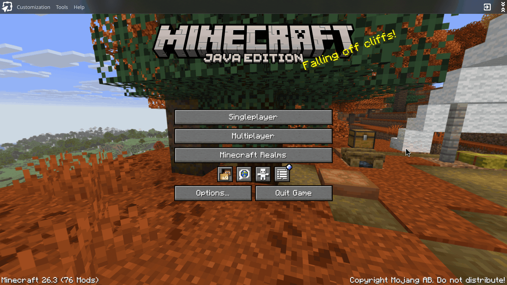

# 프로필

프로필은 레이아웃, 에셋, 변수, 설정 등 `config/fancymenu/`에 있는 모든 항목을 포함하는 완전한 FancyMenu 설정입니다([데이터 저장 위치](/data-storage-locations#your-setup) 참고). 프로필을 사용하면 하나의 Minecraft 인스턴스에 여러 설정을 보관하고, 몇 초 만에 전환하고, 파일 하나로 공유할 수 있습니다.

# 프로필 창

**메뉴 표시줄 -> 사용자 지정 -> 프로필**에서 엽니다.

- 왼쪽 목록에는 모든 프로필이 표시됩니다. 불러온 프로필이 맨 위에 표시되고 **활성**으로 표시됩니다. FancyMenu에서 변경한 내용은 모두 이 프로필에 바로 저장됩니다.
- 오른쪽에는 선택한 프로필의 아이콘, 제목, 버전, 제작자, 레이아웃 수, 크기, 링크, 설명이 표시됩니다.
- 목록과 세부 정보 아래에 있는 버튼에 마우스를 올리면 버튼 이름이 표시됩니다. 프로필을 마우스 오른쪽 버튼으로 클릭해도 작업 메뉴를 볼 수 있습니다.

현재 설정은 자동으로 **내 프로필**이라는 첫 번째 프로필이 됩니다.

# 프로필 불러오기

프로필을 선택한 다음 **프로필 불러오기**를 클릭하거나, 프로필을 두 번 클릭하거나, `Enter` 키를 누릅니다.

그러면 게임을 시작한 직후처럼 해당 프로필을 적용해 FancyMenu가 다시 로드됩니다. 다른 FancyMenu 창은 모두 닫히며, 월드에 들어가 있지 않은 경우 타이틀 화면이 열립니다.

> [!NOTE]
> 프로필을 불러와도 아무것도 삭제되지 않습니다. 먼저 현재 설정이 별도의 프로필로 저장되므로 언제든 다시 전환할 수 있습니다.

# 프로필 만들기

- **새 프로필**(목록 아래의 `+` 버튼)을 클릭하면 빈 프로필이 만들어지고 세부 정보 창이 바로 열립니다. 여기서 프로필 이름을 지정할 수 있습니다. UI 배율과 테마 같은 FancyMenu 기본 설정은 유지되지만, 레이아웃이나 다른 사용자 지정 항목은 포함되지 않습니다. 새 프로필이 자동으로 불러와지지는 않습니다.
- **복제**를 클릭하면 선택한 프로필이 복사됩니다. 원본을 건드리지 않고 새로운 설정을 시험해 볼 때 유용합니다.

# 프로필 세부 정보 편집

프로필을 선택하고 **편집**을 클릭해 세부 정보를 변경합니다.

- **제목**: 프로필에 필요한 유일한 항목입니다.
- **버전** 및 **제작자**: 제작자가 여러 명인 경우 쉼표로 구분합니다.
- **설명**: 굵은 글씨, 제목, 목록 등을 지원하는 [Markdown](/text-formatting#markdown)을 사용할 수 있습니다.
- **문제 신고 페이지**: 사용자가 프로필의 문제를 신고할 수 있는 웹사이트입니다. **문제 신고**로 표시됩니다.
- Discord 서버, YouTube 채널, 웹사이트 등의 **링크**: **링크 추가**를 클릭하고 링크를 붙여넣으면 FancyMenu가 플랫폼을 자동으로 선택합니다.
- 아이콘: **아이콘 선택**을 클릭하면 PNG 이미지를 지정할 수 있고, **아이콘 제거**를 클릭하면 아이콘이 삭제됩니다. 정사각형이 아닌 이미지는 가운데를 기준으로 잘립니다.

**완료**를 클릭하기 전까지는 변경 사항이 저장되지 않습니다.

# 프로필 공유

> [!CAUTION]
> 프로필은 링크 열기나 명령어 실행 같은 작업을 수행할 수 있습니다. 신뢰할 수 있는 출처의 프로필만 가져오세요.

## 내보내기

프로필을 선택하고 **내보내기**를 클릭한 다음 저장 위치를 선택합니다. 전체 프로필이 담긴 `.fmp` 파일이 만들어져 공유할 수 있습니다.

## 가져오기

목록 아래의 **가져오기**를 클릭하고 `.fmp` 파일을 선택하거나, 파일을 프로필 창으로 끌어다 놓습니다.

- 가져온 프로필은 자동으로 불러와지지 않습니다. 다른 프로필과 마찬가지로 직접 불러오세요.
- 이미 같은 프로필이 있는 경우(예: 이전 버전), **교체** 또는 **둘 다 유지**를 선택하세요. 불러온 프로필로 현재 불러온 프로필을 교체하면 가져온 프로필이 바로 적용되고, 이전 프로필의 변경 사항은 사라집니다.
- 최신 버전의 FancyMenu에서 만든 프로필은 일부 항목이 제대로 작동하지 않을 수 있으므로 먼저 경고가 표시됩니다.
- FancyMenu에서 내보낸 `.fmp` 파일만 사용할 수 있습니다. 일반 폴더를 가져오려면 다음 섹션을 참고하세요.

## 설정 폴더 추가

일부 설정은 `.fmp` 파일이 아니라 일반 `fancymenu` 폴더(다른 사람의 `config/fancymenu/` 복사본)로 제공됩니다. 이를 프로필로 추가하려면 다음 단계를 따르세요.

1. `.zip` 파일로 제공된 경우 압축을 풉니다.
2. 폴더를 `<game-directory>/config/fancymenu/profiles/`로 옮깁니다. `profiles` 폴더가 없다면 새로 만드세요.
3. 프로필 창을 열거나, 창을 닫았다가 다시 엽니다. FancyMenu가 해당 폴더를 프로필에 추가합니다.

폴더 안에는 다른 `fancymenu` 폴더가 아니라 `customization/` 및 `options.txt` 같은 파일이 바로 들어 있어야 합니다. 폴더에 자체 프로필 세부 정보가 없으면 폴더 이름이 프로필 제목으로 지정됩니다. 제목은 **편집**에서 변경할 수 있습니다.

## 레이아웃 템플릿

[Kekscord Discord 서버](https://discord.gg/rhayah27GC)(Keksuccino의 공식 모드 지원 Discord 서버)의 [`#layout-templates`](https://discord.com/channels/704163135787106365/1234093433795383316) 채널에는 FancyMenu와 SpiffyHUD, Drippy Loading Screen 같은 애드온을 위한 커뮤니티 제작 완성 설정이 올라옵니다. 각 게시물에는 `.fmp` 파일 또는 `fancymenu` 폴더의 다운로드 링크가 있습니다.

템플릿은 복잡하므로 자신의 설정과 합치려고 하지 마세요. 대신 별도의 프로필로 추가하세요.

1. `.fmp` 파일을 [가져오거나](#importing), [폴더를 추가합니다](#adding-setup-folders).
2. 프로필 창에서 템플릿을 선택하고 **프로필 불러오기**를 클릭합니다.

자신의 설정은 별도의 프로필로 계속 사용할 수 있으므로 언제든 다시 전환할 수 있습니다.

대부분의 템플릿은 편집하거나 모드팩 같은 프로젝트에 사용할 수 있지만, 모두 그런 것은 아닙니다. 템플릿을 어떻게 사용할 수 있는지 게시물에서 항상 확인하세요.

# 프로필 삭제

프로필을 선택하고 **삭제**를 클릭하거나 `Delete` 키를 누릅니다(macOS에서는 `Fn + Delete`). 삭제한 프로필은 복구할 수 없으므로 백업이 필요하면 먼저 내보내세요.

현재 불러온 프로필은 삭제할 수 없습니다. 먼저 다른 프로필을 불러오세요.

# 프로필 저장 위치

- 현재 불러온 프로필은 `<game-directory>/config/fancymenu/`의 내용입니다.
- 나머지 프로필은 각각 별도의 폴더로 `<game-directory>/config/fancymenu/profiles/`에 저장됩니다. **폴더 열기**를 클릭하면 선택한 프로필의 폴더가 열립니다.

`<game-directory>`는 인스턴스 폴더를 가리키며, `.minecraft`와 다를 수 있습니다. `<game-directory>/fancymenu_data/`의 데이터는 프로필에 포함되지 않습니다. [데이터 저장 위치](/data-storage-locations#instance-data)를 참고하세요.

# 문제가 발생한 경우

- **일부 파일이 아직 사용 중입니다:** 게임에서 오디오 같은 항목을 아직 불러오는 중일 수 있습니다. 몇 초 기다렸다가 다시 시도하세요. 계속 문제가 발생하면 바이러스 백신, 클라우드 동기화 프로그램, 파일 탐색기 창 등 해당 파일을 사용할 수 있는 프로그램을 닫으세요.
- **이전 프로필 전환이 아직 완료되지 않았습니다:** 데이터는 손실되지 않았습니다. 프로필을 다시 불러오거나 게임을 다시 시작해 전환을 완료하세요.
- **디스크 여유 공간이 부족합니다:** 메시지에 프로필에 필요한 공간이 표시됩니다. 공간을 확보한 다음 다시 시도하세요.
- 프로필 작업은 한 번에 하나씩 실행됩니다. 용량이 큰 프로필을 내보내거나 가져오거나 복제하는 데 시간이 걸릴 수 있으며, 작업 중에는 **취소** 버튼이 표시됩니다.
