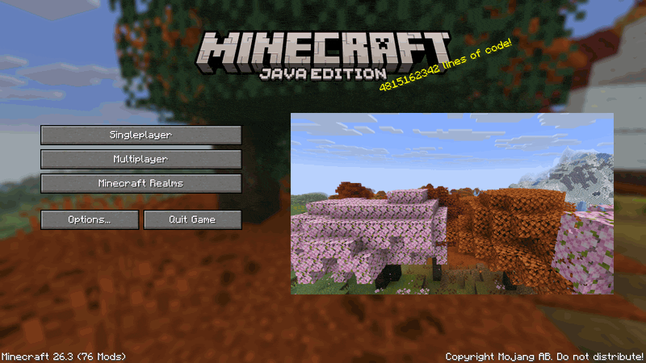

# 슬라이드쇼

슬라이드쇼는 이미지를 차례로 표시하고 다음 이미지로 부드럽게 페이드 전환합니다. 모드팩 세계의 스크린샷을 보여 주는 데 사용할 수 있습니다.

레이아웃의 [메뉴 배경](/menu-backgrounds)으로 표시하거나, 화면 일부에 [슬라이드쇼 요소](/elements#slideshow)를 배치해 표시할 수 있습니다.


# 슬라이드쇼 만들기

1. 게임 디렉터리의 `config/fancymenu/` 안에서 `slideshows` 폴더를 엽니다. **메뉴 바 -> 도구 -> FancyMenu 디렉터리 열기**를 선택하면 `config/fancymenu/`가 열립니다.
2. 그 안에 `world_tour` 같은 슬라이드쇼용 폴더를 만듭니다. 폴더 이름은 아무거나 지정해도 됩니다.
3. 폴더 안에 [`properties.txt`](#propertiestxt)와 [이미지](#the-images)가 들어 있는 `images` 폴더를 넣습니다. [`overlay.png`](#overlay)는 선택 사항입니다.
4. **메뉴 바 -> 사용자 지정 -> FancyMenu 다시 불러오기**를 선택하거나 `Ctrl + Alt + R`(macOS에서는 `Cmd + Alt + R`)을 누릅니다. 또는 게임을 다시 시작합니다.

```text
config/fancymenu/slideshows/
└── world_tour/
    ├── properties.txt
    ├── overlay.png
    └── images/
        ├── 01_river_valley.png
        ├── 02_cherry_grove.png
        └── 03_coast.png
```

# 이미지

- 이름이 `.png` 또는 `.jpg`로 끝나는 PNG와 JPG 파일만 인식됩니다. `.jpeg` 파일의 확장자는 `.jpg`로 바꾸세요.
- 파일 이름의 알파벳순으로 표시됩니다. 숫자도 문자처럼 취급되므로 `10.png`가 `2.png`보다 먼저 표시됩니다. `01`, `02` … `10`처럼 앞에 0을 붙여 이름을 지정하세요.
- 모든 이미지의 크기를 똑같이 맞추세요. 첫 번째 이미지가 슬라이드쇼의 비율을 결정하고, 나머지 이미지는 그 크기에 맞게 늘어납니다.
- `images` 안의 하위 폴더에 있는 파일은 인식되지 않습니다.

# properties.txt

```text
type = slideshow

slideshow-meta {
  name = world_tour
  duration = 5.0
  fadespeed = 5.0
  randomize = false
}
```

| 설정 | 기능 |
|---|---|
| `name` | 슬라이드쇼를 선택할 때 사용하는 이름입니다. 슬라이드쇼마다 고유한 이름을 지정하세요. |
| `duration` | 페이드 시간을 포함해 이미지가 바뀌는 간격을 초 단위로 지정합니다. 페이드 시간이 더 길면 페이드가 끝날 때까지 다음 이미지 전환을 기다립니다. |
| `fadespeed` | 한 이미지에서 다음 이미지로 페이드되는 속도입니다. `1.0`이면 페이드에 약 6초, `3.0`이면 약 2초가 걸립니다. `0`보다 큰 값이어야 합니다. |
| `randomize` | `true`이면 이미지를 무작위 순서로 표시하며, 같은 이미지가 연속해서 나오지 않습니다. `false`이면 파일 이름순으로 표시합니다. |

`name`만 필수 설정입니다. 생략한 설정에는 `duration = 10.0`, `fadespeed = 1.0`, `randomize = false`가 적용됩니다. `type = slideshow`와 `slideshow-meta {` 줄은 그대로 두고, 설정은 한 줄에 하나씩 작성하세요. 소수점에는 `2.5`처럼 마침표를 사용합니다.

이전 버전용으로 만든 슬라이드쇼에는 `width`, `height`, `x`, `y` 줄이 있을 수 있습니다. 이 설정들은 아무런 효과가 없습니다. 슬라이드쇼를 표시할 위치와 크기는 배경이나 요소가 결정합니다.

# 오버레이

`properties.txt`와 같은 위치에 있는 `overlay.png`는 모든 이미지 위에 표시되며 슬라이드쇼 크기에 맞춰 늘어납니다. 이미지와 함께 페이드되지 않으므로 테두리, 비네트 효과 또는 모서리의 로고 등에 사용할 수 있습니다. 투명한 부분으로는 이미지가 비쳐 보입니다.

오버레이는 슬라이드쇼에 포함되므로 슬라이드쇼가 표시되는 모든 곳에 함께 나타납니다. 같은 이미지를 테두리가 있는 버전과 없는 버전으로 사용하려면 슬라이드쇼를 두 개 만드세요.

# 슬라이드쇼 사용하기

## 메뉴 배경으로 사용하기


1. [레이아웃 편집기](/layout-editor)에서 배경을 마우스 오른쪽 버튼으로 클릭하고 **메뉴 배경 -> 슬라이드쇼**를 엽니다.
2. **배경 표시**를 클릭해 켭니다.
3. **슬라이드쇼 이름**을 클릭하고 슬라이드쇼를 선택한 다음 **완료**를 클릭합니다. 오른쪽 미리 보기에서 슬라이드쇼가 재생됩니다.

**슬라이드쇼 지우기**를 클릭하면 설정이 제거됩니다. 다른 배경과 함께 사용하려면 [메뉴 배경](/menu-backgrounds)을 참고하세요.

슬라이드쇼는 화면 전체에 맞춰 늘어납니다. 이미지의 비율을 유지하려면 **메뉴 배경**에서 **배경 종횡비 유지**를 켜세요. 그러면 화면을 가득 채우도록 표시되며 양옆 또는 위아래가 잘릴 수 있습니다.

## 요소로 사용하기



1. 레이아웃 편집기에서 비어 있는 곳을 마우스 오른쪽 버튼으로 클릭하고 **새 요소**로 슬라이드쇼를 추가합니다.
2. 요소를 마우스 오른쪽 버튼으로 클릭하고 **슬라이드쇼**를 클릭한 다음 슬라이드쇼를 선택합니다. 요소의 모양은 이미지의 비율에 맞춰집니다.
3. 다른 요소와 마찬가지로 위치와 크기를 조정합니다. **종횡비 복원**을 클릭하면 높이에 맞춰 너비가 다시 조정되어 이미지가 늘어나지 않습니다.

## 미리 로드하기

슬라이드쇼는 각 이미지가 처음 표시될 때 불러오므로, 용량이 큰 이미지는 처음에 잠시 늦게 나타날 수 있습니다. 게임 시작 중에 모든 이미지와 오버레이를 불러오려면 **메뉴 바 -> 사용자 지정 -> 리소스 미리 로드**에서 **슬라이드쇼 추가**를 선택하세요. [리소스 미리 로드](/preload-layouts#pre-loading-slideshows--panoramas)를 참고하세요.

# 알아 두면 좋은 점

- 같은 슬라이드쇼를 표시하는 곳은 메뉴가 서로 달라도 언제나 같은 이미지를 같은 시점에 표시합니다.
- 슬라이드쇼는 표시되는 동안에만 재생됩니다. `duration`보다 긴 시간 동안 표시되지 않았다가 다시 나타나면 다음 이미지로 즉시 페이드 전환합니다.
- FancyMenu를 다시 불러오면 모든 슬라이드쇼가 처음부터 시작됩니다. 시작 후 첫 번째 이미지는 다른 이미지의 절반 시간 동안만 표시됩니다.
- 슬라이드쇼는 불러온 [프로필](/profiles)에 속합니다.
- **슬라이드쇼 선택** 목록에 슬라이드쇼가 없다면 불러오기에 실패한 것입니다. 게임 로그인 `logs/latest.log`에서 원인을 확인할 수 있습니다. 예를 들어 `name`, `properties.txt` 또는 `images` 폴더가 없을 수 있습니다.
- Windows에서는 파일 탐색기에서 파일 이름 확장명을 표시하도록 설정하세요. 실수로 `properties.txt.txt`가 되는 일을 방지할 수 있습니다.
- 보라색과 검은색 체크무늬는 슬라이드쇼가 선택되지 않았거나 레이아웃에서 더 이상 존재하지 않는 슬라이드쇼 이름을 사용하고 있다는 뜻입니다.
- `name`이 같은 슬라이드쇼가 두 개라면 그중 하나만 표시됩니다.
- **디버그 오버레이**(`Ctrl + Alt + D`)에서 FancyMenu가 불러온 슬라이드쇼와 이미지의 개수를 확인할 수 있습니다.
