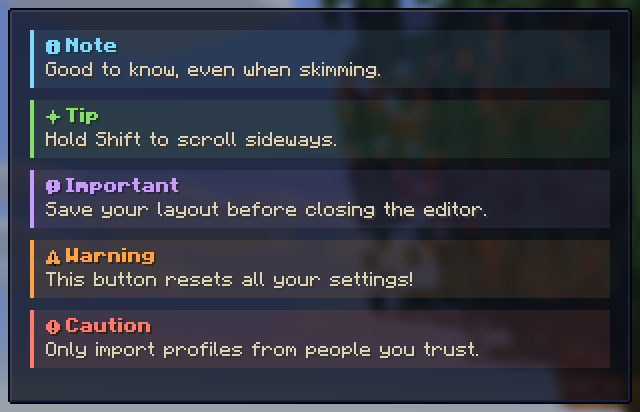

# 텍스트 서식

FancyMenu에서는 다음 세 가지 방법으로 텍스트 서식을 지정할 수 있습니다.

- [텍스트 및 툴팁 요소](/text-in-menus)에는 **Markdown**을 사용할 수 있습니다. 제목, 목록, 색상, 이미지, 표 등을 만들 수 있습니다.
- 빠르게 색상을 지정하려면 `&c`와 같은 **Minecraft 서식 코드**를 사용할 수 있습니다. Markdown 텍스트를 포함해 거의 모든 텍스트 입력란에서 작동합니다.
- 버튼과 슬라이더 레이블에는 **Minecraft 텍스트 컴포넌트**를 사용할 수 있습니다.

> [!TIP]
> 이 페이지에서는 서식 있는 텍스트를 *작성하는 방법*을 다룹니다. 메뉴에 텍스트를 추가하거나 모양을 바꾸고 스크롤되도록 하는 방법은 [메뉴의 텍스트](/text-in-menus)를 참조하세요.


# Markdown

Markdown은 텍스트 주위에 몇 가지 특수 문자를 넣어 서식을 지정합니다. 예를 들어, `**굵게**`를 입력하면 **굵게** 표시됩니다.

Markdown은 [텍스트 요소](/elements#text)와 [툴팁 요소](/elements#tooltip)에서 작동합니다. 입력한 문자에 따라 제목, 목록, 인용문과 같은 *유형*이 결정됩니다. 색상과 크기 같은 요소의 [모양](/text-in-menus#looks-and-styles)은 별도로 결정됩니다.

## 빠른 요약

| 입력 내용 | 표시 결과 |
|---|---|
| `**굵게**` 또는 `__굵게__` | 굵은 텍스트 |
| `*기울임꼴*` 또는 `_기울임꼴_` | 기울임꼴 텍스트 |
| `++밑줄++` | 밑줄 친 텍스트 |
| `~~취소선~~` | 취소선이 그어진 텍스트 |
| `` `코드` `` | 인라인 코드 |
| `[웹사이트 열기](https://example.com)` | 클릭 가능한 링크 |
| `%#ff5555%빨간색 텍스트%#%` | 색상이 지정된 텍스트 |
| `# 제목` | 제목 |
| `- 항목` | 글머리 기호 목록 |
| `1. 항목` | 번호 매기기 목록 |
| `> 텍스트` | 인용문 |
| `> [!TIP]` | 알림 상자 |
| `---` | 구분선 |

## 텍스트 스타일

| 스타일 | 작성 방법 |
|---|---|
| **굵게** | `**텍스트**` 또는 `__텍스트__` |
| **기울임꼴** | `*텍스트*` 또는 `_텍스트_` |
| **밑줄** | `++텍스트++` |
| **취소선** | `~~텍스트~~` (양쪽에 `~` 하나씩만 써도 됩니다) |

`***굵게 및 기울임꼴***`처럼 스타일을 조합할 수 있습니다.

단어 안에 있는 밑줄 하나는 일반 밑줄로 처리되므로 `my_cool_layout`은 기울임꼴로 바뀌지 않습니다. `C++`와 같은 이름도 그대로 표시됩니다.

> [!TIP]
> 텍스트 편집기에서 텍스트를 선택한 다음 `Ctrl + B`, `Ctrl + I` 또는 `Ctrl + U`(macOS에서는 `Cmd`)를 누르면 각각 굵게, 기울임꼴, 밑줄 서식이 적용됩니다. 자세한 내용은 [서식 단축키](/text-in-menus#formatting-shortcuts)를 참조하세요.

## 텍스트 색상(HEX)

텍스트 앞에 `%<HEX 색상>%`을, 뒤에 `%#%`를 입력하세요.

```
%#77fc03%이 텍스트는 초록색입니다!%#%
```

HEX 색상은 `#`으로 시작해야 합니다. 색상 이름을 사용할 수도 있습니다.

```
%#red%이 텍스트는 빨간색입니다!%#%
```

지원되는 이름: `black`, `silver`, `gray`, `grey`, `white`, `maroon`, `red`, `purple`, `fuchsia`, `magenta`, `green`, `lime`, `olive`, `yellow`, `navy`, `blue`, `teal`, `aqua`, `cyan`, `transparent`.

## 글꼴

다른 글꼴로 텍스트를 표시하려면 텍스트 앞에 `%!!<글꼴 이름>%`을, 뒤에 `%!!%`를 입력하세요. Minecraft 또는 리소스 팩에 포함된 글꼴을 사용할 수 있습니다.

```
%!!uniform%이 텍스트에는 uniform 글꼴이 적용됩니다%!!%
```

## 텍스트 정렬

텍스트는 기본적으로 왼쪽 정렬됩니다. 줄을 가운데 또는 오른쪽으로 정렬하려면 해당 줄 앞뒤에 정렬 코드를 각각 별도의 줄로 입력하세요.

- `^^^`는 줄을 가운데 정렬합니다.
- `|||`는 줄을 오른쪽 정렬합니다.

```
이 줄은 왼쪽 정렬입니다.

^^^
이 줄은 가운데 정렬입니다.
이 줄도 가운데 정렬입니다.
^^^

|||
이 줄은 오른쪽 정렬입니다.
|||
```

> [!TIP]
> 텍스트 편집기에서 `Ctrl + L`, `Ctrl + E`, `Ctrl + R`(macOS에서는 `Cmd`)을 누르면 선택한 줄을 각각 왼쪽, 가운데, 오른쪽으로 정렬할 수 있습니다.

## 제목

줄의 시작에 `# `(가장 크게), `## `(크게) 또는 `### `(작게)를 입력하세요.

```
# 환영합니다!
## 새 소식
### 작은 제목
```

## 목록


### 글머리 기호 목록

줄의 시작에 `- `를 입력하세요. 목록의 각 하위 단계마다 앞에 공백 두 개를 추가하세요.

```
- 첫 번째 항목
- 두 번째 항목
  - 하위 항목
    - 더 깊은 하위 항목
```

### 번호 매기기 목록

줄의 시작에 숫자와 마침표 또는 괄호를 입력하세요.

```
1. 메뉴 표시줄 열기
2. 사용자 지정 클릭하기
3) 이 형식도 사용할 수 있습니다
```

### 패치 노트 표시

줄의 시작에 `+`, `-`, `~` 또는 `*`를 입력할 수도 있습니다. 각 기호는 고유한 표시로 바뀌므로 패치 노트와 변경 기록에 적합합니다.

```
+ 새 메인 메뉴 추가
- 이전 로고 제거
~ 버튼 색상 변경
* 시작 시 발생하던 충돌 수정
```

| 표시 | 의미 |
|---|---|
| `+` | 추가된 항목 |
| `-` | 제거된 항목 |
| `~` | 변경된 항목 |
| `*` | 강조할 항목 |

목록에 `+` 항목이 있을 때만 `-` 항목에 "제거됨" 표시가 적용됩니다. 그렇지 않으면 일반 글머리 기호 목록 항목으로 표시됩니다. **Markdown -> Lists -> Extra Markers (+ - ~ \*) -> - Marker Used**에서 이 설정을 변경할 수 있습니다.

> [!NOTE]
> 새 텍스트 및 툴팁 요소에서는 번호 매기기 목록, 패치 노트 표시, [알림 상자](#callouts)가 활성화되어 있습니다. 이전 레이아웃의 요소에서는 텍스트가 갑자기 바뀌지 않도록 이 기능들이 비활성화되어 있습니다. 요소의 **Markdown** 메뉴에서 **Lists -> Numbered Lists**, **Lists -> Extra Markers (+ - ~ \*)**, **Callouts**를 켜세요.

## 인용문

인용문을 만들려면 줄의 시작에 `> `를 입력하세요. 다음 빈 줄이 나오기 전까지 인용문으로 처리됩니다.

```
> 인용문입니다.
이 줄도 인용문에 포함됩니다.

이 줄부터는 일반 텍스트입니다.
```

인용문 안의 줄도 `>`로 시작할 수 있으며, `>`만 있는 줄을 넣으면 인용문에 빈 줄이 추가됩니다.

```
> 인용문의 첫 번째 단락입니다.
>
> 인용문의 두 번째 단락입니다.
```

## 알림 상자

알림 상자는 아이콘과 레이블이 있는 색상 상자로, 팁이나 경고를 표시하기에 좋습니다. 인용문의 첫 줄에 알림 유형을 입력하세요.

```
> [!WARNING]
> 레이아웃을 저장하는 것을 잊지 마세요!
```



유형은 `[!NOTE]`, `[!TIP]`, `[!IMPORTANT]`, `[!WARNING]`, `[!CAUTION]`의 다섯 가지입니다.

## 하이퍼링크

텍스트를 `[ ]`로 감싸고 링크를 `( )` 안에 입력하세요.

```
[웹사이트 방문](https://example.com)
```

링크에는 `https://en.wikipedia.org/wiki/Minecraft_(video_game)`처럼 괄호를 포함할 수 있습니다. 링크 텍스트에 대괄호를 표시하려면 앞에 `\`를 입력하세요. 예: `[여기\[를\] 클릭](https://example.com)`.

## 클릭 및 마우스 오버 이벤트

웹사이트를 여는 대신 텍스트가 [리스너](/listeners)를 실행하도록 할 수도 있습니다. 원하는 ID와 함께 `click:` 또는 `hover:` 접두사를 사용하세요.

```
[클릭 가능한 텍스트](click:unique_text_click_event_id)
[마우스를 올릴 수 있는 텍스트](hover:unique_text_hover_event_id)
```

[**On Markdown Text Clicked**](/listeners#on-markdown-text-clicked) 및 [**On Markdown Text Hovered**](/listeners#on-markdown-text-hovered) 리스너를 사용해 이벤트에 반응하세요. 두 리스너 모두 ID를 `$$text_event_id`로 제공합니다.

## 이미지

이미지를 별도의 줄에 넣으려면 ``를 입력하세요.

```

```

소스에는 웹 URL, `/config/fancymenu/assets/image.png`와 같은 로컬 파일 경로 또는 리소스 팩 이미지가 올 수 있습니다. 모든 소스 유형은 [리소스](/resources)를 참조하세요.

대괄호 안의 텍스트는 이미지 캡션이 됩니다.

```

```

요소의 **Markdown -> Images -> Caption** 옵션이 켜져 있으면 이미지 아래에 캡션이 표시됩니다.

이미지를 클릭할 수 있게 하려면 링크로 감싸세요.

```
[](https://example.com)
```

## 표

셀은 `|`로 구분합니다. 첫 번째 줄은 머리글이고, 두 번째 줄에는 각 열마다 `---`를 입력합니다.

```
| 항목 | 가격 |
|:---|---:|
| 다이아몬드 검 | 10 |
| 황금 사과 | 5 |
```

두 번째 줄에 콜론을 넣어 열을 정렬할 수 있습니다. `:---`는 왼쪽, `:---:`는 가운데, `---:`는 오른쪽 정렬입니다. 셀 안에 `|`를 표시하려면 `\|`를 입력하세요.


## 구분선

`---`만 있는 줄을 입력하면 텍스트를 가로지르는 구분선이 그려집니다.

## 코드

코드는 텍스트를 서식 지정 없이 입력한 그대로 표시합니다.

- **인라인 코드:** 줄의 일부를 `` ` ``로 감쌉니다. 예: `` `/spawn` ``.
- **코드 블록:** 코드 줄 앞뒤에 `` ``` ``만 있는 줄을 입력합니다. 코드 블록의 줄은 자동 줄 바꿈되지 않습니다.

````
```
/give @p minecraft:diamond 64
```
````

첫 번째 `` ``` `` 뒤에 `json`과 같은 언어 이름을 입력할 수 있습니다. FancyMenu에서 입력을 인식하지만 코드의 표시 방식은 바뀌지 않습니다.

코드 안에서도 [플레이스홀더](/placeholders)는 계속 치환됩니다.

## 일반 텍스트

일반 텍스트는 코드처럼 보이지 않지만 서식 문자를 입력한 그대로 표시합니다. 줄의 일부를 `;;`로 감싸세요.

```
이 텍스트는 굵게 표시하는 대신 ;;**별표**;;를 그대로 표시합니다.
```

줄 전체에 적용하려면 해당 줄 앞뒤에 `;;;`만 있는 줄을 입력하세요.

```
;;;
**굵게 아님**, _기울임꼴 아님_.
;;;
```

## 문자 이스케이프

서식 문자를 일반 텍스트로 표시하려면 앞에 `\`를 입력하세요. 예를 들어 `\*기울임꼴 아님\*`은 `*기울임꼴 아님*`으로 표시됩니다.

이 방법은 `\` `` ` `` `*` `_` `{` `}` `[` `]` `(` `)` `#` `+` `-` `.` `!` `|` `>` `~` `^`에 사용할 수 있습니다.

# Minecraft 텍스트 서식

Minecraft 서식 코드는 FancyMenu의 대부분의 텍스트 입력란에서 작동합니다. Minecraft의 `§` 대신 `&`를 사용하세요. 예를 들어 `&c경고`는 빨간색 텍스트로 표시되고 `&l`은 텍스트를 굵게 만듭니다. `&r`은 서식을 초기화합니다.

모든 코드 목록은 [Minecraft 위키](https://minecraft.wiki/w/Formatting_codes)를 참조하세요.

서식 코드는 코드와 일반 텍스트 안을 제외하면 Markdown 텍스트에서도 작동합니다. 굵게나 기울임꼴 같은 스타일에는 대개 Markdown이 더 읽기 쉽지만, 빠르게 색상을 지정할 때는 서식 코드가 유용합니다.

# Minecraft 텍스트 컴포넌트(원시 컴포넌트 시스템)

Minecraft 텍스트 컴포넌트는 서식이 적용된 텍스트를 JSON으로 작성하는 방식입니다. **버튼 및 슬라이더 레이블**과 같은 **한 줄** 텍스트에는 사용할 수 있지만 텍스트 요소에서는 사용할 수 없습니다.

사용하려면 레이블에 컴포넌트만 입력하세요.

```
{"text":"버튼 레이블 텍스트","font":"uniform"}
```

`버튼 레이블 텍스트`가 `uniform` 글꼴로 표시됩니다. `text` 값에 [플레이스홀더](/placeholders)를 사용할 수 있습니다.

자세한 내용은 Minecraft 위키의 [텍스트 컴포넌트 형식](https://minecraft.wiki/w/Raw_JSON_text_format) 및 [글꼴](https://minecraft.wiki/w/Resource_pack#Fonts) 페이지를 참조하세요.
