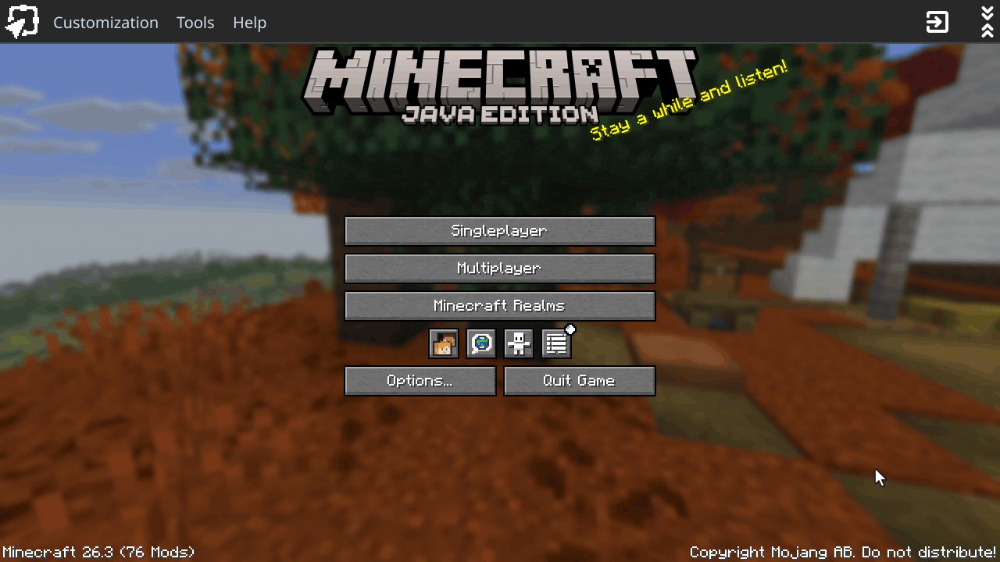

# 변수

변수는 게임을 종료한 뒤에도 FancyMenu가 기억하는 값입니다. 클릭 횟수를 세거나, 선택 사항을 기억하거나, 진행 상황을 추적하거나, 로딩 팁 같은 목록을 보관하는 데 사용할 수 있습니다. 텍스트, 동작, 요구 사항, 리스너 및 일부 요소에서 변수 값을 읽고 변경할 수 있습니다.

> [!TIP]
> 변수 관련 동작은 [동작 스크립트](/action-scripts), 요구 사항은 [요구 사항](/conditions), 리스너는 [리스너](/listeners#on-variable-updated-fm-variable) 문서를 참조하세요.

# 텍스트 변수와 목록 변수

변수에는 두 가지 종류가 있습니다.

- 텍스트 변수에는 `dark`, `5`, `true`처럼 텍스트 하나가 저장됩니다.
- 목록 변수에는 로딩 팁이나 서버 이름처럼 항목의 목록이 저장됩니다. 각 항목은 각각 하나의 텍스트입니다.

목록에서 항목의 위치를 인덱스라고 합니다. 첫 번째 항목의 인덱스는 `0`, 두 번째 항목은 `1`이며, 이후에도 같은 방식으로 이어집니다. 음수 인덱스는 끝에서부터 셉니다. 따라서 `-1`은 마지막 항목입니다.

`$$name`이나 **변수 값 확인(FM Variable)**처럼 텍스트만 처리할 수 있는 기능은 목록을 항목이 담긴 JSON 배열로 가져옵니다. 예를 들면 `["첫날 밤이 오기 전에 침대를 만드세요.","횃불은 대부분의 몹을 쫓아냅니다."]`와 같습니다.

# 변수 관리

**메뉴 바 -> 사용자 지정 -> 변수 관리**를 엽니다. 메뉴 바는 레이아웃 편집기 밖에서만 표시됩니다.



## 변수 추가

1. 목록을 마우스 오른쪽 버튼으로 클릭하고 **텍스트 변수 추가** 또는 **목록 변수 추가**를 클릭합니다.
2. 이름을 입력하고 **완료**를 클릭합니다.

이름에는 소문자, 숫자, `.`, `_`, `-`를 사용할 수 있으며, 각 이름은 한 번만 사용할 수 있습니다.

## 변수 변경

변수를 마우스 오른쪽 버튼으로 클릭하면 다음 옵션을 사용할 수 있습니다.

| 옵션 | 기능 |
|---|---|
| **값 설정** | 텍스트 변수의 텍스트를 설정합니다. |
| **목록 편집** | 목록 변수의 목록 편집기를 엽니다(아래 참조). |
| **목록으로 변환…** | 텍스트 변수를 목록으로 변환합니다. **구분 기호**로 텍스트를 항목별로 나눕니다. 줄 바꿈을 기준으로 나누려면 `\n`을 입력하세요. **항목 공백 제거**는 각 항목 앞뒤의 공백을 제거하고, **빈 항목 건너뛰기**는 빈 항목을 제외합니다. `["a","b"]`처럼 텍스트가 이미 JSON 배열인 경우 하나의 항목으로 읽힙니다(**JSON 배열로 읽기**). |
| **텍스트로 변환…** | 목록을 텍스트 변수로 변환합니다. **구분 기호**는 항목 사이에 들어가며, **JSON 텍스트 유지**를 선택하면 목록을 JSON 배열로 유지합니다. |
| **게임 시작 시 변수 비우기** | 게임을 시작할 때마다 변수를 비웁니다. 한 세션에서만 유지해야 하는 값에 유용합니다. |
| **변수 삭제** | 변수를 삭제합니다. |
| **복사** 및 **붙여넣기** | 변수를 복사합니다. |
| **AI용 변수 내보내기** | [AI 채팅](/export-for-ai)에 사용할 변수를 내보냅니다. |

변경 사항은 즉시 적용됩니다. `Ctrl + Z`로 실행 취소하고 `Ctrl + Y`로 다시 실행하세요(macOS에서는 `Cmd`). 검색하려면 입력을 시작하고, 선택한 변수를 편집하려면 `Enter`를 누르세요. 삭제하려면 `Delete`를 누릅니다.

## 목록 편집

목록 편집기에는 각 항목과 해당 인덱스가 표시됩니다.

- 항목을 추가하려면 목록 아래의 **항목 추가**를 클릭하고 항목을 입력한 다음 `Enter`를 누릅니다. 바로 다음 항목을 입력할 수 있습니다. 빈 항목에서 `Enter`를 누르거나 `Esc`를 눌러 추가를 마칩니다.
- 항목을 편집하려면 두 번 클릭합니다. `Shift + Enter`를 누르면 줄 바꿈을 입력할 수 있는 텍스트 편집기에서 항목이 열립니다.
- 항목 순서를 바꾸려면 드래그하거나 `Alt + Up`, `Alt + Down`을 누릅니다.
- 항목을 마우스 오른쪽 버튼으로 클릭하면 **항목 복제**(`Ctrl + D`), **항목 삭제**(`Delete`), **복사**, **붙여넣기**, **위로 이동**, **아래로 이동**을 사용할 수 있습니다.
- **텍스트로 편집**을 선택하면 모든 항목을 한 번에 한 줄씩 편집할 수 있습니다.

**완료**를 누르면 목록이 저장됩니다. **취소**를 누르면 목록 편집기에서 변경한 내용이 모두 취소됩니다.

# 텍스트에 변수 표시하기

`$$` 뒤에 변수 이름을 입력하면 해당 변수 값이 표시됩니다. 예를 들어 `menu_theme`이라는 변수는 `$$menu_theme`으로 표시합니다. 이 기능은 [자리 표시자](/placeholders)를 지원하는 모든 텍스트에서 사용할 수 있습니다. 여기에는 [텍스트 요소](/text-in-menus), 버튼 레이블, 툴팁, 동작 및 요구 사항의 값이 포함됩니다. 변수가 변경되면 텍스트도 자동으로 업데이트됩니다.

```
현재 테마: $$menu_theme
```

- 존재하지 않는 변수의 `$$name`은 그대로 표시됩니다.
- `coins`와 `coins_record`처럼 이름의 앞부분이 같으면 `$$coins_record`는 항상 더 긴 이름을 가리킵니다.
- 목록은 JSON 배열로 표시됩니다. 다음 자리 표시자를 사용하면 목록을 더 보기 좋게 표시할 수 있습니다.

| 자리 표시자 | 예시 | 결과 |
|---|---|---|
| **변수 값 가져오기(FM Variable)** | `{"placeholder":"getvariable","values":{"name":"clicks"}}` | 변수 값입니다. 변수가 비어 있거나 존재하지 않으면 `0`을 반환합니다. 숫자에 가장 적합합니다. |
| **목록 항목 가져오기(FM Variable)** | `{"placeholder":"list_get","values":{"name":"tips","index":"0","fallback":"아직 팁이 없습니다"}}` | 해당 인덱스의 항목을 반환하고, 항목이 없으면 `fallback` 값을 반환합니다. |
| **목록 크기(FM Variable)** | `{"placeholder":"list_size","values":{"name":"tips"}}` | 목록의 항목 수를 반환합니다. |
| **목록 항목 인덱스(FM Variable)** | `{"placeholder":"list_index_of","values":{"name":"tips","value":"횃불은 대부분의 몹을 쫓아냅니다.","ignore_case":"false"}}` | `value`와 전체가 일치하는 첫 번째 항목의 인덱스를 반환합니다. 일치하는 항목이 없으면 `-1`을 반환합니다. |
| **목록 항목 합치기(FM Variable)** | `{"placeholder":"list_join","values":{"name":"tips","separator":"\n"}}` | 모든 항목을 하나의 텍스트로 합칩니다. 항목 사이에는 `separator`가 들어갑니다(생략하면 `, `). `\n`은 줄 바꿈입니다. |

# 동작으로 변수 변경하기

[동작 스크립트](/action-scripts)를 사용하면 버튼을 클릭하거나, 타이커가 실행되거나, 리스너가 작동하는 등의 상황에서 변수를 변경할 수 있습니다.

## 텍스트 변수

[**변수 값 설정(FM Variable)**](/action-scripts#set-variable-value-fm-variable)에는 이름과 새 값을 `:`로 구분해 입력합니다. 아직 존재하지 않는 변수는 새로 생성됩니다.

```
menu_theme:dark
```

이름과 값을 구분하는 `:`은 첫 번째 문자만 사용하므로, 값에는 `last_server:play.example.net:25565`처럼 `:`을 더 포함할 수 있습니다.

버튼 클릭 횟수를 세려면 기존 값에 1을 더합니다.

```
clicks:{"placeholder":"calc","values":{"decimal":"false","expression":"{"placeholder":"getvariable","values":{"name":"clicks"}} + 1"}}
```

`clicks`가 비어 있을 때 **변수 값 가져오기(FM Variable)**는 `0`을 반환하므로, 첫 번째 클릭 시 값이 `1`로 설정됩니다.

변수 값 설정은 목록을 텍스트로 변환하지 않습니다. JSON 배열은 목록의 항목이 되고, 빈 텍스트는 목록을 비우며, 그 밖의 텍스트는 목록의 유일한 항목이 됩니다.

[**변수 삭제(FM Variable)**](/action-scripts#delete-variable-fm-variable)는 변수 하나를 삭제하고, [**모든 변수 비우기(FM Variable)**](/action-scripts#clear-all-variables-fm-variable)는 모든 변수를 삭제합니다.

## 목록 동작

각 목록 동작에는 별도의 창이 있습니다. 모든 입력란에서 자리 표시자를 사용할 수 있습니다.

| 동작 | 기능 |
|---|---|
| [**목록에 추가(FM Variable)**](/action-scripts#add-to-list-fm-variable) | 항목을 목록 끝이나 지정한 인덱스에 추가합니다. **목록에 이미 있으면 건너뛰기**를 선택하면 항목이 이미 목록에 있을 때 추가하지 않습니다. |
| [**목록 항목 설정(FM Variable)**](/action-scripts#set-list-entry-fm-variable) | 지정한 인덱스의 항목을 바꿉니다. |
| [**목록에서 제거(FM Variable)**](/action-scripts#remove-from-list-fm-variable) | **인덱스의 항목**, 값과 일치하는 **첫 번째 항목** 또는 **일치하는 모든 항목**을 제거합니다. |
| [**목록 비우기(FM Variable)**](/action-scripts#clear-list-fm-variable) | 모든 항목을 제거합니다. 목록 자체는 유지되지만 비어 있게 됩니다. |
| [**목록 설정(FM Variable)**](/action-scripts#set-list-fm-variable) | **텍스트 분할**의 결과나 **JSON 배열**의 항목으로 모든 항목을 바꿉니다. JSON 배열로 `$$other_list`를 입력하면 다른 목록을 복사합니다. |
| [**목록 정렬(FM Variable)**](/action-scripts#arrange-list-fm-variable) | **가나다순 정렬**, **역가나다순 정렬**, **숫자 오름차순**, **숫자 내림차순**, **순서 뒤집기**, **섞기**, **중복 제거**를 수행합니다. |

- 목록 동작은 아직 존재하지 않는 목록을 생성하고, 비어 있는 텍스트 변수를 목록으로 바꿉니다. 값이 있는 텍스트 변수는 변경하지 않습니다. 먼저 [변환](#변수-변경)하세요.
- `$$` 없이 목록 이름을 입력합니다. `$$`를 입력하면 동작은 해당 변수의 값을 이름으로 사용합니다.

예를 들어 텍스트 요소에 `tips` 목록의 첫 번째 항목을 표시하려면 다음을 사용합니다.

```
{"placeholder":"list_get","values":{"name":"tips","index":"0"}}
```

아래의 다음 팁 버튼에는 동작 스크립트로 **목록 정렬(FM Variable)**의 **섞기**를 설정합니다.


클릭할 때마다 목록이 섞이므로 텍스트에 무작위 팁이 표시됩니다.


## 목록 순회

[FOR EACH 루프](/action-scripts#for-each-loop)는 목록의 첫 번째 항목부터 마지막 항목까지, 각 항목마다 루프 안의 동작을 한 번씩 실행합니다.

1. 동작 스크립트 편집기의 스크립트 영역을 마우스 오른쪽 버튼으로 클릭하고 **FOR EACH 루프 추가**를 클릭합니다.
2. `$$` 없이 목록 변수의 이름을 입력하고 **완료**를 클릭합니다.
3. 루프 안에 동작을 추가합니다. 동작 값에서 `$$list_entry`는 현재 항목이고, `$$list_index`는 해당 항목의 인덱스입니다.

예를 들어 `/time set day`와 `/weather clear` 항목이 있는 `starter_commands` 목록을 만들고, 루프 안에 다음 값을 사용하는 [**채팅 메시지/명령 전송**](/action-scripts#send-chat-messagecommand) 동작을 추가하면 두 명령이 모두 실행됩니다.

```
$$list_entry
```

- 루프는 시작할 때 목록을 한 번 읽습니다. 루프 안의 동작이 목록을 변경하더라도 루프가 순회하는 항목은 바뀌지 않습니다.
- 텍스트 변수이거나 존재하지 않는 목록이면 루프는 한 번도 실행되지 않습니다.
- WHILE 루프와 마찬가지로 3초 후 중단되므로 게임이 멈추지 않습니다.

# 변수 확인하기

[요구 사항](/conditions)을 사용하면 변수가 특정 값을 가질 때만 요소를 표시하거나 동작 스크립트의 일부를 실행할 수 있습니다.

- [**변수 값 확인(FM Variable)**](/conditions#is-variable-value-fm-variable)은 전체 값을 확인합니다. 목록은 모든 항목을 담은 JSON 배열과 비교합니다.
- [**목록에 항목 포함(FM Variable)**](/conditions#list-contains-entry-fm-variable)은 목록에 항목이 있는지 확인합니다. 항목 전체가 일치해야 합니다. **대소문자 무시**를 선택하면 `Apple`과 `apple`이 일치합니다.
- [**숫자인지 확인**](/conditions#is-number)은 숫자를 비교합니다. 예를 들어 `$$clicks`가 `5`보다 큰지 확인할 수 있습니다.

예를 들어 버튼을 누르면 최신 뉴스 게시물이 열리고, **목록에 추가(FM Variable)**를 사용해 `news_42`를 `read_news` 목록에 추가합니다. 버튼 옆의 "신규!" 배지에는 `news_42`를 확인하는 **목록에 항목 포함(FM Variable)** 요구 사항을 설정하고, **요구 사항 모드**를 반대로 설정합니다. 그러면 플레이어가 게시물을 읽은 뒤 배지가 숨겨집니다.

# 변수를 요소에 연결하기

- [텍스트 입력 필드](/elements#text-input-field): **변수에 연결**을 설정하면 플레이어가 입력한 내용이 변수에 기록되고, 입력 필드에는 변수 값이 표시됩니다. 목록에 연결하면 입력한 텍스트가 목록 전체를 대체합니다.
- [체크박스](/elements#checkbox): **변수 모드**를 켜고 **변수에 연결**을 설정합니다. 체크박스는 변수에 `true` 또는 `false`를 기록합니다.
- **값 목록** 유형의 [슬라이더](/elements#slider): **목록 변수에서 값 가져오기**를 사용하면 슬라이더 값이 목록에서 가져옵니다. 목록에 항목이 추가되거나 제거되면 슬라이더에 즉시 반영됩니다.

# 변경에 반응하기

- [**변수 업데이트 시 [FM Variable]**](/listeners#on-variable-updated-fm-variable) 리스너는 변수가 설정될 때마다 동작 스크립트를 실행합니다.
- [`/fmvariable` 명령어](/commands#fmvariable)를 사용하면 채팅, 명령 블록 및 다른 모드에서 변수를 설정하고 읽을 수 있습니다.

# 변수 저장 위치

FancyMenu는 변수를 `<game-directory>/config/fancymenu/user_variables.db`에 즉시 저장하므로, 게임을 다시 시작해도 유지됩니다.

- 변수는 Minecraft 인스턴스 전체와 현재 활성화된 [프로필](/profiles)에 적용됩니다. 레이아웃, 월드, 서버 또는 플레이어별로 따로 저장되지 않습니다.
- 변수 이름은 대소문자를 구분합니다.
- 변수에 암호, 토큰 또는 기타 비밀 정보를 저장하지 마세요. 게임 폴더에 접근할 수 있는 사람은 누구나 해당 정보를 읽을 수 있습니다.
