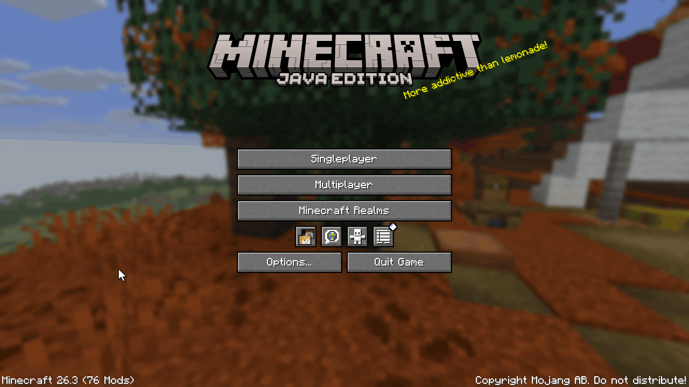

# Wymagania

Wymagania to warunki, takie jak „kursor myszy znajduje się nad tym przyciskiem”, „jest grudzień” lub „świat jest wczytany”. Używaj ich, aby:

- wyświetlać [element](/elements) tylko w określonych sytuacjach,
- wczytywać cały układ tylko w określonych sytuacjach,
- włączać przyciski, suwaki i pola wyboru tylko w określonych sytuacjach,
- uruchamiać części [skryptu działań](/action-scripts) tylko w określonych sytuacjach.

FancyMenu przez cały czas sprawdza wymagania, gdy menu jest otwarte, dlatego elementy od razu się pojawiają, znikają lub zmieniają. To pole informacyjne jest widoczne tylko wtedy, gdy kursor myszy znajduje się nad przyciskiem „Multiplayer”:

# Gdzie je znaleźć

| Gdzie | Działanie wymagań |
|---|---|
| Kliknij element prawym przyciskiem myszy -> **Wymagania wczytywania** | Element jest wyświetlany tylko wtedy, gdy wymagania są spełnione. Działa też w przypadku [elementów Vanilla](/vanilla-elements). |
| Kliknij prawym przyciskiem myszy tło edytora -> **Wymagania wczytywania [dla całego układu]** | Cały układ jest wczytywany tylko wtedy, gdy wymagania są spełnione. Zobacz [Wymagania dla całego układu](#layout-wide-requirements). |
| Kliknij przycisk, suwak lub pole wyboru prawym przyciskiem myszy -> **Aktywny stan kontrolki** | Kontrolka jest klikalna tylko wtedy, gdy wymagania są spełnione. W przeciwnym razie jest wyszarzona. Przyciski Vanilla również mają tę opcję. |
| IF, ELSE-IF i WHILE w [skryptach działań](/action-scripts#statements) | Zawarte w nich działania są uruchamiane tylko wtedy, gdy wymagania są spełnione. |

W edytorze układu elementy są zawsze widoczne, więc nadal możesz je edytować. Wymagania elementów działają poza edytorem.

> [!TIP]
> [Widoczność elementów](/element-visibility) opisuje więcej sposobów wyświetlania i ukrywania elementów, takich jak opóźnienia, zanikanie i przełączanie przyciskiem.

# Dodawanie wymagania

1. Kliknij element prawym przyciskiem myszy i wybierz **Wymagania wczytywania**. Otworzy się okno **Zarządzanie wymaganiami**.
2. Kliknij prawym przyciskiem myszy pustą listę i wybierz **Dodaj wymaganie** albo naciśnij `A`.
3. Kliknij kategorię w sekcji **Dostępne wymagania** lub zacznij wpisywać tekst, aby wyszukać nazwy i opisy. Sekcja **Opis wymagania** wyjaśnia działanie wybranego wymagania.
4. Kliknij **Dalej**, aby ustawić jego wartość. W przypadku wymagań, które nie mają wartości, pojawi się przycisk **Gotowe**. Dwukrotne kliknięcie wymagania daje ten sam efekt.
5. Wpisz wartość i kliknij **Gotowe**. Na przykład wymaganie **Is Element Hovered** potrzebuje identyfikatora elementu. Kliknij element prawym przyciskiem myszy i wybierz **Kopiuj identyfikator elementu**, aby go skopiować.
6. Kliknij **Gotowe** w oknie **Zarządzanie wymaganiami**.

## Tryb wymagania

Przycisk **Tryb wymagania** w oknie wyboru wymagania przełącza między trybami:

- **Normalny**: wymaganie jest spełnione, gdy warunek jest prawdziwy.
- **Przeciwny**: wymaganie jest spełnione, gdy warunek NIE jest prawdziwy. Na przykład wymaganie **Is World Loaded** w trybie przeciwnym jest spełnione tylko w menu głównym.

W oknie **Zarządzanie wymaganiami** widoczny jest tryb i wartość każdego wymagania.

## Wartości

- Wartości obsługują [zmienne zastępcze](/placeholders) oraz Twoje [zmienne](/variables#showing-variables-in-text), takie jak `$$coins`. FancyMenu uzupełnia je przy każdym sprawdzeniu wymagania.
- Wiele pól wartości podpowiada dostępne opcje podczas pisania, takie jak biomy, identyfikatory modów, języki lub nazwy zmiennych. Kliknij podpowiedź albo naciśnij `Tab`.
- W przypadku wymagań z prostą wartością otwiera się jednoliniowy edytor tekstu. Tytuł wskazuje, co wpisać, na przykład **Identyfikator docelowego elementu**.

## Zarządzanie wymaganiami

Kliknij prawym przyciskiem myszy listę, wymaganie lub grupę w oknie **Zarządzanie wymaganiami**, aby wyświetlić następujące opcje:

| Opcja | Skrót | Działanie |
|---|---|---|
| **Dodaj wymaganie** | `A` | Dodaje wymaganie. |
| **Dodaj grupę** | `G` | Dodaje grupę (zobacz poniżej). |
| **Edytuj wymaganie** | `Enter` lub dwukrotne kliknięcie | Otwiera okno wyboru wymagania, w którym można ustawić jego typ, tryb i wartość. |
| **Usuń wymaganie** / **Usuń grupę** | `Delete` | Usuwa element. |
| **Cofnij** / **Ponów** | `Ctrl + Z` / `Ctrl + Y` | Cofa lub ponawia zmiany w tym oknie. |
| **Eksportuj wymagania dla AI** | | Eksportuje wszystkie wymagania z tego okna do [czatu AI](/export-for-ai), uwzględniając niezapisane zmiany. |

Klawisze `Up` i `Down` wybierają poprzednie lub następne wymaganie. Przycisk **Gotowe** (`Ctrl + S`) zapisuje zmiany, a **Anuluj** odrzuca wszystkie zmiany wprowadzone w oknie. W systemie macOS użyj `Cmd` zamiast `Ctrl`.

Jeśli zaznaczono kilka elementów, opcja **Wymagania wczytywania** zmienia wymagania wszystkich z nich. Jeśli mają różne wymagania, FancyMenu najpierw poprosi o potwierdzenie, ponieważ wszystkie zostaną zastąpione.

# Łączenie wymagań

Wszystkie wymagania w oknie **Zarządzanie wymaganiami** muszą być spełnione. Aby ustawić warunek „to LUB tamto”, użyj grupy.

Grupa działa jak pojedyncze wymaganie:

- Tryb **And**: wszystkie wymagania w grupie muszą być spełnione. Nowe grupy są domyślnie tworzone w tym trybie.
- Tryb **Or**: wystarczy spełnienie jednego wymagania w grupie.

1. Kliknij prawym przyciskiem myszy listę i wybierz **Dodaj grupę** albo naciśnij `G`. Grupa otrzyma nazwę, na przykład `group_1`.
2. Kliknij grupę prawym przyciskiem myszy i wybierz **Tryb grupy**, aby przełączać się między trybami **And** i **Or**.
3. Kliknij **Edytuj wymagania grupy** albo kliknij grupę dwukrotnie. Otworzy się okno podobne do **Zarządzania wymaganiami**.
4. Dodaj wymagania do grupy i kliknij **Gotowe**.

Na przykład życzenia bożonarodzeniowe, które są wyświetlane w grudniu lub gdy gracz włączył `xmas_lights`: grupa Or z wymaganiem **Is Real Time Month** o wartości `12` oraz wymaganiem **Is Variable Value (FM Variable)** dla zmiennej `xmas_lights` o wartości `on`.

- Grupy mogą zawierać inne grupy, co pozwala tworzyć warunki takie jak „(A i B) lub (C i D)”. Tytuł okna wskazuje bieżące położenie, na przykład `Edit Group: group_1 › group_2`.
- Opcja **Edytuj identyfikator grupy** zmienia nazwę grupy. Każda nazwa może być użyta tylko raz, także w grupach.
- Pusta grupa w trybie **Or** nigdy nie jest spełniona.

# Wymagania dla całego układu

Wymagania dla całego układu decydują o tym, czy wczytany zostanie cały układ. Używaj ich na przykład do przygotowania nocnej wersji ekranu tytułowego, osobnego układu dla każdego języka lub układu wyświetlanego tylko w trybie jednoosobowym.

Kliknij prawym przyciskiem myszy tło edytora i wybierz **Wymagania wczytywania [dla całego układu]**. Opcja jest też dostępna w **pasku menu -> Układ -> Właściwości układu**.

- Jeśli wynik zmieni się, gdy menu jest otwarte, FancyMenu ponownie tworzy ekran, używając układów, których wymagania są teraz spełnione.
- Działają również w przypadku [układów uniwersalnych](/universal-layouts).
- Aby włączać i wyłączać układ przyciskiem, umieść przycisk w innym układzie. Zobacz [Włączanie i wyłączanie układów](/element-visibility#turning-layouts-on-and-off).

# Warto wiedzieć

- Wymagania dotyczące świata i gracza nigdy nie są spełnione, gdy żaden świat nie jest wczytany, na przykład w menu głównym.
- Wymagania dotyczące elementów, kursora myszy, ekwipunków, gracza i świata nie działają w elemencie [Ticker](/elements#ticker), gdy włączona jest opcja **Async**. FancyMenu wyświetli wtedy błąd z nazwą wymagania.
- Wymagania pochodzące z usuniętych dodatków są pomijane. Zapisanie układu w edytorze usuwa je na stałe.
- Opcja **pasek menu -> Dostosowywanie -> Ustawienia -> Czas buforowania wymagań [MS]** ponownie wykorzystuje wyniki wymagań przez określoną liczbę milisekund, dzięki czemu duże układy działają szybciej. Wartość `0` wyłącza tę opcję i jest wartością domyślną. Buforowanie może powodować nieoczekiwane działanie skryptów działań i szybkich zmian.

# Wszystkie wymagania

Wymagania są uporządkowane tak jak w oknie ich wyboru: najpierw według kategorii, a następnie według nazwy. Wymagania bez kategorii znajdują się na dole listy w oknie wyboru, a tutaj w sekcji [Inne](#other).

## Interfejs graficzny

### Is Active Cursor Type

**Identyfikator:** `is_active_cursor_type`

Jest spełnione, gdy kursor myszy ma określony kształt, na przykład **Dłoń wskazująca** nad linkiem lub **Kursor tekstowy** nad polem tekstowym.

- Wartość: kliknij **Typ kursora**, aby wybrać **Normalny**, **Kursor tekstowy**, **Celownik**, **Dłoń wskazująca**, **Zmiana rozmiaru w poziomie**, **Zmiana rozmiaru w pionie**, **Zmiana rozmiaru NWSE**, **Zmiana rozmiaru NESW**, **Zmiana rozmiaru we wszystkich kierunkach** lub **Niedozwolone**.

### Is Any Button Hovered

**Identyfikator:** `fancymenu_visibility_requirement_is_any_button_hovered`

Jest spełnione, gdy kursor myszy znajduje się nad dowolnym widocznym przyciskiem, Vanilla lub niestandardowym.

### Is Any Element Hovered

**Identyfikator:** `fancymenu_visibility_requirement_is_any_element_hovered`

Jest spełnione, gdy kursor myszy znajduje się nad dowolnym widocznym elementem, nie tylko przyciskiem.

### Is Any Screen Open

**Identyfikator:** `is_any_screen_open`

Jest spełnione, gdy otwarte jest dowolne menu, na przykład menu pauzy lub ekwipunek. Nie jest spełnione podczas gry bez otwartego menu.

### Is Button Active

**Identyfikator:** `fancymenu_visibility_requirement_is_button_active`

Jest spełnione, gdy przycisk można kliknąć.

- Wartość: [identyfikator elementu](/element-identifiers) będącego przyciskiem. Kliknij go prawym przyciskiem myszy w edytorze i wybierz **Kopiuj identyfikator elementu**.

### Is Customization Menu Bar Visible

**Identyfikator:** `is_customization_menu_bar_visible`

Jest spełnione, gdy widoczny jest pasek menu FancyMenu. Nie jest spełnione w trybie Modpack Mode ani gdy pasek menu jest wyłączony.

### Is Element Focused

**Identyfikator:** `is_element_focused`

Jest spełnione, gdy element jest aktywny. Przyciski i suwaki stają się aktywne po kliknięciu albo po przejściu do nich klawiszami strzałek lub `Tab`. Przejście do elementu za pomocą klawiatury nie liczy się jako najechanie kursorem, więc w przypadku graczy korzystających z klawiatury umieść to wymaganie oraz **Is Element Hovered** w [grupie Or](#combining-requirements).

- Wartość: [identyfikator elementu](/element-identifiers), na przykład `mc_titlescreen_multiplayer_button`.

### Is Element Hovered

**Identyfikator:** `fancymenu_visibility_requirement_is_element_hovered`

Jest spełnione, gdy kursor myszy znajduje się nad elementem. Element musi być widoczny.

- Wartość: [identyfikator elementu](/element-identifiers), na przykład `mc_titlescreen_multiplayer_button` dla przycisku Multiplayer na ekranie tytułowym. Kliknij element prawym przyciskiem myszy w edytorze i wybierz **Kopiuj identyfikator elementu**, aby go skopiować.

### Is Element Scrolled to End

**Identyfikator:** `is_scroll_area_scrolled_to_end`

Jest spełnione, gdy [obszar przewijania](/scrollable-areas) lub element tekstowy jest przewinięty do samego dołu. Element, którego nie da się przewijać, jest uznawany za przewinięty do końca. Przydatne w przypadku przycisku **Akceptuj**, który działa dopiero po przewinięciu zasad przez gracza.

- Wartość: [identyfikator elementu](/element-identifiers) będącego obszarem przewijania lub elementem tekstowym.

### Is GUI Scale

**Identyfikator:** `fancymenu_loading_requirement_is_gui_scale`

Jest spełnione, gdy skala interfejsu Minecrafta odpowiada podanej wartości.

- Wartość: liczba, na przykład `2` oznacza dokładnie tę skalę, `>2` — większą niż 2, a `<4` — mniejszą niż 4. Można też używać ułamków dziesiętnych, na przykład `<3.5`.
- Oddziel kilka warunków przecinkami. W przypadku zwykłych liczb jedna z nich musi pasować, na przykład `2,3`. Wszystkie warunki `>` i `<` muszą być spełnione, na przykład `>1,<4`.

### Is Key Pressed

**Identyfikator:** `is_key_pressed`

Jest spełnione, gdy klawisz jest wciśnięty. Aby uruchamiać działania raz na naciśnięcie klawisza, użyj zamiast tego nasłuchiwacza [**On Keyboard Key Pressed**](/listeners#on-keyboard-key-pressed).

- Wartość: kliknij **Zmień klawisz** w sekcji **Wybór klawisza** i naciśnij wybrany klawisz.

### Is Layout Enabled

**Identyfikator:** `fancymenu_visibility_requirement_is_layout_enabled`

Jest spełnione, gdy układ jest włączony.

- Wartość: nazwa układu, na przykład `winter_title_screen`.

### Is MC Debug Overlay Enabled

**Identyfikator:** `is_debug_overlay_enabled`

Jest spełnione, gdy widoczny jest ekran debugowania F3. Nie jest spełnione, gdy interfejs HUD jest ukryty klawiszem F1.

### Is Modpack Mode Enabled

**Identyfikator:** `is_modpack_mode_enabled`

Jest spełnione, gdy włączony jest tryb Modpack Mode w FancyMenu.

### Is Screen Title

**Identyfikator:** `is_menu_title`

Jest spełnione, gdy tytuł otwartego ekranu pasuje do podanej wartości, na przykład „Opcje” lub „Menu gry”. To tytuł widoczny dla graczy, a nie [identyfikator ekranu](/screen-identifiers).

- Wartość: tekst tytułu lub jego klucz lokalizacyjny, na przykład `options.title`. Okno wartości pokazuje oba dla edytowanego ekranu i podpowiada klucze lokalizacyjne.
- Klucze lokalizacyjne działają we wszystkich językach. Teksty tytułów muszą być identyczne.

## Czas rzeczywisty

Wymagania te sprawdzają zegar komputera gracza. Kilka wartości należy oddzielić przecinkami: jedna z nich musi pasować.

### Is Real Time Day

**Identyfikator:** `fancymenu_visibility_requirement_is_realtime_day`

Jest spełnione w określone dni miesiąca.

- Wartość: od `1` do `31`, na przykład `24,25,26`.

### Is Real Time Hour

**Identyfikator:** `fancymenu_visibility_requirement_is_realtime_hour`

Jest spełnione w określonych godzinach.

- Wartość: od `0` do `23`, na przykład `20,21,22,23` dla wieczoru.

### Is Real Time Minute

**Identyfikator:** `fancymenu_visibility_requirement_is_realtime_minute`

Jest spełnione w określonych minutach godziny.

- Wartość: od `0` do `59`.

### Is Real Time Month

**Identyfikator:** `fancymenu_visibility_requirement_is_realtime_month`

Jest spełnione w określonych miesiącach.

- Wartość: od `1` (styczeń) do `12` (grudzień), na przykład `12` dla Bożego Narodzenia.

### Is Real Time Second

**Identyfikator:** `fancymenu_visibility_requirement_is_realtime_second`

Jest spełnione w określonych sekundach minuty.

- Wartość: od `0` do `59`.

### Is Real Time Week Day

**Identyfikator:** `fancymenu_visibility_requirement_is_realtime_week_day`

Jest spełnione w określone dni tygodnia.

- Wartość: od `1` (niedziela) do `7` (sobota), na przykład `1,7` dla weekendów.

### Is Real Time Year

**Identyfikator:** `fancymenu_visibility_requirement_is_realtime_year`

Jest spełnione w określonych latach.

- Wartość: pełny rok, na przykład `2027`.

## System

### File/Folder Exists

**Identyfikator:** `fancymenu_loading_requirement_file_exists`

Jest spełnione, gdy plik lub folder istnieje.

- Wartość: ścieżka w folderze gry, na przykład `config/mymodpack/welcome_seen.txt`. Ścieżki rozpoczynające się od `.minecraft/` wskazują domyślny folder `.minecraft`.

### Is Internet Connection Available

**Identyfikator:** `is_internet_connection_available`

Jest spełnione, gdy komputer ma połączenie z internetem. FancyMenu co jakiś czas sprawdza to w tle.

### Is OS Linux

**Identyfikator:** `fancymenu_loading_requirement_is_os_linux`

Jest spełnione w systemie Linux. Technicznie rzecz biorąc, w każdym systemie, który nie jest Windowsem ani macOS.

### Is OS macOS

**Identyfikator:** `fancymenu_loading_requirement_is_os_macos`

Jest spełnione w systemie macOS.

### Is OS Windows

**Identyfikator:** `fancymenu_loading_requirement_is_os_windows`

Jest spełnione w systemie Windows.

### Scheduler Is Running

**Identyfikator:** `fancymenu_visibility_requirement_is_scheduler_running`

Jest spełnione, gdy działa [harmonogram](/schedulers).

- Wartość: identyfikator harmonogramu, na przykład `my_scheduler`.

## Okno

Rozmiary okna są podawane w rzeczywistych pikselach okna gry, a nie w pikselach interfejsu. Opis wymagania pokazuje bieżący rozmiar.

### Is Fullscreen

**Identyfikator:** `fancymenu_loading_requirement_is_fullscreen`

Jest spełnione, gdy gra działa w trybie pełnoekranowym.

### Is Window Height

**Identyfikator:** `fancymenu_loading_requirement_is_window_height`

Jest spełnione, gdy okno ma określoną wysokość.

- Wartość: wysokość, na przykład `1080`. Kilka wysokości należy oddzielić przecinkami: jedna z nich musi pasować.

### Is Window Height Bigger Than

**Identyfikator:** `fancymenu_loading_requirement_is_window_height_bigger_than`

Jest spełnione, gdy okno jest wyższe od podanej wartości.

- Wartość: wysokość, na przykład `1080`.

### Is Window Width

**Identyfikator:** `fancymenu_loading_requirement_is_window_width`

Jest spełnione, gdy okno ma określoną szerokość.

- Wartość: szerokość, na przykład `1920`. Kilka szerokości należy oddzielić przecinkami: jedna z nich musi pasować.

### Is Window Width Bigger Than

**Identyfikator:** `fancymenu_loading_requirement_is_window_width_bigger_than`

Jest spełnione, gdy okno jest szersze od podanej wartości.

- Wartość: szerokość, na przykład `1920`.

## Świat

Te wymagania nigdy nie są spełnione, gdy żaden świat nie jest wczytany. Wymagania **Is Player In Structure** i **Is In Active Raid Area** wymagają FancyMenu na serwerze. W trybie jednoosobowym zawsze działają.

### Has Player Absorption Hearts

**Identyfikator:** `has_player_absorption_hearts`

Jest spełnione, gdy gracz ma złote serca absorpcji.

### Has Player Permission Level

**Identyfikator:** `fancymenu_loading_requirement_has_player_permission_level`

Jest spełnione, gdy gracz ma w świecie lub na serwerze co najmniej określony poziom uprawnień, na przykład uprawnienia operatora.

- Wartość: od `0` do `4`. Poziom `0` jest zawsze spełniony, poziom `2` wystarcza do używania poleceń takich jak `/gamemode`, a poziom `4` nadaje polecenie `/op`.

### Is Adventure

**Identyfikator:** `fancymenu_visibility_requirement_is_adventure`

Jest spełnione, gdy gracz jest w trybie przygodowym.

### Is Any Effect Active

**Identyfikator:** `is_any_effect_active`

Jest spełnione, gdy gracz ma dowolny efekt, na przykład szybkość lub zatrucie.

### Is Attack Strength Weakened

**Identyfikator:** `is_attack_strength_weakened`

Jest spełnione, gdy atak gracza nie jest w pełni naładowany. Wtedy widoczny jest wskaźnik ataku.

### Is Block/Item In Tag

**Identyfikator:** `is_in_tag`

Jest spełnione, gdy blok lub przedmiot należy do tagu, takiego jak `minecraft:logs` lub `c:tools`. Tagi istnieją tylko wtedy, gdy wczytany jest świat.

- Wartość: kliknij **Typ tagu**, aby wybrać **Blok** lub **Przedmiot**, a następnie wpisz **Klucz bloku/przedmiotu** i **Tag**. Oba pola podpowiadają dostępne wartości. Znak `#` przed tagiem jest opcjonalny.
- Klucz świetnie współpracuje ze zmiennymi nasłuchiwacza, takimi jak `$$block_key`. Na przykład instrukcja IF w skrypcie nasłuchiwacza [**On Block Broke**](/listeners#on-block-broke) może wyświetlać powiadomienie tylko po zniszczeniu kłody.

### Is Camera Perspective

**Identyfikator:** `is_camera_perspective`

Jest spełnione, gdy kamera ma określoną perspektywę (F5).

- Wartość: kliknij przycisk, aby wybrać **Widok pierwszoosobowy**, **Widok trzecioosobowy** lub **Widok od przodu**.

### Is Clear Weather

**Identyfikator:** `is_clear_weather`

Jest spełnione, gdy nie pada ani nie grzmi.

### Is Creative

**Identyfikator:** `fancymenu_visibility_requirement_is_creative`

Jest spełnione, gdy gracz jest w trybie kreatywnym.

### Is Cursor Holding Inventory Item

**Identyfikator:** `is_cursor_holding_inventory_item`

Jest spełnione, gdy kursor myszy trzyma przedmiot na ekranie ekwipunku.

### Is Difficulty

**Identyfikator:** `is_difficulty`

Jest spełnione, gdy świat ma określony poziom trudności.

- Wartość: `peaceful`, `easy`, `normal` lub `hard`.

### Is Effect Active

**Identyfikator:** `is_effect_active`

Jest spełnione, gdy gracz ma określony efekt.

- Wartość: klucz efektu, na przykład `minecraft:speed`. Gdy jesteś w świecie, pole podpowiada dostępne efekty.

### Is Entity Nearby

**Identyfikator:** `is_entity_nearby`

Jest spełnione, gdy w pobliżu gracza znajduje się istota określonego typu.

- Wartość: **Klucz rejestru istoty**, na przykład `minecraft:creeper`, oraz **Promień sprawdzania w blokach**, na przykład `10`. Gdy jesteś w świecie, pole klucza podpowiada dostępne istoty.

### Is Game Mode

**Identyfikator:** `is_gamemode`

Jest spełnione, gdy gracz jest w określonym trybie gry.

- Wartość: `survival`, `creative`, `adventure` lub `spectator`.

### Is Hardcore

**Identyfikator:** `is_hardcore`

Jest spełnione w światach trybu Hardcore.

### Is Hotbar Slot Selected

**Identyfikator:** `is_hotbar_slot_active`

Jest spełnione, gdy wybrane jest określone miejsce na pasku szybkiego dostępu.

- Wartość: od `0` (miejsce po lewej) do `8`.

### Is In Active Raid Area

**Identyfikator:** `is_in_active_raid_area`

Jest spełnione, gdy gracz znajduje się na obszarze aktywnego najazdu, gdzie widoczny jest pasek najazdu. Wymaga FancyMenu na serwerze.

### Is Inventory Slot Filled

**Identyfikator:** `is_inventory_slot_filled`

Jest spełnione, gdy w miejscu w ekwipunku gracza znajduje się przedmiot.

- Wartość: numer miejsca. Wartości od `0` do `8` oznaczają pasek szybkiego dostępu, a od `9` do `35` — pozostałą część ekwipunku.

### Is Item Hovered In Inventory

**Identyfikator:** `is_item_hovered_in_inventory`

Jest spełnione, gdy kursor myszy znajduje się nad przedmiotem na ekranie ekwipunku, na przykład ekwipunku gracza lub skrzyni.

### Is Multiplayer

**Identyfikator:** `fancymenu_loading_requirement_is_multiplayer`

Jest spełnione, gdy gracz znajduje się na serwerze.

### Is Player Creative Flying

**Identyfikator:** `is_player_creative_flying`

Jest spełnione, gdy gracz lata w trybie kreatywnym.

### Is Player Flying With Elytra

**Identyfikator:** `is_player_flying_with_elytra`

Jest spełnione, gdy gracz szybuje z użyciem elytry.

### Is Player Fully Frozen

**Identyfikator:** `is_player_fully_frozen`

Jest spełnione, gdy gracz jest całkowicie zamarznięty w sypkim śniegu, a na pasku zdrowia widoczne są zamrożone serca.

### Is Player In Biome

**Identyfikator:** `is_player_in_biome`

Jest spełnione, gdy gracz znajduje się w określonym biomie.

- Wartość: klucz biomu, na przykład `minecraft:birch_forest`. Gdy jesteś w świecie, pole podpowiada dostępne biomy.

### Is Player In Dimension

**Identyfikator:** `is_player_in_dimension`

Jest spełnione, gdy gracz znajduje się w określonym wymiarze.

- Wartość: klucz wymiaru: `minecraft:overworld`, `minecraft:the_nether`, `minecraft:the_end` lub klucz wymiaru dodanego przez moda. Gdy jesteś w świecie, pole podpowiada dostępne wymiary.

### Is Player In Fluid

**Identyfikator:** `is_player_in_fluid`

Jest spełnione, gdy gracz znajduje się w dowolnym płynie, takim jak woda lub lawa.

### Is Player In Lava

**Identyfikator:** `is_player_in_lava`

Jest spełnione, gdy gracz znajduje się w lawie.

### Is Player In Powder Snow

**Identyfikator:** `is_player_in_powder_snow`

Jest spełnione, gdy gracz znajduje się w sypkim śniegu.

### Is Player In Structure

**Identyfikator:** `is_player_in_structure`

Jest spełnione, gdy gracz znajduje się wewnątrz określonej struktury. Wymaga FancyMenu na serwerze.

- Wartość: klucz struktury, na przykład `minecraft:village_plains`. Gdy jesteś w świecie, pole podpowiada dostępne struktury.

### Is Player In Water

**Identyfikator:** `is_player_in_water`

Jest spełnione, gdy gracz znajduje się w wodzie, choćby częściowo.

### Is Player Jumping or Falling

**Identyfikator:** `is_player_jumping`

Jest spełnione, gdy gracz znajduje się w powietrzu. Pływanie, przebywanie w płynach, lot z elytrą, spanie i czołganie się nie są uwzględniane.

### Is Player Left-Handed

**Identyfikator:** `is_left_handed`

Jest spełnione, gdy w opcjach personalizacji skórki Minecrafta ustawienie „Główna ręka” ma wartość „Lewa”.

### Is Player Poisoned

**Identyfikator:** `is_player_poisoned`

Jest spełnione, gdy gracz ma efekt zatrucia, a na pasku zdrowia widoczne są zatrute serca.

### Is Player Riding Entity With Health

**Identyfikator:** `is_player_riding_entity_with_health`

Jest spełnione, gdy gracz dosiada żywej istoty, takiej jak koń lub świnia. Łodzie i wagoniki nie są uwzględniane.

### Is Player Riding Entity/Vehicle

**Identyfikator:** `is_player_riding_entity`

Jest spełnione, gdy gracz dosiada dowolnego środka transportu lub istoty, na przykład konia, łodzi albo wagonika.

### Is Player Riding Jumpable Entity

**Identyfikator:** `is_player_riding_jumpable_entity`

Jest spełnione, gdy gracz dosiada istoty, która potrafi skakać, na przykład konia.

### Is Player Running

**Identyfikator:** `is_player_running`

Jest spełnione, gdy gracz sprintuje.

### Is Player Sneaking

**Identyfikator:** `is_player_sneaking`

Jest spełnione, gdy gracz się skrada.

### Is Player Swimming

**Identyfikator:** `is_player_swimming`

Jest spełnione, gdy gracz pływa.

### Is Player Under Water

**Identyfikator:** `is_player_under_water`

Jest spełnione, gdy głowa gracza znajduje się pod wodą.

### Is Player Using Item

**Identyfikator:** `is_player_using_item`

Jest spełnione, gdy gracz używa przedmiotu, na przykład je, pije miksturę lub naciąga łuk.

### Is Player Wearing Pumpkin

**Identyfikator:** `is_player_wearing_pumpkin`

Jest spełnione, gdy gracz nosi na głowie wyrzeźbioną dynię.

### Is Player Withered

**Identyfikator:** `is_player_withered`

Jest spełnione, gdy gracz ma efekt Wither, a na pasku zdrowia widoczne są serca objęte efektem Wither.

### Is Raining

**Identyfikator:** `is_raining`

Jest spełnione, gdy w miejscu pobytu gracza pada deszcz.

### Is Singleplayer

**Identyfikator:** `fancymenu_loading_requirement_is_singpleplayer`

Jest spełnione, gdy gracz znajduje się w świecie jednoosobowym.

### Is Snowing

**Identyfikator:** `is_snowing`

Jest spełnione, gdy w miejscu pobytu gracza pada śnieg.

### Is Spectator

**Identyfikator:** `fancymenu_visibility_requirement_is_spectator`

Jest spełnione, gdy gracz jest w trybie obserwatora.

### Is Survival

**Identyfikator:** `fancymenu_visibility_requirement_is_survival`

Jest spełnione, gdy gracz jest w trybie przetrwania.

### Is Thundering

**Identyfikator:** `is_thundering`

Jest spełnione podczas burzy z piorunami.

### Is World Loaded

**Identyfikator:** `fancymenu_loading_requirement_is_world_loaded`

Jest spełnione, gdy gracz znajduje się w świecie jednoosobowym lub wieloosobowym.

### Was Player In Powder Snow

**Identyfikator:** `was_player_in_powder_snow`

Jest spełnione, gdy przed chwilą gracz znajdował się w sypkim śniegu.

## Inne

### Is Game Language

**Identyfikator:** `fancymenu_loading_requirement_is_language`

Jest spełnione, gdy Minecraft używa określonego języka.

- Wartość: kod języka, na przykład `en_us` lub `de_de`. Pole podpowiada wszystkie dostępne języki.

### Is Mod Loaded

**Identyfikator:** `fancymenu_loading_requirement_is_mod_loaded`

Jest spełnione, gdy zainstalowane są określone mody.

- Wartość: identyfikator moda, na przykład `jei`. Pole podpowiada identyfikatory zainstalowanych modów. Kilka identyfikatorów należy oddzielić przecinkami — wszystkie wskazane mody muszą być zainstalowane. Wartość `optifine` sprawdza, czy zainstalowano OptiFine.

### Is Number

**Identyfikator:** `fancymenu_visibility_requirement_is_number`

Porównuje dwie liczby. W polach możesz umieścić zmienne zastępcze lub zmienne, na przykład `$$coins`.

- **Tryb porównania**: **Równa się**, **Większa niż**, **Mniejsza niż**, **Większa niż lub równa** albo **Mniejsza niż lub równa**.
- **Liczba**: liczba do sprawdzenia, na przykład `$$coins`.
- **Porównaj z liczbą**: liczba, z którą ma zostać porównana, na przykład `100`.

Można używać ułamków dziesiętnych, na przykład `2.5`. Jeśli któreś pole nie zawiera liczby, wymaganie nigdy nie jest spełnione.

### Is Resource Pack Enabled

**Identyfikator:** `is_resource_pack_enabled`

Jest spełnione, gdy włączony jest pakiet zasobów.

- Wartość: nazwa pakietu wyświetlana na ekranie „Pakiety zasobów”, na przykład `Programmer Art`, albo jego identyfikator. Wielkość liter nie ma znaczenia.

### Is Rinku Loaded

**Identyfikator:** `is_rinku_loaded`

Jest spełnione, gdy zainstalowany jest mod [Rinku](https://modrinth.com/mod/rinku). Wymagają go [element przeglądarki](/elements#browser) oraz starsze [typy wideo oparte na Rinku](/video#requirements).

### Is Server IP

**Identyfikator:** `fancymenu_visibility_requirement_is_server_ip`

Jest spełnione, gdy gracz znajduje się na określonym serwerze.

- Wartość: adres serwera, na przykład `play.example.net`. Jeśli podano port, na przykład `play.example.net:25566`, port również musi się zgadzać.

### Is Server Online

**Identyfikator:** `fancymenu_loading_requirement_is_server_online`

Jest spełnione, gdy serwer jest online. FancyMenu pinguje go w tle mniej więcej co 30 sekund, więc po uruchomieniu gry sprawdzenie może chwilę potrwać.

- Wartość: adres serwera, na przykład `play.example.net`.

### Is Text

**Identyfikator:** `fancymenu_visibility_requirement_is_text`

Porównuje dwa teksty. W polach możesz umieścić zmienne zastępcze lub zmienne, na przykład `$$key_name`.

- **Tryb porównania**: **Równa się**, **Zawiera**, **Zaczyna się od** lub **Kończy się na**.
- **Tekst**: tekst do sprawdzenia.
- **Porównaj z tekstem**: tekst, z którym ma zostać porównany.

Wielkość liter ma znaczenie.

### Is Variable Value (FM Variable)

**Identyfikator:** `fancymenu_visibility_requirement_is_variable_value`

Jest spełnione, gdy jedna z Twoich [zmiennych](/variables) ma określoną wartość.

- **Nazwa zmiennej**: nazwa zmiennej bez `$$`. Pole podpowiada dostępne zmienne.
- **Wartość zmiennej do sprawdzenia**: wartość, na przykład `on`. Musi być zgodna z całą wartością, z uwzględnieniem wielkości liter.

Nie jest spełnione, jeśli zmienna nie istnieje. W przypadku zmiennej listowej porównywana jest tablica JSON zawierająca wszystkie wpisy, na przykład `["apple","banana"]`. Aby sprawdzić pojedynczy wpis, użyj **List Contains Entry (FM Variable)**.

### List Contains Entry (FM Variable)

**Identyfikator:** `list_contains_entry`

Jest spełnione, gdy [zmienna listowa](/variables#text-and-list-variables) zawiera określony wpis.

- **Nazwa zmiennej listowej**: nazwa listy bez `$$`. Pole podpowiada zmienne listowe i ostrzega, jeśli wpiszesz nazwę zmiennej tekstowej.
- **Szukany wpis**: wpis, który ma zostać znaleziony. Musi pasować do całego wpisu, a nie tylko do jego części.
- **Ignoruj wielkość liter**: gdy ta opcja jest włączona, `Apple` pasuje również do `apple`.

Nie jest spełnione, jeśli lista nie istnieje.

### Mouse Button Is Pressed

**Identyfikator:** `mouse_click`

Jest spełnione, gdy przycisk myszy jest wciśnięty. Aby uruchamiać działania raz na kliknięcie, użyj zamiast tego nasłuchiwacza [**On Mouse Button Clicked**](/listeners#on-mouse-button-clicked).

- Wartość: `left` lub `right`.

### Only Once Per Session

**Identyfikator:** `once_per_session`

Jest spełnione przy pierwszym sprawdzeniu, a potem już nigdy, aż do ponownego uruchomienia gry. Każda kopia tego wymagania jest liczona osobno.

W przypadku elementów, które mają pojawiać się tylko raz w danej sesji gry, łatwiej użyć opcji **Wczytaj raz na sesję** dla elementów — [**Load Once Per Session**](/element-visibility#load-once-per-session). Elementy pozostają wtedy widoczne do otwarcia nowego ekranu.
