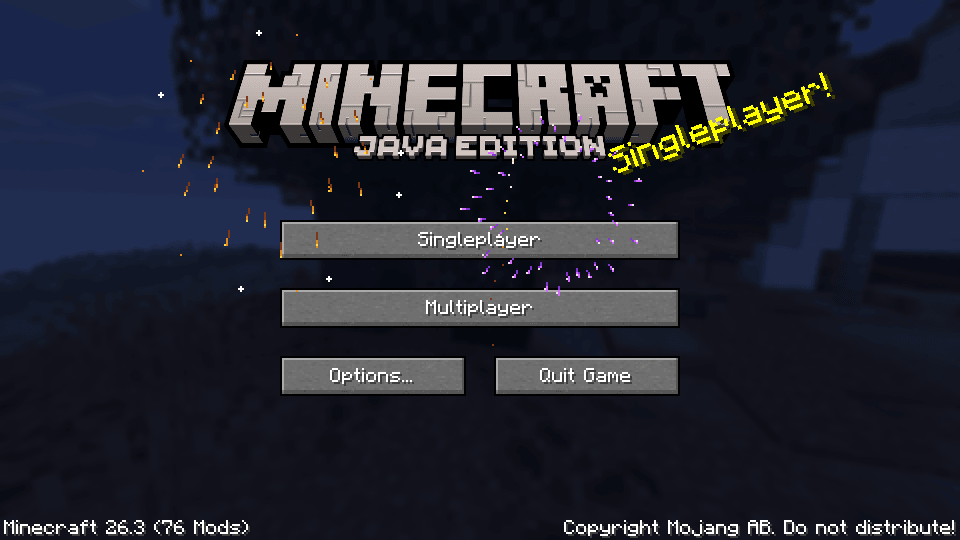

# Nakładki dekoracyjne

Nakładki dekoracyjne to animowane efekty obejmujące cały ekran, takie jak padający śnieg, świetliki, mgła czy lampki. Wiele z nich wchodzi w interakcję z menu: śnieg gromadzi się na przyciskach, ptaki na nich siadają, a mgła rozstępuje się wokół kursora.


# Dodawanie nakładki

1. Otwórz układ w edytorze układów.
2. Kliknij prawym przyciskiem myszy tło edytora i otwórz **Nakładki dekoracyjne**.
3. Otwórz wybraną nakładkę, na przykład **Opady śniegu**.
4. Kliknij **Pokaż nakładkę**, aby ją włączyć.

Włączone nakładki są oznaczone na liście symbolem ✔. Układ może wyświetlać dowolną liczbę nakładek. Najedź kursorem na nakładkę lub jedno z jej ustawień, aby zobaczyć, do czego służy.

Nakładki działają również w edytorze układów, ale reagują na elementy dopiero w prawdziwym menu. Zapisz układ i otwórz menu, aby zobaczyć pełny efekt.

Jeśli nakładki są włączone w kilku układach tego samego ekranu, wszystkie będą działać — nawet jeśli włączono tę samą nakładkę kilka razy. Dotyczy to również [układów uniwersalnych](/universal-layouts).

# Ustawienia wspólne dla wszystkich nakładek

Każda nakładka ma dwa ustawienia:

- **Pokaż nakładkę** włącza lub wyłącza nakładkę.
- **Warstwy** określa, gdzie jest rysowana nakładka:
  - **Tło i pierwszy plan**: dalsze elementy są rysowane za Twoimi elementami, a bliższe — przed nimi, co daje przyjemne wrażenie głębi. To ustawienie domyślne.
  - **Tylko tło**: wszystko jest rysowane za Twoimi elementami, ale przed tłem menu.
  - **Tylko pierwszy plan**: wszystko jest rysowane przed Twoimi elementami.

Efekty nakładki, które pojawiają się bezpośrednio na Twoich elementach, na przykład śnieg na przycisku, zawsze pozostają na tych elementach.

Wiele nakładek ma również następujące ustawienia:

| Ustawienie | Działanie |
|---|---|
| **Ilość (%)** | Określa ilość efektu — od 25% do 300%. Wartość 100% oznacza zwykłą ilość. |
| **Rozmiar** | Powiększa pikselową grafikę 2 lub 3 razy. Każdy piksel pozostaje wyraźnym kwadratem. |
| **Wygląd** | **Szczegółowy** pokazuje pełną grafikę pikselową z cieniowaniem i dodatkowymi efektami. **Prosty** jest bardziej płaski i bliższy klasycznemu wyglądowi. |

# Nakładki a elementy

Wiele nakładek wchodzi w interakcję z elementami: śnieg, popiół i konfetti gromadzą się na nich, sople zwisają z ich krawędzi, porasta je mech, a ptaki na nich siadają.

Aby wybrać, które elementy będą brały udział w interakcji, kliknij element prawym przyciskiem myszy i ustaw opcję **Powinien podlegać nakładkom dekoracyjnym**:

- Ta opcja jest domyślnie włączona dla przycisków, suwaków, pól wyboru, pól tekstowych oraz [elementów waniliowych](/vanilla-elements).
- Dotyczy to również logo, tekstu powitalnego, oznaczeń marki i informacji o prawach autorskich na ekranie tytułowym. Wyłącz tę opcję dla tych elementów, jeśli nic nie powinno na nich lądować.
- Ukryte elementy nie biorą udziału w interakcji. Nie bierze w niej udziału także część elementu odcięta przez [obszar przewijania](/scrollable-areas).

> [!TIP]
> Pozostaw co najmniej 13 pikseli odstępu między elementami. To, jak duże mogą być efekty gromadzące się na elemencie lub zwisające z niego, zależy od wolnego miejsca do następnego elementu.

Niektóre nakładki reagują na kliknięcia, na przykład Bańki, Szron i Konfetti. Twoje przyciski nadal będą reagować na każde kliknięcie.

# Wszystkie nakładki dekoracyjne

Poniżej znajdziesz wszystkie nakładki dekoracyjne FancyMenu, pogrupowane tematycznie.

## Pogoda

### Opady śniegu

Śnieg pada i powoli gromadzi się na przyciskach oraz wzdłuż dolnej krawędzi ekranu.


- **Gromadzenie śniegu** pozwala śniegowi się gromadzić.
- **Kolor śniegu [HEX]**, **Prędkość opadów śniegu**, **Ilość (%)** i **Rozmiar** zmieniają wygląd śniegu.

### Opady deszczu

Pada deszcz, tworzą się fale na płytkich kałużach, a z przycisków kapią krople.


- **Kałuże** nadają elementom i dolnej krawędzi ekranu mokry połysk. W miejscach, w które uderzają krople, pojawiają się fale.
- **Krople** sprawia, że krople zbierają się na elementach i z nich spadają.
- **Błyski piorunów** dodają od czasu do czasu błyskawice z rozgałęziającym się piorunem i delikatnym rozbłyskiem. Ustawienie **Jasność błysków piorunów** określa ich jasność.
- **Kolor deszczu [HEX]**, **Ilość (%)** i **Rozmiar** zmieniają wygląd deszczu.

> [!WARNING]
> **Błyski piorunów** powodują miganie ekranu. Wyłącz tę opcję, jeśli gracze mogą być wrażliwi na migające światło.

### Mgła

Delikatne warstwy mgły przesuwają się po ekranie i nad elementami. Najgęstsza mgła znajduje się przy ziemi.


- **Rozstępowanie się mgły wokół kursora** sprawia, że mgła rozsuwa się wokół myszy.

### Szron

Twoje menu pokrywa się lodem. Lód wpełza od krawędzi, wchodzi w narożniki i osadza się na elementach. Kliknij lód, aby odłupać jego kawałek.


- **Krawędzie ekranu**, **Narożniki** i **Na elementach** włączają lub wyłączają poszczególne obszary pokryte lodem. Etykiety na elementach pozostają czytelne.

## Natura

### Liście

Liście spadają i są porywane przez podmuchy wiatru.


- **Wygląd** przełącza między **Szczegółowymi** i **Prostymi** liśćmi.
- **Kolory** pozwala wybrać **Jesienną paletę** (pięć ciepłych, jesiennych kolorów) lub **Zakres niestandardowy** (pięć kolorów z zakresu od **Początkowy kolor liści [HEX]** do **Końcowy kolor liści [HEX]**).
- **Podmuchy wiatru** włącza lub wyłącza silne podmuchy. **Siła wiatru** określa, jak mocno wieje.
- **Gęstość liści**, **Prędkość opadania liści** i **Skala nakładki liści** zmieniają wygląd liści.

### Kwiaty wiśni

Kwitnące gałęzie wychodzą z górnych narożników, a płatki opadają na ekran.


- **Lewa gałąź** i **Prawa gałąź** pokazują lub ukrywają daną gałąź.
- **Wygląd** i **Ilość (%)** zmieniają wygląd płatków.

### Zarastanie

Natura przejmuje Twoje menu: mech, pnącza, trawa i kwiaty powoli porastają całą jego powierzchnię.


- **Trawa**, **Lewe pnącza**, **Prawe pnącza** i **Na elementach** włączają lub wyłączają poszczególne rodzaje roślinności. Etykiety na elementach pozostają czytelne.
- Opcje **Kwiaty na pnączach**, **Kwiaty na elementach** i **Kwiaty w trawie** pozwalają rozkwitać kwiatom w tych miejscach. **Kwiaty (%)** określa ich ilość.

### Chmury

Puszyste, pikselowe chmury przesuwają się po niebie za elementami, na trzech warstwach głębi. Chmury nie mają własnych ustawień.


### Promienie słońca

Promienie światła rozchodzą się od słońca znajdującego się tuż poza ekranem. W świetle tańczy kurz.


- **Strona słońca** określa krawędź ekranu, za którą znajduje się słońce. **Kąt słońca (°)** przesuwa je wzdłuż tej krawędzi.
- **Kolor światła słonecznego [HEX]** i **Intensywność (%)** zmieniają światło.
- **Poświata słońca** tworzy delikatną poświatę wokół słońca.
- **Kurz** pozwala drobinom kurzu unosić się w promieniach. Poruszanie myszą wprawia je w ruch.
- **Zatrzymuj się na elementach** sprawia, że promienie zatrzymują się na elementach, rozświetlają ich krawędzie i rzucają cienie. Gdy opcja jest wyłączona, promienie świecą przed elementami.

### Bańki

Strumienie baniek kołyszą się w górę i przesuwają wzdłuż spodniej krawędzi elementów. Kliknij je, aby je przebić! Bańki nie mają własnych ustawień.


## Zwierzęta

### Ptaki

Małe ptaki przylatują, podskakują po elementach i odlatują, gdy mysz zbytnio się zbliży.


### Motyle

Kolorowe motyle trzepoczą skrzydłami, odpoczywają na elementach i uciekają przed myszą.


### Nietoperze

Małe grupy nietoperzy przelatują przez ekran, a potem zasypiają, zwisając z elementów. Podejdź zbyt blisko, a się obudzą!


Ptaki, Motyle i Nietoperze mają ustawienia **Ilość (%)** i **Rozmiar**.

### Świetliki

Grupy świetlików świecą i wędrują po ekranie. Niektóre siadają na elementach.


- **Wygląd** przełącza między **Szczegółowymi** i **Prostymi** świetlikami. **Nieświecące tułowia** pokazuje ich ciemne, małe ciała między błyskami.
- **Podążaj za myszą** sprawia, że grupy podążają za myszą, gdy ta znajdzie się blisko.
- **Lądowanie** pozwala świetlikom od czasu do czasu siadać na elementach.
- **Kolor świetlików [HEX]**, **Liczba grup**, **Gęstość grup**, **Rozmiar grup** i **Skala świetlików** zmieniają wygląd świetlików.

### Buddy

Buddy to mały wirtualny zwierzak mieszkający u dołu menu. Chodzi dookoła, pokazuje w dymkach, czego potrzebuje, reaguje na wspólną zabawę i pamięta wszystko między sesjami gry.


#### Opieka nad Buddym

Buddy ma cztery potrzeby, mierzone w skali od `0` do `100`:

- **Głód** zmniejsza się z czasem. Jedzenie go zaspokaja.
- **Szczęście** zmniejsza się z czasem. Głaskanie, jedzenie i zabawa poprawiają nastrój Buddy’ego.
- **Energia** spada, gdy Buddy nie śpi, i uzupełnia się podczas snu.
- **Zabawa** zmniejsza się z czasem. Wspólna zabawa ją zwiększa.

Aby opiekować się Buddym:

- Kliknij Buddy’ego lewym przyciskiem myszy, aby go pogłaskać. Obudzenie go w ten sposób nieco obniża jego szczęście.
- Kliknij Buddy’ego prawym przyciskiem myszy, aby otworzyć ekran stanu. Karta **Statystyki** pokazuje jego potrzeby, poziom i PD. Karta **Osiągnięcia** pokazuje zdobyte osiągnięcia.
- Kliknij **Nakarm** na ekranie stanu, a następnie przeciągnij jedzenie do Buddy’ego.
- Kliknij **Zabawa** na ekranie stanu, a następnie przeciągnij piłkę i puść ją, aby ją rzucić. Buddy będzie za nią gonił i ją łapał.
- Kliknij **Sen**, aby Buddy odpoczął. Zasypia też sam, gdy jego energia bardzo spadnie.
- Buddy od czasu do czasu robi kupę. Kliknij ją lewym przyciskiem myszy, aby ją posprzątać. Jeśli wokół leżą co najmniej trzy kupy, szczęście Buddy’ego będzie stale spadać.

#### Poziomy i osiągnięcia

Opieka nad Buddym daje mu PD. Buddy zdobywa kolejne poziomy od 1 do 30. Im wyższy jego poziom, tym wolniej spadają jego głód, szczęście i energia — na poziomie 30 spadają nawet dwa razy wolniej.

#### Śmierć Buddy’ego

Jeśli głód lub szczęście Buddy’ego utrzymuje się na poziomie `0` przez 10 godzin rzeczywistego czasu, Buddy umiera i zostawia nagrobek. Kliknij nagrobek lewym przyciskiem myszy, aby zacząć od nowa z nowym Buddym. Wyłącz opcję **Buddy może umrzeć**, aby zapobiec jego śmierci.

Opcja **Zresetuj zapis Buddy’ego** pozwala w dowolnym momencie zacząć od nowa.

> [!WARNING]
> Zresetowanie Buddy’ego bezpowrotnie usuwa jego potrzeby, poziom, PD, osiągnięcia i kupy.

#### Zapisywanie i dostosowywanie

Buddy zapisuje się mniej więcej co dwie minuty oraz po zamknięciu jego ekranu. Zapis znajduje się w folderze `<game-directory>/fancymenu_data/buddy/`. Każda nakładka Buddy’ego ma własny zapis. Zobacz [Lokalizacje przechowywania danych](/data-storage-locations).

- **Niestandardowe tekstury** zastępuje własnymi teksturami duszki Buddy’ego, przedmioty, ikony, ekran stanu i nagrobek.
- **Dostosowanie statystyk** zmienia tempo spadku potrzeb, koszty i korzyści różnych czynności oraz maksymalną liczbę kup, które mogą leżeć jednocześnie (**Maks. liczba kup**).

## Nocne niebo

### Zorza polarna

Świecąca zorza polarna rozciąga się w górnej części nieba i powoli faluje za elementami.


- **Kolor krawędzi [HEX]** określa kolor jasnej, dolnej krawędzi. **Kolor górnej krawędzi [HEX]** określa kolor, w który przechodzą promienie.

### Spadające gwiazdy

Rozgwieżdżone nocne niebo za elementami, spadająca gwiazda co kilka sekund i od czasu do czasu cały deszcz meteorów. Spadające gwiazdy nie mają własnych ustawień.


### Lampiony

Świecące papierowe lampiony unoszą się ku nocnemu niebu, czasem całymi grupami. Lampiony mają ustawienia **Ilość (%)** i **Rozmiar**.


## Impreza

### Konfetti

Działa strzelające w konfetti, umieszczone w dolnych narożnikach, wystrzeliwują je co kilka sekund. Konfetti gromadzi się na elementach.


- **Działa w narożnikach** włącza lub wyłącza działa.
- **Wybuch po kliknięciu** wystrzeliwuje niewielką porcję konfetti w miejscu kliknięcia.
- **Tryb mieszania kolorów** używa losowych kolorów. Wyłącz tę opcję, aby używać koloru **Kolor konfetti [HEX]** dla całego konfetti.
- **Limit cząsteczek na elementach** określa, ile kawałków konfetti może jednocześnie leżeć na ekranie.
- **Ilość (%)**, **Rozmiar** i **Prędkość opadania konfetti** zmieniają wygląd konfetti.

### Fajerwerki

Rakiety wzlatują i wybuchają fajerwerkami.



- **Pokaż lot rakiety** pokazuje rakiety w trakcie wznoszenia.
- **Ilość (%)**, **Rozmiar** i **Rozmiar eksplozji** zmieniają wygląd fajerwerków.

### Lampki

Sznury lampek wiszą nad menu i kołyszą się na wietrze.


- **Wygląd** przełącza między **Prostymi** i **Szczegółowymi** lampkami. Opcja **Girlanda sosnowa** zastępuje przewód igłami sosny z bombkami.
- **Tryb świecenia lampek** określa, jak lampki świecą i migają (patrz niżej).
- **Skala lampek**, **Siła wiatru** i **Prędkość migotania** zmieniają wszystkie sznury.
- Ustawienie **Sznury** zawiera menu dla każdego z ośmiu miejsc, w których można zawiesić sznur. Włącz sznur opcją **Pokaż lampki**.

Każdy sznur ma następujące ustawienia:

- **Liczba lampek** określa, ile lampek na nim wisi. Wartość `0` rozmieszcza lampki na całej długości sznura.
- **Kolor lampek [HEX]** określa kolor lampek. Opcja **Tryb lampek bożonarodzeniowych** sprawia, że lampki mają różne kolory.
- **Kolor sznura [HEX]** określa kolor przewodu. Użyj kanału alfa, aby przewód stał się przezroczysty lub niewidoczny.
- Opcje **Indywidualne kolory lampek** i **Indywidualne rozmiary lampek** pozwalają przypisać każdej lampce osobny kolor lub rozmiar, zapisane w postaci listy wartości oddzielonych przecinkami. Jeśli lampek jest więcej niż wartości, lista zaczyna się od początku:

```
#FF0000, #00FF00, #0000FF
```

| Tryb świecenia | Działanie lampek |
|---|---|
| **Włączone** | Wszystkie lampki świecą, a od czasu do czasu jedna delikatnie przygasa, jak prawdziwa lampka. |
| **Pełna jasność** | Wszystkie lampki świecą z pełną jasnością. |
| **Połowa jasności** | Wszystkie lampki świecą z połową jasności. |
| **Wyłączone** | Wszystkie lampki są zgaszone. |
| **Cykl** | Odtwarza kolejno efekty Migotanie, Pościg, Naprzemiennie i Oddychanie, zmieniając je co 7 sekund. |
| **Migotanie** | Lampki migają w losowych momentach. |
| **Pościg** | Jasne światło przemieszcza się wzdłuż sznura. |
| **Naprzemiennie** | Świeci co druga lampka, po czym zapala się druga połowa. |
| **Oddychanie** | Wszystkie lampki powoli rozjaśniają się i przygasają jednocześnie. |

## Upiorne efekty

### Pajęczyny

W górnych narożnikach wiszą zakurzone pajęczyny, a na nitkach opuszczają się małe pająki.


- **Lewa pajęczyna** i **Prawa pajęczyna** pokazują lub ukrywają daną pajęczynę wraz z pająkiem.
- Opcja **Pająki** pozwala pająkom opuszczać się, zwisać i wspinać z powrotem. Uciekają przed myszą.
- **Zamknięty przód** łączy końce nici obręczą, dzięki czemu na ekranie nie pozostają luźne nitki.

### Żar

Świecące węgle unoszą się od dołu, a popiół opada i gromadzi się na elementach.


- **Popiół na podłożu** dodaje grubą warstwę popiołu wzdłuż dolnej krawędzi ekranu, z tlącymi się plamami i żarzącymi węglami.
- **Popiół na elementach** pozwala popiołowi gromadzić się na elementach.

## Niestandardowe

### Przeglądarka

Nakładka Przeglądarka wyświetla stronę internetową na całym ekranie.

> [!IMPORTANT]
> Nakładka Przeglądarka wymaga moda [Rinku](https://modrinth.com/mod/rinku).

- **Adres URL** określa stronę internetową do wyświetlenia.
- Opcje **Przechwytuj kliknięcia myszy**, **Przechwytuj przewijanie myszy** i **Przechwytuj naciśnięcia klawiszy** zapobiegają przekazywaniu danych wejściowych do menu znajdującego się za przeglądarką.
- Opcje **Obsługuj kliknięcia myszy**, **Obsługuj przewijanie myszy** i **Obsługuj naciśnięcia klawiszy** pozwalają przeglądarce reagować na dane wejściowe.
- Opcje **Ukryj elementy sterujące odtwarzaniem**, **Zapętlaj filmy**, **Wycisz przeglądarkę** i **Głośność dźwięku/wideo** sterują filmami i dźwiękiem na stronie.

Opcje przechwytywania i obsługi są domyślnie włączone, więc przeglądarka działa przed menu jak zwykła przeglądarka. Aby wyświetlić stronę internetową wyłącznie jako tło, wyłącz je wszystkie.

Strony internetowe mogą również uruchamiać akcje FancyMenu i odczytywać zmienne zastępcze. Zobacz [API JavaScript przeglądarki](/browser-api).

### Shader GLSL

Nakładka Shader GLSL rysuje na całym ekranie własny shader, tworząc efekty animowane lub statyczne. Wklej kod shadera w polu **Źródło shadera**.

Informacje o pisaniu shaderów dla FancyMenu znajdziesz w dokumentacji [API shaderów GLSL](/glsl-shader-api).
