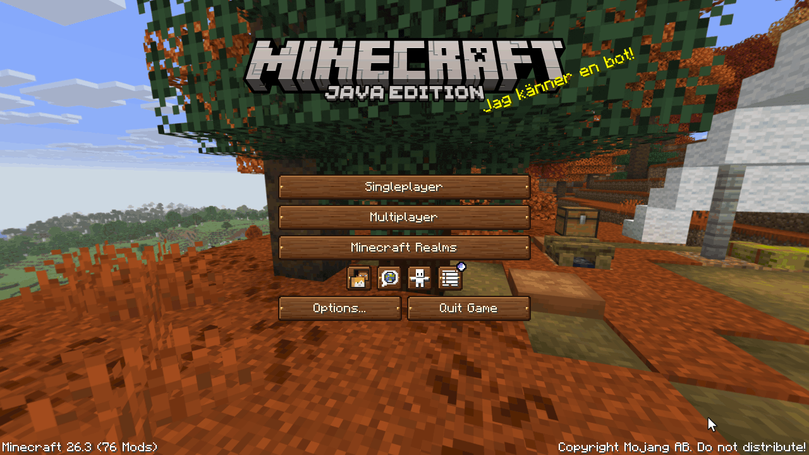

# Dostosowania globalne

Dostosowania globalne zmieniają jednocześnie wszystkie ekrany: przyciski, suwaki, tła menu, muzykę, okno gry i nie tylko. Nie wymagają układu i działają również na ekranach, na których wyłączono dostosowywanie.

Otwórz je na dowolnym ekranie poza edytorem układów, wybierając **pasek menu -> Dostosowywanie -> Dostosowania globalne**. Zmiany są stosowane od razu i zapisywane automatycznie.

> [!TIP]
> Aby zmienić tylko niektóre ekrany, użyj [układów](/layout-editor). Aby nadać przyciskom z wybranych układów własny wygląd, użyj [szablonów przycisków i suwaków](/button-slider-templates).

# Przyciski i suwaki

Te ustawienia zmieniają wszystkie przyciski i suwaki na wszystkich ekranach, również te pochodzące z innych modów.

- Przyciski i suwaki, które mają własne tekstury lub ustawienia etykiet z [układu](/layout-editor) albo [szablonu](/button-slider-templates), zachowują je.
- Przyciski będące wyłącznie obrazem, takie jak przycisk książki z przepisami, zachowują swój wygląd.

## Tekstury przycisków

Opcja **Własne tekstury przycisków** udostępnia osobną teksturę dla każdego stanu przycisku:

- **Normalny**
- **Po najechaniu**: gdy kursor znajduje się nad przyciskiem lub przycisk jest zaznaczony za pomocą klawiatury.
- **Nieaktywny**: gdy nie można kliknąć przycisku.

Ustaw tekstury dla wszystkich trzech stanów. Jeśli dla danego stanu nie ustawiono tekstury, wyświetlany jest oryginalny przycisk Minecrafta.

W tym samym menu znajdziesz więcej ustawień:

- **Przezroczyste tło** ukrywa tło wszystkich przycisków, pozostawiając widoczne tylko ich etykiety. To ustawienie ma pierwszeństwo przed teksturami.
- **Tła przycisków z podziałem na dziewięć części** zachowuje ostre krawędzie tekstur przy każdym rozmiarze przycisku. Poniżej tej opcji możesz ustawić szerokość czterech krawędzi. Zobacz [Podział na dziewięć części i kafelkowanie](/nine-slicing-and-tiling).

> [!TIP]
> Bez podziału na dziewięć części tekstury są rozciągane do rozmiaru każdego przycisku. Przyciski Minecrafta mają 20 pikseli wysokości i zazwyczaj 200 lub 150 pikseli szerokości. Dzięki podziałowi na dziewięć części jedna mała tekstura pasuje do wszystkich przycisków.

## Tekstury suwaków

Opcja **Własne tekstury suwaków** składa się z dwóch części:

- **Tekstura tła suwaka**: pasek suwaka. Ustaw ją za pomocą opcji **Ustaw teksturę**. Opcje **Przezroczyste tło** i **Tło suwaka z podziałem na dziewięć części** działają tak samo jak w przypadku przycisków.
- **Tekstury uchwytu suwaka**: przesuwana część suwaka. Możesz ustawić tekstury dla stanów **Normalny**, **Po najechaniu** i **Nieaktywny**, a także użyć opcji **Uchwyt suwaka z podziałem na dziewięć części**.

Uchwyt suwaków Minecrafta ma 8 pikseli szerokości i tyle samo wysokości co suwak — zazwyczaj 20 pikseli. Bez podziału na dziewięć części tekstury uchwytu są rozciągane do tego rozmiaru.

## Etykiety

Opcje **Etykiety przycisków** i **Etykiety suwaków** mają te same ustawienia:

| Ustawienie | Działanie |
|---|---|
| **Podkreślaj etykietę po najechaniu** | Podkreśla etykietę, gdy znajduje się nad nią kursor. |
| **Podstawowy kolor etykiety** | Kolor etykiety. Ustaw go za pomocą selektora kolorów lub jako kod HEX, na przykład `#FFF1D6`. |
| **Kolor etykiety po najechaniu** | Kolor etykiety, gdy znajduje się nad nią kursor. |
| **Skala etykiety** | Rozmiar etykiety. `1` oznacza rozmiar normalny. |
| **Wyrównanie etykiety** | **Do lewej**, **Do środka** lub **Do prawej**. |
| **Cień etykiety** | Ciemny cień za etykietą. Po wyłączeniu żadna etykieta nie ma cienia, nawet etykiety z układów. |

Etykiety z własnymi ustawieniami z układu lub szablonu zachowują je. W przypadku opcji **Skala etykiety** i **Wyrównanie etykiety** ustawienie globalne dotyczy tylko etykiet o normalnym rozmiarze i wyrównanych **Do środka**.

## Dźwięk kliknięcia

- **Własny dźwięk kliknięcia przycisku** zastępuje dźwięk kliknięcia przycisków i suwaków Minecrafta. Przyciski z własnym dźwiękiem kliknięcia ustawionym w układzie zachowują go.
- **Głośność własnego dźwięku kliknięcia przycisku** można ustawić w zakresie od 0% do 100%. Dodatkowo obowiązuje głośność kanału tego dźwięku w ustawieniach dźwięku Minecrafta.
- **Kanał własnego dźwięku kliknięcia przycisku** określa kanał, na którym jest odtwarzany dźwięk, na przykład Muzyka. Domyślnie jest to Głośność główna — kanał wszystkich dźwięków.

# Tła menu

Opcja **Własna tekstura tła menu** ustawia obraz wyświetlany za wszystkimi menu z wyjątkiem ekranu Tytuł:

- Obraz jest wyświetlany również za menu pauzy i ekranem Opcje podczas gry, ukrywając w tych miejscach świat. Ekwipunek, znaki i książki pozostają przezroczyste.
- **Zachowaj proporcje tekstury tła** zachowuje proporcje obrazu. Nadal wypełnia on cały ekran, ale fragmenty, które się nie mieszczą, zostają przycięte. Po wyłączeniu obraz jest rozciągany do rozmiaru ekranu.

Opcja **Własna panorama tła menu** zastępuje panoramę Minecrafta na ekranie Tytuł i we wszystkich menu przed dołączeniem do świata:

- **Wybierz panoramę** pozwala wybrać jedną z [panoram](/panoramas).
- **Wyczyść panoramę** przywraca panoramę Minecrafta.
- **Bieżąca panorama** pokazuje, która panorama jest ustawiona.

Jeśli ustawiono obie opcje, tekstura zakrywa panoramę, dlatego panorama jest widoczna tylko na ekranie Tytuł.

Ekrany, których układ ma własne [tło menu](/menu-backgrounds), wyświetlają właśnie to tło.

# Muzyka w menu

- **Odtwarzaj oryginalną muzykę menu** włącza lub wyłącza muzykę Minecrafta w menu.
- **Własne utwory muzyczne menu** otwiera okno **Zarządzaj utworami muzycznymi menu**. Opcja **Dodaj utwór** dodaje dźwięk, **Usuń utwór** usuwa wybrany utwór, **Wyczyść utwory** usuwa wszystkie utwory, a **Gotowe** zapisuje listę.

Przed dołączeniem do świata utwory są odtwarzane w menu w losowej kolejności zamiast muzyki menu Minecrafta. Więcej informacji o nich i muzyce na pojedynczych ekranach znajdziesz na stronie [Muzyka tła menu](/background-music).

# Ekrany i wyskakujące powiadomienia

| Ustawienie | Działanie |
|---|---|
| [**Intro gry**](/game-intro) | Odtwarza animację lub film przed wyświetleniem ekranu Tytuł. |
| **Ikony światów na ekranie trybu jednoosobowego** | Ikony światów na liście światów. Po wyłączeniu są ukryte. |
| **Ikony serwerów na ekranie trybu wieloosobowego** | Ikony serwerów na liście serwerów. Po wyłączeniu są ukryte. |
| [**Płynne wczytywanie świata**](/seamless-world-loading) | Robi zrzut ekranu po opuszczeniu świata lub serwera i wyświetla go jako tło wczytywania przy ponownym dołączaniu. |
| **Powiadomienia o osiągnięciach** | Wyskakujące powiadomienia w prawym górnym rogu, wyświetlane po odblokowaniu osiągnięcia, oraz ich dźwięki. Po wyłączeniu są ukryte. Wiadomości o osiągnięciach na czacie nadal się pojawiają, a nasłuchiwacz [Po odblokowaniu osiągnięcia](/listeners#on-achievement-unlocked) nadal działa. |

# Okno i uruchamianie gry

| Ustawienie | Działanie |
|---|---|
| [**Własna ikona okna**](/window-customization#custom-icon) | Ikona okna gry. Wymaga ikony PNG w rozmiarach 16x16 i 32x32 oraz ikony systemu macOS. |
| [**Własny tytuł okna**](/window-customization#custom-title) | Zastępuje tytuł okna Minecrafta. Można używać [symboli zastępczych](/placeholders), a tytuł aktualizuje się po ich zmianie. |
| **Domyślna skala interfejsu** | Ustawia skalę interfejsu Minecrafta jeden raz, przy pierwszym uruchomieniu instancji gry, na przykład na `2` lub `3`. Wartość `-1` wyłącza tę opcję. Ustawienie przeznaczone dla paczek modów. |
| **Wymuś pełny ekran przy uruchamianiu** | Przy każdym uruchomieniu przełącza grę na pełny ekran. |

FancyMenu zapamiętuje ustawienie opcji **Domyślna skala interfejsu** w pliku `fancymenu_data/default_scale_set.fm`. Usuń ten plik, aby skala została ustawiona ponownie przy następnym uruchomieniu (zobacz [Lokalizacje przechowywania danych](/data-storage-locations#instance-data)).

# Warto wiedzieć

- Dostosowania globalne są zapisywane w pliku `options.txt` FancyMenu, więc należą do wczytanego [profilu](/profiles) i są dołączane do paczek modów zawierających katalog `config/fancymenu/`.
- Tekstury i dźwięki mogą pochodzić z plików instancji, linków internetowych lub plików paczek zasobów. Zobacz [Zasoby](/resources).
- Opcja **pasek menu -> Pomoc -> Eksportuj dla AI -> Ustawienia FancyMenu** uwzględnia te ustawienia. Możesz jej użyć, zadając pytania na [czacie AI](/export-for-ai).
