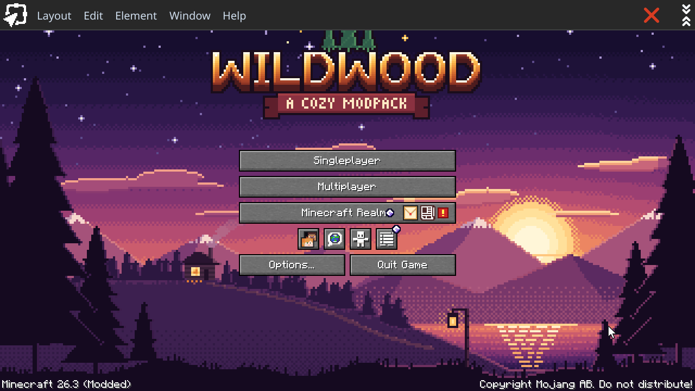

# Pierwsze kroki

FancyMenu pozwala zmieniać wszystkie menu Minecrafta, takie jak ekran tytułowy, menu pauzy i menu innych modów. Dodawaj własne tła, logo, przyciski, teksty, dźwięki i animacje, przesuwaj lub ukrywaj istniejące elementy, przypisuj przyciskom nowe działania albo twórz całkiem nowe menu. Wszystko odbywa się w grze, bez pisania kodu.

Na tej stronie krok po kroku poznasz podstawy. Po drodze stworzysz prostszą wersję tego ekranu tytułowego, a sekcja [Jak powstał przykład](#how-the-example-is-made) pokazuje, co dodano do pełnej wersji.

> [!TIP]
> Pobierz ten ekran tytułowy do swojej gry: ściągnij plik [wildwood_title_screen.fmp](https://raw.githubusercontent.com/Keksuccino/docs_fancymenu/refs/heads/wiki-2026/assets/wildwood_title_screen.fmp?raw=true), a następnie [zaimportuj](/profiles#importing) go i [wczytaj](/profiles#loading-a-profile) w **pasek menu -> Dostosowywanie -> Profile**. Możesz bezpłatnie używać go w dowolnym celu, na przykład do wypróbowania FancyMenu, nauki lub w swojej paczce modów, ze zmianami albo bez. Nie musisz podawać autora.

# Pasek menu

Pasek menu u góry każdego menu daje dostęp do wszystkich funkcji FancyMenu.

- **Dostosowywanie**: układy aktualnie otwartego menu oraz ustawienia całej konfiguracji, takie jak [Dostosowywanie globalne](/global-customizations), [Niestandardowe GUI](/custom-guis), [Zmienne](/variables), [Nasłuchiwacze](/listeners), [Harmonogramy](/schedulers), [Profile](/profiles) i ustawienia FancyMenu.
- **Narzędzia**: pomocnicze funkcje, takie jak [Instancje ekranów testowych](/dummy-screen-instances), [Kreator AFMA](/animations#fma-and-afma), **Przeglądaj zasoby gry** i **Otwórz folder FancyMenu**, który otwiera folder konfiguracji (zob. [Lokalizacje przechowywania danych](/data-storage-locations)).
- **Pomoc**: ta dokumentacja, serwer Discord, **Zgłoś błąd** i [Eksport dla AI](/export-for-ai).
- Ikona drzwi po prawej zamyka aktualnie otwarte menu — przydaje się w menu, z których nie da się inaczej wyjść.
- Podwójne strzałki skrajnie po prawej zwijają pasek menu do małego przycisku i ponownie go rozwijają.

Gracze Twojej paczki modów nie potrzebują paska menu. Informacje o tym, jak go wyłączyć, znajdziesz w sekcji [Paczki modów](/modpacks#disabling-the-menu-bar-and-hotkeys).

## Skróty paska menu

Skróty działają w każdym menu, ale nie w edytorze układów ani wtedy, gdy włączony jest tryb paczki modów. W systemie macOS używaj `Cmd + Option` zamiast `Ctrl + Alt`.

| Skrót | Działanie |
|---|---|
| `Ctrl + Alt + C` | Pokaż lub ukryj pasek menu. Jeśli nagle zniknie, użyj tego skrótu, aby go przywrócić. |
| `Ctrl + Alt + R` | Przeładuj FancyMenu, tak jak po wybraniu **pasek menu -> Dostosowywanie -> Przeładuj FancyMenu** |
| `Ctrl + Alt + D` | Pokaż lub ukryj **nakładkę debugowania**, która wyświetla [identyfikator](/screen-identifiers) menu i inne informacje |
| `Ctrl + Alt + L` | Otwórz [edytor układów](/layout-editor) z ostatnio edytowanym układem |

# Twój pierwszy układ

Układ przechowuje zmiany wprowadzone w menu: jego tło, dodane elementy oraz zmiany przycisków i tekstów, które już się w nim znajdują. Menu może mieć kilka układów, a każdy z nich można włączać i wyłączać.

## Tworzenie układu

1. Otwórz menu, które chcesz zmienić, na przykład ekran tytułowy.
2. Kliknij **pasek menu -> Dostosowywanie -> Dostosowywanie bieżącego ekranu**, tak aby pojawił się stan **Włączone**. FancyMenu zmienia tylko te menu, w których ta opcja jest włączona.
3. Kliknij **pasek menu -> Dostosowywanie -> Układy -> Nowy -> Dla bieżącego ekranu**.

Otworzy się edytor układów. Wyświetla menu tak, jak widzą je gracze, więc każdą zmianę zobaczysz od razu. Więcej informacji, na przykład o przesuwaniu, zmianie rozmiaru i kopiowaniu elementów, znajdziesz w sekcji [Edytor układów](/layout-editor).

Opcja **Dla wszystkich ekranów [uniwersalny]** tworzy [układ uniwersalny](/universal-layouts), który pojawia się w każdym menu.

## Ustawianie tła

Najpierw umieść obrazy w folderze `config/fancymenu/assets` swojej gry. Opcja **pasek menu -> Narzędzia -> Otwórz folder FancyMenu** otwiera folder `config/fancymenu`.

1. Kliknij prawym przyciskiem tło edytora i otwórz **Tła menu -> Obraz**.
2. Kliknij **Pokaż tło**, tak aby pojawił się stan **Włączone**.
3. Kliknij **Wybierz obraz**, ustaw **Typ źródła** na **Lokalny**, a następnie kliknij **Wybierz lokalny plik zasobu**.
4. Kliknij swój obraz, a potem **OK**. Dwukrotne kliknięcie otwiera foldery.

Jako tła można też ustawić panoramy, pokazy slajdów, filmy, kolory i wiele innych rzeczy. Zobacz [Tła menu](/menu-backgrounds).

## Dodawanie logo

1. Kliknij logo Minecrafta i naciśnij `Delete`. Zrób to samo z żółtym tekstem powitalnym.
2. Na pasku menu edytora kliknij **Element -> Nowy -> Obraz**.
3. Kliknij prawym przyciskiem nowy element, wybierz **Źródło obrazu** i wskaż swoje logo — tak samo jak w przypadku tła.

Usunięte elementy z podstawowej wersji gry są tylko ukrywane. Przywrócisz je, klikając **Element -> Usunięte elementy z podstawowej wersji gry**.

4. Kliknij je ponownie prawym przyciskiem i wybierz **Przywróć proporcje**, aby nie było ściśnięte. Klawisz `Esc` zamyka menu.
5. Przeciągnij logo na właściwe miejsce.

Możesz dodać wiele innych elementów, takich jak przyciski, teksty, filmy i odtwarzacze. Zobacz [Elementy](/elements).

## Zmienianie przycisków

1. Kliknij pierwszy przycisk, a następnie przytrzymaj `Ctrl` (`Cmd` w systemie macOS) i kliknij pozostałe, aby zaznaczyć je wszystkie. Kliknięcie prawym przyciskiem jednego z nich zmieni wszystkie zaznaczone przyciski naraz.
2. Kliknij jeden z nich prawym przyciskiem, wybierz **Tekstury przycisków -> Ustaw -> Zwykłe tło** i wskaż swoją teksturę — tak jak w przypadku tła.

3. Zrób to samo dla opcji **Tło po najechaniu** — tekstury wyświetlanej, gdy kursor znajduje się nad przyciskiem.
4. Kliknij **Tekstury przycisków -> Niestandardowe tło typu nine-slice**, tak aby pojawił się stan **Włączone**. Dzięki temu krawędzie tekstury pozostaną ostre na przyciskach o dowolnej szerokości. Zobacz [Podział na dziewięć części](/nine-slicing-and-tiling).

Menu kontekstowe kilku elementów zawiera tylko ustawienia wspólne dla nich wszystkich, dlatego zaznaczaj wyłącznie przyciski. Kliknij pojedynczy przycisk prawym przyciskiem, aby wyświetlić wszystkie jego ustawienia, na przykład etykietę, dźwięki, działanie po kliknięciu ([Skrypty akcji](/action-scripts)) i warunki wyświetlania ([Widoczność elementów](/element-visibility)). Zobacz [Elementy podstawowej wersji gry i modów](/vanilla-elements).

## Zapisywanie

1. Naciśnij `Ctrl + S` (`Cmd + S` w systemie macOS) albo kliknij **Układ -> Zapisz**.
2. Przy pierwszym zapisie FancyMenu poprosi o nazwę pliku. Zostaw ją bez zmian lub wpisz nową, a następnie kliknij **Zapisz**.
3. Zamknij edytor przyciskiem X po prawej stronie jego paska menu.

Układ od razu pojawi się w menu. Aby później go zmienić, najedź na niego w menu **pasek menu -> Dostosowywanie -> Układy** i kliknij **Edytuj układ** albo naciśnij `Ctrl + Alt + L`.

# Jak powstał przykład

Ekran tytułowy na górze tej strony zawiera kilka dodatków do wersji, którą właśnie utworzono:

- Niebo, wzgórza i drzewa to trzy obrazy poruszające się wraz z myszą — drzewa poruszają się najbardziej. Zobacz [Efekt paralaksy](/parallax).
- Wzgórza i drzewa są elementami Obraz rozciągniętymi na cały ekran. Dzięki temu pozostają za przyciskami i tekstami; w menu kontekstowym tła edytora włączono opcję **Niestandardowe elementy za elementami z podstawowej wersji gry**.
- Świetliki to [nakładka dekoracyjna](/decoration-overlays#fireflies).
- Rozmiar wzgórz, drzew i logo zależy od rozmiaru ekranu. Wykorzystano do tego [zaawansowane pozycjonowanie i zmianę rozmiaru](/advanced-positioning-sizing) z symbolami zastępczymi, dzięki czemu menu dopasowuje się do okien o różnych rozmiarach. Logo zmniejsza się na niskich ekranach, więc nigdy nie zasłania przycisków.

Aby zobaczyć wszystkie te elementy w edytorze układów, wczytaj [przykładowy profil](#getting-started) i edytuj jego układ.

# Co dalej?

**Zadbaj o wygląd**

- [Elementy](/elements): wszystko, co możesz dodać do menu.
- [Pozycjonowanie elementów](/positioning-elements): utrzymywanie elementów we właściwym miejscu przy różnych rozmiarach okna.
- [Tła menu](/menu-backgrounds), [Animacje](/animations), [Filmy](/video), [Nakładki dekoracyjne](/decoration-overlays) i [Muzyka w tle](/background-music).

**Dodaj funkcje**

- [Skrypty akcji](/action-scripts): określają, co robią przyciski i inne elementy.
- [Widoczność elementów](/element-visibility) i [Wymagania](/conditions): pozwalają wyświetlać elementy tylko w określonych sytuacjach.
- [Symbole zastępcze](/placeholders): dynamiczne informacje w tekstach, takie jak nazwa gracza.
- [Zmienne](/variables), [Nasłuchiwacze](/listeners) i [Harmonogramy](/schedulers): zapamiętują informacje, reagują na zdarzenia w grze i uruchamiają działania według harmonogramu.

**Twórz więcej**

- [Niestandardowe GUI](/custom-guis): całkiem nowe menu.
- [Układy uniwersalne](/universal-layouts): zmiany widoczne w każdym menu.
- [Dostosowywanie globalne](/global-customizations): zmiany dotyczące całej gry, takie jak tytuł okna.
- [Ekran ładowania](/loading-screen) i [Wprowadzenie do gry](/game-intro).

**Udostępniaj**

- [Paczki modów](/modpacks): dodawanie konfiguracji do paczki modów.
- [Profile](/profiles): przełączanie się między konfiguracjami i ich eksportowanie.

# Uzyskiwanie pomocy

- Odpowiedzi na najczęstsze pytania znajdziesz w [FAQ](/faq).
- Opcja **pasek menu -> Pomoc -> Dołącz do Discorda** otwiera serwer Discord FancyMenu.
- [Eksport dla AI](/export-for-ai) zamienia konfigurację na tekst, który można wykorzystać na czacie z AI, na przykład z botem pomocy na serwerze Discord.
- Jeśli coś nie działa tak, jak powinno, wybierz **pasek menu -> Pomoc -> Zgłoś błąd**.

# Dla programistów

Informacje o tworzeniu dodatku do FancyMenu lub używaniu go w swoim modzie znajdziesz w [dokumentacji dla programistów](https://github.com/Keksuccino/FancyMenu-Dev-Docs/wiki).
