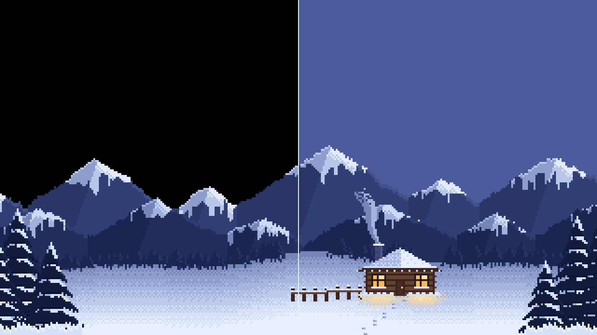

# Tła menu

Układ może nadać swojemu ekranowi własne tło: obraz, animację, panoramę, pokaz slajdów, wideo, kolor, stronę internetową lub shader. Zastępuje ono domyślne tło ekranu, takie jak panorama ekranu tytułowego, rozmycie innych menu czy świat widoczny za menu pauzy.

> [!TIP]
> Aby ustawić takie samo tło we wszystkich menu bez tworzenia układów, użyj [globalnych ustawień](/global-customizations#menu-backgrounds).

# Ustawianie tła

1. Otwórz układ ekranu w [edytorze układów](/layout-editor).
2. Kliknij prawym przyciskiem myszy tło edytora i otwórz **Tła menu**. Tę opcję znajdziesz też w **pasku menu -> Układ -> Właściwości układu**.
3. Otwórz wybrany typ tła, na przykład **Obraz**.
4. Kliknij **Pokaż tło**, aby ustawić opcję na **Włączone**.
5. Skonfiguruj tło, na przykład klikając **Wybierz obraz** w przypadku tła typu Obraz.

W menu **Tła menu** przed każdym włączonym typem znajduje się ✔, a przed każdym wyłączonym — ✖. Najedź kursorem na typ, aby zobaczyć, do czego służy.

Aby przywrócić domyślne tło ekranu, ponownie ustaw opcję **Pokaż tło** danego typu na **Wyłączone**. Jego ustawienia zostaną zachowane, więc później możesz je znów włączyć.

# Typy teł

## Obraz

Obraz z plików, strony internetowej lub zasobów gry, rozciągnięty na cały ekran. Odtwarzane są również obrazy animowane. Obsługiwane pliki wymieniono w sekcji [Obrazy](/images).

- **Wybierz obraz**: obraz. Informacje o dostępnych źródłach znajdziesz w sekcji [Zasoby](/resources).
- **Wybierz obraz zastępczy**: obraz wyświetlany, gdy nie można załadować właściwego, na przykład obrazu z sieci, gdy jesteś offline.
- **Uruchamiaj tekstury animowane od początku po otwarciu ekranu**: po każdym otwarciu ekranu [animowany obraz](/animations) zaczyna od początku. W przeciwnym razie odtwarzanie jest kontynuowane od miejsca, w którym zostało przerwane.
- **Powtarzaj teksturę**: wypełnia ekran powielonymi kafelkami obrazu zamiast rozciągać go na cały ekran. Zobacz [Dziewięciopodział i kafelkowanie](/nine-slicing-and-tiling).
- **Przesuwaj szerokie obrazy od lewej do prawej**: szeroki obraz, na przykład zdjęcie całego krajobrazu, wypełnia wysokość ekranu i powoli przesuwa się z boku na bok, zatrzymując się na chwilę na obu końcach.
- **Efekt paralaksy** i jego ustawienia: obraz porusza się nieznacznie wraz z ruchem myszy. Zobacz [Efekt paralaksy](/parallax#menu-backgrounds).

Opcji **Przesuwaj szerokie obrazy od lewej do prawej** nie można włączyć jednocześnie z **Powtarzaj teksturę** ani **Efektem paralaksy**.

## Kolor

Jeden kolor na całym ekranie.

- **Kolor [HEX]**: kolor, na przykład `#1B2440`. Dodaj dwie cyfry, aby uzyskać przezroczystość, na przykład `#1B2440C8`. Możesz też użyć [symbolu zastępczego](/placeholders).

Kolor znajduje się pod pozostałymi tłami układu, więc wypełnia ich przezroczyste obszary. Zobacz [Nakładanie teł](#stacking-backgrounds).

## Panorama sześcienna

Panorama, która powoli się obraca, podobnie jak panorama na ekranie tytułowym. Panoramy tworzy się w folderze `config/fancymenu/panoramas/`. Zobacz [Panoramy](/panoramas).

- **Nazwa panoramy**: otwiera okno **Wybierz panoramę**, w którym możesz wybrać jedną ze swoich panoram i zobaczyć jej podgląd.
- **Wyczyść panoramę**: usuwa panoramę.

Jeśli nie ustawiono panoramy, w tle wyświetlana jest fioletowo-czarna tekstura zastępcza Minecrafta.

## Pokaz slajdów

Wyświetla kolejno obrazy z pokazu slajdów. Pokazy slajdów tworzy się w folderze `config/fancymenu/slideshows/`. Zobacz [Pokazy slajdów](/slideshows).

- **Nazwa pokazu slajdów**: otwiera okno **Wybierz pokaz slajdów**, w którym możesz wybrać jeden ze swoich pokazów slajdów.
- **Wyczyść pokaz slajdów**: usuwa pokaz slajdów.

Jeśli nie ustawiono pokazu slajdów, w tle również wyświetlana jest tekstura zastępcza Minecrafta.

## Wideo

Odtwarza wideo z plików, strony internetowej lub zasobów gry. Wymaga moda Watermedia. Zobacz [Wideo](/video#requirements). Jeśli go nie ma, w tle wyświetla się informacja z linkami do pobrania.

- **Źródło wideo**: wideo.
- **Zapętl wideo**, **Głośność** i **Kanał dźwięku**: ustawienia odtwarzania.
- **Efekt paralaksy** i jego ustawienia: takie same jak w przypadku teł typu Obraz.
- **Odtwarzaj wideo w edytorze układów**: gdy ta opcja jest wyłączona, wideo pozostaje wstrzymane w edytorze układów.

[Akcje](/video) mogą wstrzymywać wideo oraz zmieniać jego głośność i czas odtwarzania. Wymagają identyfikatora tła: kliknij **Kopiuj identyfikator tła** w jego ustawieniach.

## Przeglądarka

Strona internetowa wyświetlana na całym ekranie, podobnie jak [element Przeglądarka](/elements#browser).

> [!IMPORTANT]
> Przeglądarka wymaga moda [Rinku](https://modrinth.com/mod/rinku). Jeśli go nie ma, tło jest czerwone i wyświetla informację o braku Rinku.

- **URL**: adres strony internetowej. Może zawierać [symbole zastępcze](/placeholders).
- **Przetwarzaj kliknięcia myszy**, **Przetwarzaj przewijanie myszy** i **Przetwarzaj naciśnięcia klawiszy**: pozwalają graczom klikać stronę, przewijać ją i wpisywać tekst. Strona przechwytuje klawiaturę zaraz po otwarciu ekranu.
- **Przechwytuj kliknięcia myszy**, **Przechwytuj przewijanie myszy** i **Przechwytuj naciśnięcia klawiszy**: blokują kliknięcia, przewijanie i klawisze na stronie, dzięki czemu sam ekran również na nie nie reaguje.
- **Wycisz przeglądarkę**, **Głośność audio/wideo**, **Zapętlaj wideo** i **Ukryj elementy sterujące wideo**: ustawienia multimediów na stronie internetowej.

Przyciski i elementy znajdujące się przed tłem zawsze jako pierwsze reagują na kliknięcia. W edytorze układów zamiast strony internetowej tło wyświetla pasy.

## Shader GLSL

Rysuje shader — niewielki program dla karty graficznej, który może tworzyć na przykład animowane fale, gwiazdy lub wzory. Działają też shadery z Shadertoy.

- **Źródło shadera**: kod shadera.
- **Pokaż błędy kompilacji**: wyświetla na ekranie błędy w kodzie. Wyłącz tę opcję w gotowych układach.

Pozostałe ustawienia, takie jak dodatkowe przebiegi, tekstury i czas, opisano w sekcji [API shaderów GLSL](/glsl-shader-api).

## Wideo [Rinku]

Starsze tło wideo, które wymaga Rinku. Jest widoczne na liście tylko wtedy, gdy jest włączone, na przykład w układach ze starszych wersji. Zamiast niego użyj opcji **Wideo**.

# Ustawienia wszystkich teł

Poniżej typów w menu **Tła menu** znajdziesz ustawienia dotyczące wszystkich teł układu:

- **Zachowaj proporcje tła**: zachowuje proporcje teł typu Obraz, Pokaz slajdów i Wideo. Nadal wypełniają one cały ekran, a niedopasowane fragmenty są przycinane. Gdy ta opcja jest wyłączona, tła zostają rozciągnięte na ekran.
- **Pokaż ciemną nakładkę na niestandardowym tle**: nakłada na tła ciemną, przezroczystą warstwę z menu Minecrafta, dzięki czemu przyciski i tekst są lepiej widoczne.
- **Zastosuj domyślne rozmycie tła**: rozmywa tła tak, jak Minecraft rozmywa świat widoczny za menu. Intensywność zależy od ustawienia **Rozmycie tła menu** w **Ustawieniach dostępności** Minecrafta. Przy wartości `0` rozmycie nie jest stosowane.

Od lewej: bez dodatkowych ustawień, **Pokaż ciemną nakładkę na niestandardowym tle** i **Zastosuj domyślne rozmycie tła**.

# Nakładanie teł

W jednym układzie możesz włączyć kilka typów. Są one rysowane jeden na drugim w następującej kolejności, od dołu do góry:

1. Kolor
2. Panorama sześcienna
3. Obraz
4. Pokaz slajdów
5. Wideo
6. Wideo [Rinku]
7. Przeglądarka
8. Shader GLSL

Typy dodane przez inne mody są rysowane na końcu, na wierzchu pozostałych.

FancyMenu rysuje czarne tło pod wszystkimi tłami, więc przezroczyste obszary obrazu są czarne. Umieszczenie pod nim tła typu Kolor pozwala wypełnić je wybranym kolorem:

Po lewej włączony jest tylko typ Obraz. Po prawej niebo wypełnia tło typu Kolor.

- Przezroczysty obraz, pokaz slajdów lub shader umieszczony nad panoramą sześcienną działa w ten sam sposób — może na przykład tworzyć ramkę wokół obracającej się panoramy.
- Tło typu Wideo nigdy nie jest przezroczyste. Zasłania wszystko, co znajduje się pod nim, nawet w obszarach poza kadrem wideo.

## Kilka układów

Gdy na ekranie aktywnych jest kilka układów, na przykład [układ uniwersalny](/universal-layouts) i układ danego ekranu, ich tła również nakładają się na siebie:

- Układ z wyższą wartością **Indeks układu [kolejność wielu układów]** znajduje się na wierzchu. Ustaw tę wartość w menu otwieranym prawym przyciskiem myszy na tle edytora.
- Jeśli jeden z układów włączy [ustawienie dotyczące wszystkich teł](#ustawienia-wszystkich-teł), będzie ono włączone dla teł wszystkich tych układów.
- Edytor układów wyświetla tylko tła edytowanego układu.

# Warto wiedzieć

- Elementy układu zawsze znajdują się przed jego tłami.
- Opcja **Kopiuj identyfikator tła** w ustawieniach każdego typu kopiuje identyfikator tła używany przez akcje i symbole zastępcze, które nim sterują, na przykład te dla [teł typu Wideo](/video).
- Opcja **Eksportuj dla AI** w ustawieniach każdego typu kopiuje tło na potrzeby [czatu AI](/export-for-ai).
- Nagłówki i stopki ekranów zawierających listy, takich jak lista światów, mają własne tekstury. Kliknij prawym przyciskiem myszy tło edytora i otwórz **Dostosowywanie nagłówka/stopki**.
