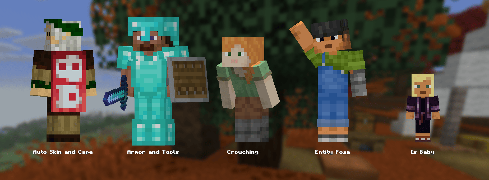

# Encje graczy

Element Encja gracza wyświetla gracza w 3D — podobnie jak postać gracza obok przycisków na ekranie tytułowym. Może odwzorować osobę grającą, wyświetlić dowolnego innego gracza albo przedstawiać własną postać z własną skórką, peleryną i imieniem.

> [!IMPORTANT]
> W Minecraft 1.20.1 i nowszych wersjach encje graczy wymagają moda Fancy Entity Renderer ([CurseForge](https://www.curseforge.com/minecraft/mc-mods/fancy-entity-renderer), [Modrinth](https://modrinth.com/mod/fancy-entity-renderer)). Bez niego są wyświetlane jako czerwony kwadrat. Jeśli nie ma jeszcze jego wersji dla Twojej wersji Minecrafta, encje graczy nie będą się w niej wyświetlać.

# Dodawanie encji gracza

Kliknij prawym przyciskiem myszy tło edytora i wybierz **Nowy element -> Encja gracza**. Przeciągaj uchwyty, aby zmienić jej rozmiar. Rozmiar gracza jest uzależniony od wysokości elementu.

Wszystkie poniższe ustawienia znajdziesz w menu elementu otwieranym prawym przyciskiem myszy.

# Kogo wyświetla

- **Kopiuj gracza klienta** wyświetla osobę grającą wraz z jej imieniem, skórką i peleryną. Gdy ta opcja jest włączona, ustawienia imienia, skórki i peleryny są zablokowane.
- **Imię gracza** może być dowolne — nie musi należeć do prawdziwego gracza. Obsługuje [zmienne](/placeholders).
- **Pokaż imię gracza** wyświetla plakietkę z imieniem nad głową. Gdy opcja **Obrót plakietki z imieniem** jest wyłączona, plakietka nie obraca się razem z graczem.

## Skórka i peleryna

- **Automatyczna skórka** i **Automatyczna peleryna** wczytują skórkę i pelerynę gracza o podanym **Imieniu gracza**. Wymaga to połączenia z internetem.
- **Tekstura skórki** i **Tekstura peleryny** używają własnych plików skórki i peleryny, na przykład skórki z Twoich [zasobów](/resources). Skórki to standardowe pliki skórek Minecrafta.
- **Wąska skórka** służy do skórek z wąskimi rękami, takich jak skórka Alex. **Automatyczna skórka** i **Kopiuj gracza klienta** same wykrywają ten typ skórki.

# Poza i ruch

- **Głowa podąża za myszą** i **Tułów podąża za myszą** sprawiają, że gracz patrzy na wskaźnik myszy. Obie opcje są domyślnie włączone dla nowych encji graczy.
- **Poza** pozwala wybrać pozycję ciała: **Stojąca**, **Kucanie**, **Spanie**, **Pływanie**, **Umieranie** lub **Atak obrotowy**.
- **Ruch ciała** animuje pozę.

## Poza encji

Opcja **Poza encji** otwiera okno z ustawieniami obrotu w osiach X, Y i Z dla **Głowy**, **Tułowia**, **Lewej ręki**, **Prawej ręki**, **Lewej nogi** i **Prawej nogi** — od `-180` do `180`.

Opcja **Tryb zaawansowany** obok suwaka zamienia go w pole tekstowe obsługujące [zmienne](/placeholders). Jeśli użyjesz w nim [zmiennej](/variables), takiej jak `$$arm_angle`, możesz animować gracza za pomocą [harmonogramu](/schedulers), zmieniając wartość tej zmiennej.

# Zbroja, przedmioty i inne

- **Zbroja i narzędzia** pozwala umieścić przedmioty na graczu: **Zbroja na głowę**, **Zbroja na tors**, **Zbroja na nogi**, **Zbroja na stopy**, **Narzędzie w lewej ręce** i **Narzędzie w prawej ręce**. Wybierz identyfikator przedmiotu, na przykład `minecraft:diamond_sword`. Identyfikatory przedmiotów obsługują zmienne. Opcje **Zaklęj zbroję na głowie** i pozostałe przełączniki zaklinania dodają efekt połysku zaklęcia.
- **Jest dzieckiem** zmniejsza gracza, jakby był dzieckiem.
- **Papuga** umieszcza papugę na prawym ramieniu, a opcja **Papuga na lewym ramieniu** przenosi ją na lewe.

# Warto wiedzieć

- Encji graczy nie można obracać, przechylać, wygaszać ani czynić przezroczystymi.
- Jeśli chcesz wyświetlić tylko głowę gracza, zobacz [Głowy graczy](/player-heads).
- W Minecraft 1.19.2 encje graczy nie wymagają moda Fancy Entity Renderer, ale mają mniej ustawień: zamiast **Pozy** dostępne jest **Kucanie**, a opcji **Obrót plakietki z imieniem**, **Ruch ciała** oraz **Zbroja i narzędzia** nie ma. Rozmiar określa ustawienie **Skala encji** (domyślnie `30`, więc `60` oznacza dwukrotnie większy rozmiar), a nie rozmiar elementu.
