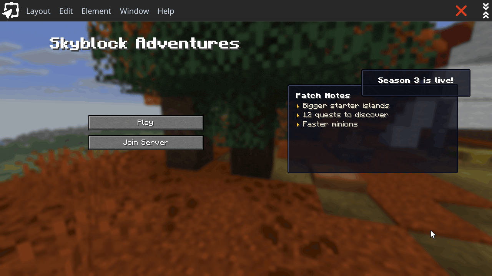

# Obracanie i pochylanie elementów

Większość elementów można obracać i pochylać. Obie operacje odbywają się wokół środka elementu, który zachowuje swoje położenie i rozmiar.

- **Obrót** obraca element, tak jak wskazówkę zegara.
- **Pochylenie pionowe** odchyla go do tyłu, a **pochylenie poziome** przechyla go na bok. Pochylone elementy są wyświetlane bez perspektywy, więc stają się jedynie niższe lub węższe. Przy obu pochyleniach elementy są również przekrzywione.


# W edytorze układu



Zaznacz element w [edytorze układu](/layout-editor) i przeciągnij jego uchwyty:

- Uchwyt na okręgu wokół elementu obraca go.
- Uchwyt na linii po jego prawej stronie ustawia **pochylenie pionowe**, a uchwyt na linii poniżej — **pochylenie poziome**. Środek linii oznacza brak pochylenia.

Podczas przeciągania:

- Przytrzymaj `Shift`, aby przyciągać do skoków: co 45 stopni dla obrotu i co 15 stopni dla pochylenia.
- W pobliżu 0 uchwyty przyciągają do wartości 0, dzięki czemu można łatwo ponownie wyprostować element.
- W lewym górnym rogu elementu wyświetlane są wartości obrotu i pochylenia.

Warto wiedzieć:

- Ramka zaznaczenia pozostaje prosta. Kliknij w jej wnętrzu, aby zaznaczyć lub przesunąć element.
- Uchwyty są widoczne tylko wtedy, gdy zaznaczony jest jeden element.
- Elementu bez okręgu lub linii nie można obracać ani pochylać. Zobacz [Elementy bez obrotu i pochylenia](#elements-without-rotation-or-tilt).
- Opcje **Pasek menu -> Okno -> Element Rotation Controls** i **Element Tilt Controls** ukrywają uchwyty wszystkich elementów.

# Dokładne wartości

Kliknij element prawym przyciskiem myszy, aby wyświetlić te ustawienia. Każde z nich ma opcje **Ustaw za pomocą selektora liczb**, **Ustaw jako zwykły tekst** i **Przywróć domyślne**.

| Ustawienie | Działanie |
|---|---|
| **Obrót** | Wartość w stopniach, o którą element obraca się zgodnie z ruchem wskazówek zegara, np. `90` oznacza ćwierć obrotu. Wartości ujemne powodują obrót przeciwny do ruchu wskazówek zegara. |
| **Pochylenie pionowe** | Kąt odchylenia do tyłu w zakresie od `-60` do `60` stopni. |
| **Pochylenie poziome** | Kąt przechylenia na bok w zakresie od `-60` do `60` stopni. |

Pojedyncze pochylenie wygląda tak samo przy wartości dodatniej i ujemnej. Gdy używane są oba pochylenia, ich znaki określają kierunek przekrzywienia elementu.

## Używanie placeholderów

Aby obrócić lub pochylić element za pomocą [zmiennej](/variables) albo innego [placeholdera](/placeholders):

1. Kliknij element prawym przyciskiem myszy i włącz **Zaawansowany tryb obrotu**, **Zaawansowany tryb pochylenia pionowego** lub **Zaawansowany tryb pochylenia poziomego**.
2. Kliknij **Obrót**, **Pochylenie pionowe** lub **Pochylenie poziome**, a następnie **Ustaw jako zwykły tekst** i wpisz placeholder.

Tryby zaawansowane przechowują własną wartość i ukrywają uchwyt, dzięki czemu przeciąganie nie zastąpi placeholdera. Po wyłączeniu trybu element odzyskuje poprzednią wartość.

Logo, które obraca się raz na 3,6 sekundy, z poniższą wartością **Obrotu** w **Zaawansowanym trybie obrotu**. Aby spowolnić obrót, dziel przez wartość większą niż `10`:

```
{"placeholder":"calc","values":{"expression":"{"placeholder":"unix_time"} / 10 % 360"}}
```

Wskazówka, która wskazuje kąt określony przez zmienną `needle_angle`, ustawianą za pomocą przycisków lub [suwaka](/elements#slider):

```
{"placeholder":"getvariable","values":{"name":"needle_angle"}}
```

# Klikanie i mysz


Przyciski, suwaki, linki i paski przewijania elementów tekstowych reagują na mysz w miejscu, w którym są wyświetlane, także po obróceniu lub pochyleniu. Dotyczy to również warunków [**Czy wskazano element**](/conditions#is-element-hovered), [**Czy wskazano dowolny element**](/conditions#is-any-element-hovered) i [**Czy wskazano dowolny przycisk**](/conditions#is-any-button-hovered).

> [!NOTE]
> Pola wyboru, pola tekstowe, elementy przeciągane i przeglądarki nadal reagują w obszarze, który zajmowałyby bez obrotu i pochylenia. Pozostaw je proste.

# Elementy bez obrotu i pochylenia

- Bez obrotu i pochylenia: [obszary przewijane](/scrollable-areas), [shadery GLSL](/elements#glsl-shader), [modele JSON bloków/przedmiotów](/elements#blockitem-json-model), [encje graczy](/player-entities) i [elementy vanilla](/vanilla-elements), takie jak przyciski należące do samego ekranu.
- Z obrotem, ale bez pochylenia: [podpowiedzi](/elements#tooltip) i [przedmioty](/elements#item).

Elementy w obszarze przewijanym można obracać i pochylać — nie można tego robić tylko z samym obszarem.

Elementy [tekstu powitalnego](/splash-text) mają też własne ustawienie **Obrót**, znajdujące się niżej w menu otwieranym prawym przyciskiem myszy, które pozwala uzyskać typowe dla nich przekrzywienie. Działa ono razem z obrotem opisanym na tej stronie.
