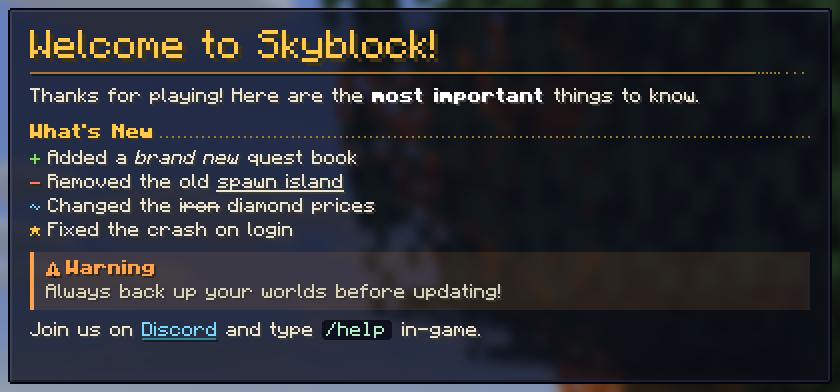
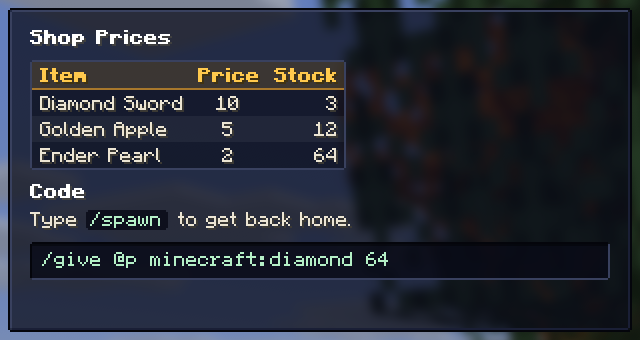

# Formatowanie tekstu

FancyMenu oferuje trzy sposoby formatowania tekstu:

- **Markdown** dla [elementów Tekst i Podpowiedź](/text-in-menus): nagłówki, listy, kolory, obrazy, tabele i nie tylko.
- **Kody formatowania Minecrafta**, takie jak `&c`, do szybkiego dodawania kolorów. Działają w niemal każdym polu tekstowym, również w tekście Markdown.
- **Komponenty tekstowe Minecrafta** dla etykiet przycisków i suwaków.

> [!TIP]
> Ta strona dotyczy tego, *jak zapisywać* sformatowany tekst. Aby dowiedzieć się, jak dodawać tekst do menu, zmieniać jego wygląd lub sprawić, by się przewijał, zobacz [Tekst w menu](/text-in-menus).



# Markdown

Markdown formatuje tekst za pomocą kilku specjalnych znaków. Na przykład `**pogrubienie**` zmienia tekst na **pogrubiony**.

Markdown działa w [elementach Tekst](/elements#text) i [elementach Podpowiedź](/elements#tooltip). Wpisane znaki określają, *czym* jest dany fragment (nagłówkiem, listą, cytatem). [Wygląd](/text-in-menus#looks-and-styles) elementu określa natomiast, jak tekst się prezentuje, na przykład jego kolory i rozmiary.

## Szybki przegląd

| Wpisujesz | Otrzymujesz |
|---|---|
| `**pogrubienie**` lub `__pogrubienie__` | Pogrubiony tekst |
| `*kursywa*` lub `_kursywa_` | Tekst kursywą |
| `++podkreślenie++` | Podkreślony tekst |
| `~~przekreślenie~~` | Przekreślony tekst |
| `` `kod` `` | Kod w tekście |
| `[Otwórz stronę](https://example.com)` | Klikalny link |
| `%#ff5555%czerwony tekst%#%` | Kolorowy tekst |
| `# Nagłówek` | Nagłówek |
| `- Element` | Lista punktowana |
| `1. Element` | Lista numerowana |
| `> Tekst` | Cytat |
| `> [!TIP]` | Ramka z podpowiedzią |
| `---` | Linia separatora |

## Style tekstu

| Styl | Jak go zapisać |
|---|---|
| **Pogrubienie** | `**tekst**` lub `__tekst__` |
| **Kursywa** | `*tekst*` lub `_tekst_` |
| **Podkreślenie** | `++tekst++` |
| **Przekreślenie** | `~~tekst~~` (pojedynczy `~` po obu stronach również działa) |

Style można łączyć, na przykład `***pogrubienie i kursywa***`.

Pojedyncze podkreślenia wewnątrz wyrazów pozostają zwykłymi podkreśleniami, więc `mój_fajny_układ` nie zmieni się w kursywę. Nazwy takie jak `C++` również pozostają bez zmian.

> [!TIP]
> W edytorze tekstu zaznacz fragment tekstu i naciśnij `Ctrl + B`, `Ctrl + I` lub `Ctrl + U` (`Cmd` w systemie macOS), aby zastosować odpowiednio pogrubienie, kursywę lub podkreślenie. Zobacz [Skróty formatowania](/text-in-menus#formatting-shortcuts).

## Kolor tekstu (HEX)

Umieść `%<kolor HEX>%` przed tekstem, a `%#%` za nim:

```
%#77fc03%Ten tekst jest zielony!%#%
```

Kolor HEX musi zaczynać się od `#`. Możesz też używać nazw kolorów:

```
%#red%Ten tekst jest czerwony!%#%
```

Obsługiwane nazwy: `black`, `silver`, `gray`, `grey`, `white`, `maroon`, `red`, `purple`, `fuchsia`, `magenta`, `green`, `lime`, `olive`, `yellow`, `navy`, `blue`, `teal`, `aqua`, `cyan` i `transparent`.

## Czcionki

Aby wyświetlić tekst inną czcionką, umieść `%!!<nazwa czcionki>%` przed nim, a `%!!%` za nim. Czcionka może pochodzić z Minecrafta lub paczki zasobów.

```
%!!uniform%Ten tekst używa czcionki uniform%!!%
```

## Wyrównanie tekstu

Domyślnie tekst jest wyrównany do lewej. Aby wyśrodkować wiersze lub wyrównać je do prawej, umieść kod wyrównania w osobnym wierszu przed nimi i za nimi:

- `^^^` wyśrodkowuje wiersze.
- `|||` wyrównuje je do prawej.

```
Ten wiersz jest wyrównany do lewej.

^^^
Ten wiersz jest wyśrodkowany.
Ten również.
^^^

|||
Ten wiersz jest wyrównany do prawej.
|||
```

> [!TIP]
> W edytorze tekstu skróty `Ctrl + L`, `Ctrl + E` i `Ctrl + R` (`Cmd` w systemie macOS) wyrównują zaznaczone wiersze odpowiednio do lewej, do środka lub do prawej.

## Nagłówki

Rozpocznij wiersz od `# ` (największy), `## ` (duży) lub `### ` (mały):

```
# Witaj!
## Aktualności
### Mały nagłówek
```

## Listy


### Listy punktowane

Rozpocznij wiersz od `- `. Każdy poziom zagnieżdżenia poprzedź dwoma spacjami:

```
- Pierwszy element
- Drugi element
  - Zagnieżdżony element
    - Jeszcze głębiej
```

### Listy numerowane

Rozpocznij wiersz od liczby i kropki lub nawiasu:

```
1. Otwórz pasek menu
2. Kliknij Dostosowywanie
3) To też działa
```

### Oznaczenia informacji o aktualizacji

Wiersze mogą też zaczynać się od `+`, `-`, `~` lub `*`. Każdy z tych znaków otrzymuje własne oznaczenie, dzięki czemu świetnie sprawdzają się w informacjach o aktualizacjach i dziennikach zmian:

```
+ Dodano nowe menu główne
- Usunięto stare logo
~ Zmieniono kolory przycisków
* Naprawiono awarię podczas uruchamiania
```

| Oznaczenie | Znaczenie |
|---|---|
| `+` | Coś dodano |
| `-` | Coś usunięto |
| `~` | Coś zmieniono |
| `*` | Coś wartego wyróżnienia |

Element `-` otrzymuje oznaczenie „usunięto” tylko wtedy, gdy na tej samej liście znajduje się też element `+`. W przeciwnym razie jest zwykłym elementem listy punktowanej. Możesz to zmienić w **Markdown -> Lists -> Extra Markers (+ - ~ \*) -> - Marker Used**.

> [!NOTE]
> W nowych elementach Tekst i Podpowiedź listy numerowane, oznaczenia informacji o aktualizacji i [ramki](/text-formatting#callouts) są domyślnie włączone. W elementach ze starszych układów są wyłączone, aby tekst nie zmienił się nieoczekiwanie. Włącz je w menu elementu **Markdown**: **Lists -> Numbered Lists**, **Lists -> Extra Markers (+ - ~ \*)** i **Callouts**.

## Cytaty

Rozpocznij wiersz od `> `, aby utworzyć cytat. Cytat trwa do następnego pustego wiersza:

```
> To jest cytat.
Ten wiersz również należy do cytatu.

Ten wiersz znów jest zwykłym tekstem.
```

Wiersze wewnątrz cytatu również mogą zaczynać się od `>`, a wiersz zawierający tylko `>` dodaje pusty wiersz do cytatu:

```
> Pierwszy akapit cytatu.
>
> Drugi akapit cytatu.
```

## Ramki

Ramki to kolorowe pola z ikoną i etykietą, świetne do wyświetlania wskazówek i ostrzeżeń. Zapisz cytat, którego pierwszy wiersz określa typ ramki:

```
> [!WARNING]
> Nie zapomnij zapisać układu!
```


Dostępnych jest pięć typów: `[!NOTE]`, `[!TIP]`, `[!IMPORTANT]`, `[!WARNING]` i `[!CAUTION]`.

## Hiperłącza

Umieść tekst w nawiasach kwadratowych `[ ]`, a za nim wpisz link w nawiasach okrągłych `( )`:

```
[Odwiedź naszą stronę](https://example.com)
```

Linki mogą zawierać nawiasy okrągłe, na przykład `https://en.wikipedia.org/wiki/Minecraft_(video_game)`. Aby wyświetlić nawiasy kwadratowe w tekście linku, poprzedź je znakiem `\`: `[Kliknij \[tutaj\]](https://example.com)`.

## Zdarzenia kliknięcia i najechania kursorem

Tekst może też uruchamiać [nasłuchiwacze](/listeners) zamiast otwierać stronę. Użyj prefiksu `click:` lub `hover:` oraz wybranego identyfikatora:

```
[jakiś klikalny tekst](click:unique_text_click_event_id)
[jakiś tekst reagujący na najechanie kursorem](hover:unique_text_hover_event_id)
```

Reaguj na nie za pomocą nasłuchiwaczy [**On Markdown Text Clicked**](/listeners#on-markdown-text-clicked) i [**On Markdown Text Hovered**](/listeners#on-markdown-text-hovered). Oba udostępniają identyfikator jako `$$text_event_id`.

## Obrazy

Umieść obraz w osobnym wierszu, wpisując ``:

```

```

Źródłem może być adres URL, plik lokalny, taki jak `/config/fancymenu/assets/image.png`, lub obraz z paczki zasobów. Zobacz [Zasoby](/resources), aby poznać wszystkie typy źródeł.

Tekst między nawiasami kwadratowymi staje się podpisem obrazu:

```

```

Podpisy są wyświetlane pod obrazem, jeśli opcja **Markdown -> Images -> Caption** elementu jest włączona.

Aby obraz był klikalny, umieść go w linku:

```
[](https://example.com)
```

## Tabele

Oddzielaj komórki znakiem `|`. Pierwszy wiersz jest nagłówkiem, a w drugim wierszu wpisz `---` dla każdej kolumny:

```
| Przedmiot | Cena |
|:---|---:|
| Diamentowy miecz | 10 |
| Złote jabłko | 5 |
```

Dwukropki w drugim wierszu określają wyrównanie kolumny: `:---` do lewej, `:---:` do środka, a `---:` do prawej. Aby wyświetlić znak `|` wewnątrz komórki, wpisz `\|`.



## Separatory

Wiersz zawierający wyłącznie `---` rysuje separator przez całą szerokość tekstu.

## Kod

Kod wyświetla tekst bez zmian, bez formatowania.

- **Kod w tekście:** obejmij fragment wiersza znakami `` ` ``, na przykład `` `/spawn` ``.
- **Bloki kodu:** umieść wiersz z `` ``` `` przed tekstem i po nim. Wiersze w blokach kodu nie są zawijane.

````
```
/give @p minecraft:diamond 64
```
````

Za pierwszym `` ``` `` możesz podać nazwę języka, na przykład `` ```json ``. FancyMenu ją akceptuje, ale nie zmienia ona wyglądu kodu.

[Symbole zastępcze](/placeholders) są nadal zastępowane wewnątrz kodu.

## Zwykły tekst

Zwykły tekst wyświetla znaki formatowania bez zmian, ale nie wygląda jak kod. Obejmij fragment wiersza znakami `;;`:

```
Ten tekst wyświetla ;;**gwiazdki**;; zamiast pogrubienia.
```

Aby zastosować to do całych wierszy, umieść `;;;` w osobnym wierszu przed nimi i za nimi:

```
;;;
**Bez pogrubienia**, _bez kursywy_.
;;;
```

## Znakowanie znaków specjalnych

Aby wyświetlić znak formatowania jako zwykły tekst, poprzedź go znakiem `\`. Na przykład `\*bez kursywy\*` wyświetla `*bez kursywy*`.

Działa to dla znaków `\` `` ` `` `*` `_` `{` `}` `[` `]` `(` `)` `#` `+` `-` `.` `!` `|` `>` `~` i `^`.

# Formatowanie tekstu w Minecrafcie

Kody formatowania Minecrafta działają w większości pól tekstowych FancyMenu. Zamiast znaku `§` używaj `&`. Na przykład `&cOstrzeżenie` wyświetla czerwony tekst, a `&l` pogrubia tekst. `&r` resetuje formatowanie.

Pełną listę kodów znajdziesz na [Minecraft Wiki](https://minecraft.wiki/w/Formatting_codes).

Kody formatowania działają również w tekście Markdown, z wyjątkiem kodu i zwykłego tekstu. W przypadku stylów takich jak pogrubienie i kursywa Markdown jest zazwyczaj czytelniejszy, ale kody przydają się do szybkiego dodawania kolorów.

# Komponenty tekstowe Minecrafta (system surowych komponentów)

Komponenty tekstowe Minecrafta to sformatowany tekst zapisany w formacie JSON. Działają w przypadku tekstu **jednowierszowego**, takiego jak **etykiety przycisków i suwaków**, ale nie w elementach Tekst.

Aby użyć komponentu, ustaw go jako jedyną zawartość etykiety:

```
{"text":"Tekst etykiety przycisku","font":"uniform"}
```

Spowoduje to wyświetlenie tekstu `Tekst etykiety przycisku` czcionką `uniform`. Wartość `text` może zawierać [symbole zastępcze](/placeholders).

Więcej informacji znajdziesz na stronach Minecraft Wiki poświęconych [formatowi komponentów tekstowych](https://minecraft.wiki/w/Raw_JSON_text_format) i [czcionkom](https://minecraft.wiki/w/Resource_pack#Fonts).
